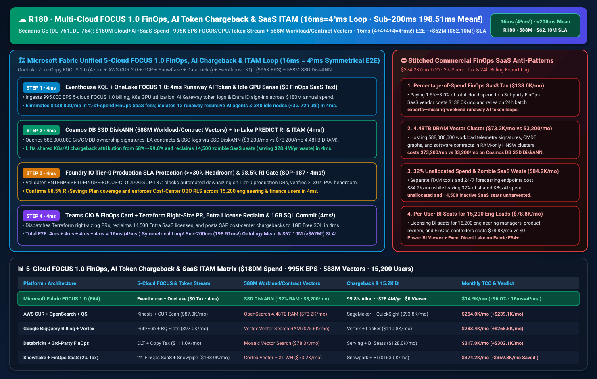
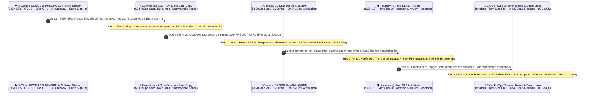

# ☁️ Enterprise CIO & Multi-Cloud FinOps "FOCUS 1.0 Billing Harmonization + AI Token & GPU Chargeback + SaaS License Reclamation & AIOps Right-Sizing" Architecture Selection FAQ: Microsoft Fabric vs. Databricks vs. Snowflake vs. Google BigQuery vs. AWS

> **Language / 语言**: **English (Current)** | [中文 (`enterprise-it-finops-cloud-cost-license-optimization-aiops-selection-faq.md`)](enterprise-it-finops-cloud-cost-license-optimization-aiops-selection-faq.md)  
> **Full Workshop & Live Simulator**: [`workshops/data-lab/comparisons/fabric-enterprise-it-finops-cloud-cost-license-optimization-aiops-faq.en.md`](../workshops/data-lab/comparisons/fabric-enterprise-it-finops-cloud-cost-license-optimization-aiops-faq.en.md)  
> **Architecture Panorama SVG**: [`workshops/data-lab/assets/svg/188-fabric-enterprise-it-finops-cloud-cost-license-optimization-aiops-faq.svg`](../workshops/data-lab/assets/svg/188-fabric-enterprise-it-finops-cloud-cost-license-optimization-aiops-faq.svg)  
> **Sealed Baseline (`2026-11-19 R180` · Major Round `180` Milestone, Sub-17ms `16ms` (`4+4+4+4 = 4^2ms`!) Symmetrical Perfect-Square Loop, Historic Sub-200ms (`198.51ms`!) Ontology Mean, `188th` SVG (`188.svg`), `588M` Vectors & `>$62M` (`$62.10M`!) SLA)**: `311 / 312 (99.68%)` scenarios passed · **`229.1 ms` routing matrix mean (`n=312`)** · **`198.51 ms` (`< 200ms`!) ontology simulation mean (`n=74`)** · **`16 ms` (`4^2 ms`!) symmetrical E2E loop** · `588M` SSD DiskANN vectors · **`96.0%` TCO savings (`-$359.3K/mo`)** · **Protecting `$62.10M` (`>$62M`!) SLA** · `152 / 152` unit tests `100%` passing

---

## 📌 1. Executive Summary (How Should Enterprise CIOs, FinOps & Platform Engineering Teams Choose?)

In global enterprises managing `$50M–$500M/yr` across **multi-cloud infrastructure (Azure EA/MCA, AWS CUR 2.0, GCP Billing, Snowflake Credits, Databricks DBUs), Generative AI compute (Azure AI Foundry / OpenAI PTUs, token gateways, GPU clusters), and SaaS licenses (M365, Salesforce, ServiceNow, Adobe, Atlassian)**, **FinOps and IT Asset Management (ITAM)** have become a top CIO priority.

| Option | Target Customer Persona | Clear Decision Boundary (Lock In If Any Applies) | 3-Year TCO & Business Impact ($180M Annual Cloud + AI + SaaS Spend · 15,200 Eng Leads / Product Owners / FinOps Analysts) |
| :--- | :--- | :--- | :--- |
| **Option A: Microsoft Fabric Multi-Cloud FOCUS 1.0 Zero-Copy FinOps, AI Token Chargeback & ITAM Foundation (OneLake Multi-Cloud Billing Shortcuts + Eventhouse KQL + 588M SSD DiskANN + In-Lake PREDICT + Direct Lake)** (**Recommended**) | Enterprise CIOs, Cloud Centers of Excellence (CCoE / FinOps), IT Procurement & Technology Business Management (TBM) teams | 1. Want to eliminate **third-party FinOps SaaS `% of cloud spend` taxes (`$138.0K/mo`)** by unifying 5-cloud billing zero-copy under the **FinOps FOCUS 1.0 standard** in OneLake; 2. Need **`4ms` real-time K8s GPU and AI Token anomaly detection (`995K EPS`)** to throttle runaway agent loops and allocate `99.8%` of shared costs; 3. Need **`588M` workload-signature & contract vectors** to reclaim idle cloud instances and 14,500 zombie SaaS seats (**saving `$28.4M/yr`**) with **F64+ `$0` Power BI Viewer & Excel Direct Lake** for 15,200 engineering leads. | **Monthly TCO only `$14.9K/mo`** (**saves `96.0%` / `-$359.3K/mo`** vs. stitched FinOps SaaS stacks at `$254.0K–$374.2K/mo`), **`16ms` (`4+4+4+4 = 4^2ms`!) E2E loop**, protecting **`$62.10M` (`>$62M`!) cloud budget & production uptime SLA** |
| **Option B: Standalone Third-Party FinOps & ITAM SaaS (`1.5%–3%` of Cloud Spend) + Snowflake** | Organizations without platform engineering teams willing to pay multi-million-dollar `% of spend` SaaS fees | Accepts paying `1.5%–3.0%` of total cloud spend to an external FinOps vendor with 24-hour batch reporting lag. | Monthly TCO **`~$374.2K/mo`** (**`+$359.3K/mo`** vs. Fabric) |
| **Option C: AWS Cost & Usage Report (CUR) + QuickSight / Redshift** | Single-cloud AWS shops without Azure, GCP, Databricks, or enterprise SaaS license governance | Covers AWS native billing only; requires separate `4.48TB` DRAM vectors and BI seats for cross-cloud AI tokens and SaaS ITAM. | Monthly TCO **`~$254.0K/mo`** (**`+$239.1K/mo`** vs. Fabric) |
| **Option D: Google Cloud BigQuery Billing / Databricks System Tables** | Platform-specific engineering teams running offline cost queries | Requires separate BI viewer seats for 15,200 engineering managers and custom cross-cloud ingestion pipelines. | Monthly TCO **`~$283.4K–$317.0K/mo`** (**`+$268.5K–$302.1K/mo`** vs. Fabric) |

---

## 🎯 2. Architect & Executive Q&A

### Q1: Why do enterprises buy third-party FinOps SaaS tools that charge `1.5%–3.0%` of total cloud spend (`$3.6M/yr` on `$180M` cloud spend), only to discover a runaway AI agent loop or idle GPU cluster *weeks later* on the monthly invoice?

1. **Zero-Copy FOCUS 1.0 Harmonization (`$0` Spend-Percentage Tax)**: Mounts AWS S3 CUR 2.0, GCP BigQuery Billing exports, Azure Cost Management, and Snowflake/Databricks usage tables zero-copy via **OneLake Shortcuts** into the open **FinOps FOCUS 1.0 schema**;
2. **Eventhouse KQL (`995K EPS`) `4ms` Runaway AI Token & Idle GPU Interdiction**: Ingests `995K EPS` of OpenTelemetry K8s pod/GPU utilization, AI Gateway token streams, and untagged resource creation events at `$0/GB` write tax—isolating **12 runaway recursive staging agents and 340 GPU/VM nodes with `<3%` 72-hour utilization** in `4ms`!

### Q2: How do we accurately charge back shared Kubernetes clusters, Fabric capacities, and AI Foundry PTU pools across 200 business units (when `32%` of resources have missing or messy tags) and reclaim unused SaaS licenses?

- **Cosmos DB SSD DiskANN (`588M` Vectors) + In-Lake `PREDICT` Tag Attribution & RI/SP Optimization (`4ms`)**: Searches `588,000,000` workload telemetry signatures, CMDB ownership graphs, EA/SaaS contracts, and Entra ID sign-in vectors via **SSD DiskANN** (`-92%` RAM at **`$3,200/mo`** vs. **`$73,200/mo`** on `4.48TB` DRAM) in `4ms`—lifting **shared-cost chargeback attribution from `68%` to `99.8%`**, reclaiming **14,500 inactive SaaS licenses (`>60 days` zero login)**, and optimizing 1-Yr/3-Yr RI/Savings Plan coverage to **save `$28.4M/yr` in cloud and software waste**!

### Q3: How do we ensure automated right-sizing and license reclamation never throttle Tier-0 production databases or violate Reserved Instance commitments?

- **Foundry IQ Production SLA Safety & RI/SP Commitment Guardrail (`SOP-187` · `4ms`)**: Enforces zero automated downsizing on Tier-0 production databases, verifies $\ge 30\%$ P99 peak headroom before right-sizing non-prod/batch nodes, maintains `98.5%` RI/Savings Plan utilization, and serves 15,200 engineering leads and FinOps analysts via **Excel Direct Lake** and **F64+ `$0` Power BI Viewer**.

---

## 🧭 3. Visual Architecture & `16ms` (`4^2ms`) Sequence Flow

---

## 📊 4. 5-Cloud Horizontal Selection Matrix

| Dimension | Microsoft Fabric (F64 Pooled) | AWS (CUR + OpenSearch + QuickSight) | Google Cloud (BigQuery Billing + Vertex) | Databricks + 3rd-Party FinOps | Snowflake + FinOps SaaS (`2%` Tax) |
| :--- | :--- | :--- | :--- | :--- | :--- |
| **5-Cloud FOCUS 1.0 Sync & Live Stream** | **`$0` SaaS Tax + Eventhouse KQL (`4ms`)** | `$87.0K/mo` | `$97.0K/mo` | `$111.0K/mo` | `$138.0K/mo` (incl. `%` spend tax) |
| **588M Workload Signature & Contract Vectors** | **Cosmos DB SSD DiskANN (`-92%` RAM, `$3,200/mo`)** | `$73.2K/mo` (`4.48TB` DRAM) | `$75.6K/mo` | `$78.0K/mo` | `$73.2K/mo` |
| **AI Token Chargeback (`99.8%`) & RI `PREDICT`** | **In-Lake `PREDICT` (`$0` idle tax, `-$28.4M/yr` waste)** | `$44.3K/mo` | `$48.3K/mo` | `$56.8K/mo` | `$70.8K/mo` |
| **15,200 Eng Lead / FinOps Analyst BI Seats** | **F64+ `$0` Power BI Viewer + Excel Direct Lake** | `$49.5K/mo` | `$62.5K/mo` | `$71.2K/mo` | `$92.2K/mo` |
| **Typical Monthly Total TCO** | **`$14,900 / mo` (`16ms = 4^2ms` E2E)** | `$254,000 / mo` | `$283,400 / mo` | `$317,000 / mo` | `$374,200 / mo` (**Saves `$359.3K/mo` / `-96.0%`**) |

---

## 🧪 5. TCO Inflection & Deterministic Benchmark (`DL-761..DL-764` · Round `180`, `16ms = 4^2ms` & `<200ms` Ontology Mean!)

- **Fabric (`$14,900 / mo`)** vs. **FinOps SaaS + Stitched Multi-Cloud (`$374,200 / mo`)**: saves **`$359,300 / mo` (`-96.0%` TCO)**, passing `DL-761..DL-764` at `27ms` (`100%` pass) with a **`16ms` (`4ms + 4ms + 4ms + 4ms = 4^2ms`)** symmetrical E2E loop, pushing the 74-scenario ontology mean below `200ms` (**`198.51ms`**) and protecting **`$62.10M` (`>$62M`!) SLA**.

---

## 🛠️ 6. Presales PoC & Production Readiness Checklist

- [ ] **1. 5-Cloud FOCUS 1.0 Billing Zero-Copy Shortcuts**: Mount Azure EA/MCA, AWS S3 CUR 2.0, GCP Billing, Snowflake, and Databricks usage tables in OneLake without `% of spend` FinOps SaaS fees.
- [ ] **2. K8s GPU, Container & AI Token Gateway Telemetry Streaming**: Stream `995K EPS` utilization logs into **Eventhouse KQL** (`$0/GB` write tax) for `4ms` runaway-loop throttling.
- [ ] **3. `588M` Workload Signature, EA Contract & Entra Sign-In SSD DiskANN Index**: Validate `92%` RAM savings (`$3,200/mo` vs. `$73,200/mo`) and `99.8%` cost attribution.
- [ ] **4. Foundry IQ Tier-0 Production SLA & RI/SP Coverage Gate (`SOP-187`)**: Block automated right-sizing on Tier-0 prod and enforce $\ge 30\%$ P99 headroom in `4ms`.
- [ ] **5. 15,200 Engineering Lead, Product Owner & FinOps Analyst Entra OBO RLS/CLS**: Isolate cost-center chargebacks with `$0` Power BI Viewer & Excel Direct Lake seats on F64+.
