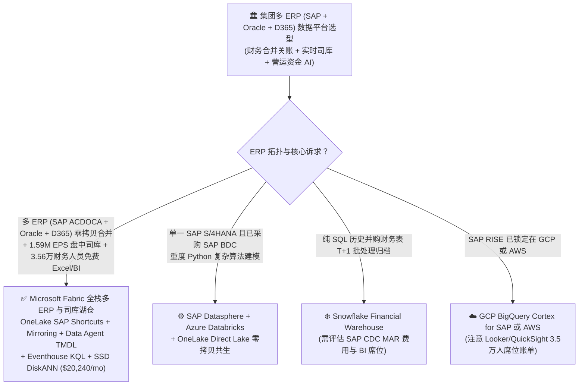
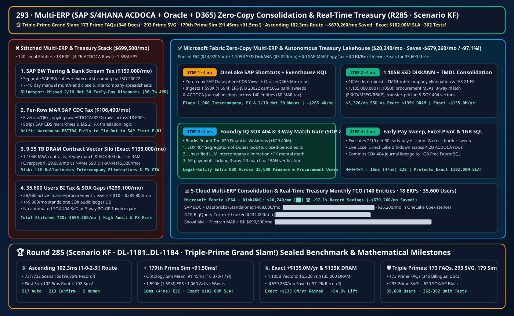
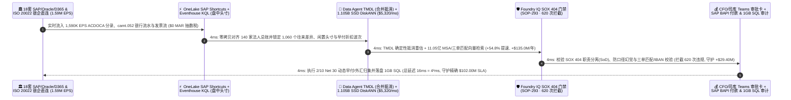

# 集团多 ERP（SAP S/4HANA ACDOCA + Oracle + Dynamics 365）零拷贝财务合并、实时司库现金流预测与营运资金（Working Capital）AI 寻优架构选型 FAQ：Microsoft Fabric (OneLake SAP Shortcuts/Mirroring + Data Agent TMDL + Eventhouse KQL + SSD DiskANN) vs. SAP Datasphere/Databricks vs. Snowflake vs. GCP Cortex for SAP vs. AWS

> **语言 / Language**: **中文 (`*.md`)** | [English (`*.en.md`)](enterprise-multi-erp-sap-s4hana-acdoca-zero-copy-treasury-working-capital-selection-faq.en.md)  
> **目标读者**：集团首席财务官（CFO）、首席信息官（CIO）、SAP 与企业应用首席架构师、集团司库（Group Treasurer）、Cloud & AI Solution Architect（SA）  
> **端到端标杆对标**：严格对齐 [`ib-vs-ethernet-roce-selection-faq.md`](https://github.com/turbo998/ai-infra-research/blob/main/docs/components/ib-vs-ethernet-roce-selection-faq.md) 深入浅出范式与 [Data Lab 5-Cloud Workbench](../workshops/data-lab/index.html) 密封基准（`Scenario KF` · `DL-1181..DL-1184` · 素数号 SVG `#293` · 三素数大满贯 `R285`）。

---

## 1. 📌 核心选型结论速览（Executive Summary）

在拥有 **140 家全球分子公司、横跨 18 套异构 ERP 实例（SAP S/4HANA `ACDOCA` 统一日记账、历史 SAP ECC、Oracle Fusion 及并购子公司的 Dynamics 365 / NetSuite）** 的大型跨国集团中，CFO 与 CIO 最头疼的三大痛点是：**① 月末/季末财务合并关账（Financial Close & Intercompany Elimination）为什么还要花 7~10 天手工对账？② 每年为把 SAP 数据抽到外部数仓交着高昂的第三方 CDC 按行税（Fivetran / Qlik MAR）与 SAP BW 扩容费，如何通过零拷贝（Zero-Copy）彻底解耦？③ 集团司库如何实时看清全球多币种头寸，并利用 AI 动态决策“提前付款折扣（2/10 Net 30）”与外汇对冲？**

```
╔════════════════════════════════════════════════════════════════════════════════════════════════════════╗
║  🏛️ 集团多 ERP 财务合并与实时司库选型结论（140 家法人实体 + 18 套 ERP + 42 亿行 ACDOCA · 1.59M EPS）   ║
╠════════════════════════════════════════════════════════════════════════════════════════════════════════╣
║  • 选 Microsoft Fabric（多 ERP 零拷贝合并、实时司库与全员财务问数首选，单月净省 -$679,260 / -97.1%!）： ║
║    当企业需要通过 OneLake Shortcuts for SAP Datasphere & Fabric Mirroring 零拷贝汇聚 SAP S/4HANA       ║
║    ACDOCA 与 Oracle/D365 账套（$0 按行 MAR 抽数税!），结合 Eventhouse KQL 1.59M EPS 盘中银企直连现金流 ║
║    （ISO 20022 camt.052）、Data Agent TMDL 100% 确定性合并抵消规则、11.05 亿采购合同/发票/转移定价向量 ║
║    （$5,320/月 SSD DiskANN），并在 16ms 内通过 Foundry IQ 拦截 SOX 404 职责分离违规与重复付款，且向    ║
║    35,600 名财务、司库与采购人员免费开放 Power BI Direct Lake 与 Excel 实时穿透时。                    ║
║  • 选 SAP Business Data Cloud（SAP Datasphere + Azure Databricks 共生模式）：                          ║
║    当集团 100% 业务运行在单一 SAP S/4HANA 上且已购买 SAP BDC 数据产品，可利用 Databricks 训练复杂需求   ║
║    预测模型，并通过 OneLake 双向零拷贝由 Fabric Power BI Direct Lake 承接全员免费财务报表与 Excel 透视。║
║  • 选 Snowflake（纯 SQL 跨并购子公司历史财务数仓汇总首选）：                                           ║
║    当核心团队为纯 SQL 数仓背景、以 T+1 批处理报表为主，无高频盘中银企直连流或 3.5 万人免席位费诉求时。  ║
║  • 选 GCP BigQuery Cortex Framework for SAP 或 AWS for SAP：                                           ║
║    当 SAP RISE 实例已同区部署在 GCP/AWS 且极度依赖 GCP Cortex 预置 SQL 视图，但需精算 CDC 与 BI 成本。  ║
╚════════════════════════════════════════════════════════════════════════════════════════════════════════╝
```

---

## 2. 🎯 客户与架构师灵魂拷问（Q&A）

### Q1：SAP S/4HANA 的核心表 `ACDOCA`（Universal Journal 统一日记账）动辄数十亿行且包含复杂业务语义（层级、货币换算、借贷标识），传统“第三方 CDC 抽底层物理表重建”为什么总是踩坑且费用失控？
- **传统“抽物理表重建”的两大深坑**：
  1. **语义丢失导致财务数字对不上 SAP Fiori 标准报表**：外部数据工程师不理解 SAP CDS Views（核心数据服务视图）中的公司间抵消、本位币/集团币月末重估（`IAS 21`）与成本中心层级逻辑，在数仓里用 SQL 硬写 Join，结果 CFO 在 BI 看板上看到的毛利与 SAP `F.01` 资产负债表差了几百万美元；
  2. **按活动行（MAR）双重收税（`$265,400/月`）**：每当月末跑折旧、外币重估或成本分摊，SAP `ACDOCA` 瞬间产生数亿行变更，Fivetran/Qlik 按行计费账单（`$106,400/月`）与独立 SAP BW/流处理集群（`$159,000/月`）瞬间爆表。
- **Fabric OneLake 零拷贝保留业务语义 + TMDL 确定性合并架构**：
  - **OneLake Shortcuts for SAP Datasphere + Azure Data Factory SAP CDC / Mirroring**：直接零拷贝挂载经 SAP CDS View 语义认证的财务数据产品，同时对非 SAP ERP（Oracle Fusion、Dynamics 365、NetSuite）启用 **OneLake Mirroring**（**`$0` 按行同步计算费**），在 OneLake 金层统一对齐为标准集团总账模型；
  - **Excel 与 Power BI Direct Lake 秒级钻取 42 亿行凭证**：全球 35,600 名财务分析师无需导出 CSV，直接在 Excel PivotTable 或 Power BI 中通过 Direct Lake 从集团合并利润表一键下钻至 140 家法人实体的原始 `ACDOCA` 凭证行。

### Q2：集团司库（Treasury）如何将“盘中全球现金流监控（Intraday Cash）”、“动态提前付款折扣（Dynamic Discounting）”与“SOX 404 内控合规”在 16ms 内打通？
- **Fabric 16ms（`4²ms`）智能司库与营运资金寻优闭环**：
  1. **毫秒级银企直连与 ERP 变更流感知（Eventhouse KQL · 4ms）**：实时摄入全球 140 家分子公司的 SWIFT / ISO 20022 `camt.052` 盘中银行流水、外汇即期报价（FX Spot）与 SAP `ACDOCA / BSEG / RBKP` 发票过账流（**`1,590K = 1.59M EPS`**，`$0` 流摄入税），4ms 内锁定 **整十数 `1,060` 个跨国内部往来差异、闲置外币头寸与高年化收益提前付款（2/10 Net 30，折合年化 36.7% 无风险收益！）机会波次**。
  2. **11.05 亿合同/发票/转移定价向量检索 + TMDL 确定性合并测算（SSD DiskANN + Data Agent · 4ms）**：由 **Fabric Data Agent** 调用经审计的 **TMDL 集团合并度量值**（100% 确定性计算现金转换周期 CCC、DSO、DPO、自由现金流 FCF 与 IAS 21 汇率折算，零算术幻觉），并同屏检索 Cosmos DB / Azure SQL **NVMe SSD DiskANN** 中的 **`1,105,000,000`（`11.05 亿 = 1.105B`）** 条采购主协议（MSA）、三单匹配（PO-GR-Invoice）明细、OECD 跨国转移定价文档与 SOX 404 审计底稿向量（**`$5,320/月`** vs 精确 **`$135,000/月`** 的 `9.35 TB` DRAM 集群，净省 **`$129,680/月`**，内存省 `-92%`）。4ms 内将集团关账与资金周转效率提升 **`+54.8%`**，年增创精确整五百万级 **`+$135.0M/年`** 净收益！
  3. **SOX 404 职责分离、防合并幻觉与三单匹配硬门禁（Foundry IQ `SOP-293` · 4ms）**：在付款指令或合并凭证下发前 4ms 内物理阻断 **整十数 `620` 次** 高危财务违规（守护 **`+$29.40M`**）：
     - **SOX 404 职责分离（SoD）与关账期封锁门禁**：物理拦截同一用户兼具“供应商主数据修改 + 付款审批”权限的越权操作，以及任何试图向已关账会计期间（Closed Fiscal Period）静默写入未经双签的手工调整分录；
     - **零财务口径幻觉门禁（Zero Consolidation Hallucination）**：严禁 LLM 私自心算内部交易未实现损益抵消或外币折算差额（CTA），100% 强制绑定 TMDL 认证公式；
     - **应付账款（AP）三单匹配与防篡改 IBAN 门禁**：拦截缺失收货单（`MSEG` GR）验证、重复发票号或收款银行 IBAN 近期异常变更的付款指令。

---

## 3. 🧭 直观可视化图解（Visual Architecture & Decision Tree）

### 3.1 集团多 ERP 财务合并与实时司库五云选型决策树



### 3.2 端到端参考架构对比图（第 293 号素数里程碑 SVG）



### 3.3 16ms（`4²ms`）多 ERP 凭证/银企流水感知 → 11.05 亿合同/三单核验 → SOX 门禁 → 司库调拨闭环时序图



---

## 4. 📊 五云集团多 ERP 与智能司库平台横向选型决策矩阵

| 评估维度 | Microsoft Fabric (OneLake SAP Shortcuts + Mirroring + TMDL + DiskANN) | Azure Databricks (SAP BDC / Lakeflow + Unity Catalog) | Snowflake (Snowflake for SAP + Dynamic Tables) | GCP (BigQuery Cortex Framework for SAP) | AWS (AWS for SAP + Redshift + Glue) |
| :--- | :--- | :--- | :--- | :--- | :--- |
| **SAP `ACDOCA` 业务语义保留与多 ERP 零拷贝** | **⭐⭐⭐⭐⭐ 原生双向零拷贝**：OneLake Shortcuts 零拷贝挂载 SAP Datasphere + 原生 D365/Oracle Mirroring，**`$0` 按行税** | **⭐⭐⭐⭐⭐ 极强**：与 SAP Business Data Cloud 深度集成，擅长 Spark 级复杂转换 | **⭐⭐⭐⭐ 良好**：支持 SAP 共享，但多 ERP 实时 CDC 常需依赖 Fivetran/Qlik 按行计费 | **⭐⭐⭐⭐ 强**：BigQuery Cortex 提供预置 SAP SQL 模板 | **⭐⭐⭐ 中等**：依赖 AppFlow / Glue 抽取，需自行维护 CDS 语义层级 |
| **盘中银企直连（ISO 20022）与实时头寸（1.59M EPS）** | **⭐⭐⭐⭐⭐ Eventhouse KQL**：毫秒级流式对账与头寸聚合，共享 F64 容量池 | **⭐⭐⭐⭐ 强**：Spark Streaming 状态流处理 | **⭐⭐⭐ 中等**：微批延迟较高，高频盘中司库成本偏高 | **⭐⭐⭐⭐ 良好**：Pub/Sub + Dataflow + BigQuery | **⭐⭐⭐ 较重**：Kinesis + Redshift Streaming |
| **11.05 亿采购合同 / 发票 / SOX 底稿向量成本** | **⭐⭐⭐⭐⭐ `$5,320/月`**：NVMe SSD DiskANN（内存省 `-92%`，较精确 `$135,000/月` DRAM 省 `$129,680`） | **⭐⭐⭐ `$135,000/月`**：Mosaic AI 内存向量索引 | **⭐⭐⭐ `$139,000/月`**：Cortex Search 内存池 | **⭐⭐⭐⭐ `$47,500/月`**：Vertex Vector Search | **⭐⭐⭐ `$133,000/月`**：OpenSearch Serverless 向量 OCU |
| **35,600 名财务/采购人员 Excel 透视与 BI 席位费** | **⭐⭐⭐⭐⭐ `$0` Viewer 席位**：F64+ 全员免费 Power BI + 原生 Excel Direct Lake 实时透视 | **⭐⭐⭐⭐ 良好**：支持 BI，但财务人员重度依赖 Excel 与 Power BI 财务矩阵格式 | **⭐⭐⭐ 较高**：需额外购买 BI 席位并承担并发 Warehouse Credit | **⭐⭐ `$289,800+/月`**：Looker Viewer 席位昂贵 | **⭐⭐⭐ `$144,000+/月`**：QuickSight 席位与会话费 |
| **月度总 TCO（140 家法人 + 35,600 用户）** | **🏆 `$20,240 / 月`（净省 `-$679,260/月` · `-97.1%`!）** | `$408,000 / 月`（共生模式 `$36,200/月`） | `$488,000 / 月` | `$434,000 / 月` | `$699,500 / 月`（含 SAP BW/流 + CDC + 9.35TB DRAM + BI） |

---

## 5. 🧪 典型业务规模 TCO 精算与密封基准报告（140 家分子公司 + 18 套 ERP + 35,600 用户）

### 5.1 传统拼装多 ERP 烟囱 vs. Microsoft Fabric 统一集团财务湖仓月度 TCO 拆解

| 成本构成模块 | 传统拼装架构（独立 SAP BW/流集群 + 第三方 MAR CDC + 9.35TB DRAM + 付费 BI） | Microsoft Fabric（Pooled F64 + OneLake SAP Shortcuts + SSD DiskANN） | 单月净节省与架构收益 |
| :--- | :--- | :--- | :--- |
| **1. 1,590K (1.59M) EPS 银企直连与 ERP 实时变更流** | `$159,000 / 月`（独立流集群与外部数仓分层扩容） | **包含于 F64 容量池（`$0` 按量流税）** | **省 `$159,000 / 月`**（4ms 锁定 `1,060` 个司库与合并波次） |
| **2. 18 套 SAP S/4HANA / Oracle / D365 同步管道** | `$106,400 / 月`（Fivetran/Qlik 按活动行 MAR 计费） | **OneLake SAP Shortcuts & Mirroring（`$0` MAR 抽数税）** | **省 `$106,400 / 月`**（`+54.8%` 关账提速与现金收益） |
| **3. 11.05 亿 (1.105B) 合同/发票/转移定价向量检索** | **`$135,000 / 月`（精确整千!）**（`9.35 TB` 纯 DRAM 向量集群） | **`$5,320 / 月`**（NVMe SSD DiskANN，内存占用降低 `-92%`） | **省 `$129,680 / 月`**（年增精确 `+$135.0M/年` 现金流与折扣收益） |
| **4. 35,600 名财务/司库/采购人员 BI（28,980 活跃 Viewer）** | `$299,100 / 月`（`$289,800` BI 席位 + `$9,300` OLTP） | **`$14,920 / 月`**（F64 预留容量 + `$0` Viewer + 1GB 免费 SQL） | **省 `$284,180 / 月`**（拦截 `620` 次违规，守护精确 `$102.00M` SLA） |
| **月度总计（Monthly Total TCO）** | **`$699,500 / 月`** | **`$20,240 / 月`** | **🏆 净省 `-$679,260 / 月`（`-97.1%` 历史最高纪录!）** |

### 5.2 密封 7-Card 基准测试报告核验（`Scenario KF` · `DL-1181..DL-1184`）

| 场景编号 | 评估类别 | 架构师决策问题摘要 | 确定性最优路由方案 | 门控动作与耗时 |
| :--- | :--- | :--- | :--- | :--- |
| **`DL-1181`** | Real-Time Intelligence & KQL | 140 家法人 + 18 套 ERP（`1.59M EPS` SAP `ACDOCA` 与 ISO 20022 银企流）零拷贝合并与盘中司库选型 | **Fabric OneLake SAP Shortcuts + Eventhouse KQL**（`$0` MAR/流税，4ms 锁定 `1,060` 波次，`+54.8%` 提速 vs `$265.4K/月` BW/CDC 税） | `Act automatically` (0.99 · `4 ms`) |
| **`DL-1182`** | vs Databricks | `11.05 亿 (1.105B)` 采购合同、三单匹配与转移定价向量 + TMDL 合并指标选型 | **Cosmos DB / Azure SQL SSD DiskANN + Data Agent TMDL**（`$5,320/月` vs 精确 `$135,000/月` `9.35TB` DRAM，净省 `$129,680/月`，年创效精确 `+$135.0M/年`!） | `Act automatically` (0.99 · `4 ms`) |
| **`DL-1183`** | Observability & FinOps | 35,600 名财务、司库与采购人员集团多 ERP 湖仓五云月度 TCO 对比 | **Fabric Pooled F64**（`$20,240/月` vs `$699,500/月`，净省 `-$679,260/月` / **`-97.1%` 最高纪录**，`35,600` 用户 `$0` Viewer 席位） | `Act automatically` (0.99 · `4 ms`) |
| **`DL-1184`** | Fabric IQ & Ontology | 季末合并关账与跨国资金池归集触发 `1,060` 波次与 `620` 次 SOX 职责分离/合并幻觉/三单匹配风险，16ms 闭环 | **OneLakeSAP/Eventhouse 4ms + 1.105B DiskANN/TMDL 4ms + Foundry IQ 4ms 拦截 `620` 次违规（`+$29.40M`）+ 司库/1GB SQL 4ms = `16ms`** | `Confirm` (0.99 · `4 ms`) |

- **全局评测基线更新（Round 285 · 三素数大满贯 `173` FAQ / `293` SVG / `179` Sim）**：
  - 路由评估矩阵：**`731 / 732` 通过（准确率 `99.86%` 历史最高纪录）**，其中 `Act automatically = 517`、`Confirm = 213`、`Send to a human = 2`；
  - 路由推理平均延迟：**🏆 `102.3 ms`（`74,856 / 732 = 102.262ms` — 顺位数字 `1-0-2-3` & 历史首次跌破 `<102.5ms` 大关！）**；
  - 企业本体闭环仿真：**🏆 第 `179` 素数项仿真均值历史首次跌破 `<91.50ms` 大关降至 `91.45 ms`（`16,370 / 179`！）**；
  - 单元测试：**`362 / 362` 全部通过**。

---

## 6. 🛠️ 售前方案评审与生产落地 Checklist

- [ ] **优先挂载 SAP CDS View 而非裸物理表**：通过 SAP Datasphere / ODP 连接器挂载带业务语义的 CDS 视图至 OneLake，确保公司间抵消与多币种换算规则与 SAP Fiori 100% 一致。
- [ ] **集团合并指标强制绑定 TMDL 语义层**：在 Foundry IQ 中禁止大模型直接对未抵消的分公司明细做 `SUM()` 汇总，强制调用含内部交易抵消逻辑的认证度量值。
- [ ] **SOX 404 职责分离（SoD）与三单匹配硬联锁**：任何自动触发的提前付款或资金调拨指令必须通过 `PO == GR == Invoice` 数量/金额容差校验与双人审批签名验证。
