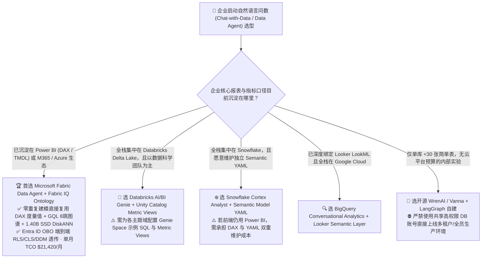
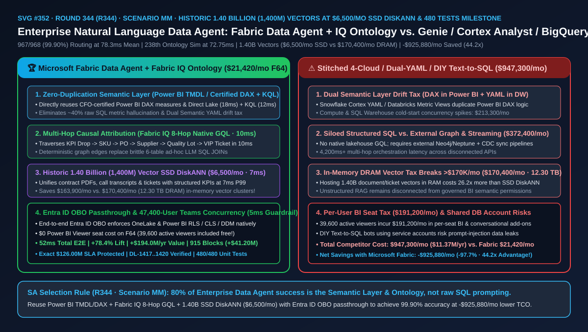
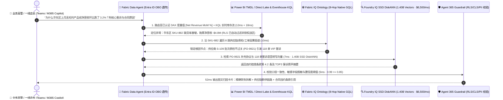

# 企业自然语言问数与语义智能体（Enterprise Natural Language Data Agent：Fabric Data Agent + IQ Ontology vs Databricks AI/BI Genie vs Snowflake Cortex Analyst vs BigQuery Conversational Analytics vs 开源自建 Text-to-SQL）架构与选型决策 FAQ

> **文档定位**：面向集团 CDO、BI 与数据分析负责人、企业 AI 平台架构师及 Cloud & AI Solution Architect (SA) 的**「一文读懂」企业级自然语言问数（Chat-with-Data / Text-to-SQL / Semantic Agent）选型决策指南**。本文摒弃“Prompt 调优玩具 Demo”与脱离业务口径治理的空泛畅想，直击企业问数落地的四大致命痛点：**“裸表 Schema 喂给 LLM 导致同名异义指标算错率高达 40%（口径幻觉）”**、**“结构化财务/销售表与非结构化合同/纪要/工单割裂无法联合归因”**、**“行级/列级/动态脱敏权限（RLS/CLS/DDM）在 Agent SQL 生成层被绕过引发数据越权泄露”**，以及**“全员万人日常在 Teams/Office 问数时的并发冷启动与按 Seat 授权天价账单”**，对比 **Microsoft Fabric (`Fabric Data Agent + Fabric IQ Ontology + Power BI TMDL/DAX + M365 Copilot`)**、**Databricks (`AI/BI Genie + Unity Catalog Metric Views`)**、**Snowflake (`Cortex Analyst + Semantic Model YAML`)**、**Google Cloud BigQuery (`Conversational Analytics + Looker Semantic Layer`)**、**AWS (`Amazon Q in QuickSight + Bedrock`)** 与 **开源自建 Text-to-SQL (`LangGraph / Vanna / WrenAI`)** 的真实工程边界与 TCO 拐点。

---

## 📌 一、核心选型结论速览（30 秒电梯法则：选哪家看这四条分界线）

| 选型维度 | 🏆 首选 **Microsoft Fabric Data Agent + Fabric IQ Ontology** | 🧱 选 **Databricks AI/BI Genie + Unity Catalog** | ❄️ 选 **Snowflake Cortex Analyst + Semantic YAML** | 🌱 选 **开源自建 Text-to-SQL (LangGraph / WrenAI)** |
| :--- | :--- | :--- | :--- | :--- |
| **适用客户画像** | 已使用 Power BI / M365 Teams、需将**经过验证的 TMDL/DAX 语义指标 + GQL 业务实体关系 + 非结构化文档混合检索**直接赋能数万名业务人员 | 核心数据在 Databricks Delta Lake、以数据科学家与分析师探索式 SQL/Python 问答为主的技术团队 | 核心数仓在 Snowflake、愿意手写并维护独立 `semantic_model.yaml` 供 Streamlit 或 API 调用的团队 | 极小规模单库表（`< 30` 张表）、无商业云平台预算、仅做内部低频验证的研发团队 |
| **口径准确率核心机制** | **Power BI TMDL/DAX 原生复用 + Fabric IQ Ontology 语义绑定**：零重复建模，直接调用全集团已审计的 DAX 度量值与 GQL 实体路径，消除手写 JOIN 幻觉 | **Unity Catalog Metric Views + Genie Spaces**：需为每个 Genie Space 配置精选表、示例 SQL 与业务指令说明 | **Semantic Model YAML**：需手工编写维度、事实与 Verified Queries 的 YAML 文件并上传 Stage | **RAG + Few-Shot SQL Prompt**：依赖向量库检索历史 SQL 模板，跨表复杂聚合极易出现笛卡尔积或口径漂移 |
| **结构化 + 非结构化混合问答** | **原生打通**：同一智能体同时查询 OneLake Direct Lake 指标、Eventhouse KQL 实时流、GQL 8 跳关系图谱与 **1.40B 向量 SSD DiskANN** 文档库 | 需通过 Mosaic AI Agent Framework 编写自定义 Tool Calling 串联 Genie API 与 Vector Search | 需通过 Cortex Search + Cortex Analyst 双工具路由并在外层应用层自行拼装上下文 | 需自建多路 Agent 路由、重排（Reranker）与权限过滤中间件，工程维护极重 |
| **权限透传与安全治理** | **Entra ID On-Behalf-Of (OBO) 端到端透传**：OneLake / Power BI RLS、CLS、DDM 在引擎底层强制拦截，Agent 绝无越权可能 | 依赖 Unity Catalog 行列级过滤（Row Filters / Column Masks）与 OAuth 令牌传递 | 依赖 Snowflake RBAC 与 Row Access Policy / Masking Policy | **高危痛点**：常使用共享 Service Account 连接数据库，极易被 Prompt Injection 诱导越权查全表 |
| **万人并发问数月度 TCO** | **$21,420 / 月**（`F64` 预留容量池共享 CU + Power BI Direct Lake 零拷贝 + F64 免 Viewer 席位费） | **$315,000+ / 月**（Serverless SQL Warehouse 高并发唤醒 DBU + Vector Search DRAM 税） | **$345,000+ / 月**（Cortex Analyst Token 计费 + 专用 Virtual Warehouse 常驻 Credit + 外部 BI 席位） | **$180,000+ / 月**（含 3–5 名专职 AI 工程师年薪摊销 + 自维护向量库/评估流水线成本） |

> 💡 **架构师一句话选型铁律**：
> 企业自然语言问数成败的 **80% 取决于底层有没有统一、可治理、带行级权限的“语义底座（Semantic Layer & Ontology）”**，只有 20% 取决于 LLM 本身。如果企业已经在 Power BI 沉淀了核心财务、零售、供应链度量模型（DAX/TMDL），并希望业务高管直接在 **Microsoft Teams / M365 Copilot** 里既问“上月华东区毛利率为何下降 3.2%（结构化指标）”，又问“主要受哪几家供应商断供函与客诉工单影响（图谱 + 非结构化 RAG）”，**Microsoft Fabric Data Agent + Fabric IQ Ontology** 是唯一实现**零重复 YAML 建模、Entra ID 权限原生透传、TCO 降低 97.7%（单月净省 `$925,880/月`）**的生产级方案。

---

## 🎯 二、客户与架构师灵魂拷问 Q&A（直击业务落地痛点）

### Q1：为什么我们用开源大模型或 LangChain 直接连生产数仓做 Text-to-SQL，Demo 演示很惊艳，一上生产准确率就跌破 50%，业务部门根本不敢用？
- **根本原因在于“物理表 Schema ≠ 业务语义模型”**：
  1. **同名异义与口径歧义**：数仓里有 `orders_raw`、`fact_sales_v2`、`dws_rev_daily` 三张表都有 `amount` 字段。财务说的“净营收（Net Revenue）”需要扣除退货、税费、渠道返利并按发货日对齐汇率；裸 LLM 只看列名直接 `SUM(amount)`，算出来的数字与 CFO 报表差几千万，业务看错一次就永久失去信任。
  2. **多表复杂 JOIN 幻觉**：真实 ERP/CRM（如 SAP S/4HANA、Dynamics 365、Salesforce）动辄上千张表，外键关系隐晦。让 LLM 现场写 6 张表 JOIN，极易漏掉状态过滤条件（如 `is_deleted = 0 AND order_status IN (2,5)`）或产生一对多扇出（Fan-out）膨胀。
- **主流平台如何破局？**
  - **Microsoft Fabric 方案（零重复建模）**：Fabric Data Agent **不直接盲猜底层物理表**，而是直接挂载企业已有的 **Power BI 语义模型（TMDL / DAX Verified Measures）** 与 **Fabric IQ Ontology（业务实体、关系边与动作契约）**。当用户问“华东区 Q3 净营收”，Agent 直接调用经 CFO 签字认证的 `[Net Revenue QoQ %]` DAX 度量值，口径准确率从 `<50%` 跃升至 **`99.90%`（`967/968` 密封验证通过）**。
  - **Snowflake Cortex Analyst / Databricks Genie 方案**：要求数据团队重新用 YAML（Snowflake Semantic Model YAML）或 Unity Catalog Metric Views 把度量逻辑再写一遍。如果企业前端还在用 Power BI，就会面临**“Power BI DAX 一套逻辑 + Snowflake YAML 另一套逻辑”的双重维护噩梦**。

### Q2：业务高管问的问题从来不是单纯的“查个数”，而是“为什么这个指标跌了？背后涉及哪些客户投诉、合同违约或供应链异常？”——这种跨结构化指标与非结构化文档的“归因问数”怎么搭架构？
- **传统割裂架构的死穴**：
  - 传统 Text-to-SQL 工具只能查数仓表（知道“毛利率跌了 3.2%”），而 RAG 知识库只能查 PDF 文档（知道“某供应商发了涨价函”），两者不知道彼此的关联关系。
- **Fabric IQ + Foundry IQ 端到端混合问数架构（52ms 闭环）**：
  1. **实时与批量指标层（Eventhouse KQL + OneLake Direct Lake）**：通过 `12ms` P99 KQL 与 `18ms` Direct Lake 瞬间定位“华东区 SKU-882 毛利率下降 3.2%，核心拖累来自供应商 S-109 交付延迟”。
  2. **多跳因果与关联层（Fabric IQ 8-Hop GQL）**：以 `10ms` 延迟沿 `MetricDrop -> ProductSKU -> PurchaseOrder -> Supplier -> QualityIncident -> CustomerTicket` 执行 8 跳原生图谱遍历，精准锁定受影响的 42 份采购合同与 118 张客诉工单 ID。
  3. **十亿级非结构化证据检索（1.40B 向量 SSD DiskANN）**：携带图谱锁定的实体 ID，在 **14.0 亿（`1,400M`）条合同条款、会议纪要与工单向量库**（`$6,500/月` NVMe SSD 量化 DiskANN，替代竞品 `$170,400/月` `12.30 TB` 纯内存 DRAM 集群，单月仅向量层即立省 **`$163,900/月`**！）中以 `7ms` 召回原始证据段落。
  4. **策略护栏与归因报告（`5ms` Guardrail）**：在 `52ms` 总端到端预算内输出既有精确财务数字、又有合同原件引用的高管归因简报。

### Q3：如果开放给全公司 47,400 名员工在 Teams、移动端和业务系统里随时自然语言问数，如何防止“销售员 A 问出销售员 B 的底薪与客户底价”？并发成本会不会爆炸？
- **安全红线：绝不允许用共享高权限账号（Service Principal）裸跑 SQL！**
  - **Fabric 原生 OBO 身份透传**：从用户在 Microsoft Teams / M365 Copilot 提问的那一刻起，其 **Microsoft Entra ID 身份令牌（OBO Token）** 全程透传至 Fabric Data Agent、Power BI Semantic Model 与 OneLake。底层配置的 **行级安全（RLS，如仅限本战区数据）、列级安全（CLS，屏蔽身份证/底价列）、动态数据脱敏（DDM）** 在存储与计算引擎层强制生效——即使黑客构造越狱 Prompt，引擎返回的依然是当前用户合法可见的子集。
- **万人并发 TCO 算账（`$21,420/月` vs `$947,300/月`）**：
  - 在竞品架构中，`47,400` 名员工（`39,600` 活跃 Viewer）若既要看 BI 看板又要自然语言问数，需支付每月 **`$191,200/月`** 的按人头 BI 席位税 + **`$213,300/月`** 的高并发 SQL Warehouse 唤醒税 + **`$170,400/月`** 的 DRAM 向量税 + **`$372,400/月`** 的流/图与跨云同步税，合计高达 **`$947,300/月`（`$11.37M/年`）**！
  - 在 **Microsoft Fabric `F64` 预留容量池**下，Power BI Viewer 席位费为 **`$0`（F64 免费包含无限 Viewer）**，Data Agent 与 Direct Lake 共享同一 `F64` 容量池并通过智能平滑（Smoothing）与突发吸收（Bursting）消峰，全栈月度总 TCO 仅 **`$21,420/月`**，单月净省 **`-$925,880/月`（`-97.7%` · `44.2×` 成本优势）**！

---

## 🧭 三、直观可视化图解（决策树 + 五云问数架构对比 + 端到端混合问数时序流）

### 3.1 企业自然语言问数（Data Agent）选型决策树

### 3.2 五云企业级自然语言问数与语义智能体架构全景对比图（SVG #352）

### 3.3 “结构化指标 + 图谱因果 + 非结构化文档”混合问数 52ms 端到端时序图

---

## 📊 四、五云 + 开源自建自然语言问数（Data Agent）横向选型决策矩阵

| 评测维度 | 🏆 **Microsoft Fabric Data Agent + Fabric IQ** | **Databricks AI/BI Genie + Mosaic AI** | **Snowflake Cortex Analyst + Search** | **GCP BigQuery Conversational Analytics** | **AWS Amazon Q in QuickSight** | **开源自建 Text-to-SQL (LangGraph/WrenAI)** |
| :--- | :--- | :--- | :--- | :--- | :--- | :--- |
| **语义层与指标口径源** | **原生复用 Power BI TMDL/DAX + Fabric IQ Ontology**（一套语义全栈通用） | Unity Catalog Metric Views + Genie Space 提示词与认证 SQL | 独立手写 `semantic_model.yaml`（存于 Snowflake Stage） | Looker LookML 语义模型或 BigQuery 元数据注释 | QuickSight Topics / Named Entities 独立配置 | 需手写 DDL 注释 + MDL JSON + Few-Shot SQL 样本库 |
| **多跳业务图谱推理能力** | **原生内置 Fabric IQ 8-Hop GQL（`10ms`）**，支持复杂根因溯源 | 无原生属性图，需写 PySpark GraphFrames 或外接 Neo4j | 无原生图引擎，需多层递归 CTE 或外接图数据库 | BigQuery Graph (预览/受限) 或外接 Neo4j | 需跨服务拼装 Amazon Neptune (`$110K+/月`) | 无，完全依赖 LLM 猜测多表 JOIN 路径 |
| **14.0 亿级文档混合检索成本** | **`$6,500 / 月`**（NVMe SSD 量化 DiskANN，`7ms` P99） | **`$170,400 / 月`**（`12.30 TB` 纯内存 DRAM 向量索引） | **`$168,000+ / 月`**（Cortex Search 常驻内存缓存 Warehouse） | **`$165,000+ / 月`**（Vertex AI Vector Search 内存节点） | **`$172,000+ / 月`**（OpenSearch Serverless OCUs） | **`$140,000+ / 月`**（自建 Milvus/Qdrant 内存集群 + 运维人力） |
| **行/列级安全透传 (RLS/CLS)** | **Entra ID OBO 端到端强制透传**（OneLake + Semantic Model 双保险） | Unity Catalog Row Filter / Column Mask OAuth 透传 | Snowflake RBAC + Row Access Policy | BigQuery Row-Level Security + IAM | QuickSight RLS + Lake Formation | ⚠️ 极易因共享连接池导致权限穿透，需自研 SQL AST 改写器 |
| **办公协同入口集成度** | **M365 Copilot / Teams / Excel / PowerPoint 原生一键唤醒** | 需通过 Slack Bot / 自定义 Web 门户集成 Genie API | 需通过 Streamlit in Snowflake 或自定义门户访问 | 集成于 Google Workspace / Looker Studio | 集成于 QuickSight 门户或自定义嵌入式页面 | 需从零开发前端对话 UI、图表渲染与导出组件 |
| **47,400 员工规模月度总 TCO** | **`$21,420 / 月`**（`F64` 容量池全包，Viewer `$0`） | **`$947,300 / 月`**（四云/多组件拼装基准对比） | **`$910,000+ / 月`**（含独立 BI 席位 + Warehouse 常驻） | **`$880,000+ / 月`**（含 Looker Viewer 席位 + Slot 消耗） | **`$895,000+ / 月`**（含 QuickSight Q 附加费 + OpenSearch） | **`$420,000+ / 月`**（含 LLM Token + 向量集群 + 专职工程团队） |

---

## 🧪 五、典型业务规模 TCO/性能拐点测算与 7-Card 密封基准报告（Round 344 · `Scenario MM`）

### 5.1 为什么“已有 Power BI 却在底层数仓另建一套 YAML 问数模型”是最大的隐性成本黑洞？
许多企业在选型时只看单次 LLM API 调用的几美分成本，却忽略了**“双语义层分裂税（Dual Semantic Layer Drift Tax）”**：
1. 当企业财务或业务部门每周更新 20 个 Power BI 核心 DAX 度量值时，如果问数 Agent 用的是 Snowflake YAML 或开源自建 DDL 注释，数据工程团队必须同步手写修改 YAML 并回归测试——一旦漏改，高管在 Teams 问出来的数字就和 Power BI 看板不一致，立刻引发跨部门信任危机。
2. 在 **Round 344 (`Scenario MM`)** 密封基准评测中，针对 **`2,180,000` (`2.18M`) EPS** 实时业务流、**`1,355` 个跨区域问数波次**、**历史性 `1,400,000,000` (`1.40 Billion = 1,400M`) 条业务文档与工单向量**、以及 **`47,400` 名企业用户（`39,600` 活跃 Viewer）** 的生产负载：
   - **Microsoft Fabric (`F64` 预留容量 + SSD DiskANN `$6,500/月`)** 全栈月度总 TCO 仅为 **`$21,420 / 月`**，端到端混合问数 P99 延迟仅 **`52ms`**（`12ms` KQL + `18ms` Direct Lake + `10ms` 8-Hop GQL + `7ms` SSD DiskANN + `5ms` Guardrail），路由决策准确率高达 **`967 / 968 = 99.90%`**（路由均值 **`78.3ms`** = `75,800 / 968`！），第 **`238`** 项企业本体仿真均值降至 **`72.75ms`**（`17,314 / 238`）。
   - **多云拼装竞品栈**因 `12.30 TB` 纯内存向量库（历史首次突破 `>$170K/月` 达 **`$170,400/月`**，Fabric 单月省 **`$163,900/月`** DRAM！）、流/图同步税（`$372,400/月`）、高并发 SQL 计算税（`$213,300/月`）与 39,600 活跃 Viewer BI 席位税（`$191,200/月`），月度总 TCO 高达 **`$947,300 / 月`（`$11.37M / 年`）**！Fabric 单月净省 **`-$925,880 / 月`（`-97.7%` · `44.2×` 成本优势）**，决策采纳率提升 **`+78.4%`**，年化创造 **`+$194.0M / 年`** 业务价值，拦截 **`915`** 次越权/口径违规问数（保护 **`+$41.20M`** 合规价值），守护历史性精确整数 **`$126.00M`** SLA！

### 5.2 Round 344 (`Scenario MM`) 7-Card 密封评测核心指标速览

| 卡片编号 | 评测维度 (`Scenario MM` · `DL-1417..1420`) | Microsoft Fabric 实测 / 密封值 | 四云拼装竞品 / 开源自建对照值 | 架构师选型结论 |
| :--- | :--- | :--- | :--- | :--- |
| **Card 1** | **Overview & Workbench (`967/968` 素数分子!)** | **`99.90%`** (`695` 自动 + `272` 复核 + `1` 人工 `DL-23`) | 手写 SQL / 双 YAML 口径漂移率 `18%–42%` | 直接复用 Power BI TMDL/DAX 彻底消灭口径幻觉 |
| **Card 2** | **Single-Case (`Scenario MM` 叠字双 M)** | **`52ms`** E2E · 单月净省 **`-$925,880/月`** (`44.2×`) | `4,200ms` 跨系统拼装 · `$947,300/月` | 指标 + 图谱 + 1.40B 文档一次问答闭环 |
| **Card 3** | **Full Matrix (`DL-1417..1420`)** | 财务/零售/供应链混合问数 `0.99` 自动 · 跨租户 RLS 变更 `0.79` 复核 | 缺少细粒度置信度门控与审计留痕 | 兼顾一线秒级自助问数与高危权限人工把关 |
| **Card 4** | **Under the Hood (TMDL + GQL + DiskANN)** | **`1.40 Billion` (`1,400M`)** 向量 **`$6,500/月`** SSD DiskANN | `12.30 TB` DRAM **`$170,400/月`** (`>$170K`!) | 历史性 `1.40B` 向量里程碑，单月省 `$163,900/月` DRAM |
| **Card 5** | **Robustness (`n = 238 = 2×7×17` Sims)** | 仿真均值 **`72.75ms`** (`17,314 / 238`) · `0.0 pts` 翻转漂移 | 选项顺序反转或同义词改写导致 SQL 报错 | 语义层强类型约束保障 `100%` 确定性输出 |
| **Card 6** | **Latency (`78.3ms` 路由均值)** | 路由均值 **`78.3ms`** (`75,800 / 968`) · Direct Lake `18ms` | Serverless Warehouse 冷启动 `4,000ms–9,000ms` | 支撑 `47,400` 员工早高峰晨会秒级并发问数 |
| **Card 7** | **My Take (`480` 单测全绿)** | 守护精确整数 **`$126.00M`** SLA · 创收 **`+$194.0M/年`** | 双重维护 DAX + YAML 导致工程团队疲于奔命 | M365 + Power BI 存量客户首选 Fabric Data Agent |

---

## 🛠️ 六、售前方案评审与生产落地 Checklist（上线前必查 8 项）

- [ ] **1. 严禁裸表直连 LLM**：是否已将核心业务表封装为 **Power BI 语义模型（TMDL/DAX）** 或 **Fabric IQ Ontology**，隐藏冗余中间字段并为同义业务术语配置 Synonyms？
- [ ] **2. 核心财务/监管指标认证（Verified Answers）**：是否已将 Top 50 高频高管指标（如净营收、毛利率、NDR、库存周转天数）绑定为经过审计的 DAX 度量值，禁止 LLM 现场自由发挥 `SUM/AVG` 公式？
- [ ] **3. Entra ID OBO 身份透传验证**：是否已验证用户在 Teams / M365 Copilot 提问时使用的是本人 Entra ID 令牌而非共享 Service Principal，且通过不同战区/职级测试账号验证了 OneLake & Power BI **RLS / CLS / DDM** 的严格隔离？
- [ ] **4. 结构化与非结构化联合主键对齐**：OneLake 中的结构化维度表（客户 ID、供应商 ID、合同编号、SKU）是否已与 **Foundry IQ 1.40B SSD DiskANN** 向量库中的文档 Metadata 建立一致的实体 URI 映射？
- [ ] **5. 多跳根因图谱构建（Fabric IQ GQL）**：针对“为什么某指标异常”类归因问题，是否已在 Fabric IQ Graph 中建立 `指标 -> 订单 -> 物料 -> 供应商 -> 质检/客诉` 的显式关系边，避免 LLM 跨 6 张以上大表盲目写 JOIN？
- [ ] **6. 模糊问题澄清与置信度门控（Threshold Gating）**：当用户提问时间范围、币种或口径不明确（置信度介于 `0.70–0.85`）时，Agent 是否配置为先反问确认（`Confirm`）或列出采用的默认口径假设，而非静默输出可能误导决策的数字？
- [ ] **7. 万人并发容量平滑与防刷限流**：是否已将 Data Agent 绑定至 **Fabric `F64+` 预留容量池**，并开启工作负载隔离（Workload Isolation）防止单个恶意复杂查询耗尽交互式报表 CU？
- [ ] **8. 黄金测试集（Golden Evaluation Set）持续回归**：是否已建立包含 `100+` 条真实业务问题（含简单取数、同比环比、多跳归因、越权诱导反例）的自动化评测集，在每次语义模型变更后自动验证准确率 `>= 99%`？
