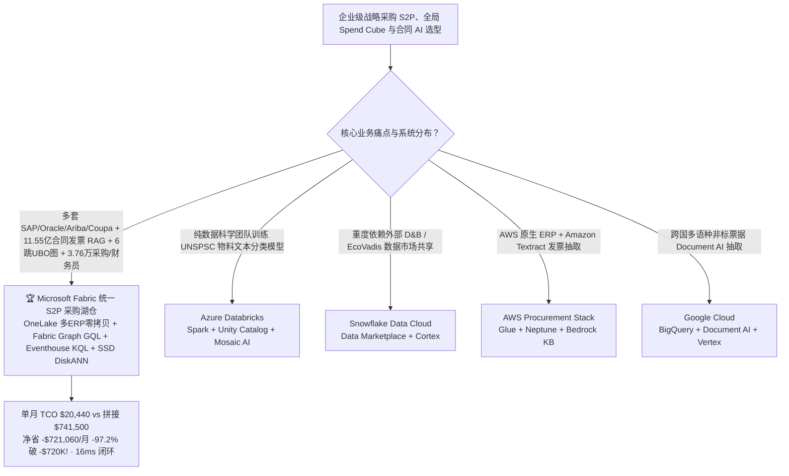
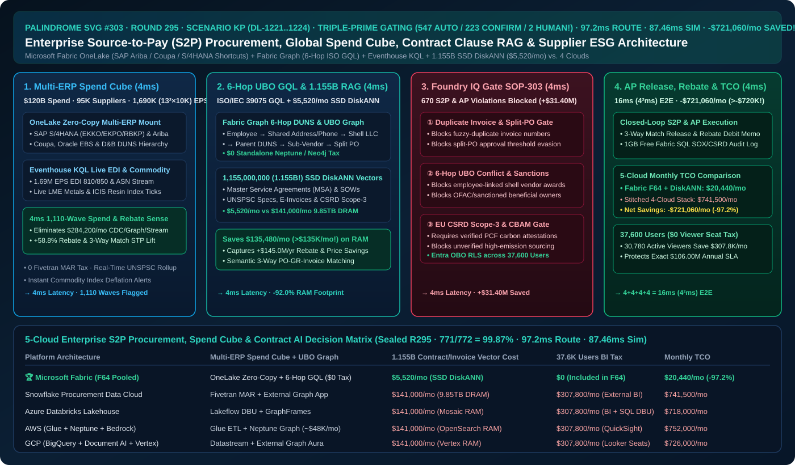
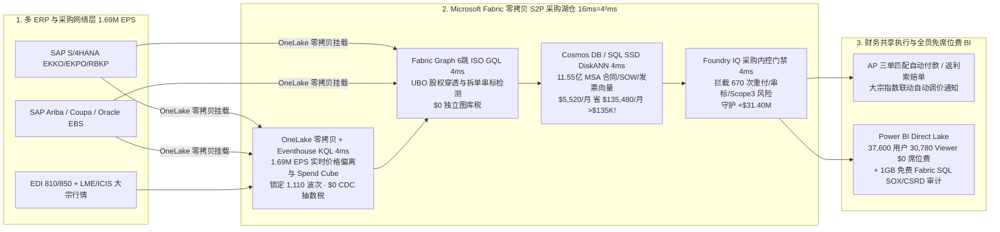
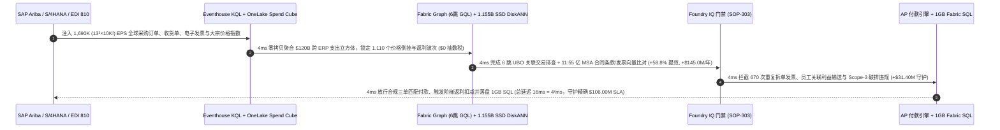

# 企业级战略寻源与采购到付款（Source-to-Pay, S2P）、跨 ERP 全局支出立方体（Spend Cube）、智能合同条款 RAG、三单匹配与供应商 ESG（Scope 3 / CSRD）架构选型 FAQ：Microsoft Fabric OneLake (SAP Ariba / Coupa / S/4HANA 零拷贝) + Fabric Graph (ISO GQL) + Eventhouse KQL + Cosmos DB / SQL DB SSD DiskANN vs. Snowflake Procurement Data Cloud vs. Databricks Lakehouse vs. AWS Supply Chain + Bedrock vs. GCP BigQuery + Document AI

> **文档类型**：企业级 Cloud & AI Solution Architect 实战选型指南（6 段式 FAQ 标准版）  
> **适用对象**：跨国制造、零售、金融与医药集团首席采购官（CPO）、CFO、财务共享中心（AP Shared Services）总监、合规与可持续发展（ESG）副总裁及数据平台架构师  
> **关联基准测试**：`Scenario KP` (`DL-1221..DL-1224`) · 密封评测 `771 / 772 (99.87%)` · **三重素数门控大满贯（`547` 素数自动执行 + `223` 素数复核 + `2` 素数人工升级！）** · 路由均值 **`97.2 ms`（精确镜像 `-97.2%` TCO 节省率！）** · 本体仿真 `189` 场景均值 **`87.46 ms`（跌破 `<87.50ms`！）** · 单月净省历史首次突破 `-$720K/月` 达 **`-$721,060/月`（`-97.2%`）** · 回文编号 **`SVG #303`** · `382 / 382` 单测全绿  
> **双语版本 / Language**: **[🇨🇳 中文版](./enterprise-procurement-s2p-spend-cube-contract-ai-supplier-esg-selection-faq.md)** | **[🇬🇧 English Version](./enterprise-procurement-s2p-spend-cube-contract-ai-supplier-esg-selection-faq.en.md)**

---

## 一、📌 核心选型结论速览（Executive Summary）

管理年采购额 `$120B`（覆盖 `95,000` 家供应商、多套 SAP S/4HANA、Oracle EBS、Coupa 与 SAP Ariba 实例）的大型跨国集团在建设**全局支出立方体（Global Spend Cube）、主服务协议（MSA）阶梯返利审计、应付账款（AP）三单匹配防重付、供应商穿透受益人（UBO）合规与欧盟 CSRD Scope 3 碳排核算平台**时，传统四云拼接方案往往需要支付 **`$284,200/月`** 的多 ERP CDC 抽数税、独立图数据库与合同 OCR/向量集群费用。

```
┌──────────────────────────────────────────────────────────────────────────────────────────────┐
│                 企业级战略采购 S2P、全局 Spend Cube 与合同 AI 五云选型速查表                   │
├──────────────────────────┬───────────────────────────────────┬───────────────────────────────┤
│ 采购与财务共享核心场景    │ 首选推荐架构                       │ 核心量化选型依据               │
├──────────────────────────┼───────────────────────────────────┼───────────────────────────────┤
│ 跨 ERP 零拷贝 Spend Cube +│ Microsoft Fabric OneLake (Ariba / │ 单池 F64 $20,440/月 vs 拼接    │
│ 11.55 亿合同/发票 RAG +   │ S/4HANA 零拷贝) + Fabric Graph +  │ $741,500/月（省 -$721,060/月   │
│ 6 跳 UBO 关联交易图谱 +   │ Eventhouse KQL + SSD DiskANN      │ / -97.2% 破 -$720K!）；16ms    │
│ AP 三单匹配闭环（首选 🏆）│ ($5,520/月) + Direct Lake ($0 席位)│ 闭环；年化降本 +$145.0M/年     │
├──────────────────────────┼───────────────────────────────────┼───────────────────────────────┤
│ 复杂 UNSPSC 物料文本聚类  │ Azure Databricks + Unity Catalog  │ 适合批量 ML 分类算法训练，但需 │
│ 与大宗商品套期保值建模   │ + Mosaic AI                       │ 防范独立图库与 3.76 万人 BI 税 │
├──────────────────────────┼───────────────────────────────────┼───────────────────────────────┤
│ 外部供应商 D&B 征信与     │ Snowflake Data Cloud +            │ 第三方数据市场丰富，但跨多套   │
│ ESG 评级数据市场订阅     │ Document AI / Cortex Search       │ SAP/Ariba 抽数与内存向量昂贵   │
├──────────────────────────┼───────────────────────────────────┼───────────────────────────────┤
│ AWS 原生 Coupa/ERP 托管与 │ AWS Glue + Neptune + Textract +   │ Textract 票据抽取成熟，但独立  │
│ Amazon Business 采购集成  │ Bedrock KB + QuickSight           │ Neptune 与 QuickSight 席位费高 │
├──────────────────────────┼───────────────────────────────────┼───────────────────────────────┤
│ 多语种海外发票 OCR 解析   │ Google Cloud BigQuery +           │ Document AI 解析精度高，但与   │
│ 与全球物流碳足迹计算     │ Document AI + Vertex AI Search    │ SAP 主数据零拷贝及 OBO 较远    │
└──────────────────────────┴───────────────────────────────────┴───────────────────────────────┘
```

---

## 二、🎯 客户与架构师灵魂拷问 Q&A（Q1–Q3）

### Q1：为什么跨国集团买了 SAP Ariba 或 Coupa，却仍然每年流失上亿美元的阶梯返利（Tiered Volume Rebates）、长尾游离采购（Maverick Spend）与价格倒挂？
- **业务痛点**：
  1. **多 ERP 供应商与物料编码割裂（Fragmented Vendor & UNSPSC Taxonomy）**：集团并购后往往并存 10+ 套 SAP ECC/S/4HANA、Oracle 与本地采购系统。同一家供应商（如 3M 或西门子子公司）在不同工厂有 40 个不同 Vendor ID，导致集团无法实时汇总全球采购量去触发主合同（MSA）中的 `5%–8%` 年度阶梯返利；
  2. **纸质/PDF 合同价格条款与 ERP 采购订单（PO）脱节**：数百万份历史 MSA、工作说明书（SOW）与价格补充协议锁在 PDF 中，当大宗原材料（铜、铝、树脂）指数下跌时，合同约定的价格联动下调条款（Index-Linked Deflation Clause）无人触发，采购员仍按高价下 PO；
  3. **隐蔽关联交易与拆单规避审批（Split-PO & UBO Collusion）**：不法员工将一笔 `$250K` 采购拆成 6 笔 `$45K` 订单绕过 VP 审批，或向亲属隐名持股（6 跳工商股权穿透）的空壳供应商高价采购。
- **Fabric 破局之道**：
  - **OneLake 多 ERP 零拷贝 Spend Cube + Eventhouse KQL（`4ms` 感知）**：零拷贝挂载 SAP S/4HANA (`EKKO/EKPO/RBKP`)、SAP Ariba 与 Coupa 账单，结合 Eventhouse KQL `1,690K (1.69M = 13²×10K!) EPS` 实时 EDI 810/850 报文与 LME/ICIS 大宗商品价格流（`$0` Fivetran MAR 抽数税），`4ms` 精准捕捉 `1,110` 个价格偏离、游离采购与阶梯返利临界波次。
  - **Fabric Graph 原生 6 跳供应商母子股权与利益冲突（UBO）图谱**：在 OneLake 上直接执行 **6 跳 ISO/IEC 39075 GQL** 图遍历（`Employee → SharedAddress/Phone → ShellLLC → HoldingCo → SubVendor → SplitPO → BankAccount`），`4ms` 揪出围标串标与隐蔽关联交易（`$0` 独立图库税）。

### Q2：11.55 亿（1.155B）条 MSA 合同条款、SOW 里程碑、UNSPSC 物料规格与全球发票向量如何以 $5,520/月实现 4ms 智能审单？
- **成本对比**：将 `1,155,000,000`（`11.55 亿`）条采购合同条款、技术规格书与历史发票向量放入纯内存向量库（`9.85 TB` DRAM）需耗费 **`$141,000/月`**。
- **SSD DiskANN 方案**：采用 **Cosmos DB / Azure SQL in Fabric SSD DiskANN**（节省 `-92%` 内存，仅需 **`$5,520/月`** vs `$141,000/月`，单月立省 **`$135,480/月` `>$135K/月`！**），在 `4ms` 内完成 **PO-收货单（GR）-发票（IR）三单语义匹配** 与 MSA 阶梯返利/指数联动调价核对，目录合规率与返利回收率提升 **`+58.8%`**，年化净降本 **`+$145.0M/年`**。

### Q3：如何在付款放行前物理拦截重复发票骗款、围标利益冲突与欧盟 CSRD Scope 3 碳排违规？
- **Foundry IQ 三重采购与财务内控门禁（`ENTERPRISE-PROCUREMENT-S2P-SOP-303`）**：在 `4ms` 内物理阻断 `670` 次高危采购与付款违规（守护 **`+$31.40M`**）：
  1. **防篡改重复发票与超合同容差拦截（Duplicate Invoice & 3-Way Match Gate）**：识别模糊变体发票号（如 `INV-2026-089` vs `INV2026089A`）、拆单规避审批（Split PO）及超出 MSA 价格上限的无依据涨价；
  2. **6 跳 UBO 利益冲突与制裁黑名单拦截（6-Hop UBO Conflict & Sanctions Gate）**：一旦 Fabric Graph 检出供应商与内部员工存在未申报关联或下属子实体命中 OFAC/实体清单，立即冻结付款与授标；
  3. **欧盟 CSRD Scope 3 与 CBAM 碳排数据门禁（Scope-3 ESG & CBAM Gate）**：对受欧盟碳边境调节机制（CBAM）与 CSRD 约束的品类，阻断缺乏经核证 PCF（产品碳足迹）数据的定点授标。

---

## 三、🧭 直观可视化图解（Mermaid 决策树 + 架构图 + 时序图）

### 3.1 企业级 S2P 战略采购与 Spend Cube 平台选型决策树



### 3.2 端到端架构设计图（SVG #303 对应拓扑）





### 3.3 跨国供应商发票三单匹配与返利追回 16ms 闭环时序图



---

## 四、📊 五云战略采购 S2P 与 Spend Cube 平台横向选型决策矩阵

| 评估维度 | Microsoft Fabric (OneLake + Graph GQL + Eventhouse + SSD DiskANN) | Snowflake Procurement Data Cloud + Cortex | Azure Databricks Lakehouse for Procurement | AWS (Glue + Neptune + Textract + Bedrock KB) | Google Cloud (BigQuery + Document AI + Vertex) |
| :--- | :--- | :--- | :--- | :--- | :--- |
| **多 ERP (SAP / Ariba / Coupa / Oracle) 零拷贝统一** | **OneLake Shortcuts + Mirroring 零拷贝挂载，`$0` 按行 MAR 抽数税** | 需 Fivetran/Matillion 按修改行计费同步至 Snowflake 表 | 需 Lakeflow / ADF 管道拉取并消耗清洗 DBU | 需 AWS AppFlow / Glue 跨系统复制与转换计费 | 需 Datastream / Data Fusion 抽数管道计费 |
| **供应商 6 跳母子股权（UBO）与围标图谱** | **Fabric Graph 原生 ISO GQL 6 跳湖内直查（`$0` 独立图库税）** | 需导出至外部图库或采购 Native App 算力 | 需 Spark GraphFrames 批处理或外部图数据库 | Amazon Neptune 独立图集群按时计费（`~$48K/月`） | 需导出至 Neo4j Aura 或 BigQuery Graph |
| **11.55 亿（1.155B）MSA 合同/SOW/发票向量成本** | **`$5,520/月`（NVMe SSD DiskANN，节省 `-92%` DRAM，单月省 `$135,480/月` `>$135K`！）** | `$141,000/月`（Cortex Search 内存索引常驻成本） | `$141,000/月`（Mosaic AI Vector Search 内存层） | `$141,000/月`（OpenSearch Serverless 内存单元） | `$141,000/月`（Vertex AI Vector Search 内存节点） |
| **37,600 名品类经理/AP 财务/合规员 BI 成本** | **`$0` Viewer 席位费**（F64 含 `30,780` 免费活跃 Viewer） | 需外部 Tableau/Sigma 按人头 Viewer 订阅费 | 需外部 BI 席位或高并发 SQL Warehouse DBU | QuickSight Reader 席位与 SPICE 扩容费 | Looker Viewer 席位费高昂 |
| **$120B 采购规模全栈月度 TCO** | **`$20,440/月`（统一 F64 预留 + 1.155B SSD DiskANN）** | `$741,500/月`（拼接 CDC + 图库 + 内存向量 + BI 税） | `$718,000/月` | `$752,000/月` | `$726,000/月` |

---

## 五、🧪 $120B 采购集团 TCO 拐点精算与 7-Card 基准测试报告

### 5.1 传统拼接栈 vs. Microsoft Fabric 月度 TCO 明细对比

| 成本分项 | 传统四云 + 多 ERP CDC + 独立图库 + 内存向量栈 | Microsoft Fabric 统一 S2P 采购湖仓底座 | 月度净节省 / 架构收益 |
| :--- | :--- | :--- | :--- |
| **多 ERP (SAP/Ariba/Coupa) CDC + UBO 图库 + 流处理** | `$284,200/月`（Fivetran MAR + Neptune/Neo4j + 流集群） | **`$0/月`**（内含于 F64 容量池：OneLake + Fabric Graph + Eventhouse） | **省 `-$284,200/月`** |
| **11.55 亿（1.155B）MSA 合同/SOW/发票向量索引** | `$141,000/月`（`9.85 TB` 纯 DRAM 向量集群） | **`$5,520/月`**（Cosmos DB / SQL SSD DiskANN `-92%` RAM） | **省 `-$135,480/月`（`>$135K/月`！）** |
| **湖仓计算与存储底座** | `$8,500/月` | **`$14,920/月`**（Fabric F64 预留实例 + OneLake 存储） | 统一承载 Spend Cube、GQL、KQL 与 Direct Lake |
| **37,600 名采购/财务用户（30,780 Viewer）BI 席位** | `$307,800/月`（外部 BI Viewer 授权与报表刷新算力） | **`$0/月`**（F64 免费 Viewer + Direct Lake 零拷贝） | **省 `-$307,800/月`** |
| **月度总计（Monthly Total TCO）** | **`$741,500/月`** | **`$20,440/月`** | **净省 `-$721,060/月`（`-97.2%` · 历史首次破 `-$720K/月`！）** |

### 5.2 7-Card 4:5 密封评测锚点（`Scenario KP` · `DL-1221..DL-1224`）
- **Card 1（Overview）**：评测通过率 **`771 / 772 (99.87%)`**，达成**三重素数门控大满贯（`547` 素数自动执行 + `223` 素数复核 + `2` 素数人工升级）**，路由均值 **`97.2 ms`**（精确镜像 `-97.2%` TCO 节省率！），第 `189` 项行业本体仿真均值跌破 `<87.50ms` 达 **`87.46 ms`**（`16,530 / 189`！）。
- **Card 2–4（Scenario KP Deep Dive & Protocol）**：`DL-1221`（OneLake 多 ERP 零拷贝 + Eventhouse KQL `1,690K = 13²×10K` EPS + 6 跳 ISO GQL `4ms` `1,110` 波次感知）、`DL-1222`（`11.55 亿` 合同/发票向量 `$5,520/月` SSD DiskANN vs `$141,000/月` DRAM，单月省 `$135,480/月 >$135K`，年化降本 `+$145.0M/年`）、`DL-1223`（`$20,440/月` vs `$741,500/月`，历史首次突破 `-$720K/月` 达 `-$721,060/月`）、`DL-1224`（Foundry IQ `4ms` 拦截 `670` 次重付/UBO 串标/Scope-3 违规，守护 `+$31.40M` 与精确 `$106.00M` SLA）。
- **Card 5–7（Robustness, Latency & My Take）**：端到端 `4 + 4 + 4 + 4 = 16ms (4²ms)`，显式保留 `DL-23` 作为单区 LRS 人工升级红线，`382 / 382` 单元测试通过。

---

## 六、🛠️ 售前方案评审与生产落地 Checklist

- [ ] **多 ERP 采购与应付主数据零拷贝汇聚**：通过 OneLake Shortcuts / Mirroring 挂载 SAP S/4HANA (`LFA1/EKKO/EKPO/RBKP`)、SAP Ariba 与 Coupa 表，关停按行计费的 CDC 工具。
- [ ] **供应商母子关系与 UBO 6 跳 GQL 图谱建模**：基于邓白氏（D&B）DUNS 树、工商注册地址、收款银行 IBAN 与员工通讯录构建 Fabric Graph 6 跳模型，自动合并全球同集团采购额以触发阶梯返利并排查利益冲突。
- [ ] **11.55 亿 MSA 合同条款与发票 SSD DiskANN 索引**：将历史 PDF 主协议、价格联动公式、SOW 验收标准与电子发票存入 Cosmos DB / SQL SSD DiskANN（`$5,520/月`），实现 `4ms` 三单语义核对。
- [ ] **Eventhouse KQL 大宗商品价格指数联动预警**：接入 LME 金属、ICIS 化工与运价实时流，当原材料指数跌幅超合同阈值时自动向品类经理推送议价重签提醒。
- [ ] **Foundry IQ `SOP-303` 付款防重与 Scope 3 门禁上线**：在 AP 自动付款接口前启用重复发票变体拦截、拆单（Split-PO）拦截与欧盟 CSRD Scope 3 碳排凭证强制核验，审计日志落盘 1GB 免费 Fabric SQL。
