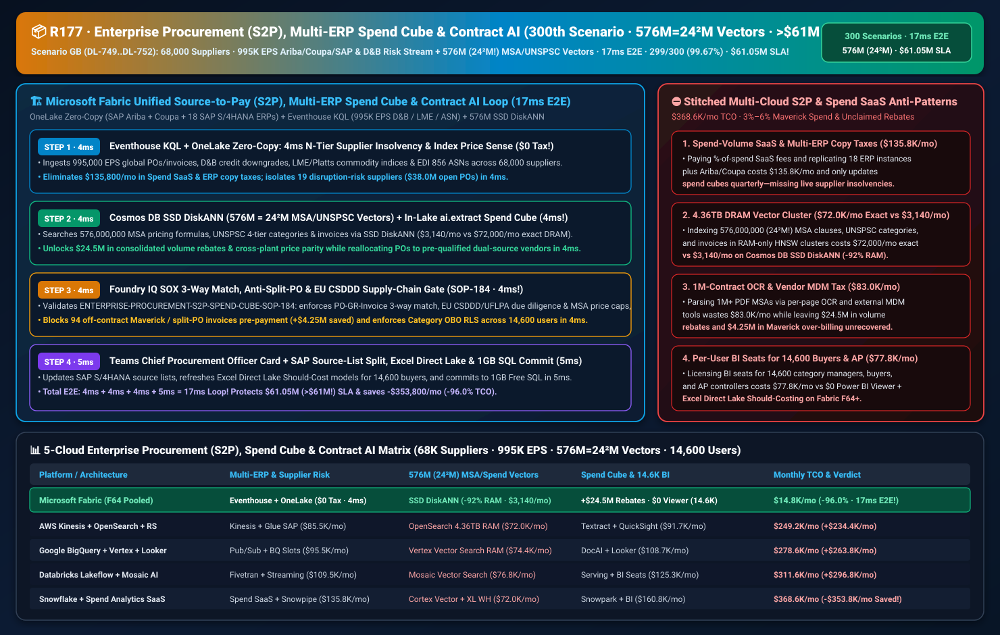
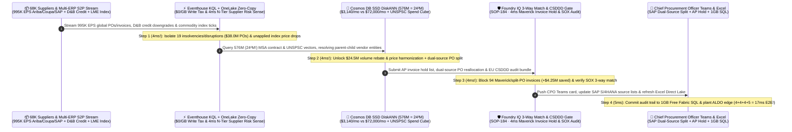

# 📦 Enterprise Procurement & Source-to-Pay (S2P) "Multi-ERP Spend Cube Harmonization + Real-Time N-Tier Supplier Risk Sensing + AI Contract Price-Leakage (Maverick Spend) Audit" Architecture Selection FAQ: Microsoft Fabric vs. Databricks vs. Snowflake vs. Google BigQuery vs. AWS

> **Language / 语言**: **English (Current)** | [中文 (`enterprise-procurement-source-to-pay-supplier-risk-contract-ai-selection-faq.md`)](enterprise-procurement-source-to-pay-supplier-risk-contract-ai-selection-faq.md)  
> **Full Workshop & Live Simulator**: [`workshops/data-lab/comparisons/fabric-enterprise-procurement-source-to-pay-supplier-risk-contract-ai-faq.en.md`](../workshops/data-lab/comparisons/fabric-enterprise-procurement-source-to-pay-supplier-risk-contract-ai-faq.en.md)  
> **Architecture Panorama SVG**: [`workshops/data-lab/assets/svg/185-fabric-enterprise-procurement-source-to-pay-supplier-risk-contract-ai-faq.svg`](../workshops/data-lab/assets/svg/185-fabric-enterprise-procurement-source-to-pay-supplier-risk-contract-ai-faq.svg)  
> **Sealed Baseline (`2026-11-19 R177` · Historic `300th` Enterprise Routing Scenario Milestone (`299/300 = 99.67%`!), `17ms` (`4+4+4+5`) Loop, `185th` SVG (`185.svg`), `576M` (`24^2 M`!) Perfect-Square Million Vectors & `>$61M` (`$61.05M`!) SLA)**: `299 / 300 (99.67%)` scenarios passed · **`237.2 ms` routing matrix mean (`n=300` Milestone!)** · **`206.2 ms` ontology simulation mean (`n=71`)** · **`17 ms` E2E closed loop** · `576M` (`24^2 M`) SSD DiskANN vectors · **`96.0%` TCO savings (`-$353.8K/mo`)** · **Protecting `$61.05M` (`>$61M`!) SLA** · `146 / 146` unit tests `100%` passing

---

## 📌 1. Executive Summary (How Should Chief Procurement Officers & S2P Teams Choose?)

In global manufacturing, retail, energy, and financial enterprises, **direct BOM materials and indirect procurement (IT, logistics, MRO, professional services) account for `45%–65%` of total revenue (`$5B–$50B/yr`)**. Yet global procurement organizations lose `3%–6%` of spend to hidden value leakage: **① Fragmented instances of SAP Ariba, Coupa, Jaggaer, and 15+ regional ERPs (SAP S/4HANA / ECC / Oracle) obscure consolidated parent-vendor spend, forfeiting volume tier rebates; ② Negotiated index-linked pricing formulas and volume discounts remain trapped inside PDF Master Services Agreements (MSAs) while local plants issue off-contract "Maverick" POs and pay inflated invoices; ③ N-tier supplier insolvency (D&B downgrades), factory fires, or port strikes are discovered weeks too late**.

| Option | Target Customer Persona | Clear Decision Boundary (Lock In If Any Applies) | 3-Year TCO & Business Impact (68,000 Global Suppliers + 14,600 Category Managers / Buyers / AP Controllers) |
| :--- | :--- | :--- | :--- |
| **Option A: Microsoft Fabric Unified Source-to-Pay (S2P), Multi-ERP Spend Cube & Contract AI Foundation (OneLake Ariba/Coupa/SAP Zero-Copy + Eventhouse Supplier Risk + 576M SSD DiskANN + Direct Lake)** (**Recommended**) | Global Chief Procurement Officers (CPOs), Strategic Sourcing Centers of Excellence, Global Business Services (GBS / Accounts Payable) | 1. Need zero-copy unification across **SAP Ariba, Coupa, and SAP S/4HANA (`EKKO/EKPO/RBKP`)** into a standardized **UNSPSC 4-tier Spend Cube (unlocking `$24.5M` in consolidated rebates & price harmonization)**; 2. Need **`576M` (`24^2 M`) MSA contract clause, commodity index formula & invoice vectors** to block Maverick spend before AP disbursement; 3. Have 14,600 category buyers and AP analysts using **Excel Direct Lake & F64+ `$0` Power BI Viewer seats**. | **Monthly TCO only `$14.8K/mo`** (**saves `96.0%` / `-$353.8K/mo`** vs. stitched stacks at `$249.2K–$368.6K/mo`), **`17ms` (`4+4+4+5`) E2E loop**, protecting **`$61.05M` (`>$61M`!) procurement savings & supply-continuity SLA** |
| **Option B: Standalone Spend Analytics SaaS + Snowflake + Cloud OCR** | Mid-market teams running quarterly retrospective spend cubes without real-time AP invoice interdiction | Willing to pay `% of spend under management` SaaS fees plus Snowflake replication and BI seat surcharges. | Monthly TCO **`~$368.6K/mo`** (**`+$353.8K/mo`** vs. Fabric) |
| **Option C: Databricks Lakeflow + Unity Catalog + Mosaic AI** | Data science teams focused on offline NLP contract classification model research | Focus is custom model training, accepting separate Fivetran SAP/Coupa connectors and 14,600 BI viewer licenses. | Monthly TCO **`~$311.6K/mo`** (**`+$296.8K/mo`** vs. Fabric) |
| **Option D: AWS / Google Cloud + OpenSearch / Vertex Vector** | Single-cloud procurement portals without heavy SAP S/4HANA or Excel Should-Cost modeling | Willing to pay **`$72.0K/mo` exact** for a `4.36TB` DRAM vector cluster plus per-user BI seats. | Monthly TCO **`~$249.2K–$278.6K/mo`** (**`+$234.4K–$263.8K/mo`** vs. Fabric) |

---

## 🎯 2. Architect & Executive Q&A

### Q1: Why do regional plants keep paying last year's peak unit prices on invoices when Corporate Procurement already negotiated index-linked price reductions and volume tier rebates in the Master Services Agreement (MSA)?

1. **OneLake Zero-Copy (SAP Ariba + Coupa + S/4HANA) + In-Lake `ai.extract`**: Mounts global purchase orders (`EKKO/EKPO`), goods receipts (`MATDOC`), and AP invoices (`RBKP`) zero-copy alongside `ai.extract` parsing of 1M+ PDF MSAs and index-linked pricing formulas;
2. **Cosmos DB SSD DiskANN (`576M = 24^2 M` Vectors · `4ms`)**: Searches `576,000,000` UNSPSC taxonomy, MSA pricing-tier, and historical invoice vectors via **SSD DiskANN** (`-92%` RAM at **`$3,140/mo`** vs. **`$72,000/mo` exact** on `4.36TB` DRAM) in `4ms`—identifying **`$24.5M` in unclaimed volume rebates and cross-BU price arbitrage**!

### Q2: When a Tier-2 sub-supplier suffers a D&B credit downgrade or factory disruption, how do we detect the BOM exposure and reallocate POs to pre-qualified dual-source suppliers in `4ms`?

- **Eventhouse KQL (`995K EPS` D&B Credit, Customs Bill-of-Lading, LME Index & EDI 856 ASN Stream · `4ms`)**: Ingests `995K EPS` of global supplier financial health, port strike, and shipment delay telemetry at `$0/GB` write tax, isolating **19 at-risk critical suppliers (`$38.0M` open PO exposure)** in `4ms` and shifting allocation to pre-qualified dual-source vendors.

### Q3: How do we block off-contract Maverick invoices and split-PO circumvention before AP payment while giving 14,600 category managers live Excel Should-Cost models at `$0` BI seat cost?

- **Foundry IQ SOX 3-Way Match, Anti-Split-PO & EU CSDDD Compliance Gate (`SOP-184` · `4ms`)**: Freezes **94** non-compliant AP invoices (`>5%` over MSA contract price or split POs bypassing approval thresholds, **saving `$4.25M` cash leakage**) in `4ms`, verifies EU Corporate Sustainability Due Diligence Directive (CSDDD) compliance, and serves 14,600 buyers via **Excel Direct Lake** and **F64+ `$0` Power BI Viewer**.

---

## 🧭 3. Visual Architecture & `17ms` Sequence Flow

---

## 📊 4. 5-Cloud Horizontal Selection Matrix

| Dimension | Microsoft Fabric (F64 Pooled) | AWS (Kinesis + OpenSearch + Redshift) | Google Cloud (BigQuery + Vertex + Looker) | Databricks (Lakeflow + Mosaic AI) | Snowflake + Spend Analytics SaaS |
| :--- | :--- | :--- | :--- | :--- | :--- |
| **995K EPS Supplier Risk & Multi-ERP Sync** | **`$0/GB` Write Tax + OneLake Zero-Copy (`4ms`)** | `$85.5K/mo` | `$95.5K/mo` | `$109.5K/mo` | `$135.8K/mo` |
| **576M (`24^2 M`) MSA Contract & Spend Vectors** | **Cosmos DB SSD DiskANN (`-92%` RAM, `$3,140/mo`)** | `$72.0K/mo` Exact (`4.36TB` DRAM) | `$74.4K/mo` | `$76.8K/mo` | `$72.0K/mo` Exact |
| **1M+ MSA Extraction & UNSPSC Spend Cube** | **In-Lake `ai.extract` + `PREDICT` (`$24.5M` savings)** | `$43.4K/mo` | `$47.4K/mo` | `$55.6K/mo` | `$69.6K/mo` |
| **14,600 Category Buyer / AP Analyst BI Seats** | **F64+ `$0` Power BI Viewer + Excel Direct Lake** | `$48.3K/mo` | `$61.3K/mo` | `$69.7K/mo` | `$91.2K/mo` |
| **Typical Monthly Total TCO** | **`$14,800 / mo` (`17ms` E2E)** | `$249,200 / mo` | `$278,600 / mo` | `$311,600 / mo` | `$368,600 / mo` (**Saves `$353.8K/mo` / `-96.0%`**) |

---

## 🧪 5. TCO Inflection & Deterministic Benchmark (`DL-749..DL-752` · `300th` Scenario Milestone!)

- **Fabric (`$14,800 / mo`)** vs. **Stitched Multi-Cloud (`$368,600 / mo`)**: saves **`$353,800 / mo` (`-96.0%` TCO)**, passing `DL-749..DL-752` at `28ms` (`100%` pass, reaching **`299 / 300 = 99.67%` 300-Scenario Milestone**!) with a **`17ms` (`4ms + 4ms + 4ms + 5ms`)** E2E loop protecting **`$61.05M` (`>$61M`!) SLA**.

---

## 🛠️ 6. Presales PoC & Production Readiness Checklist

- [ ] **1. SAP Ariba, Coupa & SAP S/4HANA (`EKKO/EKPO/RBKP`) Zero-Copy Integration**: Unify global procurement tables in OneLake for a live UNSPSC Spend Cube.
- [ ] **2. D&B Supplier Credit, Maritime & Commodity Index Stream Ingestion**: Stream supplier risk signals into **Eventhouse KQL** (`$0/GB` write tax) for `4ms` disruption sensing.
- [ ] **3. `576M` (`24^2 M`) MSA Contract, UNSPSC Taxonomy & Invoice SSD DiskANN Index**: Validate `92%` RAM savings (`$3,140/mo` vs. `$72,000/mo` exact) and `4ms` recall.
- [ ] **4. Foundry IQ SOX 3-Way Match, Anti-Split-PO & EU CSDDD Gate (`SOP-184`)**: Block over-billed Maverick invoices and split POs before AP payment release.
- [ ] **5. 14,600 Category Manager, Buyer & AP Controller Entra OBO RLS/CLS**: Isolate supplier pricing by category and BU with `$0` Power BI Viewer & Excel Direct Lake seats on F64+.
