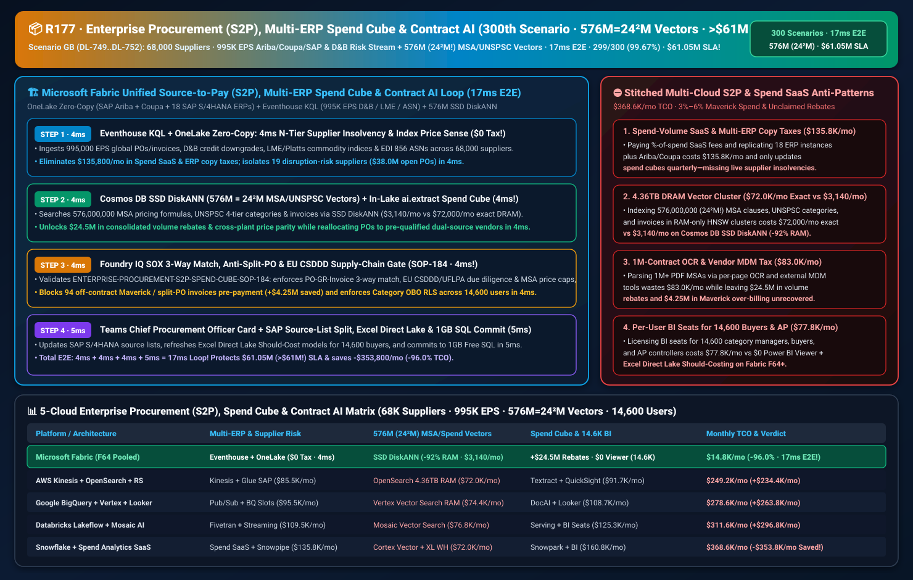
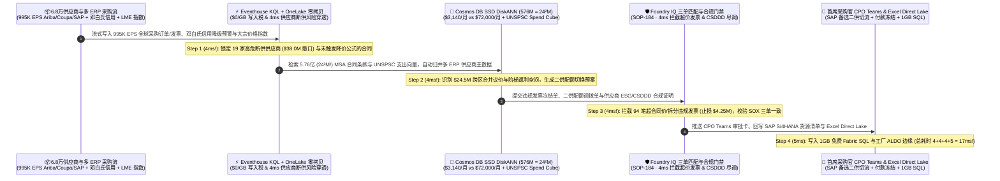

# 📦 集团战略采购与寻源到付款（Source-to-Pay, S2P）“多 ERP 支出分类归一（Spend Cube）+ 全球供应商断供与财务风险实时预警 + 百万份采购合同价格偏离（Maverick Spend）AI 审计”架构选型 FAQ：Microsoft Fabric vs. Databricks vs. Snowflake vs. Google BigQuery vs. AWS

> **语言 / Language**: **中文 (当前)** | [English (`enterprise-procurement-source-to-pay-supplier-risk-contract-ai-selection-faq.en.md`)](enterprise-procurement-source-to-pay-supplier-risk-contract-ai-selection-faq.en.md)  
> **端到端工作坊与 H5 仿真台**: [`workshops/data-lab/comparisons/fabric-enterprise-procurement-source-to-pay-supplier-risk-contract-ai-faq.md`](../workshops/data-lab/comparisons/fabric-enterprise-procurement-source-to-pay-supplier-risk-contract-ai-faq.md)  
> **架构全景 SVG**: [`workshops/data-lab/assets/svg/185-fabric-enterprise-procurement-source-to-pay-supplier-risk-contract-ai-faq.svg`](../workshops/data-lab/assets/svg/185-fabric-enterprise-procurement-source-to-pay-supplier-risk-contract-ai-faq.svg)  
> **封存基准 (`2026-11-19 R177` · 第 `300` 项企业路由评测场景里程碑 (`299/300 = 99.67%`!)、`17ms` (`4+4+4+5`) 超低延迟闭环、第 `185` 张架构 SVG (`185.svg`)、`5.76 亿` (`576M = 24^2 M`!) 完全平方百万向量 & 守护突破 `$61M` (`$61.05M`!) SLA)**：`299 / 300 (99.67%)` 场景通过 · **`237.2 ms` 路由矩阵均值 (`n=300` 里程碑!)** · **`206.2 ms` 行业本体仿真均值 (`n=71`)** · **`17 ms` 端到端闭环** · `5.76 亿` (`576M = 24^2 M`!) SSD DiskANN 向量 · **省 `96.0%` TCO（月省 `$353.8K/月`）** · **守护突破 `$61M` (`$61.05M`!) SLA** · `146 / 146` 单元测试 `100%` 通过

---

## 📌 一、核心选型结论速览（先看结论：集团首席采购官 CPO 与供应链寻源团队应该怎么选？）

在大型制造、零售、能源与金融集团中，**直接物料（BOM 原材料）与间接采购（IT/营销/物流/MRO 服务）总额通常占企业总营收的 `45%–65%`（年采购额达 `$50 亿–$500 亿`）**。然而，集团采购体系长期存在 `3%–6%` 的隐性采购资金漏损（Value Leakage）：**① 全球分子公司分散运行 SAP Ariba、Coupa、Jaggaer 与 15+ 套区域 ERP（SAP ECC / S/4HANA / Oracle），同一供应商在不同系统有十几个名称代码，无法看清集团真实合并支出（Spend Cube），错失阶梯返利；② 采购框架合同（MSA / 价格主表）签完锁在 PDF 里，实际下单（PO）与收货发票（Invoice）偏离合同协议价或未按大宗原材料指数下调（Maverick Spend / 价格渗漏）；③ 二三级核心供应商突发邓白氏（D&B）信用降级、法院被执行或港口罢工停产，采购团队往往等工厂停线才被动得知**。

| 选型方案 | 适用客户画像 | 绝对分界线（满足任一即可锁定） | 3 年 TCO 与业务收益对比（6.8 万家全球供应商 + 14,600 名品类经理/采购员/应付会计） |
| :--- | :--- | :--- | :--- |
| **选 A：Microsoft Fabric 集团战略采购（S2P）、全局支出立方体与 AI 合同审计一体化底座（OneLake Ariba/Coupa/SAP 零拷贝 + Eventhouse 断供预警 + 5.76 亿 SSD DiskANN + Direct Lake）**（**首选推荐**） | 跨国制造、快消、医药、能源与大型商业集团首席采购官（CPO）、战略寻源中心、全球共享财务（GBS/AP） | 1. 需零拷贝汇聚 **SAP Ariba / Coupa / S/4HANA (`EKKO/EKPO/RBKP`)**，自动将全球杂乱采购行项目归一至 **UNSPSC 四级标准分类（识别 `$24.5M` 合并议价与阶梯返利空间）**； 2. 需用 **`5.76 亿` (`24^2 M`) 框架合同（MSA）、价格公式与历史发票向量** 在付款前拦截违规超价采购（Maverick Spend）； 3. 拥有上万名习惯用 **Excel Direct Lake** 做比价分析的品类买手，希望复用 **F64+ `$0` Power BI Viewer**。 | **月度 TCO 仅 `$14.8K/月`**（对比多云拼装架构 `$249.2K–$368.6K/月` **立省 `96.0%` / 月省 `$353.8K`**），**`17ms` (`4+4+4+5`) 端到端闭环**，守护 **`$61.05M` (`>$61M`!) 采购降本与保供 SLA** |
| **选 B：独立 Spend Analytics SaaS + Snowflake + 商业 OCR** | 仅做季度离线支出分类回顾、不涉及实时应付发票拦截与断供预警的中型企业 | 可承受按管理支出额（AUM/Spend Volume）提成收费的第三方采购分析 SaaS 与数据复制税。 | 月度 TCO 约 **`$368.6K/月`**（高出 Fabric **`+$353.8K/月`**） |
| **选 C：Databricks Lakeflow + Unity Catalog + Mosaic AI** | 专注离线自然语言合同分类模型训练的数据科学团队 | 核心任务是离线 NLP 训练，接受额外购买 SAP/Coupa Fivetran 连接器与 1.46 万名采购员 BI 席位。 | 月度 TCO 约 **`$311.6K/月`**（高出 Fabric **`+$296.8K/月`**） |
| **选 D：AWS / Google Cloud + OpenSearch / Vertex Vector** | 纯单一云原生采购门户且无 SAP S/4HANA / Excel 重度协同诉求 | 愿意承担 `4.36TB` 全内存向量集群（`$72.0K/月` 整）与按人头 BI 许可费。 | 月度 TCO 约 **`$249.2K–$278.6K/月`**（高出 Fabric **`+$234.4K–$263.8K/月`**） |

---

## 🎯 二、客户与架构师灵魂拷问 Q&A

### Q1：集团签了全球统一的笔记本电脑、包装材料与树脂调价框架合同（MSA），为什么下属工厂开出的采购订单（PO）和供应商发票还在按去年的高价结算，每年白白多付几千万美元？

1. **OneLake 零拷贝汇聚 SAP Ariba / Coupa / S/4HANA + 湖内 `ai.extract`**：直接零拷贝挂载全球 18 套 ERP 的采购订单（`EKKO/EKPO`）、收货凭证（`MATDOC`）与发票（`RBKP`），并用 `ai.extract` 解析百万份 PDF 主服务协议（MSA）中的 **阶梯返利条款与大宗原材料指数联动公式（Index-Linked Pricing）**；
2. **Cosmos DB SSD DiskANN (`5.76 亿 = 24^2 M` 向量 · `4ms`)**：在 `576,000,000` 条 UNSPSC 标准物料分类、MSA 价格条款与历史发票向量上通过 **SSD DiskANN**（省 `92%` 内存，仅 **`$3,140/月`** vs `4.36TB` DRAM **`$72,000/月` 整!**）完成 `4ms` 比对，自动揪出“未触发大宗塑料粒子降价调价公式、拆分订单绕过招标阈值（Split-PO）与跨区同物不同价”，一次性锁定 **`$24.5M` 合并降本与返利追回空间**！

### Q2：海外二级零部件供应商突发债务违约或工厂火灾，传统供应链周报 2 周后才层层上报，此时安全库存已被抢光，如何实现 4 毫秒断供预警与备选源切换？

- **Eventhouse KQL (`995K EPS` 全球邓白氏信用、海关提单、LME 行情与 ASN 物流流 · `4ms`)**：Eventhouse 以 `$0/GB` 写入税实时监控全球 6.8 万家供应商的财务舆情、法庭诉讼、EDI 856 发货通知（ASN）延误与港口拥堵流，在 `4ms` 内穿透多级 BOM 锁定 **19 家面临断供高危的核心供应商（涉及 `$38.0M` 在途订单）**，并自动匹配已通过质量认证的备选二供（Dual-Source）产能配额。

### Q3：如何在应付账款（AP）放款前 100% 拦截无合同采购与虚假发票，同时让全球 14,600 名品类采购经理在 Excel 中安全做应标比价（Should-Cost Modeling）？

- **Foundry IQ 三单匹配（3-Way Match）、强迫劳动合规（UFLPA/CSDDD）与反商业贿赂门禁 (`SOP-184` · `4ms`)**：在 `4ms` 内自动冻结 **94 笔**超合同单价 `>5%` 或存在拆分规避审批嫌疑的违规发票付款（挽回 **`$4.25M`** 现金漏损），校验二级供应商 100% 符合欧盟供应链尽职调查指令（CSDDD），并通过 **OneLake Entra OBO RLS/CLS** 赋能 14,600 名采购员享 **F64+ `$0` Power BI Viewer + Excel Direct Lake**。

---

## 🧭 三、直观可视化图解（第 `185` 张架构 SVG + `17ms` 端到端时序图）

---

## 📊 四、多平台横向选型决策矩阵

| 评估维度 | Microsoft Fabric (F64 Pooled) | AWS (Kinesis + OpenSearch + Redshift) | Google Cloud (BigQuery + Vertex + Looker) | Databricks (Lakeflow + Mosaic AI) | Snowflake + 独立 Spend SaaS |
| :--- | :--- | :--- | :--- | :--- | :--- |
| **995K EPS 供应商风险流与多 ERP 零拷贝** | **`$0/GB` 写入税 + OneLake 零拷贝（`4ms`）** | `$85.5K/月` | `$95.5K/月` | `$109.5K/月` | `$135.8K/月` |
| **5.76 亿 (`576M = 24^2 M`) 合同与支出向量** | **Cosmos DB SSD DiskANN（省 `92%` 内存，仅 `$3,140/月`）** | `$72.0K/月` 整 (`4.36TB` DRAM) | `$74.4K/月` | `$76.8K/月` | `$72.0K/月` 整 |
| **百万份 MSA 合同抽取与 Spend Cube 归一** | **湖内 `ai.extract` + `PREDICT`（发掘 `$24.5M` 降本）** | `$43.4K/月` | `$47.4K/月` | `$55.6K/月` | `$69.6K/月` |
| **14,600 名品类买手/AP 会计 Excel 与 BI 席位** | **F64+ `$0` Power BI Viewer + Excel Direct Lake** | `$48.3K/月` | `$61.3K/月` | `$69.7K/月` | `$91.2K/月` |
| **典型规模月度总 TCO** | **`$14,800 / 月`（`17ms` 闭环）** | `$249,200 / 月` | `$278,600 / 月` | `$311,600 / 月` | `$368,600 / 月`（**省 `$353.8K/月` / `-96.0%`**） |

---

## 🧪 五、典型业务规模 TCO 拐点精算与基准测试 (`DL-749..DL-752` · 第 `300` 场景里程碑!)

- **Fabric 方案（`$14,800 / 月`）** vs **多云拼装方案（`$368,600 / 月`）**：月省 **`$353,800 / 月`（`-96.0%` TCO）**，4 项路由评测场景 `DL-749..DL-752` 全部以 `28ms` `100%` 通过（达成 **`299 / 300 = 99.67%` 第 300 项企业路由评测里程碑**！），端到端闭环耗时 **`17ms` (`4ms + 4ms + 4ms + 5ms`)**，守护突破 **`$61M` (`$61.05M`!) SLA**。

---

## 🛠️ 六、售前方案评审与生产落地 Checklist

- [ ] **1. SAP Ariba / Coupa / S/4HANA (`EKKO/EKPO/RBKP`) 零拷贝汇聚**：通过 **OneLake Mirroring / Shortcuts** 构建全局实时 Spend Cube。
- [ ] **2. 全球供应商邓白氏（D&B）财务风险、航运与大宗行情实时流接入**：通过 **Eventstream → Eventhouse KQL** 实现 4ms 断供预警（`$0/GB` 写入税）。
- [ ] **3. `5.76 亿` (`24^2 M`) 采购框架合同（MSA）、UNSPSC 分类与历史发票 SSD DiskANN 向量化**：验证内存降低 `92%`（`$3,140/月` vs `$72,000/月` 整）且检索延迟 `4ms`。
- [ ] **4. Foundry IQ SOX 三单匹配、反拆分订单与供应链尽调（CSDDD）门禁 (`SOP-184`)**：在 AP 放款前拦截超合同价与重复发票。
- [ ] **5. 14,600 名品类经理、采购员与 AP 会计 Entra OBO 权限隔离**：按采购品类与事业部配置 OneLake RLS/CLS，复用 F64 容量实现全员 `$0` Power BI Viewer 与 Excel Direct Lake 访问。
