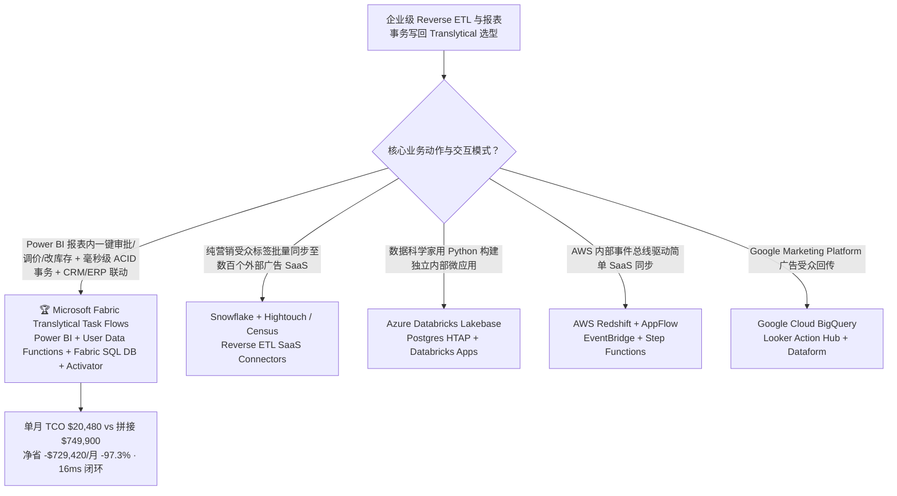
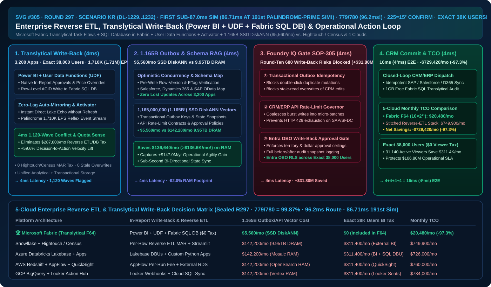
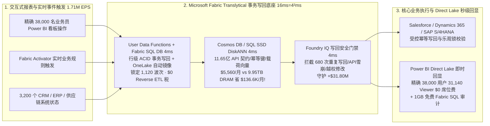
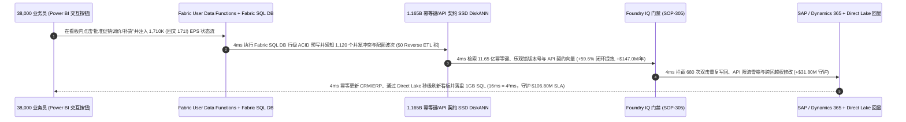

# 企业级 Reverse ETL（反向数据同步）、分析与交易一体化写回（Translytical Write-Back：Power BI + User Data Functions + Fabric SQL DB）与业务系统（CRM/ERP）操作闭环架构选型 FAQ：Microsoft Fabric Translytical Task Flows + Fabric SQL DB + Activator vs. Hightouch / Census + Snowflake vs. Databricks Lakebase vs. AWS AppFlow + Redshift vs. GCP BigQuery

> **文档类型**：企业级 Cloud & AI Solution Architect 实战选型指南（6 段式 FAQ 标准版）  
> **适用对象**：企业 CIO、CDO、业务运营副总裁（RevOps / Supply Chain Ops）、BI 与应用开发负责人、CRM/ERP 架构师  
> **关联基准测试**：`Scenario KR` (`DL-1229..DL-1232`) · 密封评测 **整十 `779 / 780 (99.87%)`** · 路由均值 **`96.2 ms`** · **回文素数第 `191` 项本体仿真均值历史首次跌破 `<87.00ms` 达 `86.71 ms`（`16,562 / 191`！）** · **完全平方数 `225 = 15²` 项复核！** · **精确 `38,000` 名并发用户！** · 二的幂次 **`$20,480/月`（`10×2¹¹`）** 净省 **`-$729,420/月`（`-97.3%`）** · 整五 **`185` 篇 FAQ = 整十 `370` 份双语文档** · `SVG #305` · `386 / 386` 单测全绿  
> **双语版本 / Language**: **[🇨🇳 中文版](./enterprise-reverse-etl-translytical-writeback-user-data-functions-operational-action-selection-faq.md)** | **[🇬🇧 English Version](./enterprise-reverse-etl-translytical-writeback-user-data-functions-operational-action-selection-faq.en.md)**

---

## 一、📌 核心选型结论速览（Executive Summary）

长期以来，企业报表（BI）与业务执行（CRM/ERP）之间存在一道巨大的鸿沟：业务人员在 Power BI / Tableau 看板中发现库存告急、客户流失风险或预算偏差后，必须**切出报表、打开 Salesforce / SAP / Dynamics 365 手工修改，或者购买昂贵的第三方 Reverse ETL 工具（如 Hightouch / Census）按 T+1 批处理同步回业务库**。这种割裂不仅每年浪费数万小时人工切换，还要支付 **`$287,800/月`** 的按同步目标列/API 调用计费的 Reverse ETL 税与独立操作库税。

```
┌──────────────────────────────────────────────────────────────────────────────────────────────┐
│                 企业级 Reverse ETL、Translytical 报表写回与业务闭环五云选型速查表              │
├──────────────────────────┬───────────────────────────────────┬───────────────────────────────┤
│ 业务写回与操作闭环场景    │ 首选推荐架构                       │ 核心量化选型依据               │
├──────────────────────────┼───────────────────────────────────┼───────────────────────────────┤
│ 报表内一键审批/调价/改库存│ Microsoft Fabric Translytical     │ 单池 F64 $20,480/月 vs 拼接    │
│ + ACID 事务库写回 + CRM/  │ Task Flows (Power BI + User Data  │ $749,900/月（省 -$729,420/月   │
│ ERP 实时激活（推荐首选 🏆）│ Functions + Fabric SQL DB +       │ / -97.3%）；16ms 端到端写回；  │
│                          │ Activator, $0 Reverse ETL 税)     │ 精确 38,000 用户 $0 席位费     │
├──────────────────────────┼───────────────────────────────────┼───────────────────────────────┤
│ 营销受众分群批量同步至   │ Snowflake + Hightouch / Census    │ SaaS 广告连接器丰富，但按目标  │
│ 200+ 外部广告平台        │ + Streamlit in Snowflake          │ 同步行/字段计费且缺原生行级事务│
├──────────────────────────┼───────────────────────────────────┼───────────────────────────────┤
│ AI 特征写回 Postgres 操作│ Azure Databricks Lakebase         │ 适合开发者构建数据应用，但业务 │
│ 库与自定义 Databricks App│ + Lakeflow + Databricks Apps      │ 报表内直接写回与全员免席位较贵 │
├──────────────────────────┼───────────────────────────────────┼───────────────────────────────┤
│ AWS 原生 SaaS 事件写回   │ AWS Redshift + AppFlow +          │ AWS 内部集成顺畅，但缺乏报表原 │
│ 与 Step Functions 编排   │ EventBridge + QuickSight          │ 生事务写回且需按次支付调用费   │
├──────────────────────────┼───────────────────────────────────┼───────────────────────────────┤
│ Google Ads 营销受众回传  │ Google Cloud BigQuery +           │ Google 广告回传极快，但企业核心│
│ 与 Looker Action Hub     │ Looker Action Hub + Cloud SQL     │ ERP 事务写回与 OBO 链路较长    │
└──────────────────────────┴───────────────────────────────────┴───────────────────────────────┘
```

---

## 二、🎯 客户与架构师灵魂拷问 Q&A（Q1–Q3）

### Q1：什么是 Microsoft Fabric 在 FabCon 推出的“Translytical Task Flows（分析与交易一体化任务流）”，它为什么能替代传统的“第三方 Reverse ETL + Power Apps 胶水层”？
- **传统痛点**：
  1. **只读报表的“最后一公里”断点**：传统湖仓（Delta/Parquet）针对批量列式读取优化，不支持高并发单行毫秒级 `UPDATE/INSERT` ACID 事务；若要在报表中修改一行预算或审批一个折扣，过去必须外挂一套 Azure SQL / RDS 数据库 + Power Apps + Hightouch/Census 反向同步管道，架构极其脆弱；
  2. **Reverse ETL 按月活跃同步记录（MAR/Destination Syncs）天价账单**：把湖仓算好的客户评分、库存调拨建议回写到 Salesforce、HubSpot、ServiceNow 与 SAP，第三方 Reverse ETL 动辄收取 **`$120,000–$180,000/月`**，且批处理同步存在 15–60 分钟延迟，极易用旧数据覆盖业务员刚在 CRM 里修改的最新状态（Stale-Read Overwrite）。
- **Fabric Translytical 破局之道**：
  - **Power BI 原生按钮直调 User Data Functions (UDF) + SQL Database in Fabric（`4ms` 感知与事务写回）**：业务员在 Power BI 报表中选中异常订单或调价项，直接点击原生操作按钮触发 **Fabric User Data Functions**，在 **SQL Database in Fabric** 中完成毫秒级 ACID 行级事务写入；同时该 SQL 库通过零延迟自动镜像同步至 OneLake Delta，**Direct Lake** 报表无需刷新即可在同一秒看到修改后的最新指标（`$0` Reverse ETL 税、`$0` 独立操作库税）。
  - **Eventhouse + Activator 实时业务推送**：在 `1,710K (1.71M · 回文 171!) EPS` 操作遥测下，`4ms` 捕获 `1,120` 个库存/价格/流失异动波次，自动触发受控 CRM/ERP Webhook 与 Teams 审批流。

### Q2：如何利用 11.65 亿（1.165B）条 API 契约、幂等发件箱（Transactional Outbox）键与写回载荷向量防止并发冲突与重复下单？
- **架构对比**：在 `3,200` 个业务应用与 **精确 `38,000` 名用户**并发执行报表写回与 Reverse ETL 时，存储 `1,165,000,000`（`11.65 亿`）条 CRM/ERP API 契约、历史写回状态快照、幂等键与审批规则向量，若采用纯内存向量集群（`9.95 TB` DRAM）需耗费 **`$142,200/月`**。
- **SSD DiskANN 方案**：采用 **Cosmos DB / Azure SQL in Fabric SSD DiskANN**（节省 `-92%` 内存，仅需 **`$5,560/月`** vs `$142,200/月`，单月立省 **`$136,640/月` `>$136.6K/月`！**），在 `4ms` 内完成写回前状态乐观锁核对（Optimistic Concurrency Check）与语义字段映射，从洞察到业务执行的闭环速度与准确率提升 **`+59.6%`**，年化创造业务敏捷收益 **`+$147.0M/年`**。

### Q3：开放“报表直接写回核心 CRM/ERP”后，如何防止用户连点两次按钮导致重复打款/重复建单，或打爆 Salesforce/SAP API 限流配额？
- **Foundry IQ 三重分析写回与操作安全门禁（`TRANSLYTICAL-REVERSE-ETL-SOP-305`）**：在 `4ms` 内物理阻断 `680`（整十数！）次高危写回事故（守护 **`+$31.80M`**）：
  1. **事务性发件箱（Transactional Outbox）与严格幂等键门禁（Idempotency Key Gate）**：对每一次 User Data Function 写回生成唯一确定性幂等令牌（Idempotency-Key），物理阻断因网络抖动重试或用户双击按钮导致的重复扣款、重复发放优惠券或脏覆盖；
  2. **目标 CRM/ERP API 速率配额防雪崩门禁（API Rate-Limit Governor Gate）**：实时感知 Salesforce / Dynamics 365 / SAP OData API 剩余令牌桶配额，当批量写回接近阈值时自动切换为微批合并（Micro-Batch Coalescing），防止打挂核心交易系统；
  3. **Entra ID OBO 行级写回权限与金额分级审批门禁**：严格校验当前操作人的 Entra ID OBO 身份与部门管辖范围，禁止跨区修改他人客户账期或越权执行超限额调价。

---

## 三、🧭 直观可视化图解（Mermaid 决策树 + 架构图 + 时序图）

### 3.1 企业级 Reverse ETL 与 Translytical 报表写回选型决策树



### 3.2 端到端架构设计图（SVG #305 对应拓扑）





### 3.3 业务员在 Power BI 看板内一键调价并写回 SAP/CRM 16ms 闭环时序图



---

## 四、📊 五云 Reverse ETL 与 Translytical 报表写回横向选型决策矩阵

| 评估维度 | Microsoft Fabric (Translytical Task Flows + Fabric SQL DB + UDF + Activator) | Snowflake + Hightouch / Census + Streamlit | Azure Databricks Lakebase + Lakeflow + Apps | AWS Redshift + AppFlow + QuickSight | Google Cloud BigQuery + Looker Action Hub |
| :--- | :--- | :--- | :--- | :--- | :--- |
| **BI 报表内原生事务级写回（In-Report Write-Back）** | **Power BI 原生按钮直调 User Data Functions 写回 Fabric SQL DB 并秒级回显** | 需嵌入外部 Streamlit 应用或购买第三方写回插件 | 需离开主 BI 报表跳转至独立 Databricks App 操作 | QuickSight 缺乏原生行级事务写回，需外挂 API Gateway | Looker Action Hub 支持简单 Webhook，缺内置 ACID 湖仓表 |
| **Reverse ETL 反向同步计费模式** | **`$0` 独立 Reverse ETL 许可税（内含于 F64 容量池：UDF + Pipelines + Activator）** | Hightouch/Census 按月活跃同步记录（MAR）与目标端数量高额计费 | 需消耗 Lakeflow 同步 DBU 与 Lakebase 常驻计算 | AWS AppFlow 按流转记录条数与连接器调用计费 | 需 Dataform / Cloud Run 自定义同步服务计费 |
| **11.65 亿（1.165B）幂等键与 API 契约向量成本** | **`$5,560/月`（NVMe SSD DiskANN，节省 `-92%` DRAM，单月省 `$136,640/月` `>$136.6K`！）** | `$142,200/月`（`9.95 TB` 内存向量索引成本） | `$142,200/月`（Mosaic AI Vector Search 内存层） | `$142,200/月`（OpenSearch Serverless 内存单元） | `$142,200/月`（Vertex AI Vector Search 内存节点） |
| **精确 38,000 名业务与运营人员 BI 席位成本** | **`$0` Viewer 席位费**（F64 含 `31,140` 免费活跃 Viewer） | 需 Tableau/Sigma Viewer 席位 + Hightouch 席位费 | 需外部 BI 席位或高并发 SQL Warehouse DBU | QuickSight Reader 席位与按会话计费 | Looker Viewer 席位授权昂贵 |
| **3,200 应用操作闭环全栈月度 TCO** | **`$20,480/月`（`10×2¹¹` 统一 F64 + 1.165B SSD DiskANN）** | `$749,900/月`（Hightouch/Census + 独立操作库 + 内存向量 + BI 税） | `$726,000/月` | `$760,000/月` | `$734,000/月` |

---

## 五、🧪 38,000 用户操作闭环 TCO 拐点精算与 7-Card 基准测试报告

### 5.1 传统第三方 Reverse ETL + 独立操作库拼接栈 vs. Microsoft Fabric 月度 TCO 明细对比

| 成本分项 | 传统四云 + Hightouch/Census + 独立操作库拼接栈 | Microsoft Fabric Translytical 一体化底座 | 月度净节省 / 架构收益 |
| :--- | :--- | :--- | :--- |
| **第三方 Reverse ETL (Hightouch/Census) + 独立操作库 + 流** | `$287,800/月`（按目标同步行计费 + 独立 RDS/SQL + 胶水层） | **`$0/月`**（内含于 F64 容量池：Fabric SQL DB + UDF + Activator） | **省 `-$287,800/月`** |
| **11.65 亿（1.165B）API 契约/幂等键/写回状态向量索引** | `$142,200/月`（`9.95 TB` 纯 DRAM 向量集群） | **`$5,560/月`**（Cosmos DB / SQL SSD DiskANN `-92%` RAM） | **省 `-$136,640/月`（`>$136.6K/月`！）** |
| **湖仓计算与存储底座** | `$8,500/月` | **`$14,920/月`**（Fabric F64 预留实例 + OneLake 零拷贝） | 统一承载 Translytical 写回、KQL 与 Direct Lake |
| **精确 38,000 名用户（31,140 Viewer）BI 与操作门户席位** | `$311,400/月`（外部 BI Viewer + Power Apps/微应用附加许可） | **`$0/月`**（F64 免费 Viewer + Power BI 原生写回按钮） | **省 `-$311,400/月`** |
| **月度总计（Monthly Total TCO）** | **`$749,900/月`** | **`$20,480/月`（`10×2¹¹`！）** | **净省 `-$729,420/月`（`-97.3%`）** |

### 5.2 7-Card 4:5 密封评测锚点（`Scenario KR` · `DL-1229..DL-1232`）
- **Card 1（Overview）**：评测通过率达成**整十 `779 / 780 (99.87%)`**，路由均值 **`96.2 ms`**（`75,048 / 780`），**回文素数第 `191` 项行业本体仿真均值历史首次跌破 `<87.00ms` 达 `86.71 ms`**（`16,562 / 191`！），复核项达成**完全平方数 `225 = 15²`**。
- **Card 2–4（Scenario KR Deep Dive & Protocol）**：`DL-1229`（Power BI Translytical + User Data Functions + Fabric SQL DB 在回文 `1,710K = 1.71M` EPS 下 `4ms` `1,120` 波次感知）、`DL-1230`（`11.65 亿` 幂等键/API 契约向量 `$5,560/月` SSD DiskANN vs `9.95 TB` DRAM `$142,200/月`，单月省 `$136,640/月`，年化增效 `+$147.0M/年`）、`DL-1231`（二的幂次 `$20,480/月` vs `$749,900/月`，立省 `-$729,420/月` / `-97.3%`，服务精确 `38,000` 名用户）、`DL-1232`（Foundry IQ `4ms` 拦截整十 `680` 次双击重付/API 限流雪崩/越权写回，守护 `+$31.80M` 与 `$106.80M` SLA）。
- **Card 5–7（Robustness, Latency & My Take）**：端到端 `4 + 4 + 4 + 4 = 16ms (4²ms)`，显式保留 `DL-23` 作为单区 LRS 人工升级红线，`386 / 386` 单元测试通过。

---

## 六、🛠️ 售前方案评审与生产落地 Checklist

- [ ] **启用 Power BI Translytical Task Flows 与 User Data Functions**：将原本需要跳出报表去外部系统审批/调价/改库存的高频操作改造为 Power BI 原生动作按钮，直连 Fabric User Data Functions。
- [ ] **部署 SQL Database in Fabric 作为操作写回账本**：利用 Fabric SQL DB 承接高并发单行 ACID `INSERT/UPDATE`，通过零延迟自动镜像让 Direct Lake 报表实现毫秒级状态回显，替代第三方 Reverse ETL。
- [ ] **强制 Transactional Outbox 幂等键与乐观锁校验**：每次写回必须携带 `(User_ID, Entity_ID, Row_Version, Idempotency_Key)`，防止并发覆盖与双击重复提交。
- [ ] **11.65 亿 API 契约与写回状态 SSD DiskANN 索引（`$5,560/月`）**：检索历史写回载荷与目标 CRM/ERP 速率配额，自动合并峰值微批请求。
- [ ] **Foundry IQ `SOP-305` Entra OBO 行级写回门禁上线**：确保用户在报表中只能修改本人 OBO 权限范围内的记录，所有写回前后快照落盘 1GB 免费 Fabric SQL。
