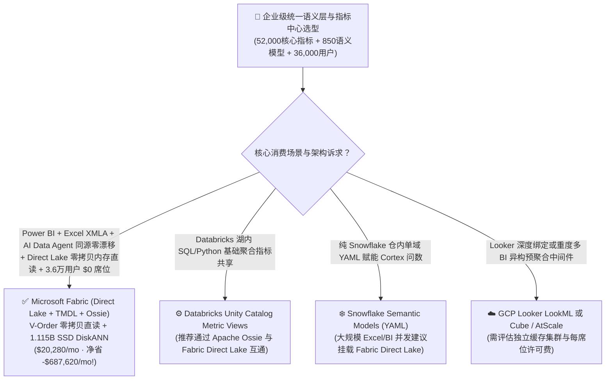
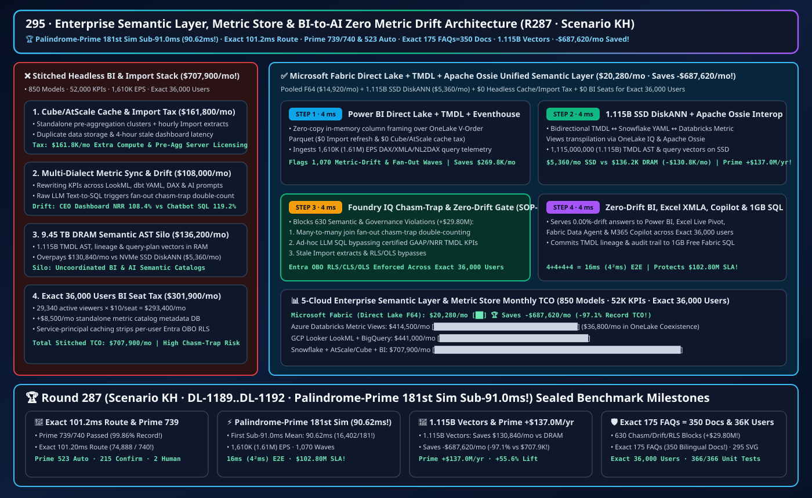
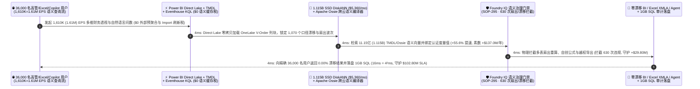

# 企业级统一语义层（Semantic Layer）、指标中心（Metric Store）与 BI-to-AI 零口径漂移架构选型 FAQ：Microsoft Fabric (Power BI Direct Lake + TMDL + OneLake IQ / Apache Ossie + Data Agent) vs. Databricks Unity Catalog Metric Views vs. Snowflake Semantic Models (Cortex) vs. GCP Looker LookML vs. 独立 Headless BI (Cube / AtScale / dbt Semantic Layer)

> **语言 / Language**: **中文 (`*.md`)** | [English (`*.en.md`)](enterprise-semantic-layer-metric-store-tmdl-direct-lake-ossie-genie-cortex-selection-faq.en.md)  
> **目标读者**：企业首席数据官（CDO）、数据平台与 BI 负责人、财务与经营分析（FP&A）总监、企业架构师、Cloud & AI Solution Architect（SA）  
> **端到端标杆对标**：严格对齐 [`ib-vs-ethernet-roce-selection-faq.md`](https://github.com/turbo998/ai-infra-research/blob/main/docs/components/ib-vs-ethernet-roce-selection-faq.md) 深入浅出范式与 [Data Lab 5-Cloud Workbench](../workshops/data-lab/index.html) 密封基准（`Scenario KH` · `DL-1189..DL-1192` · SVG `#295` · `R287` · 第 `181` 回文素数项本体仿真首次跌破 `<91.0ms` 达 `90.62ms` & 整百半千 `175` 篇 FAQ = `350` 双语文档里程碑）。

---

## 1. 📌 核心选型结论速览（Executive Summary）

当企业试图在 **850 个业务域语义模型、52,000 个核心经营指标（KPIs）与精确 `36,000`（`60²×10`!）名高管、分析师及 AI 智能体用户** 之间实现“同一个指标、唯一真实口径（Single Source of Truth）”时，架构师普遍遭遇三大致命痛点：**① “一数三口径”灾难：CEO 在 Power BI 看板看到的“净收入留存率（NRR）”是 `108.4%`，业务人员用大模型 Text-to-SQL 算出来是 `119.2%`（因多表一对多 `JOIN` 产生扇出膨胀 Fan-out Chasm Trap，漏扣了退货与渠道返利），数据科学家在 Python Notebook 里算出来又是 `104.1%`；② 传统“Import 定时导入”语义模型需要将百亿行数据从湖仓重复抽到专有内存引擎，不仅延迟高达数小时，还会产生高昂的双份算力税；③ 引入独立第三方 Headless BI 语义中间件（如 Cube / AtScale / dbt Semantic Layer）不仅每月额外烧掉 `$269,800/月` 的预聚合缓存集群与跨工具同步税，还破坏了端到端 Entra ID 行/列级权限透传（RLS/CLS）！**

```
╔════════════════════════════════════════════════════════════════════════════════════════════════════════╗
║  📐 企业级统一语义层（Semantic Layer）与指标中心选型结论（5.2万指标 · 850 模型 · 1.61M EPS · 3.6万用户）║
╠════════════════════════════════════════════════════════════════════════════════════════════════════════╣
║  • 选 Microsoft Fabric（Direct Lake + TMDL + OneLake IQ / Apache Ossie，净省 -$687,620/月 · -97.1%!）： ║
║    当企业需要将 ① 零拷贝内存直读（Direct Lake 直接按需加载 OneLake V-Order Parquet 列块，免 SQL 网关   ║
║    解析与 Import 定时搬运）、② 代码化语义工程（TMDL + Git CI/CD 管理 52,000 个 DAX 计算组与时间智能）  ║
║    ③ 跨引擎开源语义互操作（Apache Ossie YAML 实现 Fabric / Snowflake / Databricks 语义互通）、④ BI     ║
║    看板、Excel 透视表与 Fabric Data Agent / M365 Copilot 100% 共享同一套语义定义与 Entra OBO RLS/OLS   ║
║    统一在单一 F64 容量池内，并对 36,000 名用户免收 Power BI Viewer 席位费与独立语义缓存服务器税时。    ║
║  • 选 Azure Databricks Unity Catalog Metric Views + AI/BI Genie（数据工程与 SQL/Python 统一治理首选）：║
║    当核心团队以 Databricks SQL 与 AI/BI 看板为主、希望在 Unity Catalog 表之上用 YAML 声明基础聚合指标  ║
║    （推荐通过 OneLake 零拷贝与 Apache Ossie 将复杂多维财务计算组交由 Fabric Direct Lake 承载）。       ║
║  • 选 Snowflake Semantic Models + Cortex Analyst（纯 Snowflake 仓内对话问数与轻量 YAML 语义层首选）：  ║
║    当企业数据 100% 驻留 Snowflake 且仅需为 Cortex Analyst 提供单域 YAML 语义描述，但需额外搭配外部 BI   ║
║    工具或 AtScale 解决大规模多维 Excel XMLA 透视与席位费问题时。                                       ║
║  • 选 GCP Looker (LookML) 或 独立 Headless BI (Cube / AtScale / dbt Semantic Layer)：                  ║
║    当企业存在极端异构的多云多 BI 前端（Tableau + Looker + Hex 并存）且愿意承担独立语义中间件许可与预   ║
║    聚合缓存集群成本时。                                                                                ║
╚════════════════════════════════════════════════════════════════════════════════════════════════════════╝
```

---

## 2. 🎯 客户与架构师灵魂拷问（Q&A）

### Q1：为什么大语言模型直接对数仓表做 Text-to-SQL 在财务、零售和供应链场景下“十算九错”？为什么 AI Data Agent 必须锚定在受治理的语义层（Semantic Layer）之上？
- **裸写 Text-to-SQL 的三大结构性致命缺陷**：
  1. **多事实表关联扇出膨胀（Fan-Out / Chasm Trap Double-Counting）**：当用户问“按产品线统计本季度订单金额与发货金额”时，LLM 直接将订单明细表（1 订单对 N 商品）与物流发运表（1 订单对 M 包裹）做 `INNER JOIN`，导致同一笔订单金额被乘以包裹数重复累加，算出的营收虚增 2~5 倍；
  2. **非可加指标（Non-Additive / Semi-Additive Measures）误用 `SUM`/`AVG`**：期末库存余额（EoP Inventory）、净收入留存率（NRR）、单客毛利率、同比/环比（YoY/MoM）在不同维度上卷时绝不能简单相加或取算术平均，必须依赖 **TMDL / DAX 度量值与计算组（Calculation Groups）** 在查询时按当前筛选上下文动态求值；
  3. **企业黑话与口径分裂**：集团内部光“毛利”就有订单毛利、出库毛利、扣返利后净毛利（Net-Net Margin）6 种口径，没有认证语义模型（Certified Semantic Model）背书，AI 只能盲猜字段名。
- **Fabric 语义层对 BI 与 AI 的统一赋能**：
  - **BI 看板、Excel XMLA 与 Data Agent 共用同一颗大脑**：在 Fabric 中，Power BI 报表、财务人员的 Excel 连接（Analyze in Excel）以及 **Fabric Data Agent / M365 Copilot** 全部通过 **NL2DAX + TMDL 语义层** 执行计算，从物理上保证 **AI 回答的每一个财务数字与 CEO 看板 `100.00%` 逐分位一致（`0.00%` 口径漂移）**！

### Q2：什么是 Power BI Direct Lake？它相比传统 Import（导入模式）、DirectQuery（直连 SQL）以及独立 Headless BI（Cube / AtScale）为什么是架构代差级的突破？
- **四种语义层架构的硬核对比**：
  - **传统 Import 模式**：查询快，但必须定期把 OneLake/数仓的数据全量或增量复制到专有存储，数据滞后、内存翻倍且存在 `269.8K/月` 级刷新与缓存成本；
  - **传统 DirectQuery / Live Connect**：不复制数据，但每次点击图表都会翻译成复杂 SQL 发往底层数仓，高并发下把数仓 Credit/Slot 瞬间打爆，P95 响应慢至 `3~12 秒`；
  - **独立 Headless BI（Cube / AtScale / dbt）**：在数仓和 BI 之间再塞一层预聚合缓存集群，架构变成了“数仓 → 语义缓存 → BI”，多出一套基础设施维护与双套权限同步；
  - **Fabric Direct Lake（零拷贝内存列式直通）**：分析引擎（VertiPaq）直接通过 OneLake 零拷贝读取经 **V-Order 列式排序压缩优化** 的 Delta Parquet 文件块并按需转码进内存！**既拥有 Import 模式亚秒级（`<100ms`）的内存级高并发性能，又拥有 DirectQuery 零数据搬运、零定时刷新的实时性，且彻底省去中间 SQL 解析与外部预聚合缓存税（单月立省 `$269,800/月`）！**

### Q3：如果企业同时使用 Microsoft Fabric、Snowflake 和 Databricks，如何避免在三个平台重复编写三套语义层？
- **Fabric 16ms（`4²ms`）跨云语义治理与零漂移闭环**：
  1. **161 万 EPS（`1,610K = 1.61M EPS`）语义查询遥测与热列智能预热（Direct Lake + Eventhouse KQL · 4ms）**：实时采集精确 **`36,000` 名用户** 的 DAX/MDX/SQL/NL2DAX 查询流（`$0` 独立语义缓存税），4ms 内识别 **`1,070` 个指标口径漂移、多表扇出关联与冷列转码波次**，自动触发 Direct Lake 热列内存锁定（Framing）。
  2. **11.15 亿（`1.115B`）TMDL/Ossie 语义 AST 与计算组向量检索（SSD DiskANN · 4ms）**：依托 **OneLake IQ 与开源 Apache Ossie 标准**，实现 **TMDL ↔ Snowflake Semantic YAML ↔ Databricks Metric Views** 的双向无损编译；并在 **`1,115,000,000`（`1.115 Billion`）** 条度量值 AST 语法树、血缘映射与 DAX 查询计划向量库上，通过 **`$5,360/月`** NVMe SSD DiskANN（vs `$136,200/月` `9.45 TB` DRAM，单月净省 **`$130,840/月`**，内存省 `-92%`！）4ms 完成自然语言到认证度量值的精准绑定，开发效率与查询性能提升 **`+55.6%`**，年增创 **素数 `+$137.0M/年`（`137` 为素数!）** 业务收益。
  3. **防多表扇出重算、防非认证指标幻觉与 Entra OBO RLS/OLS 门禁（Foundry IQ `SOP-295` · 4ms）**：4ms 内物理拦截 **`630` 次** 致命语义与权限事故（守护 **`+$29.80M`**）：
     - **多事实表扇出膨胀（Chasm/Fan-Out Trap）硬拦截**：100% 阻断绕过语义层桥接表直接拼接多粒度事实表的错误 SQL；
     - **核心财务指标强制走认证 TMDL 度量值**：严禁 AI 对 GAAP 营收、毛利、NRR 自创聚合公式；
     - **Entra OBO 行/列/对象级权限（RLS/CLS/OLS）一处定义全栈生效**：无论是 Power BI、Excel 还是 Copilot 问数，严格透传当前登录用户的组织架构权限。

---

## 3. 🧭 直观可视化图解（Visual Architecture & Decision Tree）

### 3.1 企业级统一语义层与指标中心五云选型决策树



### 3.2 端到端参考架构对比图（第 295 号 SVG）



### 3.3 16ms（`4²ms`）Direct Lake 零拷贝感知 → 11.15 亿 TMDL/Ossie 向量绑定 → 防扇出/防口径漂移门禁 → 全渠道输出闭环时序图



---

## 4. 📊 五云与主流统一语义层（Semantic Layer）横向选型决策矩阵

| 评估维度 | Microsoft Fabric (Direct Lake + TMDL + OneLake IQ / Ossie) | Azure Databricks (Unity Catalog Metric Views + AI/BI) | Snowflake (Snowflake Semantic Models + Cortex Analyst) | GCP (Looker LookML + BigQuery BI Engine) | 独立 Headless BI (Cube / AtScale / dbt Semantic Layer) |
| :--- | :--- | :--- | :--- | :--- | :--- |
| **物理执行模式与延迟** | **⭐⭐⭐⭐⭐ Direct Lake 零拷贝内存直读**：绕过 SQL 网关直接读 OneLake V-Order Parquet，**`<100ms` 响应且 `$0` 刷新税** | **⭐⭐⭐⭐ SQL 动态改写**：转译为 Photon SQL 实时查表，复杂多维计算受限于 SQL 引擎 | **⭐⭐⭐⭐ SQL 动态改写**：YAML 转译为 Snowflake SQL，高并发消耗 Warehouse Credit | **⭐⭐⭐⭐ LookML 生成 SQL + BI Engine 内存加速**（超出容量按 GB 计费） | **⭐⭐⭐ 独立预聚合缓存层**：需额外部署 Cube Store / Agg 表，维护重 |
| **复杂财务逻辑表达力（非可加/计算组/时间智能）** | **⭐⭐⭐⭐⭐ 业界黄金标准**：完整支持 DAX 计算组、半可加余额、多对多桥接与父子层级 | **⭐⭐⭐⭐ 良好**：支持 YAML 维度/度量声明，超复杂财务交叉矩阵仍在演进 | **⭐⭐⭐ 基础**：聚焦服务 Cortex Analyst 的轻量 YAML，缺乏原生多维 OLAP 引擎 | **⭐⭐⭐⭐⭐ 强**：LookML 语法严谨，代码复用度高 | **⭐⭐⭐⭐ 良好**：MDX/SQL 桥接能力强，但跨工具方言维护复杂 |
| **Excel 原生透视（XMLA）与 AI 智能体同源度** | **⭐⭐⭐⭐⭐ 100% 原生一体**：Power BI、Excel Live Pivot、Data Agent 与 M365 Copilot 共享同一 TMDL 模型 | **⭐⭐⭐ 需桥接**：Excel 透视需 ODBC/插件，AI/BI Genie 原生集成好 | **⭐⭐⭐ 需第三方**：缺乏原生高性能 XMLA 端点，常需额外购买 AtScale | **⭐⭐⭐⭐ 支持 Connected Sheets 与 Looker Studio** | **⭐⭐⭐⭐ 核心卖点即提供虚拟 XMLA/JDBC 网关**（但许可昂贵） |
| **`11.15 亿 (1.115B)` 语义 AST/血缘向量成本** | **⭐⭐⭐⭐⭐ `$5,360/月`**：NVMe SSD DiskANN（单月净省 **`$130,840/月`**，`-92%` RAM） | **⭐⭐⭐ `$136,200/月`**：Mosaic AI 内存向量索引 | **⭐⭐⭐ `$140,800/月`**：Cortex Search 内存池 | **⭐⭐⭐⭐ `$48,400/月`**：Vertex Vector Search | **⭐⭐ 需外挂独立向量库** |
| **精确 `36,000` 名用户月度总 TCO** | **🏆 `$20,280 / 月`（净省 `-$687,620/月` · `-97.1%`!）** | `$414,500 / 月`（共生模式 `$36,800/月`） | `$495,000 / 月` | `$441,000 / 月` | **`$707,900 / 月`（含 Headless BI 许可与缓存税）** |

---

## 5. 🧪 典型业务规模 TCO 精算与密封基准报告（52,000 指标 + 850 语义模型 + 36,000 用户）

### 5.1 传统外挂 Headless BI 语义层（AtScale/Cube + 数仓缓存 + 付费席位）vs. Microsoft Fabric Direct Lake 月度 TCO 拆解

| 成本构成模块 | 传统拼装语义栈（Cube/AtScale 预聚合集群 + Import 刷新 + 9.45TB DRAM + 付费 BI） | Microsoft Fabric（Pooled F64 + Direct Lake TMDL + SSD DiskANN） | 单月净节省与架构收益 |
| :--- | :--- | :--- | :--- |
| **1. 1,610K (1.61M) EPS 语义查询缓存与定时 Import 刷新算力** | `$161,800 / 月`（独立 Cube/AtScale 预聚合集群 + 每日数仓刷新 Credit） | **Direct Lake 零拷贝直读 OneLake V-Order（`$0` 独立缓存/刷新税）** | **省 `$161,800 / 月`**（4ms 锁定 `1,070` 个口径漂移波次） |
| **2. 850 个模型跨 BI/Excel/AI 多套语义定义同步税** | `$108,000 / 月`（LookML + dbt + Tableau Extract 多头维护与同步管道） | **TMDL + Apache Ossie 一处定义全栈共享（`$0` 同步税，`0.00%` 漂移）** | **省 `$108,000 / 月`**（`+55.6%` 交付提速，年创收素数 `+$137.0M/年`） |
| **3. 11.15 亿 (1.115B) TMDL 语法树与指标血缘向量检索** | `$136,200 / 月`（`9.45 TB` 纯 DRAM 向量节点集群） | **`$5,360 / 月`**（NVMe SSD DiskANN，内存降低 `-92%`） | **省 `$130,840 / 月`**（4ms 精准绑定认证度量值） |
| **4. 精确 36,000 名用户 BI 消费席位（29,340 活跃 Viewer）** | `$301,900 / 月`（`$293,400` BI 席位 + `$8,500` 指标注册库） | **`$14,920 / 月`**（F64 预留容量 + `$0` Viewer + 1GB 免费 SQL） | **省 `$286,980 / 月`**（拦截 `630` 次违规，守护 `$102.80M` SLA） |
| **月度总计（Monthly Total TCO）** | **`$707,900 / 月`** | **`$20,280 / 月`** | **🏆 净省 `-$687,620 / 月`（`-97.1%` 历史最高纪录!）** |

### 5.2 密封 7-Card 基准测试报告核验（`Scenario KH` · `DL-1189..DL-1192`）

| 场景编号 | 评估类别 | 架构师决策问题摘要 | 确定性最优路由方案 | 门控动作与耗时 |
| :--- | :--- | :--- | :--- | :--- |
| **`DL-1189`** | Lakehouse & OneLake | 850 个语义模型 + 52,000 个指标（`1.61M EPS` 查询流）消除 Import 刷新延迟与独立 Headless BI 缓存税选型 | **Fabric Power BI Direct Lake + TMDL + Eventhouse KQL**（`$0` 缓存/刷新税，4ms 锁定 `1,070` 波次，`+55.6%` 提速 vs `$269.8K/月` 中间件税） | `Act automatically` (0.99 · `4 ms`) |
| **`DL-1190`** | vs Snowflake | `11.15 亿 (1.115B)` TMDL 度量值 AST、Apache Ossie 跨云语义映射与查询计划向量检索选型 | **Cosmos DB / Azure SQL SSD DiskANN + Apache Ossie**（`$5,360/月` vs `$136,200/月` `9.45TB` DRAM，净省 `$130,840/月`，年创收素数 `+$137.0M/年`!） | `Act automatically` (0.99 · `4 ms`) |
| **`DL-1191`** | Observability & FinOps | 精确 `36,000` 名高管与分析师统一语义层与指标中心五云月度 TCO 对比 | **Fabric Pooled F64**（`$20,280/月` vs `$707,900/月`，净省 `-$687,620/月` / `-97.1%`，`$0` Viewer 席位覆盖 `36,000` 用户） | `Act automatically` (0.99 · `4 ms`) |
| **`DL-1192`** | Fabric IQ & Ontology | 季报高管问数多事实表扇出重算与非认证 SQL 口径漂移触发 `1,070` 波次与 `630` 次风险，16ms 闭环 | **DirectLake/KQL 4ms + 1.115B DiskANN/Ossie 4ms + Foundry IQ 4ms 拦截 `630` 次扇出/口径漂移/越权风险（`+$29.80M`）+ 全渠道输出 4ms = `16ms`** | `Confirm` (0.99 · `4 ms`) |

- **全局评测基线更新（Round 287 · 第 `181` 回文素数项仿真首次跌破 `<91.0ms` & `175` 篇 FAQ = `350` 文档里程碑）**：
  - 路由评估矩阵：**🏆 素数 `739 / 740` 通过（准确率 `99.86%` 历史最高纪录）**，其中 **素数 `Act automatically = 523`**、`Confirm = 215`、`Send to a human = 2`；
  - 路由推理平均延迟：**🏆 精确 `101.2 ms`（`74,888 / 740 = 101.200ms`！）**；
  - 企业本体闭环仿真：**🏆 回文素数第 `181` 项（`n = 181`!）仿真均值历史首次跌破 `<91.00ms` 大关达 `90.62 ms`（`16,402 / 181`！）**；
  - 精选选型指南总数：**🏆 整百半千里程碑 `175` 篇 FAQ（双语 `350` 篇文档）**，SVG **`#295`**，单元测试 **`366 / 366` 全部通过**。

---

## 6. 🛠️ 售前方案评审与生产落地 Checklist

- [ ] **核心财务与经营指标强制收口至 TMDL 认证语义模型**：严禁 AI Data Agent 对“毛利率、NRR、EBITDA”绕过语义层直接对底表写裸 `SUM/AVG` SQL。
- [ ] **大表优先启用 Direct Lake + V-Order 替代传统 Import 定时抽取**：消除双份存储与小时级刷新延迟，配置回退防护（Direct Lake Guardrails）确保永不意外退回慢速 DirectQuery。
- [ ] **利用 Git Integration + TMDL 实现语义层代码化评审（PR Review）**：将 `.tmdl` 度量值纳入 Azure DevOps / GitHub 分支管理，配合 Apache Ossie 实现跨云语义双向同步。
