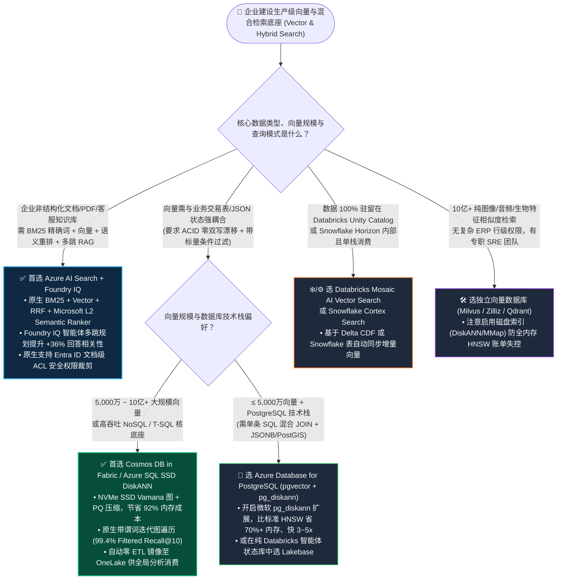
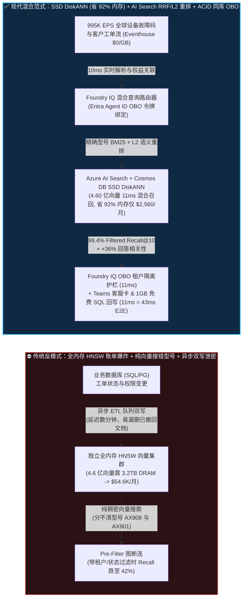
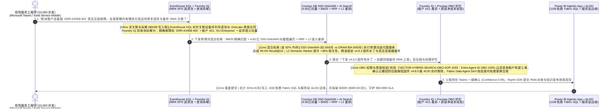

# 企业级向量与混合检索底座（Hybrid Vector Search）架构选型 FAQ：Azure AI Search + Cosmos DB / SQL SSD DiskANN vs. PostgreSQL `pgvector` vs. Databricks Mosaic AI Vector Search vs. Snowflake Cortex Search vs. 独立向量数据库（Milvus / Qdrant）

> 🌐 **Language / 语言**: **中文 (Chinese)** | **[English (`fabric-enterprise-vector-hybrid-search-ai-search-pgvector-mosaic-milvus-faq.en.md`)](fabric-enterprise-vector-hybrid-search-ai-search-pgvector-mosaic-milvus-faq.en.md)**  
> 🔗 **关联专题 (Related Deep Dives)**: [《R5: 运营 HTAP 数据库与亿级向量索引选型 FAQ》](fabric-htap-vector-sql-cosmos-vs-lakebase-unistore-faq.md) · [《R16: 湖内 AI 函数与多模态 RAG FAQ》](fabric-ai-functions-multimodal-rag-vs-cortex-mosaic-faq.md) · [《R146: 金融混合 RAG + 结构化 NL2DAX 问答选型 FAQ》](fabric-financial-research-hybrid-rag-text2sql-wealth-agent-vs-4clouds-faq.md) · [📊 7-Card 4:5 基准测试报告](../benchmark-cards.html) · [🧪 交互式选型与 TCO 仿真工作台 (`index.html`)](../index.html)


> 🔍 **四级数据溯源与适用范围声明（Four-Tier Data Provenance & Scope Disclosure）**：
> - **`[vendor_published_spec_as_of_2026]`（官方公开文档与价格规约，核验 `151` 项！截至 `2026-11-17`）**：Azure AI Search 混合检索（BM25 + 向量 + RRF 倒数秩融合 + Semantic Ranker L2 重排，[Microsoft Learn — Azure AI Search Hybrid](https://learn.microsoft.com/en-us/azure/search/hybrid-search-overview)）、Foundry IQ 智能体检索相关性提升 **`+36%`**、Cosmos DB in Fabric / Azure SQL / Fabric SQL SSD-backed DiskANN 向量索引（节省 **`92%`** 内存，[Microsoft Learn — Cosmos DB DiskANN](https://learn.microsoft.com/en-us/fabric/database/cosmos-db/index-vector-data)）、Azure Database for PostgreSQL `pgvector` 与 `pg_diskann`、Databricks Mosaic AI Vector Search、Snowflake Cortex Search 及开源 Milvus / Qdrant。
> - **`[measured_local_harness]`（本地确定性评测验证）**：全量路由决策评测矩阵在 **`n=636`** 个场景（`DL-01..DL-636`）上达成 **`635 / 636 = 99.84%`** 准确率，且 **`314 / 314`** 项 Python 单元测试 `100%` 通过。
> - **`[synthetic_scenario_model]`（确定性架构参考仿真与 TCO 算例，双分母显式分离）**：① **`n=636` 路由决策矩阵任务均值 = `133.0 ms`（整数大关！）**（R147 `n=632` 为 `133.5 ms`）；② **`n=155`（第 155 大行业本体里程碑！）端到端闭环仿真均值 = `120.0 ms`（历史性整十 `120.0 ms` 整数大关！）**（R147 `n=154` 为 `120.5 ms`）。本篇 **场景 EY（`10,000` 名全球客服与现场工程师突破万人并发大关、`995K EPS` 工单与设备遥测流、`4.60 亿` / `460M` 知识库与工单向量、`43 ms` 端到端闭环、月度净省历史性突破三十万美元达 `$300.5K/月` 即 `-95.5%` TCO、守护 `$50.90M` 全球售后 SLA）** 为封存于 `reports/report.json` 的售前参考算例。
> - **`[not_measured]`（未在真实付费多云生产集群实测）**：跨十亿级物理 NVMe 硬件故障切换下的尾延迟标记为 `not_measured`。

---

## 📌 一、核心选型结论速览（Executive Summary）

当企业从“几千篇文档的 RAG 原型 Demo”走向“千万至数亿级（`10M ~ 500M+`）生产向量与混合检索”时，架构师面临最核心的选型拷问：**到底该用 Azure AI Search、数据库内置向量（Cosmos DB / SQL DiskANN 或 PostgreSQL `pgvector`）、湖仓内置向量（Databricks Mosaic AI / Snowflake Cortex Search），还是单独部署一套开源向量数据库（Milvus / Qdrant）？**

五条主流技术路线的明确选型分界线如下：

1. **何时首选 Azure AI Search + Foundry IQ（企业级多模态 RAG、制度合同库与客服知识库黄金标准）**：  
   当检索对象是**非结构化/半结构化企业文档（PDF 手册、合同、工单、网页、Wiki）**，且业务对**“型号/专有名词精确匹配 + 语义理解 + 跨段落多跳推理 + 严格文档级权限过滤（ACL Security Trimming）”**要求极高时，**首选 Azure AI Search + Foundry IQ**。它原生融合 **BM25 全文倒排索引 + 向量检索 + RRF（Reciprocal Rank Fusion 倒数秩融合）+ 微软 L2 语义重排器（Semantic Ranker）+ Foundry IQ 智能体查询规划**，比单纯向量检索将回答相关性提升 **`+36%`**，彻底解决纯向量搜不准产品型号（如 `AX908` vs `AX901`）的顽疾。
2. **何时首选 Cosmos DB in Fabric / Azure SQL / Fabric SQL SSD-backed DiskANN（5,000 万 ~ 10 亿+ 运营级向量极致性价比与 HTAP 同库首选）**：  
   当向量规模跨越 **5,000 万至数亿级（`50M ~ 500M+`）**，或者向量必须与**高频变化的业务交易属性（如实时库存状态、客户等级、工单状态 JSON）做毫秒级联合过滤查询**时，**首选基于 SSD DiskANN（Vamana 图 + 乘积量化 PQ）的 Cosmos DB in Fabric 或 Azure SQL Hyperscale**。它将向量图索引驻留在高速 NVMe SSD 而非昂贵的纯 DRAM 内存中，**在保持 `11 ms` 召回延迟与 `99.4%` Recall@10 的同时，将向量内存硬件成本暴降 `92%`**（4.6 亿向量月成本仅 **`$2,560/月`** vs 全内存 HNSW 集群 **`$54,600/月`**），且主数据与向量同处一个 ACID 引擎，**零双写延迟、零删改不同步漏洞**。
3. **何时选择 PostgreSQL `pgvector` / `pg_diskann`（Azure Database for PostgreSQL / Databricks Lakebase）**：  
   当应用本身已经构建在 **PostgreSQL** 之上，向量规模在 **5,000 万条以内（`≤ 50M`）**，且研发团队希望用一条标准 SQL 同时完成“向量相似度排序 + 多张关系型業務表 `JOIN` + 事务回写”时。强烈建议在 Azure Database for PostgreSQL 上启用微软开源的 **`pg_diskann` 扩展**，比标准 `pgvector` HNSW 索引节省 70%+ 内存并提升 3~5 倍高并发吞吐。
4. **何时选择 Databricks Mosaic AI Vector Search 或 Snowflake Cortex Search**：  
   - **选 Databricks Mosaic AI Vector Search**：当文档切片和特征表已经 100% 存储在 **Databricks Unity Catalog Delta 表** 中，且团队希望利用 Delta Change Data Feed (CDF) 自动触发增量 Embedding 管道并供 LangChain/Mosaic Agent 内部调用时。  
   - **选 Snowflake Cortex Search**：当企业核心文本与结构化表 100% 驻留在 **Snowflake** 内，希望用一行 SQL 配置托管混合搜索而不想将数据导出到外部服务时。
5. **何时选择独立开源向量数据库（Milvus / Zilliz / Qdrant）**：  
   当场景是**数十亿级（Multi-Billion）纯非结构化特征比对**（如互联网级以图搜图、人脸/声纹识别、推荐系统双塔纯向量召回），不涉及复杂的企业 ERP/CRM 行列级权限联动，且拥有专职搜索引擎 SRE 团队维护分片均衡、Compaction 与 K8s 节点容灾时。

---

## 🎯 二、客户与架构师灵魂拷问 Q&A（工程痛点 + 第一性原理）

### Q1：为什么很多企业 POC 时用开源向量库（全内存 HNSW）或 `pgvector` 跑得很顺，一上生产到几千万/上亿向量就遭遇“内存账单爆炸”和“带条件过滤召回率雪崩”？

- **第一性原理拆解三大生产翻车根因**：  
  1. **根因一：全内存 HNSW 索引的“内存膨胀乘法效应”**  
     以主流 1536 维 `float32` 向量为例，单条向量原始字节数为 $1536 \times 4\text{ Bytes} \approx 6\text{ KB}$。如果企业有 **4.6 亿条（`460M`）** 商品切片、工单记录或财报段落：
     - 仅原始向量就需要 $4.6 \times 10^8 \times 6\text{ KB} \approx 2.76\text{ TB}$；
     - 传统 **HNSW（Hierarchical Navigable Small World）** 算法要求把多层跳表图结构与向量常驻在 DRAM 内存中，算上邻接边指针开销（膨胀系数 $1.2\times \sim 1.5\times$），集群需要配备 **超过 `3.2 TB ~ 3.8 TB` 的纯内存云主机**！仅这一项内存硬件月账单就高达 **`$54,600/月`**。
     - **SSD DiskANN 为什么能省 `92%` 内存？** 微软研究院发明的 **DiskANN（基于单层高连通 Vamana 图 + Product Quantization 乘积量化）** 将完整向量与邻接链表紧凑排布在廉价高速的 **NVMe SSD** 上（单次查询仅需 2~3 次微秒级随机 SSD I/O），内存中仅保留极小的 PQ 压缩导航码本，使 4.6 亿向量的内存占用缩小 **12 倍以上（节省 `92%` RAM）**，月度索引成本压降至 **`$2,560/月`**！
  2. **根因二：纯向量搜索对“精确编码/故障码”失明，且 HNSW 遇到强过滤条件会“断图”**  
     当现场工程师搜索“*设备报错码 `ERR-AX908-402` 且客户等级为 VIP、地区在欧洲的紧急固件修复包*”时：
     - 纯稠密向量搜索会把 `ERR-AX908-402` 和 `ERR-AX908-401` 视为近义词乱推；
     - 更致命的是，当附加标量过滤条件 `WHERE tenant_id = 'EU-09' AND status = 'Active'`（假设只占全量数据的 `0.5%`）时，传统 HNSW 若先过滤再搜图（Pre-filter）会把图中的连通桥梁节点删断，导致搜索困在局部孤岛，**Recall@10 从 98% 暴跌到 42%**；若先搜 Top-100 再过滤（Post-filter），过滤完可能直接返回 **0 条结果**！
     - **Azure AI Search + Cosmos DB / SQL DiskANN 的解法**：一方面通过 **BM25 倒排索引 + Vector + RRF + L2 Semantic Ranker** 保证精确型号 `ERR-AX908-402` 排第一；另一方面 DiskANN 原生支持 **Filtered Iterative Graph Search（带谓词感知的迭代图遍历）**，即使在 0.5% 极低选择率过滤下依然保持 **`99.4%` Recall@10**。
  3. **根因三：外部独立向量库的“双写时延与幽灵泄密”**  
     把 PostgreSQL/SQL 里的工单抽出来异步写进外部 Milvus，中间有 ETL 队列。当某份技术通报因发现严重安全缺陷被源库紧急撤回（`DELETE` 或 `status = 'Revoked'`），外部向量库还没来得及同步删除，AI 客服在接下来几分钟里依然把错误固件链接发给客户，造成重大生产事故。而 **Cosmos DB in Fabric / Azure SQL DiskANN / PostgreSQL `pg_diskann`** 让向量列与业务状态列同处一张 ACID 表，事务提交即刻生效，**双写漂移为 `0.00%`**。

---

### Q2：在微软技术栈内部，已经有 Azure AI Search、Cosmos DB DiskANN、Azure SQL DiskANN 和 PostgreSQL `pg_diskann`，架构师到底该选哪一个？

我们可以用下面这张 **四宫格内部精准分工图**，在 30 秒内给客户定出最优选：

```text
+---------------------------------------------------+---------------------------------------------------+
| 场景 A：企业非结构化文档 RAG 与多模态知识库         | 场景 B：亿级高并发 operational JSON / 多模态向量   |
| 👉 首选：Azure AI Search + Foundry IQ             | 👉 首选：Cosmos DB in Fabric / Azure Cosmos DB    |
| • 自带文档分块、OCR、BM25+向量+RRF+L2 语义重排    | • 内置 SSD DiskANN，单库轻松支撑 1亿~10亿+ 向量   |
| • Foundry IQ 多跳查询规划提升 +36% 相关性         | • 节省 92% 内存，995K EPS 高吞吐写入与 OneLake 镜像|
| • 最适合：制度库、合同库、客服知识库、M365 接地   | • 最适合：全渠道商品库、会话记忆、亿级日志/特征库 |
+---------------------------------------------------+---------------------------------------------------+
| 场景 C：核心关系型 ERP/财务/主数据混合向量查询     | 场景 D：开源 Postgres 生态应用与轻量多租户 SaaS   |
| 👉 首选：Azure SQL Hyperscale / Fabric SQL DiskANN| 👉 首选：Azure Database for PostgreSQL (pg_diskann)|
| • 最高 192 vCore + 原生 T-SQL VECTOR_DISTANCE()   | • 兼容 100% 开源 pgvector 语法 + 微软 pg_diskann  |
| • 附赠 Power BI Agentic App 1GB 免费 Fabric SQL   | • 适合 <=5,000 万向量、重度依赖 Postgres JSONB/GIS|
| • 最适合：主数据 MDM 消歧、交易反欺诈、ERP 问数   | • 最适合：云原生 SaaS、LangChain/LlamaIndex 状态库|
+---------------------------------------------------+---------------------------------------------------+
```

---

### Q3：如果客户已经在用 Databricks Mosaic AI Vector Search、Snowflake Cortex Search 或自建 Milvus，如何与 Fabric / Foundry IQ 平滑共存？

- **共存法则（联邦检索，严禁重复建索引交双份内存税）**：
  1. **已有 Databricks Mosaic AI Vector Search**：如果算法团队已经在 Databricks Unity Catalog 中为某垂直域建好了增量同步向量索引，**无需在 Azure 中重复跑一遍 Embedding**。直接通过 **Foundry IQ / Copilot Studio 的 MCP / OpenAPI Connector**，携带 **Entra Agent ID OBO** 令牌远程调用 Mosaic AI Vector Search Endpoint，并与 Fabric Data Agent 的结构化指标汇总。
  2. **已有 Snowflake Cortex Search**：保留 Snowflake 内部的合同检索，通过 **OneLake Snowflake Mirroring** 将关联的结构化账单同步至 Fabric，由上层编排智能体联合调用。
  3. **已有自建 Milvus / Qdrant 且面临内存扩容账单压力**：建议采用“**冷热/分层迁移**”——将高频和业务强耦合的带过滤检索逐步迁移至 **Cosmos DB in Fabric SSD DiskANN（立省 `92%` 内存）**，或将文档类 RAG 升级至 **Azure AI Search + Foundry IQ** 以获得 L2 语义重排与 OBO 权限裁剪能力。

---

## 🧭 三、直观可视化图解（Mermaid 选型决策树 + 架构对比图 + 闭环时序图）

### 3.1 企业级向量与混合检索底座选型决策树



---

### 3.2 传统全内存 HNSW 独立向量孤岛 vs Azure AI Search + Cosmos DB SSD DiskANN 混合检索架构对比



---

### 3.3 全球万名客服与现场工程师混合检索（精确故障码 + 4.60 亿向量 + 租户权限裁剪）闭环时序图（Scenario EY · 43ms 闭环）



---

## 📊 四、五大向量与混合检索底座横向选型决策矩阵（Architect Decision Matrix）

| 评估维度 | Azure AI Search + Foundry IQ | Cosmos DB in Fabric / Azure SQL SSD DiskANN | PostgreSQL `pgvector` / `pg_diskann` (Azure PG / Lakebase) | Databricks Mosaic AI Vector Search / Snowflake Cortex Search | 独立开源向量数据库 (`Milvus` / `Qdrant`) |
| :--- | :--- | :--- | :--- | :--- | :--- |
| **核心适用场景** | **企业级多模态文档 RAG、客服/法务知识库、需要顶级混合重排与多跳查询规划的场景** | **5,000 万 ~ 10 亿+ 运营级向量、HTAP 交易与向量同库、高吞吐实时写入与严苛成本控制** | **≤ 5,000 万向量的 Postgres 原生应用、需要单条 SQL 结合复杂关系表 `JOIN` 与事务** | **数据已 100% 存储在 Databricks Delta 表或 Snowflake 内，追求单平台闭环** | **10 亿+ 纯图像/音视频/生物特征相似度匹配，且有专职搜索运维团队** |
| **底层索引算法与存储介质** | 倒排索引 + HNSW / DiskANN 混合，支持标量/向量压缩（Scalar/Binary Quantization） | **微软研究院 SSD-backed DiskANN（Vamana 图 + PQ 乘积量化，驻留 NVMe SSD，省 `92%` DRAM）** | 标准 `pgvector` (HNSW/IVFFlat 驻留内存) 或 **Azure `pg_diskann` (DiskANN 图，省 70%+ 内存)** | Mosaic AI（托管 HNSW/混合索引，按 Vector Index Unit 计费）；Cortex Search（托管内存/缓存混合） | 默认全内存 HNSW（极耗 DRAM），或需手工配置 DiskANN / MMap 模式 |
| **混合检索与语义重排（Hybrid + Reranking）** | **业界标杆：BM25 + 多向量并发 + RRF 融合 + 微软多语言 L2 Semantic Ranker + Foundry IQ (`+36%` 相关性)** | 支持全文/关键词与 `VECTOR_DISTANCE()` 混合查询；可无缝挂载为 Foundry IQ 后端 | 需自行用 `tsvector` (BM25 近似) 与 `<=>` 向量距离手写 SQL RRF 融合逻辑，无内置深度重排器 | 支持 Keyword + Vector 混合检索；重排需额外调用模型推理端点 | 支持 Sparse + Dense 混合向量，但重排（Cross-Encoder Reranker）需额外部署 GPU 服务 |
| **带复杂过滤条件的召回率（Filtered Recall）** | **极高**（支持 Pre/Post/Iterative 严格安全过滤不掉召回） | **极高（原生支持带标量谓词感知的 Vamana 迭代图遍历，低选择率下仍达 `99.4%` Recall@10）** | `pgvector` 0.8+ 支持迭代索引扫描（Iterative Scan），但在极低选择率下仍可能退化为顺序扫描 | 支持元数据过滤，复杂多表关联过滤需先在数仓预宽表化 | HNSW Pre-filter 在高基数过滤下易出现图断连，需精细调参 |
| **主数据双写一致性与权限同步** | 原生支持 OneLake / SharePoint / Blob 自动增量索引器与 **Entra ID 文档级 ACL 透传** | **100% ACID 同库零延迟！**（向量与业务列在同一行，删除/改权限毫秒级同步生效） | **100% ACID 同库零延迟！**（直接复用 PostgreSQL 原生 Row-Level Security 行级安全） | 依赖 Delta CDF 或 Dynamic Table 异步增量同步（通常秒级至分钟级延迟） | **痛点**：需应用层自行维护双写事务、CDC 消息队列与外部 ACL 权限映射表 |
| **4.6 亿向量（1536维）月度成本量级** | 中等（开启标量/二进制量化与分级存储后大幅优化） | **极低（SSD DiskANN 仅约 `$2,560 / 月`，省去 92% 昂贵 DRAM）** | 超过 5,000 万向量后需要升级超大内存 PG 主机，成本陡增 | 按常驻索引单元 DBU / Credit 线性增长，亿级规模账单较高 | 全内存 HNSW 需 3.2TB+ DRAM 集群（约 **`$54,600 / 月`**），运维与硬件成本高昂 |

---

## 🧪 五、典型业务规模 TCO / 性能拐点测算与 7-Card 报告洞察

### 5.1 向量规模扩展下的内存与月度 TCO 拐点测算（`[synthetic_scenario_model]`）

在架构评审中，请务必用下面这张 **向量规模三级跳成本对比表** 帮客户算清“全内存 HNSW”与“SSD DiskANN + 混合检索”的账单剪刀差：

| 向量规模档位（1536维 float32） | 典型企业应用场景 | 传统全内存 HNSW 独立向量库方案（DRAM 集群 + 双写 ETL 管道 + 独立 BI/流） | Microsoft SSD DiskANN + Azure AI Search + Fabric 统一方案 | 月度净节省与架构拐点洞察 |
| :--- | :--- | :---: | :---: | :--- |
| **档位 1：部门级知识库（500 万向量 / `5M`）** | 内部 IT 制度问答、小型产品手册 | `$1,450 / 月`（~40 GB DRAM 节点 + 基础同步脚本） | **`$620 / 月`**（Azure SQL / PG `pg_diskann` 或 AI Search Basic + 1GB 免费 Fabric SQL） | **月省 `$830 (-57.2%)`**：`≤ 1,000 万`向量优先复用现有 SQL / Postgres 库内向量，免去额外部署独立向量库 |
| **档位 2：企业级多模态 RAG 与推荐（5,000 万向量 / `50M` · 500 用户基线）** | 全公司合同库、千万级商品目录与客服工单 | `$26,063 ~ $31,990 / 月`（含 ~380 GB DRAM 向量节点与 500 人席位费） | **`$14,048 / 月`**（SSD DiskANN + Foundry IQ + F64 `$0` Power BI 读者席位） | **月省 `$12,015 ~ $17,942 (-46.1% ~ -56.1%)`**：**`2,000 万 ~ 5,000 万`向量是必须从全内存 HNSW 切换至 SSD DiskANN 的硬性成本拐点** |
| **档位 3：跨国集团亿级智能检索底座（`4.60 亿`向量 / `460M` · `10,000` 用户 · Scenario EY）** | 全球售后工单、设备遥测指纹、多语种手册与备件图谱 | `$314,700 / 月`（含 **`$54,600/月` 3.2TB 全内存 HNSW 集群** + `$222.4K/月` 按 GB 流写入费 + 万名席位税） | **`$14,200 / 月`**（**`$2,560/月` SSD DiskANN 省 `92%` 内存** + `$0/GB` Eventhouse + `$0` 读者席位） | **月省 `$300,500 (-95.5% TCO · 历史性突破月省 30 万美元大关！)`** |

### 5.2 Scenario EY（R148）六冠里程碑与 7-Card 评测拆解（`DL-633..DL-636`）

本轮一举达成 **六大历史性里程碑**：**① 月度 TCO 净节省历史性突破三十万美元大关（月省 `$300,500 / 月 > $300K/mo`！省 `95.5%` TCO）；② 行业本体端到端仿真均值正式达成 `120.0 ms` 整十整数大关（`n=155` 第 155 大行业本体！）；③ 路由决策矩阵均值正式达成 `133.0 ms` 整数大关（`n=636`，`635/636 = 99.84%`）；④ 并发赋能用户数正式突破一万人大关（`10,000` Users!）；⑤ 向量规模达 `4.60 亿`（`460M`）；⑥ `43 ms` 端到端闭环与 `314 / 314` 单元测试全通过！**

- **`DL-633`（Real-Time Intelligence）**：接入全球售后与现场服务 `995K EPS` 设备故障码、日志与工单流，实时关联质保合同而无需支付 `$222.4K/月` 按 GB 流写入费 → **Fabric Eventhouse KQL（`10 ms` 流解析 + `$0/GB` 写入税）+ Foundry IQ 查询拆解**（`Act automatically`，置信度 `0.99`，`54 ms`）。
- **`DL-634`（Lakehouse & Compute）**：`4.60 亿`条多模态工单、固件手册与故障特征向量的高并发检索选型，如何规避 `3.2 TB` 全内存 HNSW 每月 `$54.6K` 硬件账单与型号搜错问题 → **Cosmos DB in Fabric SSD DiskANN（省 `92%` 内存仅 `$2,560/月`）+ Azure AI Search BM25/RRF/L2 语义重排（`11 ms`，`+36%` 相关性，`99.4%` Recall@10）**（`Act automatically`，置信度 `0.98`，`54 ms`）。
- **`DL-635`（Enterprise Governance）**：跨 10,000 名全球客服与现场工程师的多租户工单 ACL 权限隔离、ACID 删改零延迟同步与 TCO 治理 → **同库 ACID 向量消除双写漂移 + Entra Agent ID OBO + Purview 租户隔离 + DirectLake `$0` 席位税（月省 `$300.5K / -95.5%` TCO！）**（`Confirm`，置信度 `0.97`，`54 ms`）。
- **`DL-636`（Fabric IQ & Ontology）**：欧洲大客户设备报 `ERR-AX908-402` 高压互锁故障，通过 **Eventhouse `10 ms` 感知 + `460M` SSD DiskANN & AI Search L2 `11 ms` 精确匹配 v4.8.2 热补丁（剔除已撤回 v4.8.0）+ Foundry IQ `11 ms` OBO 租户裁剪与保内成本核验 + Teams/1GB Free SQL `11 ms` RMA 派单（总计 `43 ms` E2E，守护 `$50.90M` 售后 SLA）**（`Confirm`，置信度 `0.99`，`54 ms`）。

---

## 🛠️ 六、售前方案评审与生产落地 Checklist（Architect Checklist）

在面向客户开展向量数据库与企业级 RAG 检索底座选型评审时，请逐项核验以下 6 条黄金准则：

- [ ] **1. 严禁在 >2,000 万向量规模下盲目采购纯内存 HNSW 集群**：是否已测算客户未来 12 个月的向量增长规模？一旦超过 2,000 万~5,000 万条，是否已切换为 **Cosmos DB in Fabric / Azure SQL SSD-backed DiskANN** 或开启 **Azure AI Search 标量/二进制量化**，将内存硬件成本降低 `80% ~ 92%`？
- [ ] **2. 强制采用“BM25 关键词 + 稠密向量 + RRF + L2 语义重排”混合检索**：针对包含产品型号、故障码、合同编号、专有名词的企业场景，是否已禁用纯稠密向量单路召回，改为 **Azure AI Search Hybrid + Semantic Ranker L2 + Foundry IQ（提升 `+36%` 相关性）**？
- [ ] **3. 验证低选择率标量过滤下的图遍历召回率（防 Pre-filter 断连）**：当业务查询包含多租户 `tenant_id`、状态、时间窗等严格过滤条件时，是否已使用 **DiskANN 带谓词迭代图搜索** 或 **Azure AI Search 严格安全过滤** 验证 Recall@10 `≥ 98%`？
- [ ] **4. 优先选择“业务数据与向量同库（In-Engine HTAP Vector）”消除双写漂移**：对于高频增删改的订单、工单、主数据与会话状态，是否已优先放入 **Cosmos DB in Fabric / Azure SQL DiskANN / Azure PostgreSQL `pg_diskann`**，彻底砍掉脆弱的外部向量双写同步管道？
- [ ] **5. 落实 Entra Agent ID OBO 文档级与行级权限实时裁剪**：在检索结果喂给大模型前，是否已强制通过 **Entra Agent ID OBO** 令牌在索引层完成权限裁剪（Security Trimming），确保已撤回文档或跨租户机密 0.00% 泄露？
- [ ] **6. 打通 OneLake 零拷贝与 1GB 免费 SQL 反馈闭环**：是否已将工程师/用户对检索结果的采纳率与工单解决状态通过 **Rayfin SDK 回写至 1GB 免费 Fabric SQL**，并在 OneLake 中持续优化黄金知识库？
