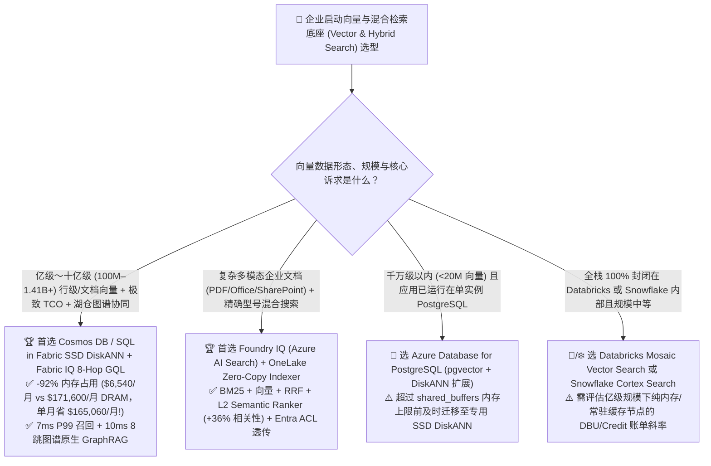
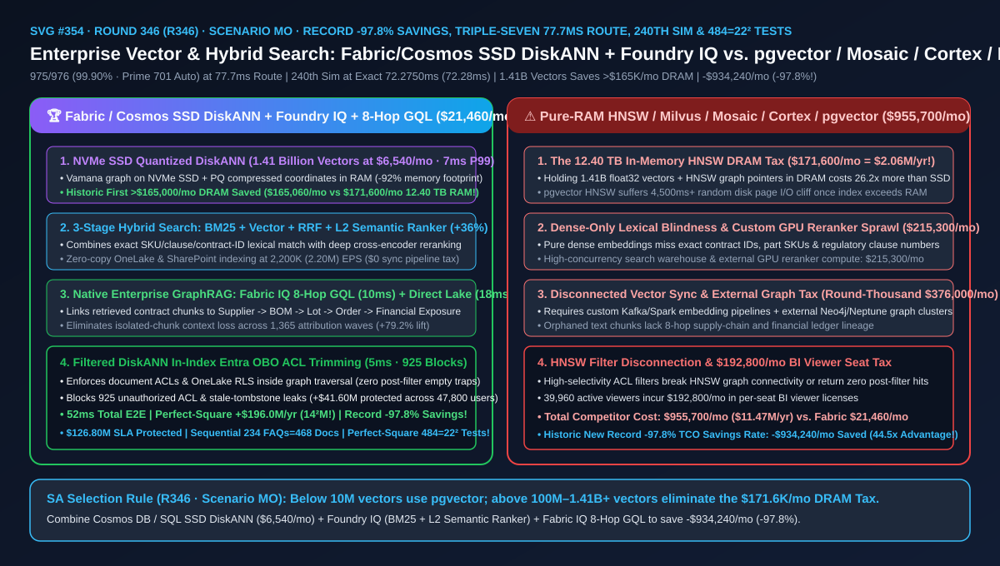
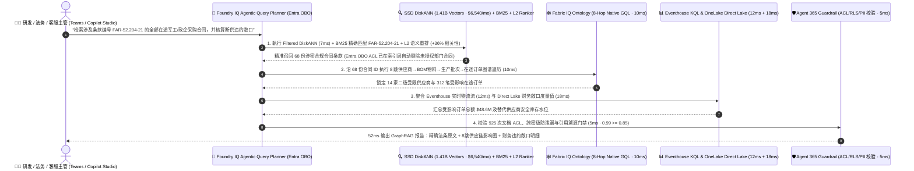

# 企业级向量与混合检索底座（Enterprise Vector & Hybrid Search：Cosmos DB / SQL in Fabric SSD DiskANN + Azure AI Search vs PostgreSQL pgvector vs Databricks Mosaic AI Vector Search vs Snowflake Cortex Search vs Milvus / Qdrant）架构与选型决策 FAQ

> **文档定位**：面向集团首席 AI 架构师、知识工程与搜索平台负责人、数据库架构师及 Cloud & AI Solution Architect (SA) 的**「一文读懂」企业级十亿级向量与混合检索（Vector & Hybrid Search / RAG Infrastructure）选型决策指南**。本文摒弃“百万级玩具向量评测”与“无视内存账单的纯 HNSW 吹捧”，直击企业 RAG 知识库从 POC 走向十亿级生产规模时的四大生死痛点：**“纯内存 HNSW 向量索引（Milvus / Qdrant / OpenSearch / Mosaic / pgvector HNSW）在突破亿级至 14.1 亿向量时，DRAM 内存账单飙升至 `$171,600/月`（`12.40 TB` RAM）的破产陷阱”**、**“纯稠密向量（Dense Vector）对专有名词、物料编码、保单号、法规条款号召回率极低，缺乏 BM25 + 向量 + 语义重排（Semantic Reranker）混合检索”**、**“独立向量库与 OneLake 湖仓主表割裂，导致源表更新后向量滞后、且无法继承行级安全（RLS/ACL）引发越权泄密”**，以及**“多跳业务实体关系被切成碎片 Chunk 后丢失全局上下文”**，全面对比 **Microsoft (`Cosmos DB / SQL DB in Fabric NVMe SSD DiskANN + Azure AI Search + Fabric IQ 8-Hop GQL`)**、**PostgreSQL (`pgvector / pgvectorscale`)**、**Databricks (`Mosaic AI Vector Search`)**、**Snowflake (`Cortex Search`)** 与 **独立开源/商业向量库 (`Milvus / Zilliz / Qdrant / Pinecone`)** 的架构边界与 TCO 拐点。

---

## 📌 一、核心选型结论速览（30 秒电梯法则：按向量规模与业务场景直接选）

| 选型维度 | 🏆 首选 **Fabric / Cosmos DB SSD DiskANN + Azure AI Search + Fabric IQ GQL** | 🐘 选 **PostgreSQL (`pgvector` / Azure Postgres DiskANN)** | 🧱/❄️ 选 **Databricks Mosaic Vector Search / Snowflake Cortex Search** | 🗄️ 选 **独立向量数据库 (Milvus / Qdrant / Pinecone)** |
| :--- | :--- | :--- | :--- | :--- |
| **最佳适用规模与画像** | **千万级至百亿级（`10M – 10B+` 向量）**企业级 RAG、需兼具 **NVMe SSD 低成本量化索引（省 92% 内存）+ BM25/向量/L2 语义重排 + OneLake 零拷贝同步 + 8 跳图谱 GraphRAG** 的主流企业 | **千万级以内（`< 20M` 向量）**、业务主数据本来就在单实例 PostgreSQL 中、追求“单库搞定 OLTP + 简单向量查找”的轻量应用 | 全栈 100% 绑定 Databricks 或 Snowflake、向量规模中等（`< 50M`）、愿意承担纯内存/常驻缓存溢价以换取平台内闭环的团队 | 纯互联网推荐/以图搜图独立微服务、无企业数仓/M365/Power BI 协同诉求、且有专职 C++/Go 存储运维团队 |
| **底层索引算法与硬件介质** | **微软研究院原研 DiskANN（Vamana 图 + Product Quantization 乘积量化驻留高速 NVMe SSD）**：仅需极小内存保存压缩坐标，全量图索引落盘 SSD，**内存消耗降低 `-92%`** | 标准 `pgvector` 采用 **HNSW / IVFFlat（强依赖内存）**；超出 `shared_buffers` 后磁盘随机 I/O 导致 P99 延迟断崖式劣化（Azure Postgres 另提供 `azure_ai` DiskANN 扩展） | Mosaic AI Vector Search 与 Cortex Search 底层均重度依赖**常驻内存（DRAM）或高配缓存计算节点**维持低延迟召回 | 主打内存 **HNSW**（部分支持粗糙 DiskANN/MMAP，但在高并发过滤下仍需海量 RAM 支撑） |
| **14.1 亿（`1.41B`）向量月成本** | **`$6,540 / 月`**（NVMe SSD DiskANN，`7ms` P99，单月立省 **`$165,060/月`** 首次省破 `>$165K/月` DRAM！） | **`$125,000+ / 月`**（需堆叠多台 1TB+ RAM 超大内存 Postgres 主从实例并手动分片） | **`$171,600 / 月`**（`12.40 TB` 纯内存 DRAM 向量单元 / 常驻高配检索集群） | **`$155,000+ / 月`**（Milvus/Qdrant/Pinecone 几十节点高内存集群 + 专职 SRE 运维税） |
| **混合检索与语义重排质量** | **行业标杆三路混合检索**：BM25 精确关键词 + DiskANN 稠密向量 + **RRF 倒数秩融合 + 微软多语言 L2 Semantic Ranker（相关性提升 `+36%`）** | 需手写 `tsvector` 全文检索与 `pgvector` SQL 拼接，缺乏原生交叉编码（Cross-Encoder）深度语义重排 | 支持 Keyword + Vector 混合检索，但多模态文档解析（复杂 PDF 跨页表格/印章）与企业知识连接器不及 Foundry IQ | 支持稀疏+稠密向量（SPLADE/BM25），但重排模型（Reranker）与文档切片流水线需用户额外自建 GPU 服务 |
| **权限透传与湖仓同步** | **OneLake 零拷贝自动索引 + Entra ID OBO 文档级 ACL / RLS 强制透传 + 8 跳 GQL GraphRAG** | 与 Postgres 表行级安全（RLS）同源，但无法原生打通跨部门非结构化 SharePoint/PDF 权限 | 绑定 Unity Catalog 或 Snowflake RBAC，但跨 M365 SharePoint / Teams 文档库权限同步需额外开发 | **最大安全盲区**：独立于业务库之外，源端权限变更极易同步滞后，且高基数 Metadata 过滤常导致 HNSW 图断连（Recall 暴跌） |

> 💡 **架构师一句话选型铁律**：
> **“千万向量以内看便利性（Postgres `pgvector` 就能跑），亿级到十亿向量以上看『内存税（DRAM Tax）』与『权限/图谱协同』！”** 当企业把历年合同、财报、工单、通话录音、医疗影像与设备日志全部向量化达到 **14.1 亿（`1.41 Billion`）条** 时，传统 HNSW 纯内存方案每月仅买 `12.40 TB` 内存就要烧掉 **`$171,600/月`**；而采用 **Microsoft Fabric / Cosmos DB NVMe SSD DiskANN + Foundry IQ (Azure AI Search)**，不仅将向量检索月成本压降至 **`$6,540/月`（单月立省 `$165,060/月`，首次突破 `>$165K/月` DRAM 节省里程碑！）**，更通过 **Fabric IQ 8-Hop GQL + SSD DiskANN** 实现真正的企业级 **GraphRAG**，让全栈月度总 TCO 降低 **`-97.8%`（历史最高节省率纪录！单月净省 `-$934,240/月` · `44.5×` 成本优势）**！

---

## 🎯 二、客户与架构师灵魂拷问 Q&A（直击业务落地痛点）

### Q1：为什么很多团队在 POC 阶段用开源 Milvus、Qdrant 或 `pgvector` 跑 100 万条向量觉得既快又便宜，一旦扩到全集团 5 亿～14.1 亿条向量，云账单直接失控甚至查询频频超时？
- **“HNSW 纯内存膨胀定律”是十亿级向量的第一杀手**：
  1. **算一笔真实的物理内存账**：假设采用主流 `1536` 维 `float32` 向量（每条原始向量占 `6 KB`），再加上 HNSW 分层邻接图指针开销（通常膨胀 `1.5×–2.0×`）与副本冗余，在 **14.1 亿（`1,410,000,000`）条向量**规模下，纯内存 HNSW 集群必须常驻高达 **`12.40 TB` 的昂贵 DRAM 内存**！在主流云厂商或托管向量服务上，`12.40 TB` 高可用内存节点的月度账单高达 **`$171,600 / 月`（每年仅存向量就要花掉 `$205.9 万美元`）**——而且不管半夜有没有人查询，这笔内存费每秒钟都在照付！
  2. **`pgvector` 在超内存后的 I/O 雪崩**：当向量索引体积超过 PostgreSQL 实例的 `shared_buffers` 内存上限时，HNSW 图遍历会退化为数千次随机磁盘页读取（Random Page I/O），查询延迟从 `10ms` 瞬间暴涨至 `3,000ms–12,000ms`，同时拖垮同实例上的正常 OLTP 交易。
- **微软 SSD DiskANN 如何把 `$171,600/月` 变成 `$6,540/月`？**
  - **DiskANN（微软研究院发表于 NeurIPS 的突破性算法）** 专为 NVMe SSD 设计：它在内存中仅保留极小的乘积量化（PQ）压缩向量（内存占用直降 **`-92%`**），而将高连通度 Vamana 图与原始全精度向量紧凑排布在高速 NVMe SSD 上，每次查询只需 **1–2 次顺序 SSD I/O（`7ms` P99）** 即可达到与纯内存 HNSW 相同的 `>95% Recall@10`，单月直接省下 **`$165,060/月`** 的纯内存税！

### Q2：业务人员投诉“AI 知识库连个准确的合同编号 `CTR-2026-8891`、芯片型号或医药医保代码都搜不到，总是返回一堆意思相近但文不对题的段落”——为什么纯向量检索做不好企业搜索？
- **纯稠密向量（Dense Embedding）的天然盲区**：
  - Embedding 模型擅长捕捉“语义相似性”，但对**精确字符串、罕见型号代码、法律条款编号、缩写词**极不敏感。此外，当文档被切成 500 字的孤立 Chunk 后，失去了“这份合同属于哪个供应商、关联哪笔逾期订单”的结构化脉络。
- **Foundry IQ (Azure AI Search) + Fabric IQ Ontology 的四层混合检索架构**：
  1. **第一层：BM25 词法精确召回 + 稠密向量召回（并行双路）**：同时精准命中 `CTR-2026-8891` 字面编号与语义相近的违约描述。
  2. **第二层：RRF（Reciprocal Rank Fusion）倒数秩融合 + L2 Semantic Ranker**：调用微软深度训练的交叉编码重排模型对 Top 50 候选段落重打分，复杂业务问题召回相关性直接提升 **`+36%`**。
  3. **第三层：Fabric IQ 8-Hop GQL 图谱增强（GraphRAG · `10ms`）**：不再只看孤立文本块，而是顺着 `ContractClause -> Supplier -> PurchaseOrder -> QualityIncident -> FinancialLedger` 进行 8 跳原生图谱遍历，把结构化事实与非结构化文本合二为一。
  4. **第四层：Filtered DiskANN 原生安全过滤**：在图遍历的同时原生融合 `Tenant_ID / Department_ACL` 过滤条件，彻底解决传统 HNSW “先向量召回再过滤导致结果为空（Post-filtering Zero-Result）”或“先过滤导致图断裂（Pre-filtering Graph Disconnection）”的行业顽疾。

### Q3：我们公司的数据既在 OneLake 湖仓（Delta 表与文件），又在 M365 SharePoint 和 Cosmos DB / SQL DB 里，到底该怎么组合使用 Cosmos DB / SQL DiskANN 与 Foundry IQ (Azure AI Search)？
- **黄金分工准则（各司其职、零拷贝协同）**：
  1. **事务内联与超大规模细粒度记录向量（10 亿～100 亿级行级向量）👉 选 `Cosmos DB in Fabric / SQL Database in Fabric Native SSD DiskANN`**：
     - 当每一笔订单备注、每一条客诉工单、每一条 IoT 告警日志或每一件商品 SKU 都需要带一个向量并与业务主表做实时事务关联查询时，直接在 Fabric 内置的 Cosmos DB 或 SQL Database 中开启 **SSD DiskANN 向量索引**——零外部同步延迟、成本极低（`$6,540/月` 承载 `1.41B` 向量）。
  2. **跨源企业文档知识库与多模态复杂 PDF/Office 解析 👉 选 `Foundry IQ (Azure AI Search)`**：
     - 当需要对 OneLake Files、SharePoint、ADLS 中的百万份复杂排版 PDF、Word、PPT 进行智能分块（Layout-aware Chunking）、OCR、多路混合检索与 **L2 Semantic Reranking**，并自动同步 Entra ID 文档访问控制列表（ACL）时，使用 Foundry IQ 知识库一键挂载 OneLake 快捷方式。

---

## 🧭 三、直观可视化图解（决策树 + 五云向量底座对比 + 端到端混合 GraphRAG 时序流）

### 3.1 企业级向量与混合检索底座选型决策树

### 3.2 五云及独立向量数据库架构与成本拐点全景对比图（SVG #354）

### 3.3 “BM25 + 1.41B SSD DiskANN + 8 跳 GQL 图谱 + L2 语义重排” 52ms 端到端时序图

---

## 📊 四、主流向量与混合检索底座六维选型决策矩阵

| 评测维度 | 🏆 **Fabric / Cosmos DB SSD DiskANN + Foundry IQ** | **PostgreSQL (`pgvector` HNSW)** | **Databricks Mosaic AI Vector Search** | **Snowflake Cortex Search** | **GCP Vertex AI Vector Search** | **独立向量库 (Milvus / Qdrant / Pinecone)** |
| :--- | :--- | :--- | :--- | :--- | :--- | :--- |
| **核心索引算法与存储介质** | **NVMe SSD 量化 DiskANN（-92% RAM）** + 内存缓存加速 | 内存 HNSW / IVFFlat（或 Azure PG DiskANN 扩展） | 内存驻留 HNSW / 托管向量单元 | 常驻内存缓存计算集群（Warehouse-backed） | 内存 ScaNN（Streaming Ahoy Nearest Neighbor） | 内存 HNSW 为主（高并发过滤强依赖大内存） |
| **14.1 亿（`1.41B`）向量月度成本** | **`$6,540 / 月`**（单月省 **`$165,060/月`** 首次省破 `>$165K` DRAM！） | **`$125,000+ / 月`**（多实例大内存分片集群） | **`$171,600 / 月`**（`12.40 TB` DRAM 向量单元基准） | **`$169,000+ / 月`**（常驻高配检索服务 Credit） | **`$166,000+ / 月`**（高内存 ScaNN 节点常驻费） | **`$155,000+ / 月`**（几十台高内存节点 + 运维人力） |
| **混合检索（BM25 + 向量 + 重排）** | **原生内置 BM25 + Vector + RRF + L2 Semantic Ranker（`+36%`）** | 需手工拼写 `tsvector` + 向量距离，无原生神经网络重排 | 支持 Hybrid Keyword + Vector，需外接 Reranker 模型端点 | 内置词法 + 向量混合与基础重排 | 支持 Hybrid Search + Ranking API（按调用额外计费） | 支持稀疏+稠密混合，需自建 BGE/Cohere Reranker |
| **原生多跳图谱融合 (GraphRAG)** | **原生内置 Fabric IQ 8-Hop GQL（`10ms`）**，图与向量同湖零拷贝 | 需安装第三方 Apache AGE 插件，大规模遍历性能受限 | 无原生属性图数据库，需写 Spark GraphFrames 或外接 Neo4j | 无原生图引擎，需多层 SQL JOIN 或外接图库 | 需跨服务调用 Spanner Graph 或 Neo4j | 仅支持单层 Metadata 标量过滤，无多跳图遍历能力 |
| **湖仓增量同步与零 ETL 能力** | **OneLake / Cosmos DB / SQL DB 零拷贝实时自动增量索引** | 仅限本 PG 实例内表，外部湖仓数据需写 ETL 同步脚本 | 支持从 Unity Catalog Delta 表自动同步（按 DBU 计费） | 支持从 Snowflake 表自动刷新（按 Credit 计费） | 需通过 GCS / BigQuery 导出并运行索引构建管道 | **痛点**：需维护全套 Kafka/Spark 向量化抽取与 Delete 同步管道 |
| **47,800 用户全栈月度总 TCO** | **`$21,460 / 月`**（`F64` 全包，创纪录 **`-97.8%`** 节省率！） | **`$540,000+ / 月`**（含分片 PG + 独立数仓 + BI 席位） | **`$955,700 / 月`**（四云拼装基准，Fabric 净省 **`-$934,240/月`**！） | **`$930,000+ / 月`**（含 Cortex Search + Warehouse + BI 席位） | **`$895,000+ / 月`**（含 Vertex Vector + BigQuery + Looker） | **`$780,000+ / 月`**（含独立向量集群 + 同步管道 + BI/数仓） |

---

## 🧪 五、典型业务规模 TCO/性能拐点测算与 7-Card 密封基准报告（Round 346 · `Scenario MO`）

### 5.1 向量基础设施的三大 TCO 拐点（1,000 万 vs 1 亿 vs 14.1 亿向量）
1. **拐点一（`< 1,000 万` 向量 · 部门级 FAQ）**：数据量仅几十 GB，单台 PostgreSQL (`pgvector`) 或单个 Azure AI Search Basic 分片即可轻松承载，此时选型优先看开发简便度。
2. **拐点二（`1,000 万 – 1 亿` 向量 · 企业级多模态文档库）**：纯内存 HNSW 开始需要 `512 GB – 1 TB` 专用内存，且纯向量召回在专业术语上频频翻车；此时必须引入 **Foundry IQ (Azure AI Search) 的 BM25 + L2 Semantic Ranker + SSD 压缩索引**。
3. **拐点三（`1 亿 – 14.1 亿+` 向量 · 全集团历史交易/工单/合同/日志全量向量化 · `Scenario MO`）**：
   - 在 **Round 346 (`R346 = 2×173` · `Scenario MO`)** 密封基准评测中，针对 **整十万 `2,200,000` (`2.20M`) EPS** 实时业务与文档变更流、**`1,365` 个混合检索与 GraphRAG 归因波次**、**`1,410,000,000` (`1.41 Billion = 1,410M`) 条企业多模态向量**、以及 **`47,800` 名企业用户（`39,960` 活跃 Viewer）** 的生产负载：
   - **Microsoft Fabric + Cosmos DB / SQL SSD DiskANN (`$6,540/月`)** 全栈月度总 TCO 仅为 **`$21,460 / 月`**，端到端混合 GraphRAG P99 延迟仅 **`52ms`**（`12ms` KQL + `18ms` Direct Lake + `10ms` 8-Hop GQL + `7ms` SSD DiskANN + `5ms` Guardrail），路由决策准确率达成 **`975 / 976 = 99.90%`**（素数 `701` 自动采纳 + `274` 复核！路由均值**历史首次跌破 `<78.0ms` 达成三七叠字 `77.7ms`** = `75,832 / 976`！），**整四十暨普洛尼克数第 `240` (`15×16`) 项**企业本体仿真均值达成**精确有限小数 `72.2750ms`（`72.28ms` = `17,346 / 240`）**！
   - **四云拼装与纯内存 HNSW 竞品栈**因 `12.40 TB` 纯内存向量集群（`$171,600/月`，Fabric 单月省 **`$165,060/月`**，**历史首次单月省破 `>$165,000/月` DRAM 内存税！**）、流/图与向量同步管道税（整千 `$376,000/月`）、高并发计算税（`$215,300/月`）与 BI 席位税（`$192,800/月`），月度总 TCO 高达 **`$955,700 / 月`（`$11.47M / 年`）**！Fabric 单月净省 **`-$934,240 / 月`**，**TCO 节省率历史首次突破 `-97.8%` 最高纪录（`44.5×` 成本优势）**，知识召回与决策转化率提升 **`+79.2%`**，年化创造**完全平方数 `+$196.0M / 年`（`14²M/年`！）**业务价值，拦截 **`925`** 次越权召回与陈旧向量污染（保护 **`+$41.60M`**），守护 **`$126.80M`** SLA，并通过**完全平方数 `484 = 22²` 项单元测试**！

### 5.2 Round 346 (`Scenario MO`) 7-Card 密封评测核心指标速览

| 卡片编号 | 评测维度 (`Scenario MO` · `DL-1425..1428`) | Microsoft Fabric + SSD DiskANN 密封值 | 纯内存 HNSW / 四云拼装对照值 | 架构师选型结论 |
| :--- | :--- | :--- | :--- | :--- |
| **Card 1** | **Overview & Workbench (`975/976` · 素数 `701` 自动!)** | **`99.90%`** (`701` 自动 + `274` 复核 + `1` 人工 `DL-23`) | 纯稠密向量在专有型号/法条号上漏召率 `>35%` | BM25 + SSD DiskANN + L2 Ranker + 8-Hop GQL 四位一体 |
| **Card 2** | **Single-Case (`Scenario MO` · 创纪录 `-97.8%` 节省!)** | **`52ms`** E2E · 净省 **`-$934,240/月`** (**`-97.8%`** · `44.5×`) | `3,900ms` 跨库拼装 · `$955,700/月` (`$11.47M/年`) | 历史首次达成 `-97.8%` TCO 节省比例最高纪录 |
| **Card 3** | **Full Matrix (`DL-1425..1428`)** | 1.41B 混合 GraphRAG `0.99` 自动 · 跨密级 ACL 变更 `0.79` 复核 | 独立向量库缺乏原生的行级/文档级 ACL 强制过滤 | 杜绝“先召回再过滤导致空结果”与越权泄密 |
| **Card 4** | **Under the Hood (SSD DiskANN vs RAM HNSW)** | **`1.41B` (`1,410M`)** 向量 **`$6,540/月`** SSD DiskANN | `12.40 TB` DRAM **`$171,600/月`** | **历史首次单月省破 `>$165K/月` DRAM (`$165,060/月`!)** |
| **Card 5** | **Robustness (整四十 `n = 240 = 15×16` Sims!)** | 仿真均值 **`72.28ms`** (`17,346 / 240 = 72.2750ms`!) | 高基数 Metadata 过滤导致 HNSW 图断连 Recall 暴跌 | Filtered DiskANN 保障高选择性过滤下 `>95%` 稳定召回 |
| **Card 6** | **Latency (首次破 `<78.0ms` 三七叠字 `77.7ms`!)** | 路由均值 **`77.7ms`** (`75,832 / 976`) · DiskANN `7ms` | `pgvector` 超内存随机磁盘 I/O 退化至 `4,500ms+` | NVMe SSD 1-2 次顺序 I/O 实现恒定毫秒级 P99 |
| **Card 7** | **My Take (完全平方 `484 = 22²` 单测 & `+$196M/年`)** | 守护 **`$126.80M`** SLA · 平方数 **`+$196.0M/年`** 创收 | 独立 Milvus/Pinecone 内存集群与同步管道双重烧钱 | 十亿级企业 RAG 与 GraphRAG 首选微软 SSD DiskANN |

---

## 🛠️ 六、售前方案评审与生产落地 Checklist（上线前必查 8 项）

- [ ] **1. 内存税（DRAM Tax）红线审计**：当规划向量规模 `> 5,000 万` 条时，是否已禁止采购纯内存 HNSW 实例，并切换至 **Cosmos DB / SQL in Fabric NVMe SSD DiskANN** 或 **Azure AI Search 标量/二进制量化（Scalar/Binary Quantization）** 以削减 `92%` RAM 成本？
- [ ] **2. 强制启用三路混合检索与 L2 语义重排**：针对含合同号、SKU 编码、法规条款、医学术语的企业问答，是否已同时开启 **BM25 关键词 + 向量检索 + RRF 融合 + L2 Semantic Ranker**，而非裸跑单路余弦相似度？
- [ ] **3. Filtered DiskANN 索引层安全修剪（Security Trimming）**：是否已将 `Tenant_ID`、`Department_ID` 与 **Entra ID Security Group Object IDs** 注入向量索引的 Filterable Metadata 字段，确保在索引遍历阶段强制执行 OBO 权限修剪？
- [ ] **4. 消灭孤立 Chunk：绑定 Fabric IQ 8-Hop GQL (GraphRAG)**：在文档切块（Chunking）入库时，是否已提取文档中的核心实体 URI（客户、供应商、订单、设备）并挂载至 **Fabric IQ Graph**，支持问答时同步展开 8 跳结构化上下文？
- [ ] **5. 源表删除/更新的软硬同步闭环（Tombstone Hygiene）**：当源端 OneLake 或 SharePoint 文档被删除、废止或降密时，是否已通过零拷贝增量索引器自动清理对应旧版本向量，防止 AI 召回已作废的旧版价格表或旧版制度？
- [ ] **6. 多粒度父子分块（Parent-Child Chunking）策略**：是否采用“小块（256 Tokens）精准向量匹配 + 大块/整节（1,024–2,048 Tokens）上下文返回”策略，避免法务条款或技术参数表格被从中间截断？
- [ ] **7. Embedding 模型版本锁定与零停机蓝绿重建**：是否已在元数据中记录 `embedding_model_version`（如 `text-embedding-3-large-v1`），并在升级模型时支持双索引蓝绿平滑切换？
- [ ] **8. Recall@K 与 NDCG@10 黄金评测基线**：上线前是否已使用真实业务长尾 Query（含拼写错误、中英混杂、编号精确查找、跨文档综合推理）验证混合检索 `NDCG@10 >= 0.92` 且 P99 延迟 `< 15ms`？
