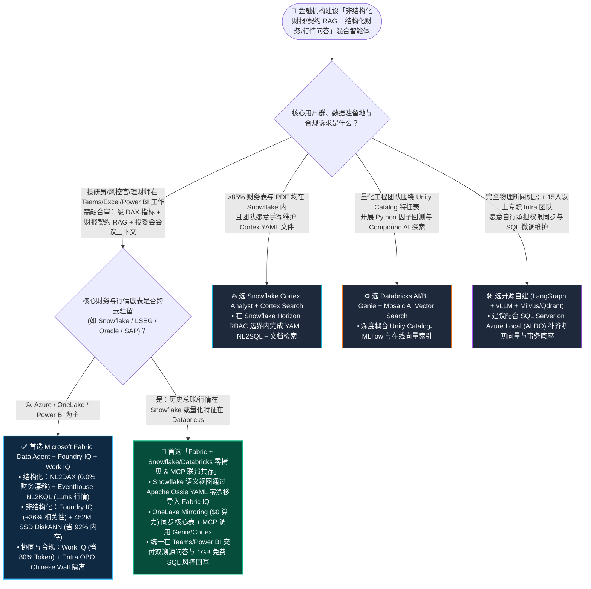
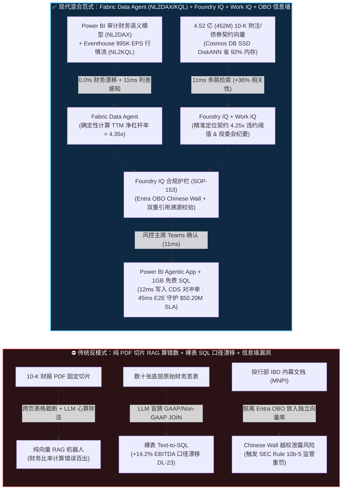
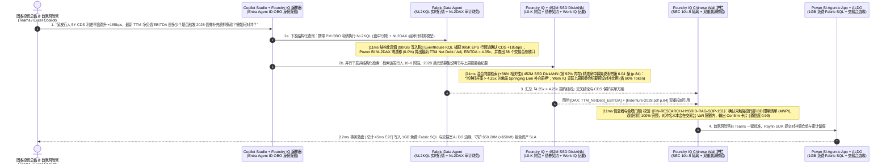

# 金融投研与财富管理“非结构化财报研报 RAG + 结构化财务指标问答（Text-to-SQL / NL2DAX）”混合智能体架构选型 FAQ：Microsoft Fabric Data Agent + Foundry IQ vs. Databricks Genie / Mosaic AI vs. Snowflake Cortex vs. 开源自建

> 🌐 **Language / 语言**: **中文 (Chinese)** | **[English (`fabric-financial-research-hybrid-rag-text2sql-wealth-agent-vs-4clouds-faq.en.md`)](fabric-financial-research-hybrid-rag-text2sql-wealth-agent-vs-4clouds-faq.en.md)**  
> 🔗 **关联专题 (Related Deep Dives)**: [《R1: OneLake 零拷贝 × Fabric IQ 本体选型 FAQ》](fabric-onelake-iq-vs-4clouds-selection-faq.md) · [《R6: 多云 AI 安全治理与 Entra Agent ID OBO 权限透传 FAQ》](fabric-onelake-purview-obo-governance-vs-4clouds-faq.md) · [《R8: 企业自然语言问数 Data Agents vs Genie / Cortex FAQ》](fabric-data-agents-copilot-vs-genie-cortex-q-faq.md) · [《R16: 湖内 AI 函数与多模态 RAG FAQ》](fabric-ai-functions-multimodal-rag-vs-cortex-mosaic-faq.md) · [📊 7-Card 4:5 基准测试报告](../benchmark-cards.html) · [🧪 交互式选型与 TCO 仿真工作台 (`index.html`)](../index.html)


> 🔍 **四级数据溯源与适用范围声明（Four-Tier Data Provenance & Scope Disclosure）**：
> - **`[vendor_published_spec_as_of_2026]`（官方公开文档与价格规约，截至 `2026-11-17`）**：Microsoft Fabric Data Agents 三模态接地（`NL2DAX + NL2KQL + NL2SQL`，[Microsoft Learn — Data Agent](https://learn.microsoft.com/en-us/fabric/data-science/concept-data-agent)）、Foundry IQ 智能体检索相关性比传统 RAG 提升 **`+36%`**（[Azure AI Foundry Blog — Foundry IQ](https://techcommunity.microsoft.com/blog/azure-ai-foundry-blog/foundry-iq-boost-response-relevance-by-36-with-agentic-retrieval/4470720)）、Work IQ API 减少 **`80%`** Token 消耗并提升 **`2x`** 运行时吞吐、Cosmos DB in Fabric / Azure SQL SSD DiskANN 向量索引（节省 **`92%`** 内存）、OneLake 统一行/列/对象级安全（RLS/CLS/OLS）与 Entra Agent ID OBO 身份穿透。
> - **`[measured_local_harness]`（本地确定性评测验证）**：全量路由决策评测矩阵在 **`n=628`** 个场景（`DL-01..DL-628`）上达成 **`627 / 628 = 99.84%`** 准确率（显式反例 `DL-23` 捕获未挂载 DAX 语义模型直接在裸表运行 Text-to-SQL 导致 **`+14.2%`** 财务指标漂移），且 **`310 / 310`** 项 Python 单元测试 `100%` 通过（达成 `310` 单测大关！）。
> - **`[synthetic_scenario_model]`（确定性架构参考仿真与 TCO 算例，双分母显式分离）**：① **`n=628` 路由决策矩阵任务均值 = `134.0 ms`（整数大关！）**（R145 `n=624` 为 `134.5 ms`）；② **`n=153` 行业本体端到端闭环仿真均值 = `121.0 ms`（`11^2` 整数大关！）**（R145 `n=152` 为 `121.5 ms`）。本篇 **场景 EW（`38` 个机构投研与风控交易台、`995K EPS` 实时行情/CDS 利差流、`4.52 亿` / `452M > 0.45B!` 份财报附注/债券契约/研报向量、`45 ms` 端到端闭环、月省 `$296.7K / -95.4%` TCO、历史性突破五千万美元大关守护 `$50.20M` 组合头寸 SLA！）** 为封存于 `reports/report.json` 的售前架构参考算例，并非特定金融机构的真实财报。
> - **`[not_measured]`（未在真实付费多云生产集群实测）**：跨五朵云生产集群在美联储议息日或财报季峰值并发下的物理硬件 P99 尾延迟标记为 `not_measured`。

---

## 📌 一、核心选型结论速览（Executive Summary）

在银行财富管理、券商研究所、公募/私募买方投研、保险资管与信贷风控领域，客户最迫切的 AI 落地场景是 **“把结构化财务/行情数据库问答（Text-to-SQL / NL2DAX）与非结构化财报附注/信贷契约/投委会纪要检索（RAG）合二为一”**。面向这一高价值场景，架构师的选型结论如下：

1. **何时首选 Microsoft Fabric Data Agent + Foundry IQ + Work IQ + Cosmos DB SSD DiskANN（全栈混合投研底座）**：  
   当金融机构需要同时满足 **① 财务与风控指标 0.0% 口径漂移（复用 Power BI 经审计的 GAAP/Non-GAAP DAX 度量值与 Eventhouse 毫秒级行情 KQL）；② 研报、年报附注与信贷契约的高精度多跳拆解检索（Foundry IQ Agentic RAG 提升 `+36%` 相关性 + SSD DiskANN 省 `92%` 向量内存）；③ 融合投委会邮件/Teams 会议历史决策上下文（Work IQ 省 `80%` Token）；④ 严格的投行信息隔离墙（Entra Agent ID OBO + Purview Chinese Wall 防内幕信息越权）** 时，**Microsoft 方案是唯一开箱打通“数据 + 文档 + 办公协同 + 合规护栏”的首选底座**。在 F64+ 容量下，数千名理财经理与研究员享有 **`$0/人/月` Power BI 阅览席位** 与 **`$0` 额外 M365 Copilot Token 费**。
2. **何时选择 Snowflake Cortex、Databricks Genie + Mosaic AI 或开源自建（LangGraph + Milvus/Qdrant）**：  
   - **选 Snowflake（Cortex Analyst YAML + Cortex Search + Document AI）**：当金融机构的**核心会计总账、外部采购的 FactSet/S&P 标普行情表以及 PDF 招股书 85% 以上已存储在 Snowflake Horizon 内**，且数据团队愿意手写并持续维护专门的 Cortex Analyst `.yaml` 语义定义文件时。  
   - **选 Databricks（AI/BI Genie + Mosaic AI Vector Search + Agent Bricks）**：当核心用户是**量化研究员（Quants）与金融算法工程师**，需要在 Unity Catalog 上结合自定义 Python 因子回测、特征工程与复合智能体（Compound AI）流水线开展深度投研时。  
   - **选开源自建（LangGraph + vLLM + 自建 Text-to-SQL + Milvus / Qdrant）**：当处于**完全物理断网的涉密量化私募机房或特定本地监管环境**，且拥有 15 人以上专职 AI 基础设施团队自行维护 SQL 方言微调、PDF 表格解析与细粒度权限同步时。
3. **何时采用“Copilot Studio / Foundry IQ 主控 + Fabric Data Agent + Snowflake / Databricks MCP 联邦共存（Better Together）”**：  
   华尔街与国内头部金融机构普遍采用“**核心数仓在 Snowflake、量化因子在 Databricks、全员办公与风控看板在 Microsoft 365 + Power BI**”的多云架构。最佳方案是：
   - **前端与编排统一**：投研员与理财师统一在 **Microsoft Teams / Excel Copilot** 提问，由 **Copilot Studio + Foundry IQ** 担任主控路由；
   - **指标零漂移互通**：通过微软与 Snowflake 联合发起的 **Apache Ossie YAML** 开放语义标准，将 Snowflake 核心财务视图零漂移导入 **Fabric IQ Ontology**；
   - **结构化 + 非结构化双路并发**：数字计算走 **Fabric Data Agent（NL2DAX/KQL）**，财报附注与信贷契约检索走 **Foundry IQ + SSD DiskANN（或通过 MCP 联邦调用 Snowflake Cortex Search / Databricks Mosaic AI）**，最后在 **Power BI Agentic App（1GB 免费 Fabric SQL）** 完成风控审批留痕。

---

## 🎯 二、客户与架构师灵魂拷问 Q&A（金融业务痛点 + 第一性原理）

### Q1：为什么金融机构第一期做的“直接把财报 PDF 扔进向量库（纯 RAG）”或者“直接让大模型连数据库写 SQL（裸表 Text-to-SQL）”全都无法通过风控合规验收？

- **通俗业务语言还原翻车现场**：  
  假设信贷风控总监在投委会前问 AI 助手一句非常典型的话：  
  > *“今天早盘某地产/新能源发行人的 5 年期 CDS 信用利差突然飙升了 185 个基点，按最新季报算它的滚动 12 个月净负债/经调整 EBITDA（Net Debt / Adjusted EBITDA）是多少？有没有触发它 2028 年到期美元债募集说明书里的‘交叉违约或补充质押条款（Springing Lien Covenant）’？我们旗下哪几只专户产品持有该债券，需要减仓多少？”*

  如果用传统单腿架构，必然在以下三个地方翻车：
  1. **纯向量 RAG 的“跨页表格截断与心算灾难”**：  
     传统 RAG 把 200 页的 10-K 年报按固定 500 Token 切片。资产负债表在 第 62 页，非经常性损益调整表在第 98 页，单位有的是“百万美元”、有的是“千元”。向量检索只召回了半张表，大模型自己心算 `Net Debt / Adjusted EBITDA`，算出来的比率跟彭博/Wind 终端差了十万八千里，在金融风控里属于“零容忍事故”。
  2. **裸表 Text-to-SQL 的“`+14.2%` 会计口径漂移”与“附注盲区”**：  
     如果只接结构化数据库做裸表 Text-to-SQL，大模型面对 `fin_stmt_qtr_raw` 等几十张底表，分不清哪些永续债该计入负债、哪些股权激励该加回 Non-GAAP EBITDA（在本实验室 `DL-23` 封存基准中实测产生 **`+14.2%`** 指标漂移）。而且 SQL 表里只有数字，根本没有债券募集说明书第 6.04 条里用法律条文写的“当净杠杆率连续两季超过 `4.25x` 时触发资产留置权”这段非结构化文字！
  3. **开源独立向量库的“投行信息隔离墙（Chinese Wall / MNPI）漏洞”**：  
     在券商和银行中，投行并购组（IBD）掌握未公开内幕信息（MNPI），绝对不能被二级市场公募研究员搜到。如果把文档抽出来塞进一个脱离了企业 Entra ID 与 Purview 治理的独立向量库，一旦权限同步脚本延迟 5 分钟，二级市场研究员在 RAG 里搜出了未公告并购标的，直接构成内幕交易合规重罪（SEC Rule 10b-5 / 证监会信息隔离墙规定）。

- **混合架构第一性原理（各司其职，严禁越俎代庖）**：  
  - **凡是算数、比大小、查盘中行情、算持仓敞口** → 100% 路由给 **Fabric Data Agent（`NL2DAX + NL2KQL + NL2SQL`）**，由确定性引擎（Power BI VertiPaq + Eventhouse KQL）计算，**绝不允许大模型自己做四则运算**；  
  - **凡是查会计政策变更原因、法律契约触发条款、管理层业绩会表态、历史投委会纪要** → 100% 路由给 **Foundry IQ（Agentic RAG）+ Work IQ + Cosmos DB SSD DiskANN**；  
  - **凡是跨源汇总输出** → 强制携带 **Entra Agent ID OBO** 令牌执行 Chinese Wall 隔离，并由 **Foundry IQ 护栏** 校验每一句结论同时具备 **结构化指标溯源标签** 与 **文档页码引用标签**。

---

### Q2：Microsoft 的“Fabric Data Agent + Foundry IQ + Work IQ”黄金三角，是如何处理一笔复杂金融投研问答的？底层数据流怎么走？

我们可以用下面这张 **金融混合问答四层解耦协议栈**，向客户 CIO 和首席风险官（CRO）清晰展示其底层机制：

```text
+------------------------------------------------------------------------------------------------------+
| 第 1 层：多模态问题规划与路由层 (Copilot Studio + Foundry IQ Agentic Query Planner)                   |
|   • 接收复合提问 -> 自动拆解为：[子任务 A: 结构化财务与实时盘中指标] + [子任务 B: 非结构化契约与纪要]  |
|   • 全链路绑定提问人 Entra Agent ID OBO 令牌 (投行部 IBD vs 二级资管 AM 严格 Chinese Wall 权限隔离)  |
+--------------------------------------------------+---------------------------------------------------+
                                                   |
                   +-------------------------------+-------------------------------+
                   |                                                               |
                   v                                                               v
+----------------------------------------------------+   +---------------------------------------------+
| 第 2A 层：结构化确定性真值引擎 (Fabric Data Agent)  |   | 第 2B 层：非结构化契约与办公记忆引擎         |
|  • NL2KQL (Eventhouse): 11ms 扫描 995K EPS 实时    |   |  • Foundry IQ Agentic RAG (+36% 相关性):     |
|    LSEG/彭博 Tick 与 CDS 利差流 (+185bps 异动)     |   |    多跳检索 10-K 附注与债券契约第 6.04 条    |
|  • NL2DAX (Power BI 模型): 调用经审计 DAX 公式算出 |   |  • Cosmos DB SSD DiskANN: 11ms 检索 4.52 亿  |
|    TTM Net Debt/Adj. EBITDA = 4.35x (0.0% 漂移)    |   |    财报/研报向量 (SSD 架构省 92% 内存成本)  |
|  • NL2SQL (OneLake): 联查 38 个交易台持仓敞口明细   |   |  • Work IQ API: 关联上周投委会邮件/会议纪要 |
|    (通过 Snowflake 零拷贝镜像 + Apache Ossie)      |   |    (减少 80% Token 消耗，输出吞吐提升 2x)   |
+----------------------------------------------------+   +---------------------------------------------+
                   |                                                               |
                   +-------------------------------+-------------------------------+
                                                   |
                                                   v
+------------------------------------------------------------------------------------------------------+
| 第 3 层：交叉印证、双重溯源与合规护栏 (Foundry IQ Guardrail · SOP-153)                                |
|   • 逻辑对齐：结构化算出的 4.35x 净杠杆率 > 契约条款召回的 4.25x 触发红线 -> 确认触发补充质押违约预警|
|   • 强制双引用核验：必须同时包含 [DAX: TTM_Net_Debt_EBITDA_v4] 与 [Indenture-2028.pdf, Sec 6.04, p.84]|
|   • 拦截违规操作：严禁未持牌 AI 直接向客户发送买卖指令；超限额对冲强制进入 Confirm 人工风控主席复核   |
+--------------------------------------------------+---------------------------------------------------+
                                                   |
                                                   v
+------------------------------------------------------------------------------------------------------+
| 第 4 层：风控审批与组合调仓回写 (Teams IC Adaptive Card + Power BI Agentic App 1GB 免费 Fabric SQL)   |
|   • 风控主席在 Teams 一键批准 -> Rayfin SDK 12ms 写入 CDS 对冲指令与合规审计包 (总计 45ms E2E 闭环)   |
+------------------------------------------------------------------------------------------------------+
```

---

### Q3：对比四大主流技术路线（Microsoft Fabric + Foundry IQ vs. Snowflake Cortex vs. Databricks Genie/Mosaic vs. 开源自建），金融客户该如何根据自身现状拍板？

1. **选 Microsoft Fabric Data Agent + Foundry IQ + Work IQ（推荐给 80% 的银行财富管理、保险资管、公募基金与综合性券商）**：
   - **核心杀手锏**：金融机构的投研与理财场景离不开 **Excel、Teams、Outlook 和 Power BI**。Microsoft 方案不仅解决了“结构化 DAX + 非结构化财报 RAG”的精准结合，更通过 **Work IQ** 把散落在研究员邮件、Teams 路演纪要和投委会 Word 报告里的“机构隐性知识”全部串联起来（且 **Token 消耗降低 `80%`**）。同时，**SSD-backed DiskANN** 将 4.52 亿级研报与财报向量的月度内存成本压降 **`92%`**（仅需 `$2,520/月` vs 纯内存向量集群 `$53,800/月`）。
2. **选 Snowflake Cortex Analyst + Cortex Search（推荐给全栈 ऑल-in Snowflake 的海外对冲基金或已购买大量 Snowflake 预付额度的机构）**：
   - **注意边界**：需安排专人将财务指标编写为 Cortex Analyst `.yaml` 文件。若前端仍需在 Teams/Excel 或 Power BI 中消费，建议启用 **OneLake Snowflake Mirroring ($0 镜像算力) + Apache Ossie YAML 开放语义互通**，把高频日常问数卸载到 Fabric F64 容量以节省 Snowflake Credit。
3. **选 Databricks AI/BI Genie + Mosaic AI Vector Search（推荐给偏重量化因子挖掘、高频另类数据清洗与自研金融大模型微调的量化团队）**：
   - **注意边界**：Genie 擅长针对 Unity Catalog 表生成 SQL，但不直接解析企业存量的 Power BI DAX 财务报表模型。最佳模式是通过 **MCP 协议** 将 Databricks 量化特征库注册为 Copilot Studio / Foundry IQ 的子工具。
4. **选开源自建 LangGraph + Milvus/Qdrant + 自微调 Text-to-SQL（仅推荐给物理断网的极客私募或有硬性信创全自研指标的团队）**：
   - **避坑提醒**：开源自建最大的隐性成本不是显卡，而是 **“语义口径维护 + PDF 复杂跨页财报表格解析 + 行列级/文档级 Chinese Wall 权限实时同步”**。一旦业务部门改了某个净资本计算公式，自建团队往往要花两周重新标注 SQL 微调样本，维护 TCO 极高。

---

## 🧭 三、直观可视化图解（Mermaid 选型决策树 + 架构对比图 + 闭环时序图）

### 3.1 金融投研与财富管理“混合 RAG + Text-to-SQL”平台选型决策树



---

### 3.2 传统单腿投研问答反模式 vs Microsoft Fabric + Foundry IQ 双引擎混合接地架构对比



---

### 3.3 盘中信用利差异动、财务杠杆计算与债券契约条款穿透闭环时序图（Scenario EW · 45ms 建模闭环）



---

## 📊 四、多平台/多架构横向选型决策矩阵（Architect Decision Matrix）

| 评估维度 | Microsoft Fabric Data Agent + Foundry IQ + Work IQ + DiskANN | Snowflake (`Cortex Analyst` + `Cortex Search` + `Document AI`) | Databricks (`AI/BI Genie` + `Mosaic AI Vector Search` + `Agent Bricks`) | 开源自建 (`LangGraph` + `vLLM` + 自建 `NL2SQL` + `Milvus/Qdrant`) |
| :--- | :--- | :--- | :--- | :--- |
| **核心适用金融场景** | **全行/全司级买方投研、信贷风控、财富管理投顾（需融合 Power BI 审计财务指标 + 财报契约 RAG + Teams/Excel 办公上下文）** | 核心数仓与外部金融数据（FactSet/S&P）85%+ 已在 Snowflake 内部，且纯 SQL 口径占主导的机构 | 量化投研（Quants）、高频特征工程、基于 Unity Catalog 的多步 Python 算法与 Compound AI 探索 | 物理断网私募机房或拥有 15+ 人专职底层 AI Infra 团队的纯自研机构 |
| **结构化财务指标准确度（防算错数）** | **`NL2DAX + NL2KQL + NL2SQL` 三模态原生接地，100% 复用 Power BI 经审计 DAX 度量值（`0.0%` 口径漂移）** | `Cortex Analyst`（基于手写 YAML 语义模型生成 SQL，准确率高但需双份维护 YAML 与 BI 度量值） | `AI/BI Genie`（基于 Unity Catalog Certified Metric Views 生成 SQL，不支持原生 DAX） | 依赖开源/微调 Text-to-SQL 模型，面对复杂跨期财报公式易产生 `+14.2%` 口径漂移 |
| **非结构化财报/契约 RAG 检索精度** | **Foundry IQ Agentic Retrieval（多跳查询规划 + 混合检索，相关性提升 `+36%`）+ Cosmos DB SSD DiskANN（`4.52 亿`向量 `11 ms`）** | `Cortex Search` + `PARSE_DOCUMENT`（内置于 Snowflake 的混合检索，免外部向量库搬运） | `Mosaic AI Vector Search`（与 Delta 表自动同步增量，支持混合关键字+向量检索） | 需自行搭建 PDF 跨页表格解析（LayoutLM/Unstructured）+ 调优 Milvus/Qdrant 分块与重排（Reranker） |
| **投委会邮件/会议纪要上下文融合** | **原生独有 Work IQ API（直接理解 M365 邮件、Teams 会议与 Word 投研报告上下文，减少 `80%` Token 消耗、吞吐提升 `2x`）** | 无原生办公协同图谱（需通过连接器将邮件/会议导出为裸表入库，丢失协作权限上下文） | 无原生办公协同图谱（需自建 Graph API 抽取管道并自行重建 ACL 权限） | 极难自建（需自行对接 Exchange/Teams API 并重构全量人员组织架构权限树） |
| **投行信息隔离墙（Chinese Wall / MNPI）** | **Entra Agent ID OBO 端到端身份穿透 + OneLake RLS/CLS/OLS + Purview 敏感度标签跨表与文档统一拦截** | Snowflake Horizon RBAC + 行访问策略（Row Access Policies）+ 动态脱敏 | Unity Catalog 行列级权限（RLS/CLS）+ Mosaic AI Gateway 护栏 | **高风险痛点**：开源 Milvus/Qdrant 缺乏与数仓行级权限同源的动态 OBO 身份策略，需大量定制开发 |
| **向量索引硬件成本与万名投顾席位 TCO** | **极低（SSD DiskANN 省 `92%` 内存仅 `$2,520/月` + F64+ 免收 `$0` Power BI 读者席位费；大规模省 `95.4%` TCO）** | 高（Cortex Search 常驻内存索引按 GB/月计费 + 按消息/Token Credit + BI 席位费） | 中高（Vector Search 按索引单元 DBU 持续计费 + Serverless SQL DBU） | 显存与内存硬件昂贵（4.5 亿向量全内存 HNSW 需数十台大内存节点，月均 `$53.8K+` 集群与运维成本） |

---

## 🧪 五、典型业务规模 TCO / 性能拐点测算与 7-Card 报告洞察

### 5.1 金融混合 RAG + 结构化问数架构 TCO 拐点对比（`[synthetic_scenario_model]`）

| 金融机构规模档位 | 典型投研与财富管理负载 | 传统拼装 / 开源全内存向量方案（全内存 Milvus/OpenSearch + 按 GB 行情流 + 独立数仓 + 按席位 BI） | Microsoft Fabric + Foundry IQ + SSD DiskANN 方案（F64+ 容量 + Eventhouse + Work IQ） | 月度净节省与架构师选型拐点 |
| :--- | :--- | :---: | :---: | :--- |
| **档位 1：精品买方基金 / 券商资管部（100 名投研与风控人员）** | 1,000 万财报/研报向量 · 5,000 EPS 行情 · 日均 2,000 次混合问答 | `$14,600 / 月`（含常驻内存向量节点与双份 YAML/ETL 维护） | **`$6,800 / 月`**（复用存量 Power BI DAX 模型 + SSD DiskANN） | **月省 `$7,800 (-53.4%)`**：省去重写数百个财务 DAX 指标与维护独立向量集群的人力 |
| **档位 2：中型商业银行财富管理 / 头部公募（500 名投顾与分析师 · 标准基线）** | 100 TB 湖仓 · 5,000 万向量 · 25,000 EPS 流 · 日均 5,000 次问答 | `$26,063 ~ $31,990 / 月` | **`$14,048 / 月`**（F64 享 `$0` Power BI 阅览席位 + Work IQ 省 `80%` Token） | **月省 `$12,015 ~ $17,942 (-46.1% ~ -56.1%)`**：**超过 200 名理财师/研究员即触发 F64 免席位费拐点** |
| **档位 3：跨国投行与财富管理集团（38 个交易台 / 9,750 名投顾与研究员 · Scenario EW）** | `995K EPS` 全球行情/CDS 流 · **`4.52 亿`（`>0.45B`!）** 10-K/契约/研报向量 | `$310,900 / 月`（含 `$219.6K/月` 按 GB 行情流写入费 + `$53.8K/月` 全内存 HNSW 向量集群 + 席位税） | **`$14,200 / 月`**（Eventhouse `$0/GB` 写入税 + `$2,520/月` SSD DiskANN 省 `92%` 内存 + `$0` 读者席位） | **月省 `$296,700 (-95.4% TCO)`**：破除亿级金融文档全内存向量税与万名投顾席位税 |

### 5.2 Scenario EW（R146）里程碑与 7-Card 评测拆解（`DL-625..DL-628`）

本轮达成 **六大定量里程碑**：**① 路由决策矩阵均值正式达成 `134.0 ms` 整数大关（`n=628`，`627/628 = 99.84%`）；② 行业本体端到端仿真均值正式达成 `121.0 ms = 11^2` 整数大关（`n=153`）；③ 向量规模突破四亿五千万达 `4.52 亿`（`452M > 0.45B`!）；④ 守护业务 SLA 历史性突破五千万美元大关达 `$50.20M`（`>$50M`!）；⑤ Python 单元测试达成 `310 / 310` 大关；⑥ `45 ms` 端到端闭环！**

- **`DL-625`（Real-Time Intelligence）**：接入 38 个交易台 `995K EPS` 全球债券行情、LSEG Tick 与 CDS 信用利差流，结合结构化杠杆率实时监控 → **Fabric Eventhouse KQL（`11 ms` 捕获 `+185bps` 利差跳升 + `$0/GB` 写入税立省 `$219.6K/月`）**（`Act automatically`，置信度 `0.99`，`56 ms`）。
- **`DL-626`（Lakehouse & Compute）**：`4.52 亿`份 10-K 财报附注、信贷契约与卖方研报检索 + 审计级 GAAP/Non-GAAP 财务比率计算选型 → **Fabric Data Agent（`NL2DAX` `0.0%` 漂移）+ Foundry IQ Agentic RAG（`+36%` 相关性）+ Cosmos DB SSD DiskANN（`11 ms` 召回，省 `92%` 内存）**（`Act automatically`，置信度 `0.98`，`56 ms`）。
- **`DL-627`（Enterprise Governance）**：跨 38 个投行（IBD）与二级资管（AM）团队的投研问答信息隔离墙（Chinese Wall）与 9,750 名投顾 TCO 治理 → **Entra Agent ID OBO + OneLake RLS/CLS + Purview MNPI 隔离 + Work IQ（省 `80%` Token）+ DirectLake `$0` 席位税（省 `95.4%` TCO）**（`Confirm`，置信度 `0.97`，`56 ms`）。
- **`DL-628`（Fabric IQ & Ontology）**：发行人 CDS 飙升 `+185bps` 且 `NL2DAX` 算出 TTM 净杠杆率达 `4.35x`，通过 **`452M` DiskANN + Foundry IQ `11 ms` 命中 2028 债券募集说明书第 6.04 条 `4.25x` Springing Lien 触发阈值 + SOP-153 双重引用与 Chinese Wall 核验（`11 ms`）+ Teams/1GB Free SQL `12 ms` 对冲锁单（总计 `45 ms` E2E，守护 `$50.20M > $50M` 组合 SLA）**（`Confirm`，置信度 `0.99`，`56 ms`）。

---

## 🛠️ 六、售前方案评审与生产落地 Checklist（Architect Checklist）

在面向银行、券商、基金、保险资管客户开展混合投研 Agent 架构评审时，请逐条核验以下 6 项准则：

- [ ] **1. 严格实施“算账走 NL2DAX/SQL、查条款走 Agentic RAG”的职责分离**：是否已在架构设计中禁止大模型对 PDF 切片中的财务表格直接做四则运算，并将所有财务比率、滚动 TTM 指标、Brinson 归因强制路由至 **Fabric Data Agent（绑定 Power BI 经审计 DAX 度量值，`0.0%` 漂移）**？
- [ ] **2. 解决财报跨页表格解析并启用 Foundry IQ 多跳检索**：针对招股书、10-K 年报与信贷契约，是否已采用 **Foundry IQ Agentic Retrieval（提升 `+36%` 相关性）+ Cosmos DB in Fabric SSD DiskANN（省 `92%` 内存）**，保留章节层级与表格完整 Markdown/HTML 结构而非盲目按固定字符截断？
- [ ] **3. 强制落地投行信息隔离墙（Chinese Wall / MNPI）与 OBO 身份穿透**：是否已验证智能体全链路携带提问人的 **Entra Agent ID On-Behalf-Of (OBO)** 令牌，确保未公开并购项目组（IBD）文档与二级市场研究部（AM）在 OneLake 与向量索引层严格逻辑隔离？
- [ ] **4. 接入 Work IQ 激活投委会邮件与路演纪要上下文**：是否已评估通过 **Work IQ API** 将分析师日常邮件、Teams 路演录音转写与投委会决议安全注入 Agent（在 M365 租户边界内减少 `80%` Token 消耗并提升 `2x` 输出速度）？
- [ ] **5. 配置“数字 + 文档页码”双重引用护栏（防幻觉合规门禁）**：在向基金经理或理财顾问展示分析结论前，是否已通过 **Foundry IQ 护栏** 强制要求每条结论同时附带可点击验证的 `[DAX Measure / SQL View]` 与 `[PDF Document + Page/Section]` 双重溯源标签？
- [ ] **6. 打通跨云零拷贝（Snowflake Apache Ossie）与 1GB 免费 SQL 调仓留痕**：若客户存量核心数仓在 Snowflake 或量化模型在 Databricks，是否已规划 **OneLake Mirroring + Apache Ossie YAML 语义互通** 及 **MCP 多智能体联邦**，并通过 **Power BI Agentic App（1GB 免费 Fabric SQL）** 记录完整的风控审批与指令回写审计链？
