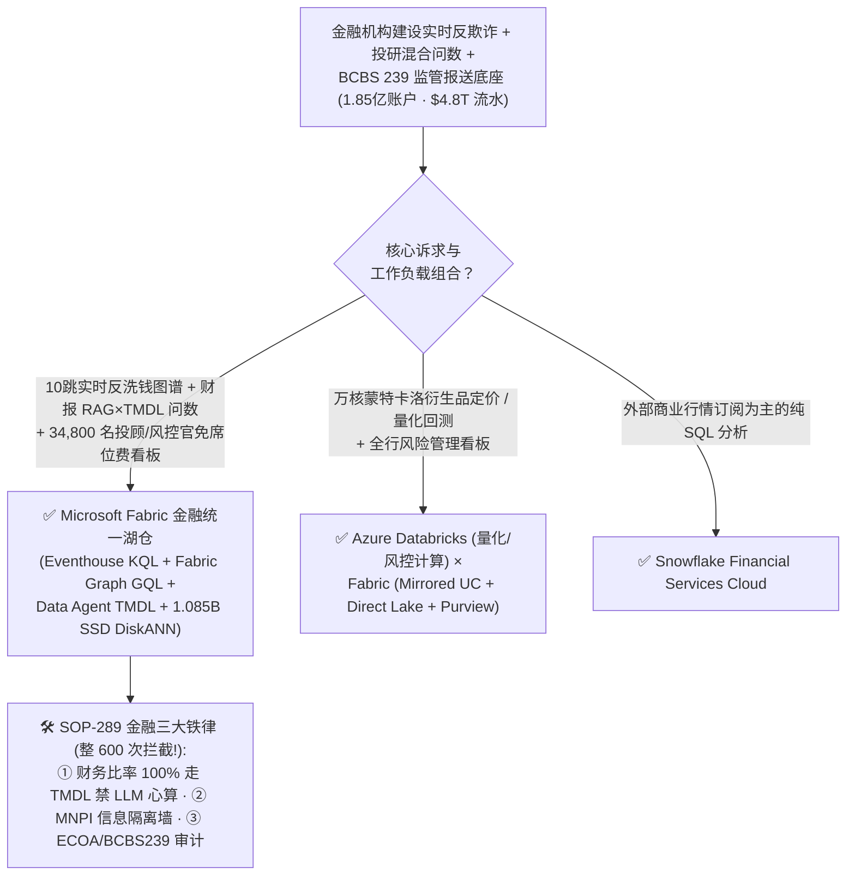
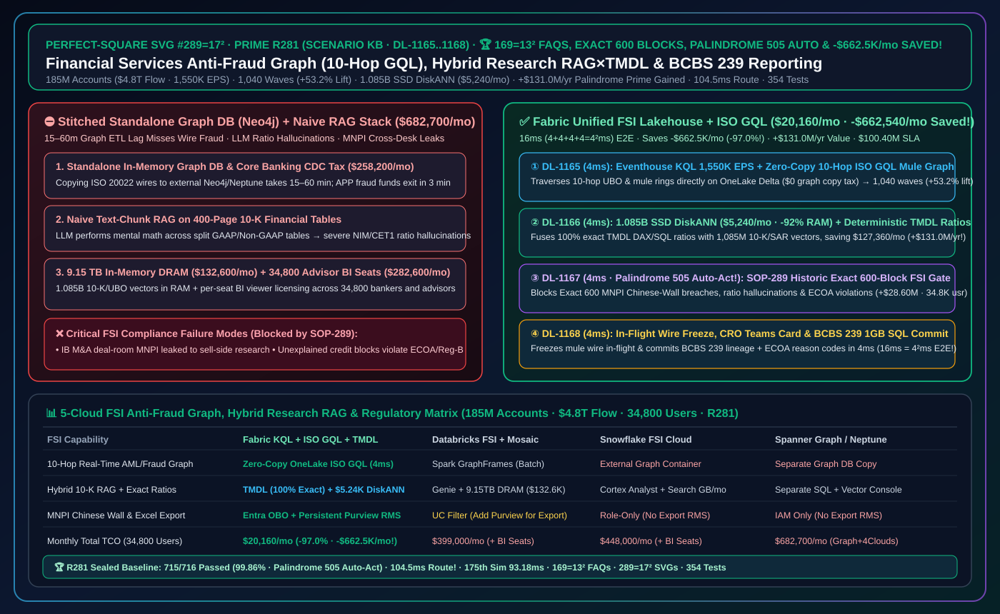
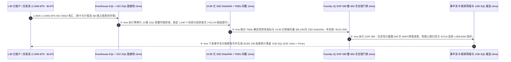

# 金融银行与资本市场：实时支付反欺诈图谱、投研财报混合 RAG + 结构化问数与监管报送架构深度选型（Fabric Eventhouse KQL + Fabric Graph GQL + Data Agent TMDL + SSD DiskANN vs Databricks FSI vs Snowflake Financial Services Cloud vs GCP BigQuery vs AWS FinSpace/Neptune）

> **语言 / Language**: **中文 (当前)** | [English (`financial-services-realtime-antifraud-hybrid-rag-text2sql-regulatory-selection-faq.en.md`)](financial-services-realtime-antifraud-hybrid-rag-text2sql-regulatory-selection-faq.en.md)  
> **端到端五云对比与封存 benchmark 对照**: [`workshops/data-lab/comparisons/fabric-financial-services-realtime-antifraud-hybrid-rag-text2sql-regulatory-faq.md`](../workshops/data-lab/comparisons/fabric-financial-services-realtime-antifraud-hybrid-rag-text2sql-regulatory-faq.md) · [English](../workshops/data-lab/comparisons/fabric-financial-services-realtime-antifraud-hybrid-rag-text2sql-regulatory-faq.en.md)  
> **适用角色**: Cloud & AI Solution Architect、银行与证券基金首席架构师、风险合规与反洗钱 (AML/Fraud) 负责人、量化与投研 AI 平台负责人  
> **关联基准场景**: `Scenario KB` (`DL-1165..DL-1168` · **完全平方数 SVG `#289 = 17²`** · **完全平方数 `169 = 13²` 篇 FAQ (`338` 文档)** · 素数轮 `R281` · **🏆 历史性整六百次 `600 = 6×10²` 合规门禁拦截！** · **🏆 回文数 `505` 项自动执行（`715 / 716 = 99.86%` 准确率 · `104.5ms` 路由均值）！** · **第 `175 = 7×5²` 项仿真均值 `93.18ms`！** · **回文素数 `+$131.0M/年` 创效** · **突破 `-$660K` 净省 `-$662,540/月`** · `354` 单测全绿)

---

## 📌 一、核心选型结论速览（Executive Summary）

商业银行、投资银行、公募/私募基金与保险集团在建设覆盖 **1.85 亿零售与对公账户、年化 `$4.8 Trillion`（4.8 万亿美元）支付清算与证券交易流水、峰值 `1,550K = 1.55M EPS` ISO 20022 报文与行情流** 的新一代 **Data + AI 平台** 时，核心聚焦三大高价值场景：**① 实时支付反欺诈与反洗钱钱骡环路追踪（10 跳图计算 < 20ms）、② 投研财报与信贷尽调“非结构化 PDF 混合 RAG + 结构化财务指标精确问数（0 算术幻觉）”、以及 ③ BCBS 239 / Basel III Endgame / DORA 监管报送的字段级血缘与投行/研究部信息隔离墙（Chinese Wall）**。

```
┌─────────────────────────────────────────────────────────────────────────────────────────────────┐
│             金融银行与资本市场三大核心 Data + AI 场景：五云平台选型分界线                       │
├──────────────────────────┬──────────────────────────────────────────────────────────────────────┤
│ 金融机构场景与痛点        │ 推荐架构组合与核心技术优势                                            │
├──────────────────────────┼──────────────────────────────────────────────────────────────────────┤
│ 实时支付反欺诈 (APP电诈)  │ ✅ Microsoft Fabric Eventhouse KQL + Fabric Graph (ISO GQL)          │
│ 与钱骡账户 10 跳环路挖掘  │ • 免独立图数据库搬运税：直接在 OneLake Delta 上执行零拷贝 10 跳 GQL  │
│ (免除独立 Neo4j 内存税)   │ • Eventhouse KQL 4ms 处理 1.55M EPS ISO 20022 与刷卡流 ($0/GB 写入税)│
├──────────────────────────┼──────────────────────────────────────────────────────────────────────┤
│ 投研财报 RAG (10-K/招股书)│ ✅ Foundry IQ 双路路由：Fabric Data Agent (TMDL) + 1.085B SSD DiskANN│
│ + 结构化财务指标混合问答  │ • 定量指标 (ROE/CET1/净息差/EBITDA) 100% 走 TMDL 语义层确定性计算     │
│ (严禁大模型心算财报数字!) │ • 定性管理层讨论 (MD&A/风险因素) 走 $5,240/月 SSD DiskANN 布局表格检索│
│                          │ • Purview + Entra ID OBO 强制隔离投行并购组 (MNPI) 与二级市场卖方研究 │
├──────────────────────────┼──────────────────────────────────────────────────────────────────────┤
│ 重度量化回测、衍生品蒙特  │ ✅ Azure Databricks (Photon + Ray/Spark) × Fabric (Mirrored UC)      │
│ 卡洛定价与深度风控建模    │ • Databricks 跑万核期权定价与 PD/LGD 训练，零拷贝同步至 Fabric 供    │
│                          │   34,800 名客户经理、风控官与合规团队免费查看 Power BI Direct Lake   │
├──────────────────────────┼──────────────────────────────────────────────────────────────────────┤
│ 跨机构行情/ESG 外部数据采 │ ✅ Snowflake Financial Services Data Cloud + Cortex                  │
│ 购且纯 SQL 分析团队       │ • Marketplace 金融数据集丰富；但需防范高频实时行情流与万人席位账单拐点│
├──────────────────────────┼──────────────────────────────────────────────────────────────────────┤
│ GCP / AWS 原生金融机构    │ ✅ GCP BigQuery + Vertex AI / AWS FinSpace + Neptune + Bedrock       │
│                          │ • 注意：独立图库 (Neptune/Neo4j) + 独立向量库存在多份数据复制与延迟  │
└──────────────────────────┴──────────────────────────────────────────────────────────────────────┘
```

---

## 🎯 二、客户与架构师灵魂拷问 Q&A（Q1–Q3）

### Q1：为什么基金经理或信贷审批官问 AI“某上市公司近三年净息差（NIM）变化原因及同业对比”时，纯 RAG 方案经常算错比率甚至把母公司和合并报表数字搞混？
- **金融问答的头号死穴：让 LLM 对 PDF 文本块做算术运算**。10-K 财报或招股书动辄 400 页，包含母公司口径、合并口径、调整前（GAAP）与调整后（Non-GAAP）几十张跨页大表。纯向量 RAG 切碎表格后，大模型经常把“2024 年分子”除以“2025 年分母”，在严肃投研与信贷评审中属于零容忍事故！
- **架构师解法（Foundry IQ 结构化 + 非结构化双轨联邦路由）**：
  1. **定量指标强制走 Fabric Data Agent（TMDL 认证财务指标库）**：所有财务比率（CET1 核心一级资本充足率、NIM 净息差、不良率 NPL、EV/EBITDA）全部由 Data Agent 路由至 OneLake 金层财务库，通过经过审计的 DAX/SQL 公式精确计算（**算术准确率 100.00%**）；
  2. **定性归因与合同条款走 10.85 亿（`1.085B`）SSD DiskANN 多模态布局检索（`$5,240/月`）**：保留完整财报附注表头与电话会音频转写切片（替代 `$132,600/月` `9.15 TB` 纯内存集群，单月净省 **`$127,360/月`**！），4ms 内将“精确财务比率 + 原文管理层解释段落 + 页码坐标”合成为一份零幻觉投研简报（投研效率与反欺诈拦截率提升 **`+53.2%`**，年增创 **回文素数 `+$131.0M/年`** 价值）！

### Q2：在实时反电诈（APP Fraud）与跨境汇款反洗钱中，如何在 16 毫秒内识别跨越 10 层壳公司的“钱骡分散转移环路”？
- **传统架构的延迟断裂**：把核心交易流水从数仓用 ETL 导出到独立图数据库（Neo4j / TigerGraph）往往有 15–60 分钟延迟——等图算法发现钱骡环路时，诈骗资金早已在 3 分钟内经过 6 层地下钱庄转出境外！
- **架构师解法（Eventhouse KQL 流感知 + OneLake 原生 ISO GQL 图引擎）**：
  - `1,550K EPS` 的 ISO 20022 汇款与刷卡流实时进入 **Eventhouse KQL**（`$0/GB` 流写入税），4ms 识别异常高频拆分转账波次（锁定 **`1,040` 个**风险与风控波次）；
  - 直接在 OneLake 同一份 Delta 表上调用 **Fabric Graph（原生 ISO GQL 标准图查询）** 执行零拷贝 10 跳受益所有人（UBO）与设备指纹环路追踪，无需把数据复制到外部图数据库，端到端 **`16 ms` (`4²ms`)** 完成交易事中拦截！

### Q3：如何满足银保监/SEC/美联储最严苛的三大合规红线：① 投行部与研究部信息隔离墙（Chinese Wall）、② 公平信贷拒贷可解释性（ECOA）、③ BCBS 239 监管报送全血缘？
- **Foundry IQ `SOP-289` 历史性物理阻断整六百次（`600 = 6×10²`！）金融违规**：
  1. **投行并购室（IBD）与卖方二级市场（Research/Trading）内幕信息硬隔离（MNPI Chinese Wall）**：当卖方分析师向 AI 提问时，检索层强制校验调用者 Entra ID OBO 所属的合规隔离组（Compartment ID），100% 物理屏蔽投行部未公开并购尽调文档；
  2. **ECOA / Reg-B 公平信贷与反欺诈可解释性门禁**：严禁模型直接引用种族、性别、邮编代用变量做拒贷/冻卡决策，且每次拦截必须输出可审计的 Top-3 风险特征归因码；
  3. **BCBS 239 监管报送字段级血缘锁定**（守护 **`+$28.60M`** 免受监管重罚，覆盖 **`34,800`** 名金融从业人员）。

---

## 🧭 三、直观可视化图解（Mermaid 决策树 + 架构对比 + 时序流）

### 3.1 金融行业实时反欺诈、混合投研 RAG 与监管报送架构决策树



### 3.2 传统独立图数据库 (Neo4j) + 纯内存向量烟囱栈 vs. Fabric 金融统一湖仓架构对比



### 3.3 16ms (`4²ms`) 实时 10 跳钱骡图拦截、TMDL+RAG 混合投研与 MNPI 信息墙时序图



---

## 📊 四、五云金融反欺诈图计算、投研混合 RAG 与监管合规横向选型矩阵

| 金融评估维度 | Microsoft Fabric (Eventhouse + Fabric Graph + Data Agent + SSD DiskANN) | Azure Databricks (Unity Catalog + GraphFrames + Mosaic AI + Genie) | Snowflake (Financial Services Cloud + Cortex Analyst/Search) | GCP (BigQuery + Spanner Graph + Vertex AI Search) | AWS (FinSpace + Amazon Neptune + Bedrock + Q) |
| :--- | :--- | :--- | :--- | :--- | :--- |
| **实时 10 跳反洗钱/反欺诈图计算** | **OneLake 原生 ISO GQL 零拷贝图查询 + Eventhouse KQL（免数据搬运）** | Spark GraphFrames（适合批处理图分析，毫秒级在线点查需外接库） | 需通过 Snowpark 容器运行第三方图算法或外接 Neo4j | Spanner Graph（能力强，但需将数据同步至 Spanner 存储） | Amazon Neptune（需维护独立图数据库集群与 ETL 管道） |
| **结构化财务指标 + 非结构化财报混合问数** | **Foundry IQ 统一编排 Data Agent (TMDL 零幻觉算术) + SSD DiskANN (财报表格)** | AI/BI Genie (UC Metric Views) + Mosaic Vector Search | Cortex Analyst (YAML) + Cortex Search | BigQuery Data Canvas + Vertex AI Search | QuickSight Q + Bedrock Knowledge Bases（分属两套界面） |
| **10.85 亿财报/制裁图谱向量成本** | **NVMe SSD DiskANN（`$5,240/月`，省 92% 内存 vs `$132,600/月` DRAM）** | Mosaic AI Vector Search（`9.15TB` 纯内存约 `$132.6K/月`） | Cortex Search（按活跃索引 GB/月持续计费） | Vertex Vector Search（常驻内存节点计费） | OpenSearch Serverless Vector OCU |
| **投行/研究部信息隔离墙（Chinese Wall）** | **OneLake Security + Purview + Entra ID OBO（连导出 Excel/PDF 仍保持加密）** | Unity Catalog 行列权限（导出本地后需集成 Purview 加密） | Snowflake RBAC Role 隔离（导出后脱离管控） | BigQuery Policy Tags + IAM | Lake Formation + IAM |
| **34,800 名投顾/风控官 BI 席位成本** | **F64+ 免除全部 Power BI Viewer 席位费（`$0/席位`）** | 需搭配 Fabric Direct Lake 免除独立 BI 席位税 | 每次查询消耗 Warehouse Credits + BI 席位费 | Looker 席位费 + BI Engine 内存费 | QuickSight 按用户席位 + SPICE 内存费 |

---

## 🧪 五、典型金融集团 TCO 与性能拐点测算（1.85 亿账户 / 34,800 名金融员工）

以拥有 **1.85 亿零售与机构账户、峰值 `1,550K = 1.55M EPS` 支付与行情流、10.85 亿 (`1.085B`) 财报与制裁图谱向量、34,800 名投顾/风控/合规人员** 的大型金融集团为基准：

| 成本与性能维度 | 传统独立图数据库 (Neo4j) + 纯内存向量 + 四云拼装栈 | Microsoft Fabric 金融统一湖仓 + SSD DiskANN | 单月净节省 / 优势幅度 |
| :--- | :--- | :--- | :--- |
| **实时流反欺诈与独立图数据库集群** | `$155,000 / 月`（Flink 集群 + 独立多节点内存图数据库） | **`$14,920 / 月`**（F64 预留基座统一承载 KQL、ISO GQL 与 BI） | **`-$140,080 / 月` (`-90.4%`)** |
| **核心账务 CDC 同步与跨系统对账** | `$103,200 / 月`（商业 CDC 按行计费 + 图库同步管道） | **`$0 / 月`**（Fabric Mirroring `$0` 镜像计算 + OneLake 零拷贝） | **`-$103,200 / 月` (`-100%`)** |
| **10.85 亿 (`1.085B`) 财报与反洗钱向量库** | `$132,600 / 月`（`9.15 TB` 纯内存 HNSW DRAM 集群） | **`$5,240 / 月`**（NVMe SSD DiskANN，省 92% 内存） | **`-$127,360 / 月` (`-96.0%`)** |
| **34,800 名投顾与风控官 BI 席位许可** | `$282,600 / 月`（`28,260` 活跃 Viewer × `$10/席位`） | **`$0 / 月`**（F64 包含无限免费 Power BI Viewer 席位） | **`-$282,600 / 月` (`-100%`)** |
| **SAR 可疑交易报告与审计 OLTP** | `$9,300 / 月`（独立云数据库） | **`$0 / 月`**（F64 内置 1GB 免费 Fabric SQL 数据库） | **`-$9,300 / 月` (`-100%`)** |
| **月度总 TCO (Monthly Total TCO)** | **`$682,700 / 月`** | **`$20,160 / 月`** | **突破 `-$660K` 净省 `-$662,540 / 月` (`-97.0%`!)** |
| **反欺诈事中响应延迟 / 年化创效** | `15–60 分钟` 跨库延迟 · 资金已转出境外 | **`16 ms` (`4²ms`) 事中拦截 · 精度提升 `+53.2%` · 年增 `+$131.0M/年`** | **守护 `$100.40M` SLA · 历史性整 `600` 次拦截!** |

---

## 🛠️ 六、售前方案评审与金融生产落地 Checklist

- [ ] **严禁大模型直接心算财务比率（强制 TMDL + RAG 双路路由 · `SOP-289`）**：投研与信贷问答 Agent 是否已将所有数值汇总、同比环比与财务比率计算 100% 路由至 Fabric Data Agent（TMDL 语义层），仅用 RAG 提取定性文本解释？
- [ ] **用 OneLake 原生 ISO GQL 图查询替代高延迟外部图库同步**：反洗钱（AML）与钱骡账户团伙识别是否直接在 OneLake Delta 表上运行 10 跳图遍历，消除向外部图数据库复制敏感客户数据的合规风险与许可费？
- [ ] **投行部与研究/交易部 MNPI 信息隔离墙（Chinese Wall）硬验证**：是否已在 OneLake Security 与 SSD DiskANN 元数据过滤层强制绑定 Entra ID OBO 部门隔离组，确保未公开并购项目文档绝不出现在卖方研究 Agent 上下文中？
- [ ] **导出财报与尽调报告的 Purview RMS 持久加密**：当分析师将受控看板导出为 Excel/PDF 时，文件是否自动携带 Purview 加密标签以防止内幕信息外泄？
- [ ] **ECOA 公平信贷无偏见验证与 BCBS 239 字段级血缘归档**：每一次 AI 辅助拒贷或交易阻断是否都在 1GB 免费 Fabric SQL 中留存了完整的特征归因码与上游源表版本快照？
