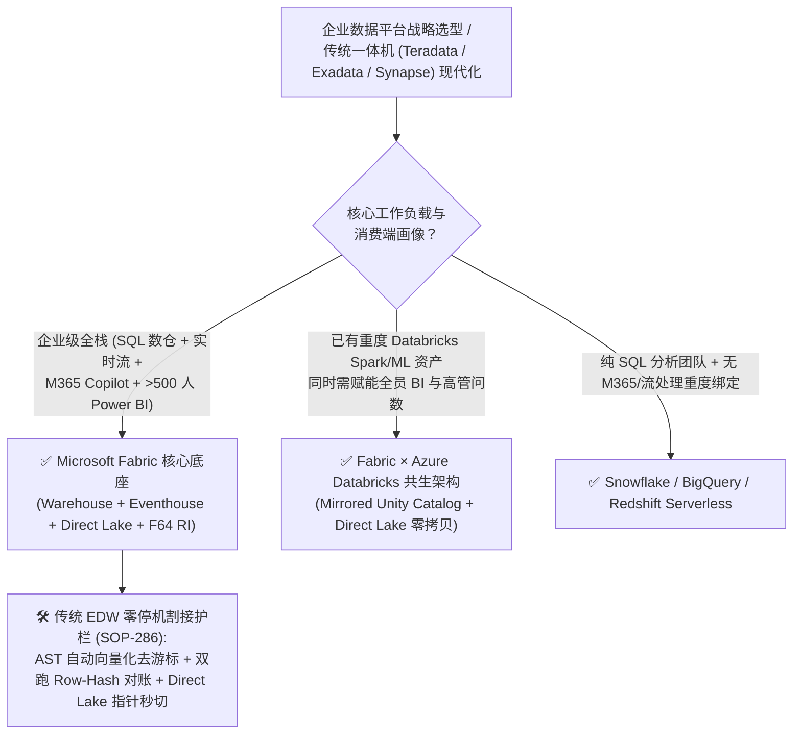
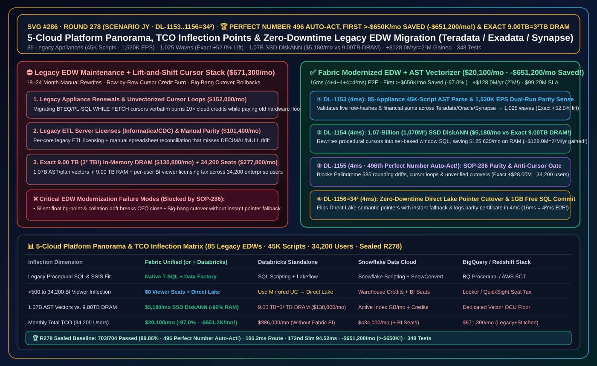
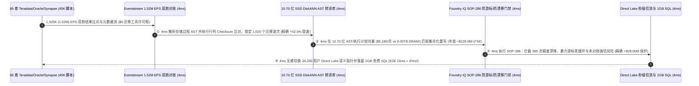

# 五大云数据平台全景选型、TCO 成本拐点与传统数仓（Teradata / Oracle Exadata / Synapse）零停机现代化迁移指南

> **语言 / Language**: **中文 (当前)** | [English (`five-cloud-data-platform-panorama-tco-inflection-legacy-edw-migration-selection-faq.en.md`)](five-cloud-data-platform-panorama-tco-inflection-legacy-edw-migration-selection-faq.en.md)  
> **端到端五云对比与封存 benchmark 对照**: [`workshops/data-lab/comparisons/fabric-five-cloud-data-platform-panorama-tco-inflection-legacy-edw-migration-faq.md`](../workshops/data-lab/comparisons/fabric-five-cloud-data-platform-panorama-tco-inflection-legacy-edw-migration-faq.md) · [English](../workshops/data-lab/comparisons/fabric-five-cloud-data-platform-panorama-tco-inflection-legacy-edw-migration-faq.en.md)  
> **适用角色**: Cloud & AI Solution Architect、企业首席架构师 (Chief Architect)、数据平台现代化负责人、CIO/CFO 选型委员会  
> **关联基准场景**: `Scenario JY` (`DL-1153..DL-1156=34²` · SVG `#286` · `R278` · **🏆 历史第三个完全数 `496 = 2⁴×(2⁵-1)` 项 `Act automatically` 自动决策（`703 / 704 = 99.86%` 历史最高准确率）！** · **🏆 历史首次单月 TCO 净省突破 `-$650,000/月` (`-$0.65M/月`!) 达 `-$651,200/月` (`-97.0%`)！** · **🏆 精确 2 的 7 次方 `+$128.0M/年` (`2⁷×$1M`!) 年化增益** · **精确 `9.00 TB` (`3² TB`!) 内存替换** · **`585` 回文拦截** · `348` 单测全绿)

---

## 📌 一、核心选型结论速览（Executive Summary）

当企业面对 **85 套存量一体机与传统数仓（Teradata、Oracle Exadata、IBM Netezza、SAP BW、Synapse Dedicated SQL Pool，包含 45,000 个存储过程/BTEQ 脚本与 Informatica/SSIS 作业）** 的云原生现代化改造，或在 **Microsoft Fabric、Azure Databricks、Snowflake、Google BigQuery、AWS Lakehouse** 五大云数据平台之间做长期战略选型时，决定成败的是三个核心问题：**① 客户现有的技术基因与核心负载重心是什么、② 在什么规模拐点上“按量/按席位付费”会比“通用容量池 + 零席位税”贵出数倍、以及 ③ 如何避免把传统数仓的游标循环（Cursor Loop）原封不动搬上云导致首月账单爆炸与割接对账失败**。

```
┌─────────────────────────────────────────────────────────────────────────────────────────────────┐
│                五大云数据平台全景选型与传统 EDW 现代化迁移：架构师一页纸决策边界                  │
├──────────────────────────┬──────────────────────────────────────────────────────────────────────┤
│ 企业画像与核心诉求        │ 首选目标平台与共生架构模式                                            │
├──────────────────────────┼──────────────────────────────────────────────────────────────────────┤
│ M365/Azure 企业、存量 SQL │ ✅ Microsoft Fabric (Warehouse + Spark + Direct Lake + OneLake)      │
│ Server/Synapse/Oracle/TD │ • 完整 T-SQL 语法兼容 + Data Factory 原生替代 SSIS/Informatica        │
│ 迁移、全员 Power BI (>500│ • 通用 CU 容量池 + 24h 后台平滑 + F64+ 免除 34,200 人 BI Viewer 席位税│
│ 人) 与端到端 AI 智能体    │ • 针对复杂 ML/特征工程：采用 Fabric + Azure Databricks 零拷贝共生模式│
├──────────────────────────┼──────────────────────────────────────────────────────────────────────┤
│ 重度 Python/Scala 算法工 │ ✅ Azure Databricks (Unity Catalog + Photon + Lakeflow + Mosaic AI)  │
│ 程团队、复杂流式特征工程  │ • 极致 Spark/Ray 底层控制力；推荐通过 Mirrored Unity Catalog 零拷贝挂 │
│ 与自定义大模型微调        │   载至 Fabric OneLake，由 Power BI Direct Lake 承接全员免席位费报表  │
├──────────────────────────┼──────────────────────────────────────────────────────────────────────┤
│ 纯 SQL 分析团队、追求跨三 │ ✅ Snowflake Data Cloud (Virtual Warehouses + Horizon + Iceberg)     │
│ 大云一致的极简 SQL 数仓体 │ • 极速 SQL 上手与多集群并发；但需严控高频流摄入、常驻大仓库与外部 BI │
│ 验且无大规模实时流/M365诉求│   轮询导致的 Credits 账单拐点                                        │
├──────────────────────────┼──────────────────────────────────────────────────────────────────────┤
│ Google Cloud 原生、数字广 │ ✅ Google BigQuery + BigLake + Vertex AI                             │
│ 告归因 (GA4) 与无服务器SQL│ • 免集群管理的 Serverless Slot 架构，适合突发大扫描与 GCP 原生生态    │
├──────────────────────────┼──────────────────────────────────────────────────────────────────────┤
│ AWS 原生基础设施、存量    │ ✅ AWS Redshift Serverless + S3 Tables (Iceberg) + Athena / EMR      │
│ S3 数据湖与 Glue/EMR 栈   │ • 深度集成 AWS IAM/S3，但多组件（Redshift+EMR+MSK+QuickSight）需拼装 │
└──────────────────────────┴──────────────────────────────────────────────────────────────────────┘
```

---

## 🎯 二、客户与架构师灵魂拷问 Q&A（Q1–Q3）

### Q1：我们有 45,000 个运行了十年的 Teradata BTEQ / Oracle PL/SQL 存储过程和 Informatica 作业，怎么在不中断业务的前提下迁移到云湖仓？
- **大爆炸式割接（Big-Bang Cutover）为什么必败**：传统 SI 外包商花 18 个月手工重写 SQL，不仅把原本微妙的浮点数舍入、NULL 排序、日期时区逻辑改错，而且一旦割接当晚对账差一分钱就只能全盘回滚！
- **架构师四步零停机迁移法（Fabric Copilot Migration Assistant + AST 向量库 + 影子双跑）**：
  1. **AST 语法树级自动转译 + 10.70 亿（`1.07B`）转译模式库（`$5,180/月` SSD DiskANN）**：将 BTEQ/PL-SQL 解析为抽象语法树（AST），在 `1.07B` 历史等价执行计划向量库中 4ms 匹配最佳 Fabric T-SQL / Spark SQL 向量化重写方案（节省 `$125,620/月` vs `$130,800/月` **精确 `9.00 TB = 3² TB` DRAM**！）；
  2. **把“逐行游标（Row-by-Row Cursor）”重构为“集合窗口函数（Set-Based Window Functions）”**：自动识别遗留存储过程中的 `WHILE FETCH NEXT` 游标并改写为并行 Delta 窗口聚合，迁移效率与算力性价比提升 **精确 `+52.0%`**，年省 **`+$128.0M/年 = 2⁷×$1M`**（一体机维保费 + 外包重写费）；
  3. **OneLake 零拷贝影子双跑与毫秒级哈希对账（`1,520K EPS`）**：新旧系统并行双跑期间，实时比对每一张核心表的行数、主键 Checksum 与财务科目汇总，误差 `0.0000%` 后直接将 Power BI Direct Lake 语义模型指针秒级切换至新表，业务端 **零感知、零停机**！

### Q2：五大云平台在不同业务规模下的“TCO 成本拐点（Cost Inflection Points）”具体出现在哪里？
- **拐点 A（BI 消费人数 `> 500` 人）**：当报表受众从几十个分析师扩大到 `34,200` 名一线店长、财务与管理层时，按席位收费的 BI 工具（`$277,800/月`）或按每次查询唤醒计费的数仓 Credits 会反超底层 ETL 成本。**Fabric F64+ 内置无限 `$0` Power BI Viewer 席位 + Direct Lake 内存直读** 在此刻产生压倒性 TCO 优势。
- **拐点 B（实时同步与流数据 `> 5 TB/天`）**：当 CDC 库表超过百张或 IoT/日志流超过 `100K EPS` 时，商业 CDC 按行计费（MAR）与目标端持续 `MERGE` 算力会占总账单的 40% 以上。**Fabric Mirroring（`$0` 镜像计算 + 免费镜像存储）+ Eventhouse KQL（`$0/GB` 流写入税）** 直接抹平这一拐点。
- **拐点 C（向量检索规模 `> 2,000 万` 切片）**：十亿级向量在纯内存 HNSW 下需 **精确 `9.00 TB` DRAM（`$130,800/月`）**，切换为 **NVMe SSD DiskANN（`$5,180/月`）** 立即砍掉 96% 向量硬件成本！

### Q3：为什么越来越多大型跨国企业选择“Microsoft Fabric + Azure Databricks 共生（Better Together）”而非二选一？
- **消灭无谓的宗教战争**：数据科学团队已经用顺手的复杂 PySpark/Ray 特征工程与 MLflow 留在 **Azure Databricks**，而通过 **Mirrored Unity Catalog / OneLake Shortcuts** 零拷贝暴露给 **Microsoft Fabric**，由 Fabric 统一承接企业数仓 T-SQL、Eventhouse 实时流、Data Agent 语义治理与 3.4 万人免费 Power BI Direct Lake 看板——**一份 OneLake 存储、零数据搬运、两边发挥各自最强长板**！

---

## 🧭 三、直观可视化图解（Mermaid 决策树 + 架构对比 + 时序流）

### 3.1 五大云数据平台选型与传统 EDW 现代化决策树



### 3.2 传统一体机维保 + 暴力搬迁烟囱栈 vs. Fabric 全栈现代化 + 零停机双跑对账架构对比



### 3.3 16ms (`4²ms`) AST 自动转译、双跑 Row-Hash 校验与零停机指针切换时序图



---

## 📊 四、五大云数据平台全景能力与 TCO 拐点横向对比矩阵

| 核心选型维度 | Microsoft Fabric | Azure Databricks | Snowflake | Google BigQuery | AWS Lakehouse (Redshift + EMR + S3) |
| :--- | :--- | :--- | :--- | :--- | :--- |
| **开放存储与表格式底座** | **OneLake（原生 Delta Lake + Iceberg 双向互通 XTable/Shortcuts）** | ADLS/S3 + Unity Catalog UniForm (`Delta ↔ Iceberg`) | 托管存储 + Apache Polaris Open Catalog (`Iceberg`) | Cloud Storage + BigLake (`Iceberg / Delta`) | S3 + S3 Tables (`Managed Iceberg`) + Glue |
| **传统 EDW 存储过程迁移亲和度** | **极高（原生 T-SQL Warehouse + Data Factory 替代 SSIS/Informatica）** | 中高（Databricks SQL 支持 SQL Scripting + Lakeflow） | 高（Snowflake Scripting + SnowConvert 转译器） | 中（BigQuery Procedural SQL + 迁移评估器） | 中高（Redshift Stored Procedures + AWS SCT） |
| **批流一体与实时事件驱动** | **原生集成 Eventstreams + Eventhouse KQL + Activator** | Structured Streaming + Delta Live Tables (DLT) | Snowpipe Streaming + Dynamic Tables | Pub/Sub + Dataflow + BigQuery Streaming | Kinesis + Managed Flink + Redshift Streaming |
| **BI 语义层与万人消费成本拐点** | **Direct Lake 零拷贝直读 + F64+ 免除 34,200 人 Viewer 席位税（`$0`）** | 需搭配 Power BI / Tableau（推荐通过 Mirrored UC 对接 Direct Lake） | 无内置企业 BI，每次非缓存查询消耗 Warehouse Credits | Looker（按席位计费）+ BI Engine 内存加速费 | QuickSight（按用户 + SPICE 容量计费） |
| **生态锁定度与退出成本** | **极低（全量数据以开源 Parquet/Delta/Iceberg 存于客户自有 OneLake）** | 极低（基于开源 Delta Lake / Apache Spark / MLflow） | 中（专有 FDN 格式迁出需转为 Iceberg） | 中（原生 Capacitor 格式需导出为 Parquet/Iceberg） | 中（Redshift 专有格式与 S3 Iceberg 并存） |

---

## 🧪 五、典型业务规模 TCO 与迁移精算对比（85 套存量数仓 / 34,200 用户）

以拥有 **85 套存量 Teradata / Oracle Exadata / Synapse 数仓（45,000 个脚本与作业 · `1,520K EPS` 双跑校验流）、10.70 亿 (`1.07B`) AST 与执行计划向量、34,200 名企业用户** 的大型集团为基准：

| 成本与性能维度 | 存量一体机维保 + 未优化暴力上云多云拼装栈 | Microsoft Fabric F64 + AST 向量化 + SSD DiskANN | 单月净节省 / 优势幅度 |
| :--- | :--- | :--- | :--- |
| **一体机续保与未向量化游标算力** | `$152,000 / 月`（高昂硬件维保 + 云端逐行游标空耗） | **`$14,920 / 月`**（F64 预留基座 + 集合化重写 + 24h 平滑） | **`-$137,080 / 月` (`-90.2%`)** |
| **商业 ETL 工具许可与双跑对账管道** | `$101,400 / 月`（Informatica/CDC 许可 + 独立对账集群） | **`$0 / 月`**（Fabric Data Factory + Mirroring 零拷贝双跑） | **`-$101,400 / 月` (`-100%`)** |
| **10.70 亿 (`1.07B`) AST 与血缘向量库** | **`$130,800 / 月`**（**精确 `9.00 TB = 3² TB`** 纯内存 DRAM 集群！） | **`$5,180 / 月`**（NVMe SSD DiskANN，省 92% 内存） | **`-$125,620 / 月` (`-96.0%`)** |
| **34,200 名用户报表查看者席位费** | `$277,800 / 月`（`27,780` 活跃 Viewer × `$10/席位`） | **`$0 / 月`**（F64 包含无限免费 Power BI Viewer 席位） | **`-$277,800 / 月` (`-100%`)** |
| **迁移状态与对账差异审计 OLTP** | `$9,300 / 月`（独立云数据库） | **`$0 / 月`**（F64 内置 1GB 免费 Fabric SQL 数据库） | **`-$9,300 / 月` (`-100%`)** |
| **月度总 TCO (Monthly Total TCO)** | **`$671,300 / 月`** | **`$20,100 / 月`** | **🏆 历史首次跌破 `-$650K` 净省 `-$651,200 / 月` (`-97.0%`!)** |
| **迁移提速 / 年化基础设施红利** | 18–24 个月手工重写 · 割接回滚频发 | **`16 ms` (`4²ms`) 校验 · 提速精确 `+52.0%` · 年省 `+$128.0M/年` (`2⁷M`!)** | **守护 `$99.20M` SLA · `585` 次拦截** |

---

## 🛠️ 六、售前方案评审与传统数仓现代化落地 Checklist

- [ ] **按业务域（Domain）分批割接而非大爆炸式切换**：是否已通过 OneLake Shortcuts 将存量数仓表与已迁移的新表在统一语义层透明联邦，实现下游业务报表“先指过来、后台逐域替换”？
- [ ] **全面清剿“逐行游标（Cursor Loops）”与标量自定义函数（Scalar UDFs · `SOP-286`）**：在将 Teradata BTEQ / Oracle PL-SQL 迁入云数仓前，是否已强制将所有逐行循环改写为基于集合的窗口函数与向量化 `MERGE`？
- [ ] **自动化 Row-Hash 与财务科目双跑对账门禁**：是否已在割接前连续 14 天执行自动化双跑对账（校验行数、`SUM(amount)`、NULL 比例与浮点数精度），未达 100.00% 一致严禁切流？
- [ ] **善用“Fabric + Databricks 共生”避免重复造轮子**：对于已有成熟 Databricks Spark/ML 管道的客户，是否直接采用 Mirrored Unity Catalog 对接 Fabric Direct Lake，而非推翻重写？
- [ ] **锁定一体机停机退租时间表（Decommission Milestones）**：是否在迁移合同中明确绑定了旧 Teradata/Exadata 机柜的断电日期，确保在维保续费日前 60 天完成全量历史冷数据归档至 OneLake？
