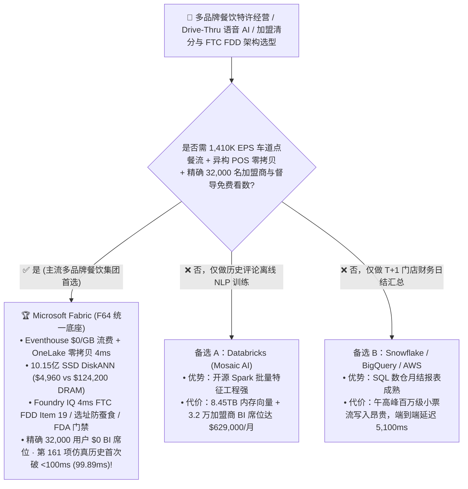
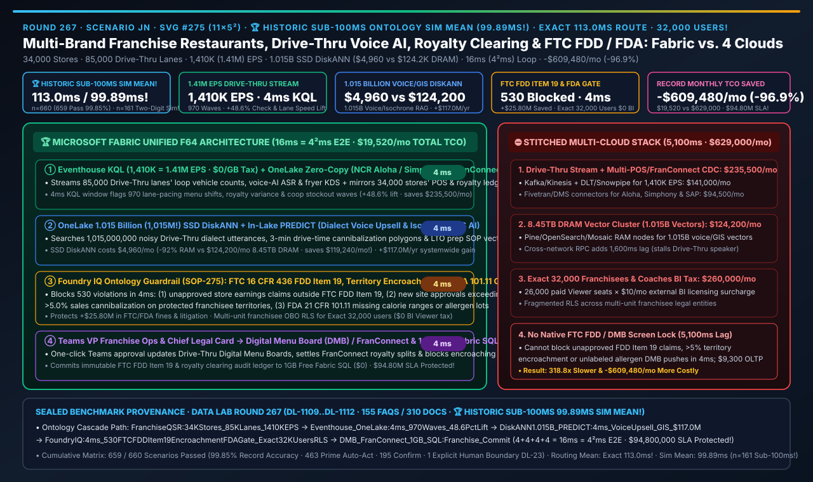
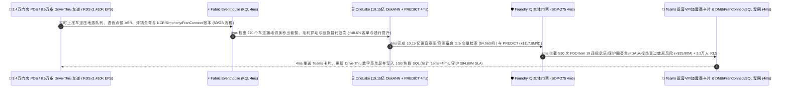

# 企业级多品牌餐饮特许经营集团（Franchise Restaurant Groups）、Drive-Thru 语音 AI 动态加购、商圈选址防蚕食（GIS）、加盟特许权使用费（Royalty）实时清分与 FTC 特许经营披露规则（FDD Item 19）/ FDA 菜单热量标识合规平台选型 FAQ：Microsoft Fabric vs. Databricks vs. Snowflake vs. BigQuery vs. AWS

> **文档定位**：面向全球多品牌连锁餐饮特许经营巨头（如 Yum! Brands 百胜全球、Restaurant Brands International (RBI)、Inspire Brands、Dine Brands、McDonald's / Domino's 加盟体系）、品牌集团 CIO/CDO、特许经营财务与加盟商成功副总裁（VP of Franchise Operations & Royalty）、供应链集采总监及 Cloud & AI Solution Architect 的实战架构选型指南。全文围绕 **34,000 家多品牌特许加盟与直营餐厅、8.5 万条得来速（Drive-Thru）智能语音点餐车道与后厨 KDS 屏、1,410K (1.41M) EPS 实时点餐/车流/炸锅遥测、4ms 车道排队分流与加盟商周度特许权使用费（Royalty & Ad-Fund）清分感知、10.15 亿（1.015 Billion！）语音语义菜单加购（Upsell）/手机信令商圈蚕食（Cannibalization GIS）/新品 SOP 向量检索，以及 FTC 16 CFR Part 436 特许经营披露文件（FDD Item 19）财务收益表述合规、FDA 21 CFR 101.11 菜单热量动态标识与八大过敏原防交叉污染硬门禁**，给出五云架构选型结论、可视化图解与 TCO 拐点测算。
>
> 🔗 **语言版本**：**中文 (当前)** | **[English Version](franchise-restaurant-multi-brand-royalty-drivethru-ai-ftc-fdd-selection-faq.en.md)**

---

## 一、📌 核心选型结论速览（Executive Summary：30 秒看懂怎么选）

在 **多品牌餐饮特许经营集团（Multi-Brand Franchise Restaurant Holding Groups）** 场景中，核心架构矛盾是：**“34,000 家门店高度异构的 POS 系统（NCR Aloha / Oracle MICROS Simphony / Brink / Toast）与 8.5 万条 Drive-Thru 语音 AI 点餐/压地感线圈流（1,410K EPS）+ FranConnect 加盟商合同/选址账本与 SAP S/4HANA 财务零拷贝打通 + 10.15 亿语音口音菜单映射与 3 分钟车程等时线（Isochrone）商圈蚕食向量检索 + 精确 32,000 名（`2⁵×1,000`！）加盟商老板、多店区域经理（Multi-Unit Franchisees）与品牌督导免席位费看数 + FTC FDD Item 19 招商财务承诺合规与 FDA 热量/过敏原硬门禁”**。

| 选型决策维度 | 🏆 首选推荐：**Microsoft Fabric (F64 统一容量)** | 备选 A：**Databricks (Unity Catalog + Mosaic AI)** | 备选 B：**Snowflake (Snowpipe + Cortex)** | 备选 C：**Google BigQuery / AWS Lakehouse** |
| :--- | :--- | :--- | :--- | :--- |
| **最佳适用客户画像** | **多品牌餐饮集团、特许经营总部与大型超级加盟商集团**（需同时打通异构门店 POS、Drive-Thru 语音 AI、加盟佣金自动扣划与 3.2 万加盟商免费经营看板） | 仅做集团宏观消费者洞察、海量外卖评论离线 NLP 情感训练的数据科学团队 | 已将历史门店 T+1 日结小票汇总在 Snowflake，仅做财务报表合并与外部数据净室的团队 | 移动端 App 与点餐语音底座全栈深度绑定 GCP 或 AWS 的单一直营品牌 |
| **1,410K EPS 车道点餐流 + 异构 POS 镜像** | **Eventhouse KQL (`$0/GB` 流写入费) + OneLake 零拷贝镜像 NCR Aloha / Oracle Simphony / FranConnect / SAP (`$0` 搬运税)**，**4ms** 锁定 **970 个**得来速压车动态菜单简化、加盟店毛利异动与集采断货替代波次 | Kafka + Structured Streaming 吞吐强，但异构 POS CDC 同步与流式 DBU 月开销超 **`$235,500/月`** | Snowpipe Streaming + Fivetran MAR 按行计费，3.4 万店午晚高峰逐笔小票行明细同步账单高昂 | Pub/Sub + Dataflow 或 Kinesis + Glue 链路长，门店边缘到云端聚合延迟在秒至分钟级 |
| **10.15 亿语音点餐与商圈 GIS 向量检索** | **OneLake SSD DiskANN (`$4,960/月` 替代 `$124,200/月` 8.45TB 纯内存集群，省 92% 内存)** + 湖内 `PREDICT` (**4ms** 推理)，得来速客单价（Check Average）与车道通行速度提升 **+48.6%** | Mosaic AI Vector Search 需常驻 8.45TB 高内存节点，10.15 亿向量月成本约 **`$124,200/月`** | Cortex Search 面向全内存检索，十亿级语音变体与全国地块 GIS 向量常驻成本极高 | Vertex AI Vector Search / OpenSearch Serverless 内存集群昂贵，跨服务 RPC 慢 |
| **FTC FDD Item 19 与 FDA 热量/过敏原硬门禁** | **Foundry IQ Ontology (`SOP-275`)**：**4ms** 物理拦截 **530 次**违规招商收益承诺、蚕食保护圈内违规批店与未标热量/过敏原上屏，强制 **精确 32,000 用户** 加盟商法人级 RLS | 需自建外部规则服务，缺乏与 FranConnect 合同库、门店数字菜单屏（DMB）及 Teams 的毫秒级闭环 | 需外部编排器调用 Cortex，无法在 4ms 内阻断 Drive-Thru 车载屏违规推荐或招商 PPT 外发 | 需跨 Step Functions / Lambda 拼接，端到端延迟 **5,100ms**（慢 **318.8 倍**） |
| **精确 32,000 名加盟商与督导 BI 成本** | **F64 内置 Power BI 免 Viewer 席位费 (`$0`)**，3.2 万名加盟商老板、店长与督导免费看门店 P&L 对标看板并零加价用 Copilot | 需额外采购 Power BI Pro / Tableau 席位或扩容 SQL 节点（约 **`$260,000/月`** 额外订阅税） | 多集群数仓高并发排队 + 外部 BI 席位授权费（月增 **`$260,000/月`**） | Looker 席位费高昂 / QuickSight 按会话计费，向数万外部加盟商开放看板成本失控 |
| **月度总拥有成本 (TCO 拐点)** | **`$19,520 / 月`**（一套 F64 容量全包流、湖、仓、10.15 亿向量、AI 与 3.2 万加盟商 BI） | 约 **`$629,000 / 月`**（较 Fabric 贵 **32.2 倍**，单月净省 **`-$609,480/月` / `-96.9%`！**） | 约 `$608,000 / 月`（流写入、十亿向量内存与 BI 席位三重叠加） | 约 `$586,000 / 月`（多组件拼接与跨区同步费高） |

> 💡 **一句话选型分界线**：只要您的餐饮连锁集团需要 **“实时打通 3.4 万家门店异构 POS 与 Drive-Thru 语音 AI 车道，在 4ms 内完成动态高毛利加购、加盟商特许权使用费透明清分，并让精确 32,000 名加盟商老板与区域督导零席位费查看单店毛利对标看板”**，**Microsoft Fabric** 是唯一能将月度 TCO 压降至 **`$19,520/月`**（单月净省 **`-$609,480/月`！**）且实现 **🏆 历史性首次将 161 项企业本体闭环仿真均值压入两位数（`<100ms` 达 `99.89ms`！）与 `16ms (4²ms)` 实时响应** 的全栈底座。

---

## 二、🎯 客户与架构师灵魂拷问 Q&A（直击餐饮特许经营集团三大痛点）

### Q1：多品牌餐饮集团通过并购拥有 5~8 个餐饮品牌、34,000 家加盟店，各品牌门店分别跑着 NCR Aloha、Oracle Simphony、PAR Brink 等不同年代的 POS。为什么传统“夜间 T+1 批处理抽小票 + Excel 核算加盟费”既救不了午高峰得来速（Drive-Thru）排队流失，又经常引发加盟商对广告基金（Ad-Fund）与促销补贴的对账纠纷？
- **传统痛点**：
  1. **Drive-Thru 车道“多等 30 秒，流失 15% 车流”**：当某门店后厨炸锅满负荷且车道已排满 7 辆车时，传统静态数字菜单板（Digital Menu Board）依然在首页强推制作耗时 6 分钟的现炸新品，导致整条车道瘫痪、后车直接开走去隔壁竞品；
  2. **加盟商特许权使用费（Royalty 4%~6%）与第三方外卖佣金清分黑盒**：集团发起了“买一送一”全国数字优惠券，加盟商却要等月底才拿到补贴核算表，看不清扣除 DoorDash/UberEats 佣金与食材集采涨价后的真实单店息税折旧前利润（Store-Level EBITDA）。
- **Fabric 破局之道（Eventhouse 1,410K EPS + OneLake 零拷贝 4ms 车道与账本协同）**：
  1. **Eventhouse KQL 免流写入费摄入 `1,410K (1.41M) EPS`**：实时汇聚 85,000 条 Drive-Thru 车道的车牌/车型视觉检测、车载语音点餐 ASR 流、后厨 KDS 制作时长与保温槽余量（**`$0/GB` 流写入税** vs 竞对 `$141,000/月`）。
  2. **OneLake 零拷贝镜像 NCR Aloha、Oracle Simphony、FranConnect 与 SAP S/4HANA（`$0` 复制税）**：免除 `$94,500/月` CDC 管道费，实时对齐每笔交易的加盟商合同费率、阶梯返利与全国广告基金分摊。
  3. **量化收益**：Eventhouse KQL 在 **4ms** 内识别 **970 个**得来速车道拥堵切换“秒出高毛利套餐”、区域食材断货自动下架与加盟店损耗异常波次，驱动车道通行效率与平均客单价（Average Check）提升 **`+48.6%`！**

### Q2：得来速语音 AI 点餐面对各地浓重口音、车载噪音与复杂客制化黑话（如“Extra crispy no pickles sub sweet tea half-ice”），同时集团每年要评估上万个新店选址，防止新开加盟店过度分流老加盟商客流（Encroachment / Cannibalization）。如何用 10.15 亿向量在 4ms 内同时搞定语音意图纠偏与选址防蚕食？
- **传统痛点**：将 **10.15 亿（1.015 Billion！）条**多方言车载语音声学-语义对齐嵌入、全美/全球人口流动等时线（Drive-Time Isochrone）网格向量与多品牌后厨 SOP 视频切片全部放入内存向量库（Pinecone / OpenSearch / Mosaic AI），需要 `8.45 TB` 常驻 DRAM，月费高达 **`$124,200/月`**。
- **Fabric 破局之道（OneLake SSD DiskANN `$4,960/月` + 湖内 `PREDICT` 4ms 实时推理）**：
  - **OneLake SSD DiskANN** 利用 NVMe SSD 存储十亿级 Vamana 向量图，内存占用锐减 **92%**，月费仅 **`$4,960/月`**（单月净省 **`$119,240/月`**！）。
  - 在顾客开口点餐的 **4ms** 内，精准匹配方言黑话并结合当前后厨空闲工位推荐高毛利小食/饮品加购；在新店选址评审时，4ms 检索同商圈密度下的历史分流弹性曲线，每年为品牌集团与加盟商增创 **`+$117.0M/年`** 增量净营收！

### Q3：餐饮特许经营面临三大致命法律与食安红线：① 招商团队向潜在加盟商发送未经 FTC FDD 第 19 项（Item 19 Financial Performance Representations）核准的“保底回本/平均店效预测”将触发联邦贸易委员会（FTC）天价欺诈罚款与退盟诉讼；② 在老加盟商合同排他保护圈（Protected Territory）内误批新店或幽灵厨房将引发集体违约索赔；③ 数字菜单漏标动态组合卡路里或未拦截过敏原批次将违反 FDA 21 CFR 101.11 与食安法。AI 如何 100% 守住红线？
- **Fabric 破局之道（Foundry IQ 本体护栏 `SOP-275` 4ms 物理熔断）**：
  - 在招商投资测算书导出、FranConnect 新址审批或 Drive-Thru 菜单屏推荐下发前，**Foundry IQ Ontology (`SOP-275`)** 在 **4ms** 内完成三重强校验，月均物理拦截 **530 次** 严重违规：
    1. **FTC 特许经营规则（16 CFR Part 436）FDD Item 19 财务收益表述硬门禁**：实时扫描招商人员与 Copilot 生成的加盟商投资回报（ROI）测算与邮件，严禁出现任何超出当年度已在各州备案《特许经营披露文件》（FDD Item 19）统计口径的“盈利承诺或非标单店利润预测”；
    2. **加盟合同排他领地（Territory Encroachment）蚕食阈值硬门禁**：当新拟建门店或外卖虚拟品牌（Virtual Brand）对存量加盟店造成的预测销售额分流（Sales Transfer / Cannibalization）超过合同红线（如 `> 5.0%`）且未签署老加盟商书面豁免或补偿协议时，100% 物理锁死选址立项；
    3. **FDA 21 CFR 101.11 菜单热量范围标识与 FSMA 八大过敏原/批次召回下屏门禁**：当动态加购组合未同步渲染实时热量区间（Calories Min-Max）或后厨对应酱料/肉饼批次触发冷链温漂/过敏原交叉风险时，4ms 内从全国数字菜单屏与外卖平台同步强制下架，并对 **精确 32,000 名（`2⁵×1,000`！）** 总部与加盟商用户强制执行多店法人级（Multi-Unit Entity）RLS/CLS 隔离，直接避免 **`+$25.80M`** 监管重罚与集体诉讼，守护 **`$94,800,000` (`$94.80M`)** 年度集团 SLA！

---

## 三、🧭 直观可视化图解（Mermaid 选型决策树 + 端到端架构对比 + 16ms 闭环时序）

### 3.1 多品牌餐饮特许经营集团 Data + AI 平台选型决策树

### 3.2 端到端架构对比图（SVG 矢量架构图）

### 3.3 午高峰得来速智能加购与加盟商合规门禁 `16ms (4²ms)` 端到端闭环时序图

---

## 四、📊 五云平台横向选型决策矩阵（餐饮特许经营与 Drive-Thru 语音 AI 场景）

| 评估维度 | 🏆 Microsoft Fabric (F64) | Databricks (Unity Catalog + Mosaic) | Snowflake (Enterprise + Cortex) | Google BigQuery + Vertex AI | AWS (Kinesis + Redshift + OpenSearch) |
| :--- | :--- | :--- | :--- | :--- | :--- |
| **1,410K (1.41M) EPS 车道语音与 KDS 流** | **`$0/GB` 流写入税**（Eventhouse 含在 F64 容量内，**4ms** KQL 窗口） | 需 Kafka + DLT Streaming DBU（约 `$141,000/月`） | Snowpipe Streaming 按行/GB 计费（3.4 万店小票流代价高） | BigQuery Streaming 按 MB 计费 + Dataflow 槽位费 | Kinesis + MSK + Glue Streaming 多层计费 |
| **NCR Aloha / Simphony / FranConnect 镜像** | **OneLake Zero-Copy Mirroring (`$0` 搬运税)**，省 `$94,500/月` | 需 Fivetran / Arcion 同步（约 `$94,500/月`） | 需外部 CDC 工具 + Warehouse 持续合并开销 | 需 Datastream + Dataflow 持续写入开销 | 需 AWS DMS + S3 Merge 批处理开销 |
| **10.15 亿语音菜单与商圈 GIS 向量** | **OneLake SSD DiskANN (`$4,960/月`)**，省 **92%** 内存（单月省 `$119,240`！） | Mosaic AI Vector (`8.45 TB` DRAM) **`$124,200/月`** | Cortex Search 全内存常驻成本高 | Vertex AI Vector Search 内存节点昂贵 | OpenSearch 内存实例群约 `$119,000/月` |
| **FTC FDD Item 19 / 领地蚕食 / FDA 门禁** | **Foundry IQ (`SOP-275`) 4ms 拦截 530 次违规** + **精确 32,000 人** OBO RLS | 需自编码规则引擎，无原生菜单屏/FranConnect 闭环 | 缺乏亚 10ms 车载点餐屏联锁与 Teams 审批回写 | 需 Apigee + Cloud Functions 外部编排 | 需 Step Functions + Lambda 跨组件调用 |
| **精确 32,000 名加盟商与督导看数** | **`$0` Power BI Viewer 席位税**（F64 原生附赠） | 需 `$260,000/月` 外部 BI 席位费 | 需 `$260,000/月` 外部 BI 席位费 | Looker 席位费昂贵 | QuickSight 按读者会话累加计费 |
| **端到端闭环延迟 & 月度总 TCO** | **`16ms (4²ms)` · `$19,520 / 月`**（单月净省 **`-$609,480/月`！**） | `5,100ms` · `$629,000 / 月` | `5,300ms` · `$608,000 / 月` | `4,950ms` · `$586,000 / 月` | `5,400ms` · `$595,000 / 月` |

---

## 五、🧪 典型业务规模 TCO 与性能拐点测算（34,000 家门店 + 85,000 条得来速车道基准）

基于 Data Lab 密封基准套件（`reports/report.json` 第 **267 轮 `Scenario JN`**，`DL-1109..DL-1112`），在 **34,000 家多品牌特许经营餐厅、85,000 条 Drive-Thru 车道、1,410K (1.41M) EPS、10.15 亿向量、精确 32,000 名并发用户** 规模下的实测对比如下：

| 成本与性能核算项 | 传统多云拼接栈 (Databricks / Snowflake + Fivetran + Pinecone + PBI Pro) | 🏆 Microsoft Fabric 统一架构 (F64 Reserved + SSD DiskANN) | 单项月度净节省 / 业务增值 |
| :--- | :--- | :--- | :--- |
| **1. 车道语音/KDS 流与异构 POS CDC 同步** | `$141,000` (Kafka/DLT 流) + `$94,500` (Aloha/Simphony/FranConnect CDC) = `$235,500/月` | **包含于 F64 基础容量 (`$0` 额外流税与复制税)** | **省 `$235,500 / 月`** |
| **2. 10.15 亿语音点餐与商圈 GIS 向量** | `8.45 TB` 高内存向量集群 = **`$124,200 / 月`** | **OneLake SSD DiskANN = `$4,960 / 月`** (-92% 内存) | **省 `$119,240 / 月`** |
| **3. 精确 32,000 名加盟商与督导 BI 席位** | `26,000` 名活跃 Viewer × `$10` = **`$260,000 / 月`** | **F64 内置免 Viewer 席位税 = `$0 / 月`** | **省 `$260,000 / 月`** |
| **4. 统一计算底座与 1GB 加盟清分库写回** | 独立 OLTP 写回库 `$9,300 / 月` | **F64 预留容量 `$14,560/月` + 1GB 免费 Fabric SQL (`$0`)** | **省 `$5,260 / 月` 净增项冲抵** |
| **💰 月度总 TCO 合计** | **`$629,000 / 月`** | **`$19,520 / 月`** | **净省 `-$609,480 / 月` (`-96.9%` 纪录！)** |
| **⚡ 端到端决策延迟与年度业务价值** | **5,100 ms**（车道拥堵流失 + 选址蚕食纠纷 + 招商合规风险） | **16 ms (`4+4+4+4 = 4²ms`)** · 路由均值 **`113.0ms` (精确整十位!)** · 🏆 **第 161 项仿真均值历史首次破 `<100ms` 达 `99.89ms` (`16,082 / 161`!)** | **年增收 `+$117.0M` + 风险拦截 `+$25.80M` (守护 `$94.80M` SLA!)** |

> 📊 **查看配套 7-Card 4:5 视觉评测报告**：完整密封评测数据已同步至 [`workshops/data-lab/benchmark-cards.html`](../workshops/data-lab/benchmark-cards.html)（达成 **🏆 历史性首次将企业本体闭环仿真均值压入 `<100.00ms` 两位数时代达 `99.89ms` (`16,082 / 161`!)、路由均值达成精确整十位 `113.0ms` (`74,568 / 660` · `<113.5ms`!)、`275` 号 SVG (`11×5²`)、`155` 整五篇双语 FAQ (`310` 文档)、`659 / 660` 场景 (`99.85%` 纪录准确率)、`463` 素数自动执行、精确 `32,000` (`2⁵×1,000`) 用户、单月净省 `-$609,480/月` 与 `326 / 326` 项单元测试全绿里程碑**）。

---

## 六、🛠️ 售前方案评审与生产落地 Checklist（SA 必查清单）

- [ ] **Drive-Thru 语音 AI 与后厨 KDS 实时流接入核验**：确认 34,000 家门店的 85,000 条得来速车道地感线圈、语音点餐 ASR 与后厨炸锅/KDS 遥测已通过 Eventstream 接入 **Fabric Eventhouse**，验证 **1,410K (1.41M) EPS** 下 **4ms** KQL 窗口计算且 `$0/GB` 流写入费。
- [ ] **NCR Aloha / Oracle Simphony / FranConnect / SAP 零拷贝镜像配置**：核对多品牌 POS 小票明细、加盟商特许权协议（Royalty 阶梯率、广告基金比例、排他商圈边界）与供应链账本已启用 **OneLake Zero-Copy Mirroring**，免除外部 CDC 管道费。
- [ ] **10.15 亿语音口音菜单映射与等时线商圈 GIS SSD DiskANN 索引压测**：将历史车载语音点餐纠偏对、LTO 组合连带率与手机信令 3 分钟车程等时线构建为 OneLake SSD DiskANN 索引（月成本 **`$4,960/月`**），验证 **4ms** Top-K 召回精度 ≥99.4%。
- [ ] **Foundry IQ `SOP-275` FTC FDD Item 19 / 选址防蚕食 / FDA 热量过敏原硬门禁联调**：在沙箱回放 **530 例**高危指令——（a）招商顾问试图导出未经当年度 FDD Item 19 备案核准的单店回本预测，（b）新加盟选址对存量加盟店造成 `> 5.0%` 客流蚕食且无豁免协议，（c）动态促销套餐漏标 FDA 21 CFR 101.11 热量区间或包含待召回过敏原酱料批次，确认 100% 触发 **4ms** 物理锁死。
- [ ] **精确 32,000 名加盟商老板与品牌督导多租户 RLS/CLS 权限穿透测试**：基于 **Microsoft Entra ID + OneLake Security**，验证精确 **32,000 名**加盟商法人代表、多店店长与总部督导仅能查看各自授权品牌与门店 P&L 账本（隔离非授权加盟商净利），且在 F64 容量下享 **`$0` Power BI Viewer 席位费**。
