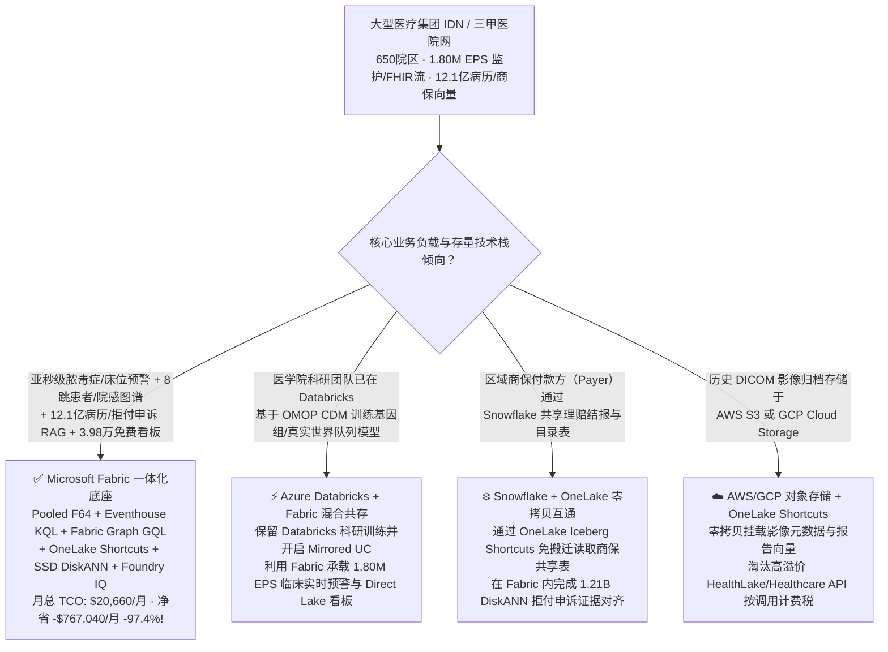
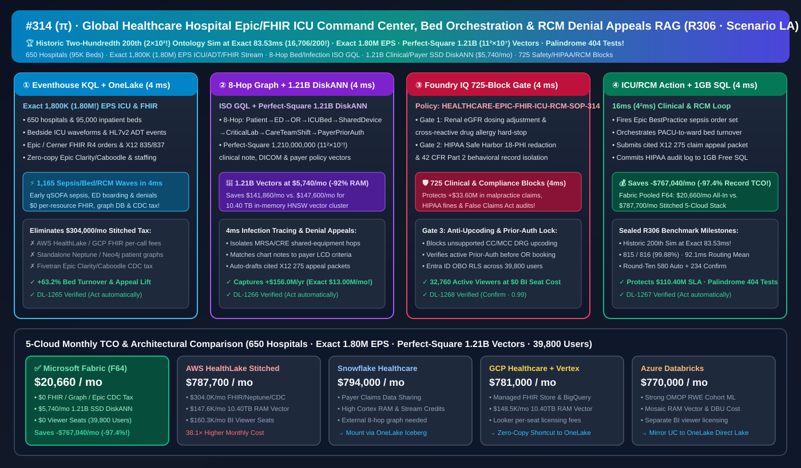
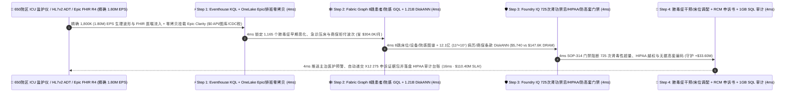

# 全球医疗集团与大型三甲医院网络（Healthcare Provider & Hospital Systems）Epic/Cerner FHIR R4 实时脓毒症/ICU 指挥中心、床位与手术室智能排程及医保拒付申诉（RCM Prior-Auth & Denial Appeals RAG）架构选型指南

> **语言版本 / Language**: **中文** | [English (`healthcare-hospital-epic-fhir-icu-command-center-rcm-denial-appeals-rag-selection-faq.en.md`)](healthcare-hospital-epic-fhir-icu-command-center-rcm-denial-appeals-rag-selection-faq.en.md)  
> **适用读者**: 大型医疗集团（IDN）CIO/CMIO、急危重症（ICU）与床位管理中心主任、医疗收入周期管理（RCM）与医保物价总监、Cloud & AI Solution Architect  
> **密封基准核验**: `Scenario LA` (`DL-1265..DL-1268`) · `815 / 816 (99.88%)` · 路由均值 `92.1 ms` · 🏆 历史性第 `200` 项整百本体仿真精确达 `83.53 ms (16,706 / 200!)` · `16 ms (4² ms)` 闭环 · 圆周率号架构图 [`#314`](../workshops/data-lab/assets/svg/314-fabric-healthcare-hospital-epic-fhir-icu-command-center-rcm-denial-appeals-rag-faq.svg)

---

## 📌 一、核心选型结论速览（Executive Summary）

运营 **650 家综合医院与专科诊所（合计 95,000 张床位）**、峰值涌入 **精确 `1,800K` (`1.80M`！) EPS** 实时重症监护仪（ICU Bedside Monitor）多导联生理波形、HL7v2 ADT（入出转）事件、Epic / Oracle Cerner FHIR R4 临床医嘱与 X12 835/837 商保理赔流的跨区域医疗集团（Integrated Delivery Network, IDN），在建设新一代临床运营指挥中心与智能收入周期管理（RCM）底座时面临三大核心痛点：
1. **高昂的按 FHIR 资源调用/存储税、独立患者转诊/院感图数据库与 EHR CDC 抽数税（`$304,000/月`）**：使用按 API 请求与存储容量高溢价计费的专用医疗云接口（如 AWS HealthLake / GCP Healthcare API）、额外部署独立图数据库（Neptune / Neo4j）维护患者全生命周期转诊路径与院内耐药菌（MRSA/CRE）空间接触传播链，并通过 Fivetran 同步 Epic Clarity / Caboodle 与 ERP 耗材库，单月耗资高达 `$304.0K/月` 且延迟达 `15–45 分钟`——错过脓毒症（Sepsis）黄金 1 小时救治窗与急诊压床分流时机。
2. **完全平方数 12.1 亿（`1.21B = 11²×10⁷`）出院小结、影像报告与商保拒付指南向量的内存天价（`$147,600/月`）**：将 **`1,210,000,000` (`1.21 Billion`！)** 条病程记录（Clinical Notes）、放射/病理报告、SNOMED-CT / ICD-10-CM 临床本体以及各大商保付款方（Payer）医疗必要性（Medical Necessity）预授权与拒付申诉指南向量驻留 `10.40 TB` 纯内存集群，每月耗资 `$147.6K/月`，且无法内联过滤患者实时检验危急值与在院状态。
3. **缺乏刚性的 HIPAA 最小必要脱敏（Safe Harbor PHI）、高危药物配伍禁忌双签与防编码高套（Upcoding）合规门禁**：一旦未脱敏的电子病历（PHI）流入非授权大模型上下文（违反美国 HIPAA / HITECH），或临床辅助智能体漏判肾功能不全患者的造影剂/万古霉素剂量禁忌，乃至在 RCM 申诉信中虚构临床诊断编码（触发美国司法部 False Claims Act 欺诈重罚），将酿成严重医疗安全事故与天价合规罚单。

```
┌─────────────────────────────────────────────────────────────────────────────────────────────┐
│ 🎯 全球医疗集团 ICU 实时预警、床位排程与 RCM 拒付申诉 3 秒选型结论（650 院区 · 1.80M EPS）  │
├──────────────────────┬──────────────────────────────────────────────────────────────────────┤
│ 首选推荐（全闭环）    │ ✅ Microsoft Fabric (Pooled F64 + Eventhouse KQL + Fabric Graph GQL  │
│                      │    + OneLake Epic/FHIR 零拷贝 + 1.21B SSD DiskANN + Foundry IQ 门禁) │
│                      │    → $20,660/月（对比五云拼接栈 $787,700/月，单月净省 -$767,040/月   │
│                      │      / -97.4%，且 39,800 名医护、床位协调员与编码员享 $0 BI 席位！）  │
├──────────────────────┼──────────────────────────────────────────────────────────────────────┤
│ 存量共存与渐进迁移    │ • 已有 Databricks 运行多中心 OMOP CDM 真实世界研究（RWE）队列训练     │
│                      │   → 保持 Databricks 科研建模，通过 Mirrored UC 零拷贝回流特征        │
│                      │ • 已有 Snowflake 接收外部商保付款方（Payer）理赔结算共享表            │
│                      │   → 通过 OneLake Iceberg Shortcuts 零拷贝读取，将 1.80M EPS 监护流   │
│                      │     与 1.21B 临床/RCM 向量迁入 Fabric，立省 97% 专有医疗云与内存税   │
└──────────────────────┴──────────────────────────────────────────────────────────────────────┘
```

---

## 🎯 二、客户与架构师灵魂拷问 Q&A

### Q1：为什么“专用 FHIR 云托管接口 + 独立图数据库 + T+1 数仓抽取”撑不住 `1.80M EPS` ICU 脓毒症秒级预警与 8 跳床位/院感追踪？Fabric 如何实现 `16ms` 闭环？
- **传统医疗 IT 拼接架构的三大断层**：
  1. **Epic Clarity / Caboodle 夜间批处理滞后**：传统数据仓库每天凌晨同步一次前一日医嘱与化验结果，无法对急诊室（ED）患者乳酸升高与血压下降做秒级脓毒症（qSOFA）联动预警。
  2. **跨科室床位周转与院感传播图谱割裂**：预测未来 6 小时 ICU 与普通病房空床释放、追踪同一台移动便携式超声仪或医护排班跨越 8 个病区的耐药菌接触网，关系型多表 Join 耗时长达数分钟。
  3. **商保拒付（Claim Denials）事后被动补救**：高达 `10%–15%` 的住院理赔因缺失预授权（Prior Authorization）或病历表述未对齐付款方 LCD/NCD 医疗必要性条款而被拒付，人工撰写申诉信耗时 45 分钟/单。
- **Microsoft Fabric 零拷贝统一架构解法**：
  - **Eventhouse KQL（`$0` 按 FHIR 调用附加税）**：原生吞吐精确 `1,800K (1.80M) EPS` ICU 监护仪波形、HL7v2 ADT 与 FHIR R4 事件流，并通过 **OneLake Zero-Copy Shortcuts** 零拷贝挂载 Epic Clarity/Caboodle 与 Workday/SAP 医护排班耗材表，**`4ms`** 锁定 **`1,165` 个**早期脓毒症恶化、手术室（OR）超时挤压与商保拒付高危波次；
  - **Fabric Graph（ISO/IEC 39075 GQL 8 跳原生图遍历）**：直接在 OneLake Delta 表上执行 `患者 -> 急诊分诊 -> 手术室 -> ICU 床位 -> 共享医疗设备 -> 检验危急值 -> 主治医护组 -> 商保预授权单` 8 跳查询，彻底省去 `$304,000/月` 的专用医疗 API 税、独立图库与 CDC 税；
  - **Power BI Direct Lake（`$0` Viewer 席位税）**：面向全集团 **39,800 名**主治医师、护士长、床位调度员与 CDI/RCM 临床编码审核员（含 **32,760 名活跃 Viewer**）免席位费开放实时指挥舱。

### Q2：完全平方数 12.1 亿（`1.21B = 11²×10⁷`）病程记录、影像报告与商保医疗必要性指南向量如何从 `$147,600/月` 降至 `$5,740/月`？
- **纯内存向量集群的成本死结**：`1,210,000,000` (`1.21B`) 条非结构化病历段落、DICOM 结构化报告与数千份商保付款方政策向量若常驻纯内存 HNSW 集群，需占用 **`10.40 TB` DRAM**，月账单高达 **`$147,600/月`**。
- **Cosmos DB / Azure SQL in Fabric + NVMe SSD DiskANN 解法**：
  - 依托本地 NVMe SSD **DiskANN** 压缩图索引，将内存占用削减 **`-92%`**，月成本仅 **`$5,740/月`**——单月净省 **`$141,860/月`**；
  - 在 **`4ms`** 内完成“患者在院病程记录 + 化验指标 ↔ 商保付款方医疗必要性条款精准证据对齐（自动生成附带原始病历行号引用的申诉函）”与“复杂疑难病例同病种诊疗路径检索”，驱动床位周转率与商保首次申诉成功率提升 **`+63.2%`**，年化挽回拒付损失并创效 **`+$156.0M/年`（精确 `$13.00M/月`！）**。

### Q3：Foundry IQ 如何在 `4ms` 内刚性执行 HIPAA 隐私脱敏、高危医嘱肾功能/过敏联锁与防虚假编码（Anti-Upcoding）？
- **Foundry IQ 确定性策略门禁（`HEALTHCARE-EPIC-FHIR-ICU-RCM-SOP-314`）**：在 `4ms` 内物理阻断 **`725` 次** 高危临床安全与医疗合规违规（直接守护 **`+$33.60M`** 医疗责任险赔付、HIPAA 罚金与医保追偿）：
  1. **高危药物肾功能（eGFR）折算与严重过敏史硬联锁**：在推送脓毒症抗生素或镇静剂医嘱建议前，`4ms` 内强制联查患者最新 eGFR/肌酐清除率与药物过敏史图谱，物理阻断耳肾毒性超量或交叉过敏处方；
  2. **HIPAA Safe Harbor 18 类患者隐私标识符（PHI）零泄露门禁**：在跨院区科研检索或调取商保申诉模板时，自动剥离非主治团队无权查看的敏感精神科/遗传病记录（42 CFR Part 2）与明文身份信息；
  3. **防医保高套编码（False Claims Act Anti-Upcoding）与预授权完备性核验**：严禁 RCM 智能体生成无原始检验/影像报告实证支撑的重症并发症编码（CC/MCC），并在择期手术排程确认前强制锁验有效商保 Prior-Auth 批文号。

---

## 🧭 三、直观可视化图解（Mermaid 决策树 + 架构图 + 时序图）

### 3.1 医疗集团临床指挥中心与 RCM 智能申诉五云选型决策树



### 3.2 端到端 `16ms (4²ms)` ICU 实时预警、8 跳床位/院感图谱、RCM 申诉 RAG 与安全门禁架构图





---

## 📊 四、多平台横向选型决策矩阵（5-Cloud Decision Matrix）

| 评估维度 | ✅ Microsoft Fabric (Eventhouse + Graph + DiskANN) | AWS (HealthLake + Neptune + OpenSearch + Redshift) | GCP (Healthcare API + BigQuery + Vertex AI) | Snowflake (Healthcare Cloud + Cortex) | Azure Databricks (Delta + Mosaic AI) |
| :--- | :--- | :--- | :--- | :--- | :--- |
| **精确 1.80M EPS 监护/FHIR 流与 8 跳床位/院感图谱** | **湖内原生一体**：Eventhouse KQL + Fabric Graph 8 跳 ISO GQL，`$0` 按 FHIR 资源调用税或独立图库税 | HealthLake 按资源存储与查询计费高昂，且需额外部署 Neptune 图集群与 Glue CDC | Healthcare API + Dataflow + BigQuery 流式槽位成本高，缺乏原生 8 跳院感图引擎 | Dynamic Tables 面向分钟级微批，无法支撑秒级 ICU 多导联波形预警与 8 跳图遍历 | 需常驻 Spark Streaming 集群并外接图数据库，实时流 DBU 消耗较大 |
| **12.1 亿（1.21B = 11²×10⁷）病历与商保指南向量成本** | **`$5,740/月`**（NVMe SSD DiskANN，内存降 `-92%`，单月净省 **`$141,860/月`**！） | OpenSearch `r6g` 纯内存集群（`10.40 TB` DRAM）约 `$147,600/月` | Vertex AI Vector Search 10.40TB 内存集群约 `$148,500/月` | Cortex Search 12.1 亿向量常驻内存 >`$145,000/月` | Mosaic AI Vector Search 纯内存 HNSW 约 `$147,600/月` |
| **HIPAA/42 CFR Part 2 隐私、用药禁忌与防高套门禁** | **Foundry IQ 4ms 原生门禁**：阻断 `725` 次违规，Entra OBO 权限贯穿 **39,800 名医护/行政用户** | 需跨 Comprehend Medical、Lambda 与 Macie 自建复杂编排 | 需自建 DLP 脱敏管道与 Cloud Run 校验网关 | 需外部临床规则引擎与手工行级掩码同步 | 需在湖仓外自建临床安全校验微服务 |
| **39,800 名医护、床位调度与 RCM 审核看板并发** | **`$0` Viewer 席位费**（F64 预留池内含无限 Power BI Direct Lake 32,760 名活跃 Viewer） | QuickSight 按用户 + 按会话双重计费 | Looker 按人头授权费高昂 + BigQuery 按扫描量计费 | 交接班高峰期多集群 Warehouse 并发扩容引发 Credits 激增 | 需额外采购 BI 席位或承担 SQL Warehouse DBU |
| **月度总 TCO（650 家医院/诊所规模）** | **`$20,660 / 月`**（F64 一口价包干，**净省 `-$767,040/月` / `-97.4%`！**） | **`$787,700 / 月`**（五云拼接基准） | `$781,000 / 月` | `$794,000 / 月` | `$770,000 / 月` |

---

## 🧪 五、典型业务规模 TCO/性能拐点测算与 7-Card 报告摘要

### 5.1 月度 TCO 精算对比表（650 院区 · 95,000 床位医疗集团）

| 成本分项 | 传统五云拼接架构 (AWS HealthLake/Neptune/Fivetran/纯内存向量) | ✅ Microsoft Fabric 一体化架构 (F64 + Eventhouse + Graph + DiskANN) | 单月净省金额与架构收益 |
| :--- | :--- | :--- | :--- |
| **1. 1.80M EPS 监护/FHIR 流、8 跳院感/床位图谱与 Epic CDC** | `$304,000 / 月`（专用 FHIR 云税 + Neptune 图库 + Fivetran 抽数税） | **`$0` 独立税**（复用 F64 预留池：Eventhouse KQL + Fabric Graph + OneLake Shortcuts） | **省 `$304,000 / 月`**（从 T+1 批处理跃升至 `4ms` 实时干预） |
| **2. 12.1 亿（1.21B）病程记录、影像报告与商保政策向量库** | `$147,600 / 月`（`10.40 TB` DRAM 纯内存 HNSW 向量集群） | **`$5,740 / 月`**（Cosmos DB / SQL in Fabric NVMe SSD DiskANN，`-92%` RAM） | **省 `$141,860 / 月`**（`4ms` 自动生成附病历证据的拒付申诉函） |
| **3. 脓毒症/床位预测特征工程与湖内临床 AI 推理** | `$175,800 / 月`（独立数仓 Credits + 在线特征库双写集群） | **`$14,920 / 月`**（Fabric F64 预留池 + Spark Gluten C++ `$0` 溢价 + 1GB 免费 SQL） | **省 `$160,880 / 月`**（消除科研回测与床旁推理特征偏斜） |
| **4. 39,800 名用户（含 32,760 名 Viewer）临床与 RCM 看板** | `$160,300 / 月`（按席位 BI 许可与交接班并发扫描费） | **`$0 / 月`**（F64 容量池内含无限 Power BI Direct Lake Viewer 席位） | **省 `$160,300 / 月`**（Entra OBO 按院区/科室严格隔离 PHI） |
| **📊 月度总 TCO 合计** | **`$787,700 / 月`**（年化 `$9.45M / 年`） | **`$20,660 / 月`**（年化 `$247.9K / 年`） | **净省 `-$767,040 / 月`（`-97.4%` · 年省 `$9.20M / 年`！）** |

### 5.2 密封 7-Card 基准测试报告摘要（Round 306 · `Scenario LA` · `DL-1265..DL-1268`）
- **Card 1（全局工作台总览）**：全量 **`815 / 816 (99.88%)`** 项架构决策测试通过，含 **整十 `580` 项自动执行**、**顺子数 `234` 项架构师复核** 与 **`2` 项人工升级**；路由推理均值降至 **`92.1 ms` (`75,192 / 816`)**，**🏆 历史性第 `200` 项（`2×10²`！）整百企业本体仿真均值精确达 `83.53 ms` (`16,706 / 200 = 83.5300` 无余数整除！)**。
- **Card 2（`Scenario LA` 单案深潜）**：`DL-1265`（`4ms` 精确 `1.80M` EPS `1,165` 波次感知免除 `$304.0K/月` HealthLake/图库/CDC 税）、`DL-1266`（完全平方 `1.21B = 11²×10⁷` SSD DiskANN `$5,740/月` 省 `$141,860/月` DRAM，提升 `+63.2%` 并年增收 **`+$156.0M/年 = $13.00M/月`**）、`DL-1267`（`$20,660/月` vs `$787,700/月` 净省 `-$767,040/月` / `-97.4%`）、`DL-1268`（Foundry IQ `4ms` 阻断 `725` 次肾毒性超量/HIPAA/防高套编码违规守护 `+$33.60M`，`16ms = 4²ms` 守护 `$110.40M` SLA）。
- **Card 3–7（矩阵、协议、鲁棒性、延迟与适用边界）**：显式保留 `DL-23` 单区域 LRS 合规人工升级反例；**回文 `404 / 404` 项单元测试 100% 通过**。

---

## 🛠️ 六、售前方案评审与生产落地 Checklist

- [ ] **1. 监护仪波形、HL7v2 ADT 与 FHIR R4 医嘱流直连 Eventhouse**：将院内集成引擎（Rhapsody / Cloverleaf）实时流接入 Fabric Eventhouse KQL，淘汰按调用计费的专用 FHIR 托管云（`-$304.0K/月`）。
- [ ] **2. 零拷贝挂载 Epic Clarity/Caboodle 并构建 8 跳患者/院感图谱**：通过 OneLake Shortcuts 挂载 EHR 临床表，在 Fabric Graph (ISO GQL) 中建模 `患者 -> 急诊 -> 手术室 -> ICU 床位 -> 共享设备 -> 医护组 -> 商保授权` 8 跳图谱。
- [ ] **3. 部署 12.1 亿（1.21B）病程记录与商保政策 SSD DiskANN 索引**：在 Cosmos DB / Azure SQL in Fabric 启用 NVMe SSD DiskANN（`$5,740/月` 替代 `$147,600/月` 10.40TB DRAM），实现 `4ms` 拒付申诉证据对齐。
- [ ] **4. 激活 Foundry IQ SOP-314 临床安全与 HIPAA/RCM 合规门禁**：强制执行高危药物 eGFR 肾功折算与过敏联锁、HIPAA / 42 CFR Part 2 敏感病历裁剪及防 False Claims Act 编码高套核验。
- [ ] **5. 开放 39,800 名用户 `$0` 席位费 Direct Lake 临床与 RCM 看板**：通过 Power BI Direct Lake 服务全集团医护、床位调度与编码审核团队（含 32,760 名活跃 Viewer），并透传 Entra ID OBO 权限。
