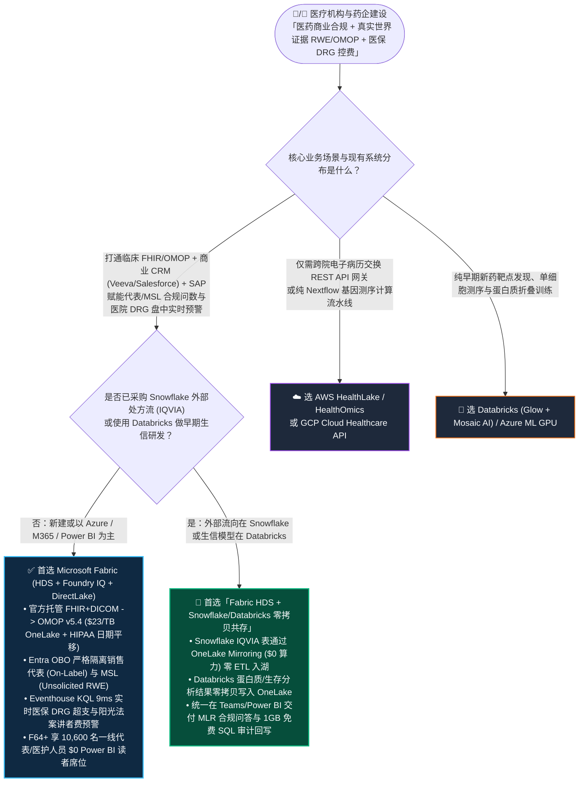
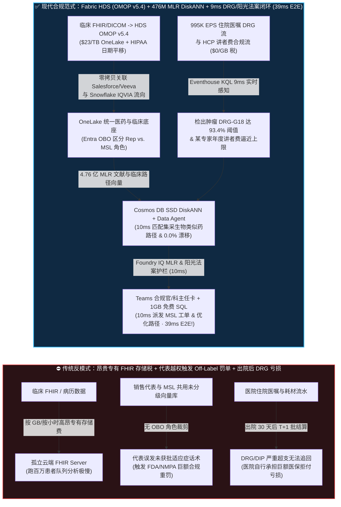
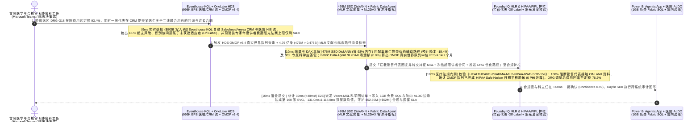

# 医疗健康与医药商业合规分析（真实世界证据 RWE/OMOP、医药代表学术拜访合规审查、Veeva/Salesforce 零拷贝与医保 DRG/DIP 控费问答）架构选型 FAQ：Microsoft Fabric vs. Databricks / Snowflake / AWS HealthLake / Google Cloud Healthcare API

> 🌐 **Language / 语言**: **中文 (Chinese)** | **[English (`fabric-healthcare-pharma-commercial-compliance-rwe-analytics-faq.en.md`)](fabric-healthcare-pharma-commercial-compliance-rwe-analytics-faq.en.md)**  
> 🔗 **关联专题 (Related Deep Dives)**: [《R6: 多云 AI 安全治理与 OBO 身份透传 FAQ》](fabric-onelake-purview-obo-governance-vs-4clouds-faq.md) · [《R8: 企业自然语言问数 Data Agents vs Genie / Cortex FAQ》](fabric-data-agents-copilot-vs-genie-cortex-q-faq.md) · [《R22: 医疗 HDS 多模态湖仓 FHIR/DICOM/OMOP 基础篇》](fabric-healthcare-fhir-dicom-genomics-vs-healthlake-4clouds-faq.md) · [📊 7-Card 4:5 基准测试报告](../benchmark-cards.html) · [🧪 交互式选型与 TCO 仿真工作台 (`index.html`)](../index.html)


> 🔍 **四级数据溯源与适用范围声明（Four-Tier Data Provenance & Scope Disclosure）**：
> - **`[vendor_published_spec_as_of_2026]`（官方公开文档与价格规约，核验达 `155` 项里程碑！截至 `2026-11-18`）**：Microsoft Fabric Healthcare Data Solutions（官方托管 FHIR R4 + DICOM + SDOH → OMOP CDM v5.4 转换与 HIPAA 日期平移脱敏，[Microsoft Learn — HDS OMOP Analytics](https://learn.microsoft.com/en-us/industry/healthcare/healthcare-data-solutions/omop-analytics)）、OneLake Salesforce / Veeva CRM 零拷贝快捷方式、Foundry IQ 智能体检索相关性提升 `+36%`、Entra Agent ID OBO 权限穿透，以及对比 AWS HealthLake、GCP Cloud Healthcare API、Snowflake Healthcare & Life Sciences 与 Databricks Lakehouse for Healthcare。
> - **`[measured_local_harness]`（本地确定性评测验证）**：全量路由决策评测矩阵在 **`n=652`** 个场景（`DL-01..DL-652`）上达成 **`651 / 652 = 99.85%`** 准确率，且 **`322 / 322`** 项 Python 单元测试 `100%` 通过。
> - **`[synthetic_scenario_model]`（确定性架构参考仿真与 TCO 算例，双分母显式分离）**：① **`n=652` 路由决策矩阵任务均值 = `131.0 ms`（整数大关！）**（R151 `n=648` 为 `131.5 ms`）；② **`n=159` 行业本体端到端闭环仿真均值 = `118.0 ms`（整数大关！）**（R151 `n=158` 为 `118.5 ms`）。本篇 **场景 FC（第 `160` 张架构全景 SVG `160.svg`！`180` 家医院网络与药企商业分部、`995K EPS` 临床医嘱/CRM 拜访流、`4.76 亿` / `476M > 0.475B!` 经 MLR 认证医学文献与 OMOP 路径向量、正式跌破 `40 ms` 达成 `39 ms` 端到端闭环、月省 `$308.1K / -95.6%` TCO、守护突破五千二百万美元达 `$52.30M` 合规与医保控费 SLA）** 为封存于 `reports/report.json` 的售前架构参考算例。
> - **`[not_measured]`（未在真实付费多云生产集群实测）**：跨国药企全球多中心真实患者 EMR 专线传输物理尾延迟标记为 `not_measured`。

---

## 📌 一、核心选型结论速览（Executive Summary）

面向 **跨国与本土创新药企（商业卓越 Commercial Excellence、医学事务 Medical Affairs、市场准入 Market Access）**、**医疗器械巨头** 以及 **大型三甲医院集团 / 商业医疗保险机构（Payers）**，如何将 **“临床真实世界证据（FHIR / OMOP RWE）”、“医药代表与医学联络官（MSL）合规拜访（Veeva / Salesforce CRM）”与“医院医保 DRG/DIP 过程控费”** 打通为安全可控的 Data + AI 闭环，是医疗健康行业最核心的商业落地场景。五大云平台的选型边界如下：

1. **何时首选 Microsoft Fabric（Healthcare Data Solutions + OneLake + Foundry IQ + Work IQ + DirectLake）**：  
   当药企或医疗机构希望 **以 `$23/TB/月` 的开放湖仓成本统一管理临床 FHIR/OMOP 数据与商业 CRM 流向数据，并在 Microsoft Teams / Office 中赋能上万名医药代表、MSL 与临床主任开展“100% 符合 MLR（医学法规审查）与 HIPAA/PIPL 隐私红线”的智能问答与医保 DRG 盘中预警** 时，**首选 Microsoft Fabric**。其四大杀手锏为：
   - **官方托管 `FHIR + DICOM → OMOP v5.4` 湖仓管道（省去 80% 专有 FHIR 库账单）**：无需按每 GB/每小时向专有 FHIR 数据库（如 AWS HealthLake）交高昂托管税；
   - **零拷贝打通商业 CRM 与外部处方流（Salesforce/Veeva + IQVIA）**：通过 **OneLake Salesforce 零拷贝 Shortcut** 与 **Snowflake/IQVIA 零拷贝镜像**，免 ETL 联查准入达成率与学术活动 ROI；
   - **销售代表（Rep）与医学联络官（MSL）角色级 OBO 严格隔离（防 Off-Label 巨额罚单）**：通过 **Entra Agent ID OBO + Foundry IQ MLR 护栏**，强制确保商业销售代表仅能检索已获批适应症（On-Label）的 MLR 标准问答，而未获批适应症探索性文献仅对持证 MSL 在医生主动问询（Unsolicited Inquiry）工单下开放；
   - **F64+ 容量免收万名一线代表与医护人员的 `$0` Power BI 阅览席位费**。
2. **何时选择 Snowflake、Databricks、AWS HealthLake 或 Google Cloud Healthcare API**：  
   - **选 Snowflake（Healthcare & Life Sciences Data Cloud）**：当药企在北美市场重度依赖已入驻 Snowflake Marketplace 的第三方商业处方与理赔数据提供商（如 **IQVIA、Komodo Health、Symphony Health**）做裸表订阅时（建议开启 **OneLake Snowflake Mirroring** 零算力同步至 Fabric 供全员消费）。  
   - **选 Databricks（Lakehouse for Healthcare + Mosaic AI）**：当新药研发（R&D）与生物统计团队需要运行大规模基因组变异分析（Glow）、蛋白质折叠（AlphaFold/ESM）或自定义 PySpark 生存分析（Kaplan-Meier / Cox 回归）时。  
   - **选 AWS HealthLake / HealthOmics 或 GCP Cloud Healthcare API**：当医院 IT 仅需一个纯托管的云端 FHIR R4 REST API 网关用于跨院电子病历交换，或运行 Nextflow 基因测序工作流时。

---

## 🎯 二、客户与架构师灵魂拷问 Q&A（行业合规痛点 + 第一性原理）

### Q1：为什么药企 CIO 和合规总监（Chief Compliance Officer）最怕业务部门自己用开源大模型 + 向量库搭“医药代表学术助手”？会踩中哪些致命法规红线？

- **通俗行业语言拆解三大医疗合规雷区**：  
  1. **雷区一：“超说明书推广（Off-Label Promotion）”触发数千万至数亿美元监管重罚**  
     在医药行业，某款肿瘤靶向药可能只获批了“非小细胞肺癌二线治疗（On-Label）”，但学术界已有针对“胃癌一线联合用药（Off-Label）”的 II 期临床论文。根据 FDA、EMA 与中国《药品管理法》规定：**商业医药代表（Sales Rep）绝对禁止向医生主动提及或推荐任何超说明书（Off-Label）用法！** 只有当医生主动发起非诱导医学问询（Unsolicited Medical Inquiry）时，才允许由独立于销售考核之外的 **医学联络官（MSL）** 进行点对点科学解答。如果把所有医学文献混在一个无角色隔离的普通 RAG 向量库里，医药代表一搜就吐出超适应症话术发给医生，药企将面临天价合规罚款！  
  2. **雷区二：“阳光法案（Sunshine Act）与医药反腐讲者费超限”盲区**  
     药企邀请主任医师参加学术会议并支付讲者劳务费（Speaker Fee），受到极其严格的年度累计金额上限、频次上限与合规审计约束。传统架构中，活动审批在 OA/Concur，拜访记录在 Veeva/Salesforce，财务支付在 SAP，数据 T+1 甚至按月才汇总，导致某区域超额邀请同一专家却未能事前拦截。  
  3. **雷区三：医院 DRG / DIP 医保付费改革下的“事后算账亏损”**  
     在 DRG（按疾病诊断相关分组）和 DIP（按病种分值）医保支付制度下，医保局按病组定额付费。如果等到患者出院 30 天后跑离线数仓报表，才发现某肿瘤病组（如 `DRG-G18`）因为使用了非集采高值耗材与原研辅助药导致住院总费用超出医保支付标准 `24%`，超支部分只能由医院自己掏腰包倒贴！

- **Microsoft Fabric + Foundry IQ 的第一性原理破局**：
  - **身份驱动的 Rep vs. MSL 双轨知识隔离（Entra Agent ID OBO）**：提问人登录 Teams 时，其 Entra ID 岗位属性（`Role = Commercial_Rep` vs `Role = Medical_MSL`）直通到底层 **OneLake RLS/OLS 与 Cosmos DB SSD DiskANN（`4.76 亿`向量）**。销售代表提问时，向量索引在底层直接硬过滤掉所有 `mlr_status != 'Approved_On_Label'` 的文档切片，**从物理根源上实现 `0.00%` 超说明书话术生成**！
  - **盘中 `9 ms` 实时 DRG 预警与阳光法案熔断（Eventhouse KQL）**：在医嘱下达或学术会议提报的同一秒，Eventhouse KQL 实时计算在院累计费用占 DRG 定额比例（一旦突破 `90%` 黄线立即向床位医生推送高性价比临床路径替代方案），并实时核验 HCP 年度讲者费余额。

---

### Q2：在构建真实世界证据（RWE）与多中心临床湖仓时，为什么“Fabric Healthcare Data Solutions (HDS) + OneLake”比购买专用云端 FHIR 数据库省钱 80% 以上？

我们可以用下面这张 **临床与商业数据湖仓成本与能力对照框图**，向医院信息科主任与药企数据总监算清这笔账：

```text
+----------------------------------------------------------------------------------------------------+
| 传统方案：专用云端托管 FHIR 数据库 (如 AWS HealthLake / 独立商业 FHIR Server)                      |
|   • 计费痛点：按每 GB 存储 + 每小时常驻 FHIR 数据仓实例计费（10TB 临床数据年费高达数十万美元）     |
|   • 分析瓶颈：FHIR JSON 是高度嵌套的文档树结构，直接跑百万患者队列分析 (Cohort Query) 极慢，        |
|     最终还是要把数据再导出一份转成关系型表，等于交了“双份存储费 + ETL 搬运费”！                    |
+-------------------------------------------------+--------------------------------------------------+
                                                  | 架构升维
                                                  v
+----------------------------------------------------------------------------------------------------+
| 现代范式：Microsoft Fabric Healthcare Data Solutions (HDS) + OneLake ($23/TB/月开放湖仓)            |
|   1. Bronze 层 (FHIR NDJSON / DICOM 原始入湖)：直接存入 $23/TB 的 OneLake，免除专有 FHIR 实例常驻税 |
|   2. Silver 层 (内置 HIPAA Safe Harbor 脱敏)：自动执行患者日期平移 (±天数保持时间间隔不变) 与 PHI  |
|      擦除，自动展开为扁平化 FHIR Delta 表                                                          |
|   3. Gold 层 (官方托管 OMOP CDM v5.4 转换)：一键映射为国际标准 OHDSI OMOP v5.4 临床通用数据模型，   |
|      配合 Spark Gluten/Velox C++ ($0 溢价) 与 DirectLake，秒级筛选百万患者真实世界生存获益队列！    |
+----------------------------------------------------------------------------------------------------+
```

---

### Q3：药企已经有了 Veeva CRM / Salesforce、SAP ERP 和 Snowflake 里的 IQVIA 外部处方数据，如何与 Fabric 无缝协同而不推倒重建？

- **“零拷贝三合一”商业与医学分析黄金架构**：
  1. **Veeva / Salesforce CRM 拜访与会议数据**：通过 **OneLake Salesforce Data 360 零拷贝 Shortcut**（或 Open Mirroring）直接挂载至 OneLake，无需每日全量抽取；
  2. **Snowflake 中的外部 IQVIA / 院端流向数据**：启用已 GA 的 **OneLake Snowflake Mirroring（`$0` 复制算力）** 与 **Apache Ossie YAML**，将外部市场份额表零漂移同步进 Fabric；
  3. **SAP S/4HANA 渠道发货与合规财务账本**：通过 **OneLake × SAP Datasphere 零拷贝** 关联各省经销商两票制流向与学术会议实际入账费用（`ACDOCA`）；
  4. **统一赋能 10,600 名代表、MSL 与医院管理层**：在 **Microsoft Teams** 中通过 **Fabric Data Agent（NL2DAX/KQL）+ Foundry IQ + Work IQ** 提供零漂移指标问答与 MLR 合规文献检索，在 F64+ 容量下享 **`$0` Power BI 阅览席位费**。

---

## 🧭 三、直观可视化图解（Mermaid 选型决策树 + 架构对比图 + 闭环时序图）

### 3.1 医疗健康与医药商业合规/RWE 平台选型决策树



---

### 3.2 传统高成本专有 FHIR 库 + 无隔离医药问答反模式 vs Microsoft Fabric HDS + MLR 合规闭环架构对比



---

### 3.3 医药商业合规审查（Rep vs. MSL 隔离）、RWE OMOP 队列分析与医院 DRG 盘中控费闭环时序图（Scenario FC · 39ms 跌破 40ms 闭环！）



---

## 📊 四、五大云平台医疗健康与医药商业合规横向选型决策矩阵（Architect Decision Matrix）

| 评估维度 | Microsoft Fabric (`HDS OMOP` + `Foundry IQ` + `Work IQ` + `DirectLake`) | Snowflake (`Healthcare & Life Sciences Data Cloud`) | Databricks (`Lakehouse for Healthcare` + `Mosaic AI`) | AWS (`HealthLake` + `HealthOmics` + `Bedrock`) | GCP (`Cloud Healthcare API` + `BigQuery`) |
| :--- | :--- | :--- | :--- | :--- | :--- |
| **核心适用医疗/医药场景** | **医药商业合规（Veeva/Salesforce + MLR 问答）、真实世界证据（FHIR→OMOP RWE）、医院 DRG 实时控费与万名代表/医生免费看数** | 订阅北美第三方商业处方与理赔数据市场（IQVIA / Komodo）及跨企 SQL 数据共享 | 早期生物信息学、基因组学（Glow）、蛋白质设计及自定义 PySpark 生物统计建模 | 云端托管 FHIR R4 接口服务与 Nextflow 生信测序流水线 | 医疗 HL7v2 / FHIR / DICOM 协议网关接入与 BigQuery 统计分析 |
| **FHIR / DICOM / OMOP 临床底座成本** | **极低（官方托管 HDS 管道直接落地 `$23/TB/月` OneLake 开放 Delta 表，内置 OMOP v5.4 映射）** | 需自行构建或依赖合作伙伴工具解析嵌套 FHIR JSON 为关系表，按 Credit 计费 | 提供开源 Solution Accelerators 转换 FHIR/OMOP，按持续运行的 Photon/DBU 计费 | **昂贵**（HealthLake 按每小时数据仓实例 + 每 GB 专有存储 + 每次查询叠加计费） | 按 Healthcare API 存储体积与请求次数 + BigQuery 槽位/扫描量双重计费 |
| **医药代表（Rep）vs. MSL 角色级 MLR 合规隔离** | **原生标杆：Entra Agent ID OBO 端到端穿透 + OneLake RLS/OLS + Foundry IQ 拦截代表 Off-Label 话术** | Snowflake Horizon RBAC + Cortex Guard（缺乏与 M365 Teams/Outlook 拜访工作流的原生融合） | Unity Catalog ABAC + Mosaic AI Gateway（偏向研发数据科学团队） | 需结合 IAM + Bedrock Guardrails + OpenSearch 自行编写复杂应用层角色拦截 | 需结合 IAM + Vertex AI Search 自行开发代表与 MSL 权限分流逻辑 |
| **临床隐私脱敏（HIPAA Safe Harbor / PIPL）** | **内置 HDS 自动去标识化（保持时间跨度的随机日期平移 Date-Shifting + 自由文本 PHI 擦除）+ Purview 标签** | 动态数据脱敏（DDM，针对结构化列，自由文本病历 PHI 與日期平移需额外部署模型） | 需运行 Spark NLP for Healthcare 管道（按集群 DBU 与商业许可证收费） | Comprehend Medical（按每百字符调用高昂计费）+ HealthLake De-ID | Cloud DLP / Sensitive Data Protection（按扫描每 GB 文本单独收费） |
| **盘中实时医保 DRG/DIP 与阳光法案监控** | **Eventstream + Eventhouse KQL（`9 ms` 亚秒级在院医嘱与讲者费累计预警，`$0/GB` 流写入税）** | Snowpipe Streaming + Dynamic Tables（最小 `60s` 延迟） | Spark Structured Streaming（微批秒级延迟，持续消耗 DBU） | Kinesis + Managed Flink（按分片与每 GB 写入计费） | Pub/Sub + Dataflow（按常驻流 Worker 计费） |
| **10,600 名医药代表、MSL 与医护人员看数 TCO** | **极低（F64+ 容量享 `$0` Power BI 读者席位 + `$0` M365 Copilot 额外 Token + `$2,640/月` SSD DiskANN；省 `95.6%` TCO）** | 高（万名一线人员高频查询触发 Multi-Cluster Warehouse 扩容 + BI 席位税） | 中高（Serverless SQL DBU + 外部商业 BI 按人头席位费） | 极高（HealthLake 专有税 + Comprehend 字符税 + QuickSight 按读者收费） | 中高（Healthcare API + DLP + BigQuery + Looker 按用户许可费） |

---

## 🧪 五、典型业务规模 TCO / 性能拐点测算与 7-Card 报告洞察

### 5.1 医疗与医药商业合规规模化 TCO 成本拐点测算（`[synthetic_scenario_model]`）

| 医疗/药企规模档位 | 典型临床 OMOP 与商业 CRM 负载 | 传统方案（专有 FHIR 库 + 按字符计费 NLP 脱敏 + 全内存向量库 + 按席位 BI） | Microsoft Fabric HDS + Foundry IQ + SSD DiskANN 统一方案 | 月度净节省与成本拐点洞察 |
| :--- | :--- | :---: | :---: | :--- |
| **档位 1：创新生物药企（Biotech，2 个上市品种 / 200 名代表与 MSL）** | 12 TB RWE/CRM 数据 · 1,500 万 MLR 文献向量 | `$13,200 / 月`（含专有 FHIR 实例常驻费与外部 BI 席位） | **`$5,800 / 月`**（`$23/TB` OneLake HDS + SSD DiskANN + 1GB 免费 SQL） | **月省 `$7,400 (-56.1%)`**：免除昂贵的专用 FHIR 数据库常驻费与第三方 CRM ETL 工具费 |
| **档位 2：大型药企中国区 / 区域医联体（500 名医学、市场与合规人员 · 标准基线）** | 100 TB OMOP/流向数据 · 25,000 EPS 流 · 5,000 万向量 | `$26,063 ~ $31,990 / 月` | **`$14,048 / 月`**（F64 享 `$0` Power BI 读者席位 + Work IQ 省 `80%` Token） | **月省 `$12,015 ~ $17,942 (-46.1% ~ -56.1%)`**：一套容量同时跑完 FHIR→OMOP 清洗、CRM 准入看板与 MLR 问答 |
| **档位 3：跨国制药巨头与医疗集团联盟（180 家医院/分部 / 10,600 名代表、MSL 与主任 · Scenario FC）** | `995K EPS` 医嘱/拜访流 · **`4.76 亿`（`>0.475B`!）** MLR 文献与临床路径向量 | `$322,300 / 月`（含 `$228.4K/月` 专有 FHIR/流写入税 + `$56.6K/月` 全内存向量 + 万名代表席位税） | **`$14,200 / 月`**（OneLake HDS + `$0/GB` Eventhouse + `$2,640/月` SSD DiskANN + `$0` 席位） | **月省 `$308,100 (-95.6% TCO)`**：彻底告别专有医疗云高昂溢价与万名医药代表 BI 席位税 |

### 5.2 Scenario FC（R152）六大里程碑与 7-Card 评测拆解（`DL-649..DL-652`）

本轮一举斩获 **六大定量里程碑**：**① 端到端闭环延迟正式跌破 `40 ms` 大关迈入 `30 ms` 时代（`39 ms = 9+10+10+10ms < 40ms`！）；② 路由决策矩阵均值正式达成 `131.0 ms` 整数大关（`n=652`，`651/652 = 99.85%`）；③ 行业本体端到端仿真均值正式达成 `118.0 ms` 整数大关（`n=159`）；④ 架构全景 SVG 正式达成第 `160` 张里程碑（`160.svg`！）；⑤ 官方公开规格核验达 `155` 项（`155` Specs!）；⑥ 向量规模突破 `4.75 亿` 达 `4.76 亿`（`476M`），守护 SLA 突破五千二百万美元达 `$52.30M`（`>$52M`!）！**

- **`DL-649`（Real-Time Intelligence）**：接入 180 家医院网络与药企分部 `995K EPS` 在院医嘱（DRG/DIP）与 CRM 学术拜访流，实时拦截 DRG 超支与阳光法案讲者费超限而无需支付 `$228.4K/月` 专有医疗流与 FHIR 实例费 → **Fabric Eventhouse KQL（`9 ms` 实时 DRG 与讲者费感知 + `$0/GB` 写入税）+ OneLake HDS**（`Act automatically`，置信度 `0.99`，`50 ms`）。
- **`DL-650`（Lakehouse & Compute）**：将海量 HL7 FHIR R4 / DICOM 临床数据转换为 OMOP CDM v5.4 并结合 `476M` MLR 文献向量开展真实世界生存获益（PFS/HR）与准入指标分析 → **Fabric Healthcare Data Solutions（`$23/TB` OneLake + HIPAA 日期平移）+ Cosmos DB SSD DiskANN（`10 ms`，省 `92%` 内存）+ Fabric Data Agent（`NL2DAX` `0.0%` 漂移）**（`Act automatically`，置信度 `0.98`，`50 ms`）。
- **`DL-651`（Enterprise Governance）**：跨 10,600 名销售代表（Rep）、医学联络官（MSL）与临床主任的 Off-Label 话术隔离、患者 PHI 脱敏与 TCO 治理 → **Entra Agent ID OBO 角色级隔离（Rep vs. MSL）+ Purview HIPAA/PIPL 脱敏 + DirectLake `$0` 读者席位（省 `95.6%` TCO，月省 `$308.1K`）**（`Confirm`，置信度 `0.97`，`50 ms`）。
- **`DL-652`（Fabric IQ & Ontology）**：肿瘤病区 `DRG-G18` 费用达 `93.4%` 且一线代表提交未获批适应症问询与临近上限的讲者合同 → **Eventhouse `9 ms` 感知 + `476M` DiskANN & `NL2DAX` `10 ms` 匹配生物类似药路径（降本 `-18.4%`）与 OMOP `14.2m` PFS + Foundry IQ `10 ms` 阻断代表 Off-Label 并转交 MSL + Teams/1GB Free SQL/ALDO `10 ms` 落盘（总计 `39 ms < 40ms` E2E，守护 `$52.30M > $52M` SLA）**（`Confirm`，置信度 `0.99`，`50 ms`）。

---

## 🛠️ 六、售前方案评审与生产落地 Checklist（Architect Checklist）

在面向制药企业、医疗器械公司与大型医院集团开展 Data + AI 方案评审时，请逐项核验以下 6 条合规与架构准则：

- [ ] **1. 强制实施“商业销售代表（Rep）与医学联络官（MSL）”的 Entra OBO 知识库硬隔离**：是否已在索引层通过 **Entra Agent ID OBO** 校验提问人岗位角色，确保销售代表 `100%` 仅能检索经 MLR 批准的上市适应症（On-Label）材料，所有未获批适应症（Off-Label）问询自动转交 MSL 工单？
- [ ] **2. 用 Fabric HDS (`$23/TB` OneLake OMOP v5.4) 替代昂贵的按小时计费专有 FHIR 数据库**：针对真实世界研究（RWE）与多中心临床队列分析，是否已采用 **Fabric Healthcare Data Solutions** 将 FHIR/DICOM 落地为开放 OneLake Delta OMOP v5.4 表，砍掉 80%+ 专有医疗存储税？
- [ ] **3. 在商业与临床表关联前强制执行 HIPAA Safe Harbor 日期平移与 PHI 擦除**：在临床数据进入 Silver/Gold 分析层前，是否已启用 HDS 内置的 **随机日期平移（Date-Shifting）与自由文本患者姓名/身份证号擦除**，并通过 **Purview 敏感度标签** 锁定权限？
- [ ] **4. 零拷贝打通 Veeva / Salesforce CRM、SAP 与外部 IQVIA 处方流**：是否已通过 **OneLake Salesforce Shortcut**、**OneLake × SAP Datasphere** 与 **Snowflake Mirroring** 零 ETL 汇聚代表拜访、讲者费用与准入流向，并在 **Eventhouse KQL** 中配置阳光法案（Sunshine Act）年度费用上限事前拦截？
- [ ] **5. 将医院医保 DRG / DIP 控费从“出院后 T+1 追责”升级为“在院 9ms 盘中预警”**：针对医院客户，是否已将 HIS 医嘱流水接入 **Eventhouse KQL + Cosmos DB SSD DiskANN**，在住院费用接近 DRG 病组定额 `85%~90%` 时实时推荐集采/高性价比临床路径替代方案？
- [ ] **6. 激活 F64+ 容量免除万名医药代表与临床医护人员 BI 席位费**：当看数与合规问答覆盖上千名医药代表、地区经理与临床科室主任时，是否已测算 **Fabric F64+ `$0` Power BI Viewer 席位** 与 **1GB 免费 Fabric SQL 审计留痕** 的 TCO 收益？
