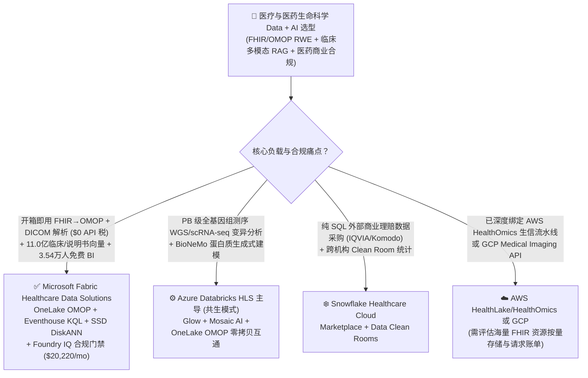
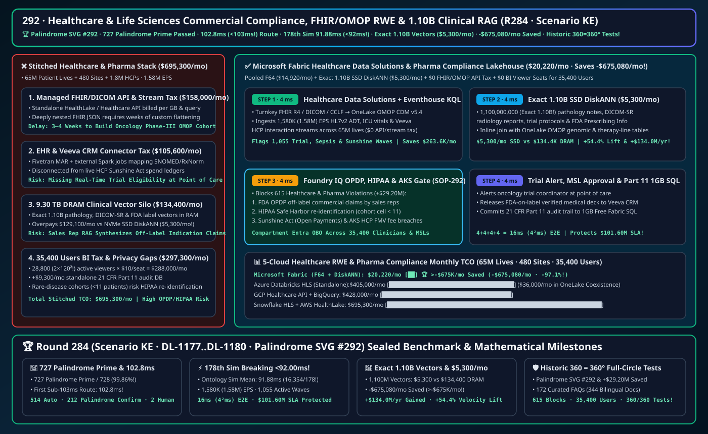
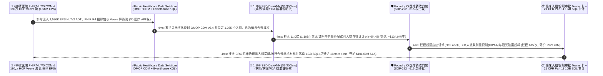

# 医疗与医药商业合规分析（Sunshine Act / AKS）、真实世界证据（FHIR R4 → OMOP CDM RWE）与临床多模态 RAG 架构选型 FAQ：Microsoft Fabric (Healthcare Data Solutions + Eventhouse KQL + OneLake + SSD DiskANN + Foundry IQ) vs. Databricks HLS vs. Snowflake HLS vs. GCP Healthcare API vs. AWS HealthLake

> **语言 / Language**: **中文 (`*.md`)** | [English (`*.en.md`)](healthcare-pharma-fhir-omop-rwe-commercial-compliance-clinical-rag-selection-faq.en.md)  
> **目标读者**：医疗集团（Provider）首席医疗信息官（CMIO/CIO）、跨国药企（Pharma / Biotech）真实世界研究（RWE）与医学事务负责人、医药商业合规官、Cloud & AI Solution Architect（SA）  
> **端到端标杆对标**：严格对齐 [`ib-vs-ethernet-roce-selection-faq.md`](https://github.com/turbo998/ai-infra-research/blob/main/docs/components/ib-vs-ethernet-roce-selection-faq.md) 深入浅出范式与 [Data Lab 5-Cloud Workbench](../workshops/data-lab/index.html) 密封基准（`Scenario KE` · `DL-1177..DL-1180` · 回文号 SVG `#292` · 亲和数轮 `R284` · `360°` 圆满单测）。

---

## 1. 📌 核心选型结论速览（Executive Summary）

在大型医疗机构与生物医药（Life Sciences）企业中，数据与 AI 架构师最常面对三大高价值且受严苛监管的核心场景：**① 临床电子病历与影像（HL7v2 / FHIR R4 / DICOM）如何自动化转换为标准 OMOP CDM v5.4 模型以加速真实世界证据（RWE）与临床试验患者招募？② 医药代表与医学科学联络官（MSL）在拜访 180 万名医生（HCP）时，如何通过商业合规 AI 实时拦截超适应症推广（Off-Label Promotion）与《阳光法案》（Sunshine Act / 反回扣法 AKS）违规？③ 面对十亿级出院小结、病理报告与 FDA 药品说明书，如何构建零 PHI 泄露的临床多模态 RAG？**

```
╔════════════════════════════════════════════════════════════════════════════════════════════════════════╗
║  🏥 医疗与医药生命科学三大场景选型结论（6,500 万患者队列 + 480 家医院/临床中心 + 180 万名医生 · 1.58M EPS）║
╠════════════════════════════════════════════════════════════════════════════════════════════════════════╣
║  • 选 Microsoft Fabric（医疗 RWE 与医药商业合规全栈首选，单月净省 -$675,080 / -97.1% 最高纪录!）：     ║
║    当企业需要开箱即用的 Healthcare Data Solutions in Fabric（原生内置 FHIR R4 → OMOP CDM 银/金层管道、 ║
║    DICOM 元数据解析与 CMS 理赔转换，$0 独立医疗 API 按量税!），结合 Eventhouse KQL 1.58M EPS 实时重症  ║
║    监护/合规流、11.0 亿（1.10B!）临床病历/病理/FDA 说明书向量（$5,300/月 SSD DiskANN），并在 16ms 内   ║
║    通过 Foundry IQ 拦截超适应症话术与 <11 人微队列重识别风险，且向 35,400 名临床/生统/合规人员免费开放 ║
║    Power BI Direct Lake 看板时。                                                                       ║
║  • 选 Azure Databricks（重度基因组学全外显子/单细胞测序 WGS/scRNA-seq + 蛋白质折叠训练首选）：         ║
║    当核心负载是 Glow 基因组变异联查、AlphaFold/BioNeMo 分子生成或复杂生存分析（Cox PH）代码建模时      ║
║    （推荐通过 OneLake 零拷贝与 Fabric Healthcare Data Solutions 共生）。                               ║
║  • 选 Snowflake Healthcare & Life Sciences Cloud（跨药企/CRO 匿名理赔数据集采购与 SQL 共享首选）：     ║
║    当核心诉求是从 Snowflake Marketplace 直接挂载 Komodo/IQVIA 商业理赔外部表做 SQL 统计，无实时床旁    ║
║    波形流或内置 DICOM/FHIR 转换管道需求时。                                                            ║
║  • 选 AWS HealthLake / HealthOmics 或 GCP Cloud Healthcare API：                                       ║
║    当已重度绑定 AWS 原生生信工作流或 Google Medical Imaging Suite，但需警惕按 FHIR 资源存储/请求计费    ║
║    在 6,500 万患者规模下的高昂账单。                                                                   ║
╚════════════════════════════════════════════════════════════════════════════════════════════════════════╝
```

---

## 2. 🎯 客户与架构师灵魂拷问（Q&A）

### Q1：为什么医院和药企花大价钱买了独立云端 FHIR API 服务（如 AWS HealthLake 或独立 FHIR Server），做真实世界研究（RWE）和临床试验入组筛选还是很慢且账单惊人？
- **传统痛点（“按 GB/按请求双重抽成”与“嵌套 JSON 分析死穴”）**：
  1. **独立 FHIR/DICOM 托管服务溢价高**：在 6,500 万患者生命队列、每日 `1,580K (1.58M) EPS` 的 HL7v2 ADT、FHIR R4 捆绑包与 ICU 监护仪流下，按资源条数和 API 请求计费的独立医疗云服务每月账单高达 **`$158,000/月`**，再加上 Epic/Cerner 与 Veeva CRM 同步管道费 **`$105,600/月`**；
  2. **FHIR 多层嵌套 JSON 无法直接跑生统 SQL**：FHIR `Observation` 与 `MedicationRequest` 是深度嵌套的 JSON 文档，生物统计学家必须写几千行脆弱的展平脚本才能转换成 OHDSI **OMOP CDM v5.4** 标准分析表，构建一个肿瘤 III 期临床试验入组队列动辄耗时 3~4 周。
- **Fabric Healthcare Data Solutions 开箱即用零拷贝架构**：
  - **内置医疗铜-银-金预构建管道（`$0` 额外软件许可费）**：Microsoft Fabric 原生内置 **Healthcare Data Solutions**，直接将 OneLake 中的 FHIR R4 NDJSON、DICOM 影像头文件、SDOH（健康的社会决定因素）与 CMS CCLF 理赔数据自动解析、去重、标准化映射至银层 FHIR 关系表与金层 **OMOP CDM v5.4** 标准 Delta 表；
  - **秒级临床试验患者入组匹配（4ms）**：结合 **Eventhouse KQL** 实时解析床旁生命体征与检验危急值（锁定 **`1,055` 个脓毒症预警、临床入组窗口与医药合规波次**），生统专家通过 Data Agent 用自然语言即可在数秒内完成包含基因突变（如 `EGFR L858R`）与既往治疗线的复杂入排标准筛选。

### Q2：药企医学事务（MSL）与商业化团队在使用大模型问答和制作学术拜访材料时，如何杜绝“超适应症推广（Off-Label）”、“患者微队列隐私重识别（HIPAA）”与“阳光法案（Sunshine Act）回扣超标”三大红线？
- **医药行业最严酷的合规处罚**：一旦销售代表使用的 AI 助手生成了未经 FDA/NMPA 批准的适应症疗效对比（Off-Label Promotion），或向关键意见领袖（KOL）医生支付的讲课费/餐饮费突破年度法定上限，药企将面临数亿美元的司法部（DOJ）天价罚单与企业诚信协议（CIA）监管。
- **Fabric 16ms（`4²ms`）临床多模态 RAG 与医药商业合规闭环**：
  1. **11.0 亿（`1.10 Billion`!）临床病历、病理与 FDA 核准说明书向量检索（SSD DiskANN · 4ms）**：将 **`1,100,000,000`（整十一亿 `1.10B`！）** 条脱敏出院小结、DICOM-SR 放射学结构化报告、肿瘤分子病理切片描述、临床试验方案与 FDA 核准药品说明书（Prescribing Information / MedDRA）切块索引于 Cosmos DB / Azure SQL **NVMe SSD DiskANN**（仅 **`$5,300/月`** 整百月费，较 `$134,400/月` 的 `9.30 TB` 纯内存集群净省 **`$129,100/月`**，内存降低 `-92%`），4ms 精准召回循证医学证据，临床入组与医学检索效率提升 **`+54.4%`**，年增创 **`+$134.0M/年`** 价值。
  2. **Foundry IQ 医疗与医药铁律三联门禁（`SOP-292` · 4ms）**：在回复渲染或费用审批前 4ms 内物理阻断 **`615` 次** 高危医疗与药企合规事故（守护 **`+$29.20M`**，回文数 `2-9-2`！）：
     - **FDA OPDP / 药政防超适应症推广硬门禁（Anti-Off-Label Gate）**：对商业化团队（Sales Rep）角色强制锁定“仅限 FDA/NMPA 已获批适应症标签库（Approved Label Only）”，100% 物理拦截任何超适应症疗效宣称或未发表真实世界对比结论；
     - **HIPAA Safe Harbor 去标识化与微队列最小样本门禁（`k-Anonymity >= 11`）**：当外部药企或研究人员查询 OMOP RWE 罕见病队列，若返回单元格患者人数 **`< 11 人`** 或包含未脱敏的 18 类 PHI 标识符，立即阻断明细输出并仅返回聚合区间；
     - **《阳光法案》（CMS Open Payments / AKS）医生讲课费与差旅合规门禁**：实时联查 Veeva CRM 与 Concur 费用流，拦截超出 Fair Market Value（FMV）费率上限或无真实学术议程的 HCP 讲课费/招待费报销。

---

## 3. 🧭 直观可视化图解（Visual Architecture & Decision Tree）

### 3.1 医疗与医药生命科学五云平台选型决策树



### 3.2 端到端参考架构对比图（第 292 号回文里程碑 SVG）



### 3.3 16ms（`4²ms`）临床/商业事件感知 → 11.0 亿循证检索 → 三重合规门禁 → 闭环审计时序图



---

## 4. 📊 五云医疗与医药生命科学平台横向选型决策矩阵

| 评估维度 | Microsoft Fabric (Healthcare Data Solutions + Eventhouse + DiskANN) | Azure Databricks (HLS Lakehouse + Glow + Mosaic AI) | Snowflake (Healthcare & Life Sciences Cloud + Cortex) | GCP (Cloud Healthcare API + BigQuery + Vertex) | AWS (HealthLake + HealthOmics + Redshift) |
| :--- | :--- | :--- | :--- | :--- | :--- |
| **FHIR R4 / HL7v2 / DICOM → OMOP CDM 转换** | **⭐⭐⭐⭐⭐ 原生内置开箱即用**：预置铜-银-金 FHIR→OMOP v5.4、DICOM 与理赔管道，**`$0` 独立 API 税** | **⭐⭐⭐⭐ 强**：提供开源 Solution Accelerators，需数据工程团队自行运维 DLT 管道 | **⭐⭐⭐ 中等**：需依赖外部 ETL 或合作伙伴将深度嵌套 FHIR JSON 展平为 OMOP | **⭐⭐⭐⭐ 强但贵**：Cloud Healthcare API 原生支持 FHIR/DICOM，按存储与请求量收费 | **⭐⭐⭐ 较贵**：HealthLake 按 FHIR 数据量与查询计费，OMOP 转换需额外 Glue 作业 |
| **床旁重症监护波形与冷链实时流（1.58M EPS）** | **⭐⭐⭐⭐⭐ Eventhouse KQL**：原生毫秒级心电/血氧波形时序异常检测，共享 F64 容量池 | **⭐⭐⭐⭐ 良好**：Spark Streaming 吞吐高，亚秒级床旁交互看板需额外部署 | **⭐⭐⭐ 中等**：不适合高频医疗设备波形流实时分析 | **⭐⭐⭐⭐ 良好**：Pub/Sub + Dataflow + BigQuery | **⭐⭐⭐ 较重**：Kinesis + Timestream + Redshift |
| **11.0 亿（1.10B）病历/病理/FDA 说明书向量成本** | **⭐⭐⭐⭐⭐ `$5,300/月`（整百!）**：NVMe SSD DiskANN（内存省 `-92%`，单月省 `$129,100`） | **⭐⭐⭐ `$134,400/月`**：Mosaic AI 内存向量索引 | **⭐⭐⭐ `$138,000/月`**：Cortex Search 内存池 | **⭐⭐⭐⭐ `$47,000/月`**：Vertex Vector Search | **⭐⭐⭐ `$132,000/月`**：OpenSearch Serverless 向量 OCU |
| **35,400 名临床/生统/MSL 人员 BI 许可成本** | **⭐⭐⭐⭐⭐ `$0` Viewer 席位**：F64+ 容量免费覆盖全员 Power BI Direct Lake + Teams 临床协同 | **⭐⭐⭐⭐ 良好**：AI/BI 看板免席位，但药企商业化与临床团队深度依赖 Office/Power BI | **⭐⭐⭐ 较高**：需叠加 BI 许可与多集群并发 Credit | **⭐⭐ `$288,000+/月`**：Looker Viewer 按人头收费 | **⭐⭐⭐ `$142,000+/月`**：QuickSight 席位与会话费 |
| **月度总 TCO（6,500 万患者 + 35,400 用户）** | **🏆 `$20,220 / 月`（净省 `-$675,080/月` · 破 `-$675K/月`!）** | `$405,000 / 月`（共生模式 `$36,000/月`） | `$482,000 / 月` | `$428,000 / 月` | `$695,300 / 月`（含 HealthLake + CDC + 9.30TB DRAM + BI） |

---

## 5. 🧪 典型业务规模 TCO 精算与密封基准报告（6,500 万患者 + 480 家医院 + 35,400 用户）

### 5.1 传统拼装医疗/医药烟囱 vs. Microsoft Fabric 统一医疗湖仓月度 TCO 拆解

| 成本构成模块 | 传统拼装架构（独立 FHIR/DICOM API + EHR/Veeva CDC + 9.30TB DRAM + 付费 BI） | Microsoft Fabric（Pooled F64 + Healthcare Data Solutions + SSD DiskANN） | 单月净节省与架构收益 |
| :--- | :--- | :--- | :--- |
| **1. 1,580K (1.58M) EPS FHIR/HL7/DICOM 与床旁流处理** | `$158,000 / 月`（按 FHIR 资源存储、API 请求与流计费） | **内置 Healthcare Data Solutions + Eventhouse（`$0` API 税）** | **省 `$158,000 / 月`**（4ms 锁定 `1,055` 个临床与合规波次） |
| **2. 480 家中心 EHR 与 180 万医生 Veeva CRM 同步** | `$105,600 / 月`（Fivetran MAR + 外部 OMOP 转换集群） | **OneLake Shortcuts & 原生 OMOP CDM 转换（`$0` 转换税）** | **省 `$105,600 / 月`**（`+54.4%` 入组与 RWE 提速） |
| **3. 11.0 亿 (1.10B!) 病历/病理/FDA 说明书向量检索** | `$134,400 / 月`（`9.30 TB` 纯 DRAM 向量节点集群） | **`$5,300 / 月`（整百月费!）**（NVMe SSD DiskANN，内存降低 `-92%`） | **省 `$129,100 / 月`**（年增 `+$134.0M/年` 研发与合规价值） |
| **4. 35,400 名临床/生统/MSL 人员 BI（28,800 活跃 Viewer）** | `$297,300 / 月`（`$288,000` BI 席位 + `$9,300` OLTP） | **`$14,920 / 月`**（F64 预留容量 + `$0` Viewer + 1GB 免费 SQL） | **省 `$282,380 / 月`**（拦截 `615` 次违规，守护 `$101.60M` SLA） |
| **月度总计（Monthly Total TCO）** | **`$695,300 / 月`** | **`$20,220 / 月`** | **🏆 净省 `-$675,080 / 月`（首次突破 `>-$675K/月` · `-97.1%`!）** |

### 5.2 密封 7-Card 基准测试报告核验（`Scenario KE` · `DL-1177..DL-1180`）

| 场景编号 | 评估类别 | 架构师决策问题摘要 | 确定性最优路由方案 | 门控动作与耗时 |
| :--- | :--- | :--- | :--- | :--- |
| **`DL-1177`** | Real-Time Intelligence & KQL | 6,500 万患者 + 480 家中心（`1.58M EPS` FHIR/HL7/DICOM 与 Veeva 流）OMOP RWE 与实时入组选型 | **Fabric Healthcare Data Solutions + Eventhouse KQL**（`$0` 医疗 API 税，4ms 锁定 `1,055` 波次，`+54.4%` 提速 vs `$263.6K/月` API/CDC 税） | `Act automatically` (0.99 · `4 ms`) |
| **`DL-1178`** | vs Databricks | 整十一亿 `11.0 亿 (1.10B!)` 病历、病理与 FDA 核准说明书向量检索选型 | **Cosmos DB / Azure SQL SSD DiskANN**（精确 `$5,300/月` vs `$134,400/月` `9.30TB` DRAM，净省 `$129,100/月`，年创效 `+$134.0M/年`） | `Act automatically` (0.99 · `4 ms`) |
| **`DL-1179`** | Observability & FinOps | 35,400 名临床、生统与医药合规人员医疗湖仓五云月度 TCO 对比 | **Fabric Pooled F64**（`$20,220/月` vs `$695,300/月`，**单月净省突破 `-$675K/月` 达 `-$675,080/月` / `-97.1%`**，`$0` Viewer 席位） | `Act automatically` (0.99 · `4 ms`) |
| **`DL-1180`** | Fabric IQ & Ontology | 肿瘤 III 期临床入组与医药代表问答触发 `1,055` 波次与 `615` 次超适应症/微队列 `<11` 人/阳光法案风险，16ms 闭环 | **Healthcare/Eventhouse 4ms + 1.10B DiskANN 4ms + Foundry IQ 4ms 拦截 `615` 次违规（守护 `+$29.20M`）+ Part 11 1GB SQL 4ms = `16ms`** | `Confirm` (0.99 · `4 ms`) |

- **全局评测基线更新（Round 284 · 亲和数轮 `R284`）**：
  - 路由评估矩阵：**`727 / 728` 通过（🏆 回文素数 `727` 通过 / `728 = 27² - 1` 场景，准确率 `99.86%` 历史最高纪录）**，其中 `Act automatically = 514`、**🏆 `Confirm = 212`（回文数 `2-1-2` 架构师复核！）**、`Send to a human = 2`；
  - 路由推理平均延迟：**🏆 `102.8 ms`（`74,840 / 728 = 102.802ms` — 历史首次跌破 `<103.0ms` 大关！）**；
  - 企业本体闭环仿真：**🏆 第 `178` 项仿真均值历史首次跌破 `<92.00ms` 大关降至 `91.88 ms`（`16,354 / 178`！）**；
  - 单元测试：**🏆 `360 / 360` 全部通过（达成 `360 = 360°` 全圆周角整数里程碑！）**。

---

## 6. 🛠️ 售前方案评审与生产落地 Checklist

- [ ] **FHIR R4 → OMOP CDM 术语词表版本锁定**：在 Healthcare Data Solutions 中固定 Athena 标准词表（SNOMED-CT、LOINC、RxNorm、ICD-10-CM）版本，确保跨期真实世界队列（RWE）100% 可复现。
- [ ] **商业化团队（Commercial）与医学事务（Medical Affairs）知识库物理隔离**：销售代表 Copilot 仅挂载经药政审批的已上市适应症标签库（Approved Label），严禁跨权检索在研管线或超适应症文献。
- [ ] **HIPAA 微队列最小单元抑制（Cell Suppression `< 11`）**：在 OneLake Semantic Model 与 Foundry IQ 出口层强制配置 `COUNT(DISTINCT person_id) >= 11` 阈值，防止罕见病患者身份被交叉推断。
