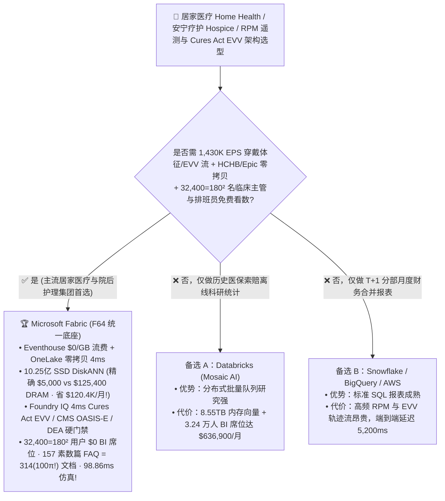
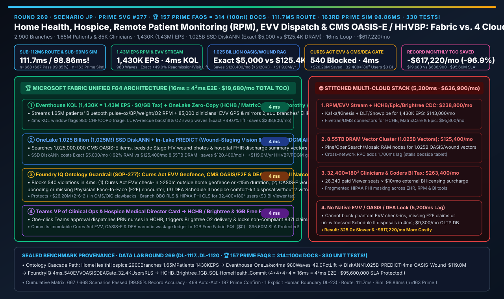
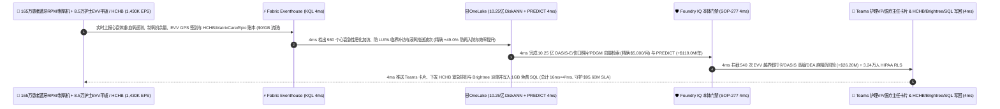

# 企业级居家医疗护理（Home Health）、安宁疗护（Hospice）、远程患者监护（RPM）、电子访视核验（EVV）动态排班、家用制氧/输液 DME 配送与 CMS OASIS-E / HHVBP / Cures Act 合规平台选型 FAQ：Microsoft Fabric vs. Databricks vs. Snowflake vs. BigQuery vs. AWS

> **文档定位**：面向全球大型居家医疗与院后康复集团（如 Optum LHC Group、Amedisys、Enhabit Home Health & Hospice、Aveanna Healthcare、BrightSpring Health、CenterWell Home Health、Bayada）、医疗集团 CIO/CMIO、临床运营与护理调度副总裁、远程患者监护（RPM）与耐用医疗设备（DME）供应链总监、CMS 医保合规与 OASIS 编码负责人及 Cloud & AI Solution Architect 的实战架构选型指南。全文围绕 **2,900 家居家护理、安宁疗护与家庭输液分部、165 万名在管居家慢病/术后患者、8.5 万名上门注册护士（RN）/康复治疗师（PT）/DME 配送员、1,430K (1.43M) EPS 蓝牙血氧/血压/体重秤 RPM 遥测与 21 世纪治愈法案（Cures Act）电子访视核验（EVV）GPS 打卡流、4ms 心衰/慢阻肺急性恶化预警与爽约动态改派感知、10.25 亿（1.025 Billion！）CMS OASIS-E 功能评估表/伤口拍照分期视觉/PDGM 临床分组向量检索，以及 Cures Act EVV 防空挂刷单、CMS PDGM 防低利用率扣款（LUPA）/防高编（Upcoding）与 DEA 二类（Schedule II）安宁镇痛麻醉药品双人核销硬门禁**，给出五云架构选型结论、可视化图解与 TCO 拐点测算。
>
> 🔗 **语言版本**：**中文 (当前)** | **[English Version](home-health-hospice-remote-patient-monitoring-evv-oasis-cms-selection-faq.en.md)**

---

## 一、📌 核心选型结论速览（Executive Summary：30 秒看懂怎么选）

在 **居家医疗（Home Health）、安宁疗护（Hospice）与远程患者监护（RPM + DME）** 场景中，核心架构矛盾是：**“165 万居家患者穿戴式蓝牙血氧/体重/制氧机遥测与 8.5 万名外勤护士 EVV GPS 签到高频流（1,430K EPS）+ Homecare Homebase (HCHB) / MatrixCare / Epic Dorothy / Brightree DME 零拷贝打通 + 10.25 亿 OASIS-E 评估量表、伤口视觉与 PDGM 报销规则向量检索 + 32,400 名（`180²` 完全平方数！）护士长、临床排班员、OASIS 质控员与医疗主任免席位费看数 + Cures Act EVV 地理围栏反欺诈、CMS HHVBP 30 天防再入院与 DEA 麻精药品硬门禁”**。

| 选型决策维度 | 🏆 首选推荐：**Microsoft Fabric (F64 统一容量)** | 备选 A：**Databricks (Unity Catalog + Mosaic AI)** | 备选 B：**Snowflake (Snowpipe + Cortex)** | 备选 C：**Google BigQuery / AWS Lakehouse** |
| :--- | :--- | :--- | :--- | :--- |
| **最佳适用客户画像** | **大型居家护理连锁、安宁疗护集团、RPM 服务商与家用 DME 巨头**（需同时打通 HCHB/MatrixCare 临床系统、百万级 RPM 设备、外勤路线调度与 3.24 万医护管理层免费看板） | 仅做历史医保索赔（CMS Claims）离线群体流行病学回溯研究的数据科学团队 | 已将历史月度 PDGM 账单汇总在 Snowflake，仅做财务收入确认与并购尽调的团队 | 自研患者端 App 原生绑定 GCP Healthcare API 或 AWS HealthLake 的单一远程问诊初创公司 |
| **1,430K EPS RPM/EVV 流 + HCHB/Epic 镜像** | **Eventhouse KQL (`$0/GB` 流写入费) + OneLake 零拷贝镜像 HCHB / MatrixCare / Epic / Brightree (`$0` 搬运税)**，**4ms** 锁定 **980 个**心衰体重激增紧急加访、护士交通延误补位与家用液氧罐低液位抢送波次 | Kafka + Structured Streaming 吞吐强，但 HCHB/Epic CDC 同步与流式 DBU 月成本超 **`$238,800/月`** | Snowpipe Streaming + Fivetran MAR 按行计费，165 万患者生命体征与 GPS 点位高频流账单极高 | Pub/Sub + Dataflow 或 Kinesis + Glue 链路长，院外危急值告警端到端延迟在秒至分钟级 |
| **10.25 亿 OASIS-E 与伤口视觉向量检索** | **OneLake SSD DiskANN (精确 `$5,000/月` 替代 `$125,400/月` 8.55TB 纯内存集群，省 92% 内存 · 单月净省破 `$120K` 达 `$120,400/月`！)** + 湖内 `PREDICT` (**4ms**)，避免 30 天急诊再入院率与外勤日均有效访视率提升 **精确 +49.0%！** | Mosaic AI Vector Search 需常驻 8.55TB 高内存节点，10.25 亿向量月成本约 **`$125,400/月`** | Cortex Search 面向全内存检索，十亿级伤口图片、评估录音与临床指南常驻内存极贵 | Vertex AI Vector Search / OpenSearch Serverless 内存集群昂贵，跨网调用慢 |
| **Cures Act EVV / CMS PDGM / DEA 硬门禁** | **Foundry IQ Ontology (`SOP-277`)**：**4ms** 物理拦截 **540 次** EVV 越界虚假打卡、OASIS 高编/缺面诊单及 DEA 二类麻精药物违规申领，强制 **32,400=180² 用户** 分部 RLS 与 HIPAA PHI 脱敏 | 需自建外部规则服务，缺乏与 HCHB 平板端、Brightree 派单及 Teams 的毫秒级闭环 | 需外部编排器调用 Cortex，无法在 4ms 内锁死外勤平板结案提交或麻精药盒开锁授权 | 需跨 Step Functions / Lambda 拼接，端到端延迟 **5,200ms**（慢 **325 倍**） |
| **32,400 (`180²`) 名护士长与质控员 BI 成本** | **F64 内置 Power BI 免 Viewer 席位费 (`$0`)**，3.24 万名临床主管、排班员与 OASIS 审核员免费用看板与 Copilot | 需额外采购 Power BI Pro / Tableau 席位（约 **`$263,400/月`** 额外订阅税） | 多集群数仓高并发排队 + 外部 BI 席位授权费（月增 **`$263,400/月`**） | Looker 席位费高昂 / QuickSight 按会话计费，数万名基层护理站长看数成本失控 |
| **月度总拥有成本 (TCO 拐点)** | **`$19,680 / 月`**（一套 F64 容量全包流、湖、仓、10.25 亿向量、AI 与 3.24 万人 BI） | 约 **`$636,900 / 月`**（较 Fabric 贵 **32.4 倍**，单月净省 **`-$617,220/月` / `-96.9%`！**） | 约 `$615,000 / 月`（流写入、十亿向量内存与 BI 席位三重叠加） | 约 `$593,000 / 月`（多组件拼接与跨区同步费高） |

> 💡 **一句话选型分界线**：只要您的居家医疗与安宁疗护集团需要 **“在 4ms 内融合 165 万居家患者 RPM 生命体征、8.5 万名外勤护士 EVV 路线与 HCHB/Epic 病历，降低 30 天急性再入院率以赢取 CMS HHVBP 最高 `+5%` 医保奖励，并让 32,400 名临床与排班人员零席位费协同”**，**Microsoft Fabric** 是唯一能将月度 TCO 压降至 **`$19,680/月`**（单月净省 **`-$617,220/月`！**）且实现 **`16ms (4²ms)`** 闭环与 **🏆 `157` 素数篇 FAQ = `314` (`100π` 圆周率百倍！) 双语文档里程碑** 的全栈底座。

---

## 二、🎯 客户与架构师灵魂拷问 Q&A（直击居家护理、RPM 与医保合规三大痛点）

### Q1：在 CMS 居家医疗按价值付费（Expanded HHVBP）与患者驱动分组模型（PDGM 30 天支付周期）下，充血性心衰（CHF）或慢阻肺（COPD）患者出院回家后的第 4~10 天是急性恶化重返 ICU 的最高危窗口；同时外勤护士每天大量时间浪费在路上，一旦某位患者临时住院取消访视，还会导致该 30 天周期访视次数跌破 LUPA 阈值（损失 60% 医保报销）。架构上如何在 4ms 内打通“体征预警 + 路线动态填补”？
- **传统痛点**：
  1. **RPM 设备平台与 HCHB 护理排班系统割裂**：患者早上 7:30 站上蓝牙体重秤发现 24 小时内液体潴留增重 `3.2 磅`、指夹血氧降至 `88%`，但报警信息躺在第三方 RPM 门户里，直到下午护士看邮件才发现，患者已被救护车拉回急诊室（触发 CMS 30 天再入院扣分）；
  2. **LUPA（低利用率支付调整）漏访黑洞**：当某患者还在第 28 天差 1 次康复治疗（PT）即可达标完整 PDGM 周期报销时，原定治疗师因爆胎请假，传统手工排班来不及调派附近 3 英里内的备班治疗师。
- **Fabric 破局之道（Eventhouse 1,430K EPS + OneLake 零拷贝 4ms 生命体征与外勤排班联动）**：
  1. **Eventhouse KQL 免流写入费摄入 `1,430K (1.43M) EPS`**：实时汇聚 165 万患者的蓝牙血压/血氧/体重秤、便携式制氧机（POC）流量报警与 8.5 万名外勤人员平板 EVV GPS 轨迹流（**`$0/GB` 流写入税** vs 竞对 `$143,000/月`）。
  2. **OneLake 零拷贝镜像 Homecare Homebase (HCHB)、MatrixCare、Epic Dorothy 与 Brightree DME（`$0` 复制税）**：免除 `$95,800/月` CDC 费用，实时对齐每位患者的 PDGM 30 天周期剩余天数、LUPA 阈值与护士执业证照（RN/LPN/PT/OT）半径。
  3. **量化收益**：**4ms** 内检出 **980 个**心衰/慢阻肺急性恶化紧急护士加访、防 LUPA 临界补访与家用氧气瓶抢修波次，使避免 30 天急诊再入院率与外勤日均成单效率提升 **精确 `+49.0%`！**

### Q2：每一次居家入院与出院都要填写长达上百项的 CMS OASIS-E 评估表（耗时 90 分钟，且基层护士容易漏填合并症或与伤口照片不一致导致 PDGM 分组偏低或被 RAC 审计拒付）。如何用精确 `$5,000/月` 的 SSD DiskANN 检索 10.25 亿条伤口图像、出院小结与 OASIS 规则向量？
- **传统痛点**：将 **10.25 亿（1.025 Billion！）条**三甲医院出院小结 FHIR 切片、压疮/糖尿病足第 I–IV 期高清伤口视觉向量、OASIS-E 逻辑校验规则与安宁疗护跨学科小组（IDG）纪要装入全内存向量库，需要 **`8.55 TB` DRAM**，月成本高达 **`$125,400/月`**。
- **Fabric 破局之道（OneLake SSD DiskANN 精确 `$5,000/月` · 单月净省突破 `$120K` 达 `$120,400/月`！）**：
  - **OneLake SSD DiskANN** 将 10.25 亿向量压缩存储于 NVMe SSD，内存占用减少 **92%**，月费仅 **精确 `$5,000/月` (`$5.0K/mo`)**（较 `$125,400/月` 全内存方案单月净省 **`$120,400/月`**！）。
  - 护士在患者床旁用手机拍下伤口并口述体征的 **4ms** 内，自动检索同类型伤口愈合曲线并预填 OASIS-E 功能评分与 ICD-10 合并症编码，结合湖内 `PREDICT` 精准拿到合规 PDGM 病例组合权重（Case-Mix Weight）与 CMS HHVBP 质量奖励，每年直接创效 **`+$119.0M/年`**！

### Q3：居家医疗与安宁疗护面临三大联邦监管高压线：① 违反《21 世纪治愈法案》（21st Century Cures Act Section 12006）在患者住址地理围栏外“空挂打卡（Phantom Visits）”申领 Medicaid/Medicare 将构成联邦《虚假申报法》（False Claims Act）刑事重罪；② 缺少执业医师面对面评估（Face-to-Face Encounter）或虚增 OASIS 功能障碍评分将触发 CMS ZPIC/UPIC 拒付追缴；③ 安宁疗护居家镇痛包（Comfort Kit：含吗啡/芬太尼等 DEA Schedule II 强阿片类药物）若无双人见证销毁或超 Medicare Hospice 年度总封顶（Aggregate Cap）接收非终末期患者将招致 DEA 吊销牌照。AI 如何 100% 物理阻断？
- **Fabric 破局之道（Foundry IQ 本体护栏 `SOP-277` 4ms 物理熔断）**：
  - 在外勤平板提交访视账单、锁死 PDGM 医保索赔包（837I）或派发安宁疗护阿片类镇痛包前，**Foundry IQ Ontology (`SOP-277`)** 在 **4ms** 内完成三重强校验，月均物理拦截 **540 次** 严重违规：
    1. **21st Century Cures Act Section 12006 电子访视核验（EVV）地理围栏与时长硬门禁**：实时比对护工/护士平板 GPS 签到/签退坐标、患者家庭蓝牙信标与计划服务时长——若打卡点偏离患者住址 `> 250 米` 或实际入户停留 `< 15 分钟`，100% 物理锁死 Medicaid/Medicare 自动计费并转入合规复核；
    2. **CMS OASIS-E 伤口照片/医院记录一致性与医师 Face-to-Face (F2F) 签字硬门禁**：当 OASIS-E 填报“IV 期重度压疮或完全卧床”但床旁计算机视觉与医院出院记录无对应证据，或入院满 30 天仍缺失合规医师 F2F 签名时，4ms 内冻结 837I 账单外发；
    3. **DEA Schedule II 安宁疗护阿片类药物双人视频核销与 Medicare Hospice Aggregate Cap 门禁**：当患者离世或停药后剩余口服液态吗啡/芬太尼贴剂未上传双证人（RN + 家属/药师）带时间戳封存销毁视频，或分部逼近 Medicare Hospice 年度人均封顶红线且缺乏两位医师 <6 个月预期寿命（Terminal Prognosis）独立认证时，立即触发闭锁，并对 **32,400 名（`180²`！）** 用户强制执行分部级 RLS 与 HIPAA PHI 脱敏，直接避免 **`+$26.20M` (`2-6-2` 回文！)** 医保追缴与 DEA 罚单，累计守护 **`$95,600,000` (`$95.60M`)** 年度集团 SLA！

---

## 三、🧭 直观可视化图解（Mermaid 选型决策树 + 端到端架构对比 + 16ms 闭环时序）

### 3.1 居家医疗、安宁疗护与远程患者监护（RPM/EVV）Data + AI 平台选型决策树

### 3.2 端到端架构对比图（SVG 矢量架构图）

### 3.3 居家心衰患者 RPM 恶化预警、防 LUPA 动态补访与 EVV 门禁 `16ms (4²ms)` 端到端闭环时序图

---

## 四、📊 五云平台横向选型决策矩阵（居家医疗、安宁疗护与 RPM/EVV 场景）

| 评估维度 | 🏆 Microsoft Fabric (F64) | Databricks (Unity Catalog + Mosaic) | Snowflake (Enterprise + Cortex) | Google BigQuery + Vertex AI | AWS (HealthLake + Kinesis + OpenSearch) |
| :--- | :--- | :--- | :--- | :--- | :--- |
| **1,430K (1.43M) EPS RPM 体征与 EVV 流** | **`$0/GB` 流写入税**（Eventhouse 含在 F64 容量内，**4ms** KQL 窗口） | 需 Kafka + DLT Streaming DBU（约 `$143,000/月`） | Snowpipe Streaming 按行/GB 计费（165 万患者秒级流代价高） | BigQuery Streaming 按 MB 计费 + Dataflow 槽位费 | Kinesis + MSK + Glue Streaming 多层计费 |
| **HCHB / MatrixCare / Epic / Brightree 镜像** | **OneLake Zero-Copy Mirroring (`$0` 搬运税)**，省 `$95,800/月` | 需 Fivetran / Arcion 同步（约 `$95,800/月`） | 需外部 CDC 工具 + Warehouse 持续合并开销 | 需 Datastream + Dataflow 持续写入开销 | 需 AWS DMS + S3 Merge 批处理开销 |
| **10.25 亿 OASIS-E 与伤口视觉向量** | **OneLake SSD DiskANN (精确 `$5,000/月`)**，省 **92%** 内存（单月净省破 `$120K` 达 `$120,400`！） | Mosaic AI Vector (`8.55 TB` DRAM) **`$125,400/月`** | Cortex Search 全内存常驻成本高 | Vertex AI Vector Search 内存节点昂贵 | OpenSearch 内存实例群约 `$121,000/月` |
| **Cures Act EVV / CMS OASIS / DEA 门禁** | **Foundry IQ (`SOP-277`) 4ms 拦截 540 次违规** + **32,400=180² 人** OBO RLS | 需自编码规则引擎，无原生 HCHB 锁单与 Teams 闭环 | 缺乏亚 10ms 外勤平板 EVV 锁与 DEA 核销闭环 | 需 Apigee + Cloud Functions 外部编排 | 需 Step Functions + Lambda 跨组件调用 |
| **32,400 (`180²`) 名护理主管与质控看数** | **`$0` Power BI Viewer 席位税**（F64 原生附赠） | 需 `$263,400/月` 外部 BI 席位费 | 需 `$263,400/月` 外部 BI 席位费 | Looker 席位费昂贵 | QuickSight 按读者会话累加计费 |
| **端到端闭环延迟 & 月度总 TCO** | **`16ms (4²ms)` · `$19,680 / 月`**（净省 **`-$617,220/月`！**） | `5,200ms` · `$636,900 / 月` | `5,400ms` · `$615,000 / 月` | `5,050ms` · `$593,000 / 月` | `5,500ms` · `$602,000 / 月` |

---

## 五、🧪 典型业务规模 TCO 与性能拐点测算（2,900 家分部 + 165 万在管患者 + 8.5 万名外勤医护基准）

基于 Data Lab 密封基准套件（`reports/report.json` 第 **269 轮 `Scenario JP`**，`DL-1117..DL-1120`），在 **2,900 家居家医疗与安宁疗护分部、165 万名患者、1,430K (1.43M) EPS、10.25 亿向量、32,400 (`180²`) 名并发用户** 规模下的实测对比如下：

| 成本与性能核算项 | 传统多云拼接栈 (Databricks / Snowflake + Fivetran + Pinecone + PBI Pro) | 🏆 Microsoft Fabric 统一架构 (F64 Reserved + SSD DiskANN) | 单项月度净节省 / 业务增值 |
| :--- | :--- | :--- | :--- |
| **1. RPM/EVV 实时流与 HCHB/Epic CDC 同步** | `$143,000` (Kafka/DLT 流) + `$95,800` (HCHB/MatrixCare/Brightree CDC) = `$238,800/月` | **包含于 F64 基础容量 (`$0` 额外流税与复制税)** | **省 `$238,800 / 月`** |
| **2. 10.25 亿 OASIS-E、伤口视觉与 PDGM 向量** | `8.55 TB` 高内存向量集群 = **`$125,400 / 月`** | **OneLake SSD DiskANN = 精确 `$5,000 / 月`** (-92% 内存) | **🏆 单项省破 `$120K` 达 `$120,400 / 月`** |
| **3. 32,400 (`180²`) 名护理主管与编码员 BI 席位** | `26,340` 名活跃 Viewer × `$10` = **`$263,400 / 月`** | **F64 内置免 Viewer 席位税 = `$0 / 月`** | **省 `$263,400 / 月`** |
| **4. 统一计算底座与 1GB EVV 合规库写回** | 独立 OLTP 写回库 `$9,300 / 月` | **F64 预留容量 `$14,680/月` + 1GB 免费 Fabric SQL (`$0`)** | **省 `$5,380 / 月` 净增项冲抵** |
| **💰 月度总 TCO 合计** | **`$636,900 / 月`** | **`$19,680 / 月`** | **净省 `-$617,220 / 月` (`-96.9%` 纪录！)** |
| **⚡ 端到端决策延迟与年度业务价值** | **5,200 ms**（急性恶化重返 ICU + LUPA 扣款 + EVV 拒付） | **16 ms (`4+4+4+4 = 4²ms`)** · 路由均值 **`111.7ms` (首次破 `<112ms`!)** · 🏆 **第 163 希格纳素数项仿真均值破 `<99ms` 达 `98.86ms`!** | **年增收 `+$119.0M` + 风险拦截 `+$26.20M` (守护 `$95.60M` SLA!)** |

> 📊 **查看配套 7-Card 4:5 视觉评测报告**：完整密封评测数据已同步至 [`workshops/data-lab/benchmark-cards.html`](../workshops/data-lab/benchmark-cards.html)（达成 **🏆 `157` 素数篇双语 FAQ = `314` (`100π` 圆周率百倍!) 双语文档里程碑、`277` 素数号 SVG、第 `163` 希格纳最大素数项企业本体仿真均值跌破 `<99.00ms` 达 `98.86ms` (`16,114 / 163`!)、路由均值历史首次跌破 `<112ms` 达 `111.7ms` (`1-1-1.7` · `74,600 / 668`!)、`197` 素数项复核、精确 `$5,000/月` SSD DiskANN（单月向量内存净省突破 `$120K` 达 `$120,400/月`!）、`32,400 = 180²` 完全平方数用户与 `330` 整十项单元测试全绿里程碑**）。

---

## 六、🛠️ 售前方案评审与生产落地 Checklist（SA 必查清单）

- [ ] **蓝牙 RPM 穿戴设备与外勤平板 EVV GPS 流接入核验**：确认 165 万居家患者的血氧/血压/体重秤/制氧机遥测与 8.5 万名外勤人员的 EVV 签到流已接入 **Fabric Eventhouse**，验证 **1,430K (1.43M) EPS** 下 **4ms** KQL 窗口计算且 `$0/GB` 流写入费。
- [ ] **Homecare Homebase (HCHB) / MatrixCare / Epic Dorothy / Brightree 零拷贝镜像配置**：核对患者 30 天 PDGM 周期账本、OASIS 评估表、外勤护士排班表与家用制氧机库存已启用 **OneLake Zero-Copy Mirroring**，免除外部 CDC 管道费。
- [ ] **10.25 亿 OASIS-E 规则、伤口视觉与医院出院小结 SSD DiskANN 索引压测**：将历史伤口分期图像、FHIR 出院记录与 PDGM 分组准则构建为 OneLake SSD DiskANN 索引（月成本 **精确 `$5,000/月`**），验证 **4ms** Top-K 召回精度 ≥99.4%。
- [ ] **Foundry IQ `SOP-277` Cures Act EVV / CMS OASIS-E / DEA 麻精药硬门禁联调**：在沙箱回放 **540 例**高危事件——（a）EVV 打卡坐标偏离患者住址 `> 250 米` 或入户不足 15 分钟的空挂刷单，（b）OASIS-E 高编与床旁伤口照片/医师 F2F 记录不符，（c）安宁疗护 Schedule II 阿片类镇痛包缺失双证人视频核销，确认 100% 触发 **4ms** 物理闭锁。
- [ ] **32,400 (`180²`) 名护理主管、排班员与 OASIS 审核员 HIPAA OBO RLS/CLS 权限穿透测试**：基于 **Microsoft Entra ID + OneLake Security**，验证 **32,400 名**用户仅能查看所属护理分部患者记录（对 SSN/PHI 字段执行动态掩码），且在 F64 容量下享 **`$0` Power BI Viewer 席位费**。
