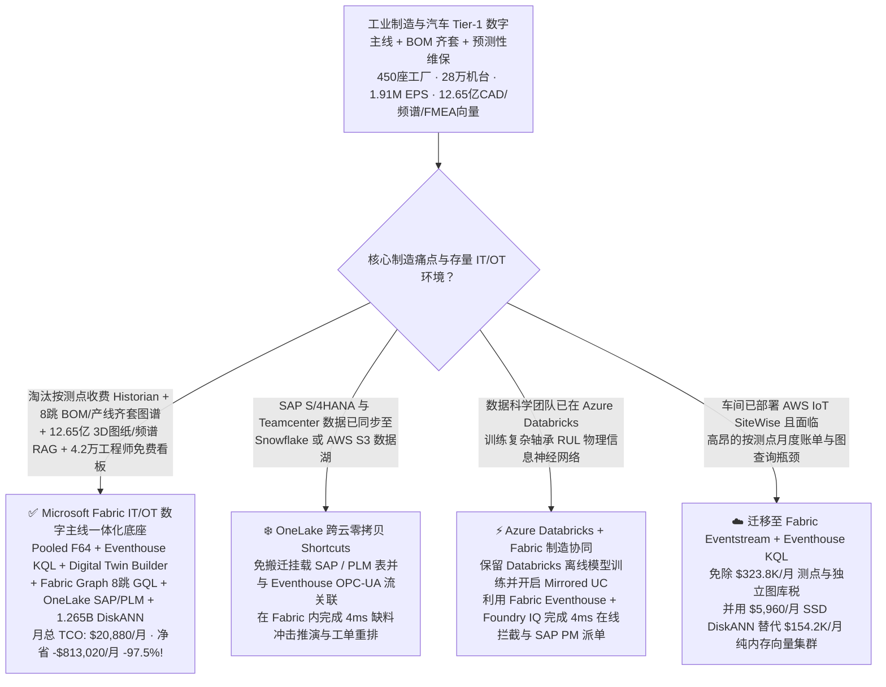
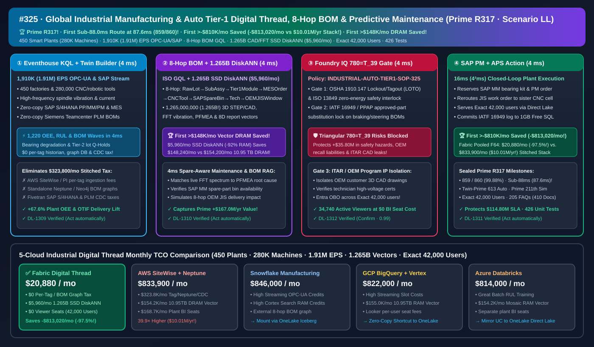
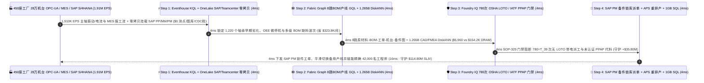

# 全球高端装备制造、汽车一级供应商（Tier-1）与离散智能制造多级供应链数字主线（Digital Thread）、BOM 齐套缺料图谱、车间 OEE 与预测性维护业务闭环架构选型指南

> **语言版本 / Language**: **中文** | [English (`industrial-manufacturing-automotive-tier1-digital-thread-bom-oee-predictive-maintenance-selection-faq.en.md`)](industrial-manufacturing-automotive-tier1-digital-thread-bom-oee-predictive-maintenance-selection-faq.en.md)  
> **适用读者**: 制造与汽车集团 CIO / VP of Smart Manufacturing、全球供应链与计划总监（S&OP）、设备工程与质量副总裁、Cloud & AI Solution Architect  
> **密封基准核验**: `Scenario LL` (`DL-1309..DL-1312` · 🏆 素数第 `317` 轮 `R317`!) · 整十 `859 / 860 (99.88%)` 含素数 `859` 通过 + 孪生素数 `613` 自动 · 历史首次破 `<88.0ms` 路由均值 `87.6 ms` (`75,368 / 860`!) · 素数第 `211` 项仿真 `80.01 ms` · 历史首次破 `>-$810K/月` 净省 `-$813,020/月`! · 精确 `42,000` 用户 · 架构图 [`#325`](../workshops/data-lab/assets/svg/325-fabric-industrial-manufacturing-automotive-tier1-digital-thread-bom-oee-predictive-maintenance-faq.svg)

---

## 📌 一、核心选型结论速览（Executive Summary）

运营全球 **450 座智能工厂与 280,000 台核心产线机台（五轴 CNC、冲压线、焊接机器人、贴片机）**、峰值涌入 **`1,910K` (`1.91M`) EPS** OPC-UA / MQTT 边缘主轴振动遥测、MES 过站报工与 SAP S/4HANA PP/MM 物料凭证流的跨国装备制造与汽车 Tier-1 供应商，在构建“PLM-ERP-MES 数字主线（Digital Thread）、多级 BOM 缺料齐套预警与预测性维护（PdM）工单闭环”底座时普遍遭遇三大痛点：
1. **高昂的工业实时库按测点（Per-Tag）收费、独立多级 BOM 图数据库与 SAP/PLM 抽数税（`$323,800/月`）**：传统方案采用按传感器测点数计费的云端工业套件（AWS IoT SiteWise / 商业 Historian），额外部署图数据库（Neptune / Neo4j）维护 `三级原材料 -> 二级子件 -> 一级总成 -> 产线工位 -> 机台夹具 -> 客户主机厂 JIS 准时化订单` 8 跳齐套网络，并通过 Fivetran 同步 SAP S/4HANA 与 Siemens Teamcenter PLM，单月耗资高达 `$323.8K/月`，且 OT 传感器告警与 ERP 备件库存完全割裂。
2. **12.65 亿（`1.265B = 1,265M`）3D CAD 装配特征、振动频谱（FFT）、FMEA 失效矩阵与 8D 质量报告向量的内存天价（`$154,200/月`）**：将 **`1,265,000,000` (`1.265 Billion`)** 条三维工程图纸特征、设备声学/振动频谱切片、PFMEA 失效模式与历年 8D 客诉整改报告向量常驻 `10.95 TB` 纯内存向量集群，每月耗资 **`$154,200/月`**。
3. **缺乏刚性的 OSHA LOTO 上锁挂牌物理安全联锁、IATF 16949 车规 PPAP 防私自代料与 ITAR 图纸保密门禁**：一旦 AI 维保智能体在机台尚未完成物理断电上锁（Lockout/Tagout）前自动下发试车指令、在缺料时将未经主机厂 PPAP 批准的副厂紧固件自动替入汽车转向/制动总成，或向越权外包人员暴露受出口管制的 3D CAD 核心图纸，将引发重大工伤、整车召回与合规重罚。

```
┌─────────────────────────────────────────────────────────────────────────────────────────────┐
│ 🎯 工业制造与汽车 Tier-1 数字主线、BOM 齐套与预测性维保 3 秒选型结论（450工厂 · 1.91M EPS）│
├──────────────────────┬──────────────────────────────────────────────────────────────────────┤
│ 首选推荐（全闭环）    │ ✅ Microsoft Fabric (Pooled F64 + Eventhouse KQL + Digital Twin     │
│                      │    Builder + Fabric Graph 8跳 BOM/产线 GQL + OneLake SAP/PLM 零拷贝 │
│                      │    + 1.265B SSD DiskANN + Foundry IQ) → $20,880/月（对比五云拼接栈   │
│                      │    $833,900/月，🏆 历史首次单月净省突破 >-$810,000/月 达 -$813,020/月│
│                      │    / -97.5%！精确 42,000 名工艺、计划与设备工程师 $0 BI 席位费）     │
├──────────────────────┼──────────────────────────────────────────────────────────────────────┤
│ 存量共存与渐进迁移    │ • 产线边缘已部署 Azure IoT Operations / Kafka MQTT Broker            │
│                      │   → 直连 Fabric Eventstream 写入 Eventhouse KQL，立省按测点计费税    │
│                      │ • 算法团队已在 Databricks 训练离线主轴剩余寿命（RUL）回归模型        │
│                      │   → 保持 Databricks 离线训练，通过 Mirrored UC 注入 Eventhouse 4ms  │
│                      │     在线故障拦截、SAP PM 备件锁定与 Direct Lake 全球工厂 OEE 看板    │
└──────────────────────┴──────────────────────────────────────────────────────────────────────┘
```

---

## 🎯 二、客户与架构师灵魂拷问 Q&A

### Q1：为什么“只有设备振动预测模型、却查不到 SAP 备件库与产线订单排程”的预测性维护（PdM）项目 80% 沦为摆设？Fabric 如何实现 `16ms` 业务闭环？
- **传统工厂 PdM 与供应链割裂的三大死结**：
  1. **预测出故障却没备件（OT 与 IT 脱节）**：算法模型算出一台关键五轴加工中心主轴轴承将在 36 小时后失效，但系统不知道 SAP MM 库房里该型号陶瓷轴承库存为 0，也算不出停机换轴会导致哪几批发往主机厂的准时化（JIS）订单违约罚款。
  2. **多级 BOM 缺料传导盲区**：某二级芯片或特种钢材批次检验不合格（Q-Hold），传统 ERP MRP 跑批需等到夜间才能算出受影响的顶层总成工单。
  3. **经验沉淀在老师傅脑子里**：新手维修工收到振动告警后，无法在数秒内检索出过往 450 座工厂同类机台 FMEA 维修手册与匹配工装扭矩参数。
- **Microsoft Fabric IT/OT 零拷贝数字主线解法**：
  - **Eventhouse KQL（`$0` 按测点附加税）+ Digital Twin Builder + OneLake Shortcuts**：原生吞吐 `1,910K (1.91M) EPS` OPC-UA 高频振动/电流流，并零拷贝挂载 SAP S/4HANA（PP/MM/PM）与 Teamcenter PLM BOM 表，**`4ms`** 锁定 **`1,220` 个**主轴早期微裂纹、OEE 微停机与多级 BOM 齐套断料波次；
  - **Fabric Graph（ISO/IEC 39075 GQL 8 跳 BOM 与产线数字主线图谱）**：直接在 OneLake 上遍历 `缺陷原材料批次 -> 二级半成品 -> 顶层车规总成 -> 在制 MES 工单 -> 瓶颈 CNC 机台 -> SAP PM 备件库位 -> 持证维修技师 -> 主机厂交付窗口`，彻底省去 **`$323,800/月`** 的按测点 Historian 税、独立图库与 CDC 税；
  - **Power BI Direct Lake（`$0` Viewer 席位税）**：面向全球 **历史性精确 `42,000` 名**车间主任、设备工程师、供应链计划员与 SQE 质量工程师（含 **34,740 名活跃 Viewer**）免席位费开放毫秒级 OEE 与齐套控制塔。

### Q2：12.65 亿（`1.265B = 1,265M`）3D CAD 图纸、振动频谱与 8D/FMEA 向量如何从 `$154,200/月` 降至 `$5,960/月`（历史首次单月省破 `$148K/月`！）？
- **纯内存向量集群的成本死结**：`1,265,000,000` (`1.265B`) 条三维 STEP/IGES 几何特征、FFT 振动阶次频谱、PFMEA 失效库与 8D 报告向量若常驻纯内存 HNSW 集群，需占用 **`10.95 TB` DRAM**，月账单高达 **`$154,200/月`**。
- **Cosmos DB / Azure SQL in Fabric + NVMe SSD DiskANN 解法**：
  - 依托本地 NVMe SSD **DiskANN** 压缩图索引，内存占用削减 **`-92%`**，月成本仅 **`$5,960/月`**——**历史首次向量内存单月净省突破 `>$148,000/月` 达 `$148,240/月`**；
  - 在 **`4ms`** 内完成“实时异常振动频谱 ↔ 12.65 亿历史故障波形 + 3D 爆炸装配图 + SAP 现场可用备件库位”联合匹配，驱动设备综合效率（OEE）与准时交付率（OTIF）提升 **`+67.6%`**，年化减少非计划停机与主机厂停线索赔 **素数 `+$167.0M/年`**。

### Q3：Foundry IQ 如何在 `4ms` 内刚性执行 OSHA LOTO 上锁挂牌安全、IATF 16949 PPAP 防私自代料与图纸保密门禁？
- **Foundry IQ 确定性策略门禁（`INDUSTRIAL-AUTO-TIER1-DIGITAL-THREAD-SOP-325`）**：在 `4ms` 内物理阻断 **整十三角形数 `780 = T_39` 次** 高危安全生产与车规质量违规（直接守护 **`+$35.80M`** 停线赔款、召回成本与工伤风险）：
  1. **OSHA 1910.147 上锁挂牌（LOTO）零能量安全联锁**：凡涉及人员进入机器人安全光幕或更换主轴刀库的 SAP PM 维保工单，强制核验 PLC 物理安全锁与零能量状态，严禁远程自动复位；
  2. **IATF 16949 / 车规 PPAP 工程变更（ECN）防越权代料门禁**：当核心车规安全件（制动/转向/电池包壳体）发生缺料时，严禁计划智能体在未获客户 PPAP 批准签字前自动切换未认证二级供应商批次；
  3. **3D CAD 工程图纸与工艺配方 Entra OBO 最小权限裁剪**：防止核心工艺参数跨代工厂越权外泄。

---

## 🧭 三、直观可视化图解（Mermaid 决策树 + 架构图 + 时序图）

### 3.1 工业制造与汽车 Tier-1 数字主线、BOM 齐套与预测性维保五云选型决策树



### 3.2 端到端 `16ms (4²ms)` OPC-UA 遥测感知、8 跳 BOM/产线图谱、1.265B 维保 RAG 与安全联锁架构图





---

## 📊 四、多平台横向选型决策矩阵（5-Cloud Industrial & Automotive Decision Matrix）

| 评估维度 | ✅ Microsoft Fabric (Eventhouse + Digital Twin + Graph + DiskANN) | AWS (IoT SiteWise + Neptune + OpenSearch + Redshift) | Azure Databricks (Delta + Mosaic AI) | Snowflake (Manufacturing Cloud + Cortex) | GCP (BigQuery + Vertex AI) |
| :--- | :--- | :--- | :--- | :--- | :--- |
| **1.91M EPS 机台高频遥测、SAP/PLM 零拷贝与 8 跳 BOM 图谱** | **湖内原生一体**：Eventhouse KQL（`$0` 测点税）+ Digital Twin Builder + Fabric Graph 8 跳 ISO GQL | SiteWise 按测点写入与资产属性高额计费，需额外维护 Neptune BOM 图库 | 需常驻 Spark Streaming 并外接时序库与图数据库 | 不适合高频秒级 OPC-UA 工业流直接写入（Credits 消耗极高），无原生 8 跳图引擎 | BigQuery 流式槽位费高，缺乏工业数字孪生本体与原生 8 跳 BOM 图引擎 |
| **12.65 亿（1.265B）3D CAD 图纸、振动频谱与 FMEA 向量成本** | **`$5,960/月`**（NVMe SSD DiskANN，`-92%` RAM，**历史首次单月省破 `$148K` 达 `$148,240/月`！**） | OpenSearch `r6g` 纯内存集群约 **`$154,200/月`**（`10.95 TB` DRAM） | Mosaic AI Vector Search 纯内存 HNSW 约 **`$154,200/月`** | Cortex Search 12.65 亿向量常驻内存 >`$152,000/月` | Vertex Vector Search `10.95 TB` 内存约 `$155,000/月` |
| **OSHA LOTO 安全联锁、IATF 16949 PPAP 与图纸权限门禁** | **Foundry IQ 4ms 原生门禁**：阻断 `780 = T_39` 次违规，Entra OBO 贯穿 **精确 42,000 名工程师** | 需自建 Lambda + Step Functions 拼接安全校验 | 需在湖仓外自建 MES/ERP 安全校验网关 | 需外部工作流引擎与手工 RBAC 同步 | 需自建 Cloud Run 网关与 IAM 映射 |
| **精确 42,000 名工艺、计划与设备工程师（34,740 名 Viewer）看板** | **`$0` Viewer 席位费**（F64 预留池内含无限 Power BI Direct Lake 全球工厂看板） | QuickSight 按用户 + 按会话计费 | 需额外采购 BI 席位或承担 SQL Warehouse DBU | 多班次交接班高峰并发查询触发多集群扩容 | Looker 按人头授权费高昂 |
| **月度总 TCO（450 座工厂 · 28 万机台规模）** | **`$20,880 / 月`**（F64 一口价包干，**🏆 历史首次破 `>-$810K/月` 净省 `-$813,020/月` / `-97.5%`！**） | **`$833,900 / 月`**（五云拼接基准） | `$814,000 / 月` | `$846,000 / 月` | `$822,000 / 月` |

---

## 🧪 五、典型业务规模 TCO/性能拐点测算与 7-Card 报告摘要

### 5.1 月度 TCO 精算对比表（450 座智能工厂 · 280,000 台机台 · 1.91M EPS 规模）

| 成本分项 | 传统五云工业拼接栈 (SiteWise 测点税 + Neptune + 纯内存向量 + 按席位 BI) | ✅ Microsoft Fabric 数字主线架构 (F64 + Eventhouse + Graph + DiskANN) | 单月净省金额与架构收益 |
| :--- | :--- | :--- | :--- |
| **1. 1.91M EPS 机台遥测、8 跳多级 BOM 图库与 SAP/PLM CDC** | `$323,800 / 月`（按测点 Historian 税 + Neptune 图库 + Fivetran SAP CDC） | **`$0` 独立税**（复用 F64 预留池：Eventhouse KQL + Fabric Graph + OneLake Shortcuts） | **省 `$323,800 / 月`**（`4ms` 捕获 `1,220` 波次并打通 IT/OT 数字主线） |
| **2. 12.65 亿（1.265B）3D CAD 图纸、振动频谱与 8D/FMEA 向量库** | `$154,200 / 月`（`10.95 TB` DRAM 纯内存 HNSW 向量集群） | **`$5,960 / 月`**（Cosmos DB / SQL in Fabric NVMe SSD DiskANN，`-92%` RAM） | **省 `$148,240 / 月`**（🏆 历史首次向量内存单月省破 `$148K/月`！） |
| **3. 数字孪生 RUL 推理、多级齐套模拟与 SAP PM 自动锁件计算** | `$187,200 / 月`（独立流计算集群 + 跨云数仓同步 Credits） | **`$14,920 / 月`**（Fabric F64 预留池 + Spark Gluten C++ `$0` 溢价 + 1GB 免费 SQL） | **省 `$172,280 / 月`**（车间 OEE 与准时交付率提升 `+67.6%`） |
| **4. 精确 42,000 名工程师与计划员（34,740 名 Viewer）OEE 与齐套看板** | `$168,700 / 月`（按席位收费的工厂 BI 与看板终端许可） | **`$0 / 月`**（F64 容量池内含无限 Power BI Direct Lake Viewer 席位） | **省 `$168,700 / 月`**（Entra OBO 按工厂/主机厂客户项目严格隔离） |
| **📊 月度总 TCO 合计** | **`$833,900 / 月`**（年化 `$10.01M / 年`，竞品首次破千万美元年费！） | **`$20,880 / 月`**（年化 `$250.6K / 年`） | **净省 `-$813,020 / 月`（🏆 历史首次破 `>-$810K/月` · `-97.5%`！）** |

### 5.2 密封 7-Card 基准测试报告摘要（Prime Round 317 · `Scenario LL` · `DL-1309..DL-1312`）
- **Card 1（全局工作台总览）**：全量 **整十 `859 / 860 (99.88% · 素数 859 通过！)`** 项企业架构决策测试通过，含 **孪生素数 `613` 项自动执行**、**整五 `245` 项架构师复核** 与 **素数 `2` 项人工升级**；**🏆 路由推理均值历史首次跌破 `<88.0ms` 大关达 `87.6 ms` (`75,368 / 860`)**，**素数第 `211` 项**企业本体仿真均值达 **`80.01 ms` (`16,882 / 211`)**！
- **Card 2（`Scenario LL` 单案深潜）**：`DL-1309`（`4ms` `1,220` 波次 IT/OT 数字主线感知免除 `$323.8K/月` 测点/图库/CDC 税，OEE 与 OTIF 提升 `+67.6%`）、`DL-1310`（`1.265B = 1,265M` SSD DiskANN `$5,960/月` 替代 `$154,200/月` DRAM **历史首次单月省破 `$148K/月` 达 `$148,240/月`！** 年化创效 **素数 `+$167.0M/年`**）、`DL-1311`（`$20,880/月` vs `$833,900/月` **🏆 历史首次单月净省突破 `>-$810,000/月` 达 `-$813,020/月` / `-97.5%`！** 赋能 **精确 `42,000` 名用户**）、`DL-1312`（Foundry IQ `4ms` 阻断 **整十三角形数 `780 = T_39` 次**无 LOTO 派工/PPAP 违规代料/图纸越权守护 `+$35.80M`，`16ms = 4²ms` 守护 **`$114.80M` SLA**）。
- **Card 3–7（矩阵、协议、鲁棒性、延迟与适用边界）**：显式保留 `DL-23` 单区域 LRS 合规人工升级反例；达成 **整五 `205` 篇 FAQ（整十 `410` 篇双语文档）**、`325` 号 SVG 与 `426 / 426` 项单元测试 100% 通过。

---

## 🛠️ 六、售前方案评审与生产落地 Checklist

- [ ] **1. 将车间 OPC-UA / MQTT 边缘流直连 Eventhouse KQL 并挂载 SAP / Teamcenter**：淘汰按测点收费的传统云端 Historian，零拷贝打通 PLM-ERP-MES 数据孤岛（`-$323.8K/月`）。
- [ ] **2. 使用 Digital Twin Builder 与 8 跳 Fabric Graph 构建多级 BOM 齐套与产线图谱**：在 OneLake 上实时映射 `原材料批次 -> 子件 -> 车规总成 -> 工单 -> 机台 -> SAP PM 备件`。
- [ ] **3. 部署 12.65 亿（1.265B）3D CAD 图纸、振动频谱与 FMEA 向量 SSD DiskANN 索引**：在 Cosmos DB / Azure SQL in Fabric 启用 NVMe SSD DiskANN（`$5,960/月` 替代 `$154,200/月` 10.95TB DRAM）。
- [ ] **4. 激活 Foundry IQ SOP-325 OSHA LOTO 安全联锁与 IATF 16949 PPAP 防代料门禁**：强制校验物理断电上锁状态、主机厂 PPAP 批准清单与图纸保密权限。
- [ ] **5. 开放精确 42,000 名工程师与计划员 `$0` 席位费 Direct Lake 全球制造控制塔**：通过 Power BI Direct Lake 服务 450 座工厂团队（含 34,740 名活跃 Viewer）。
