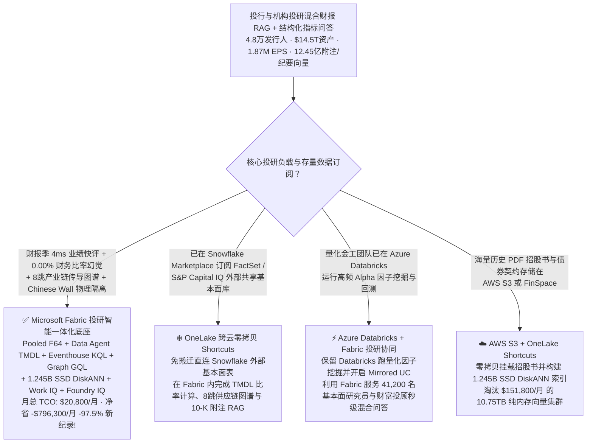
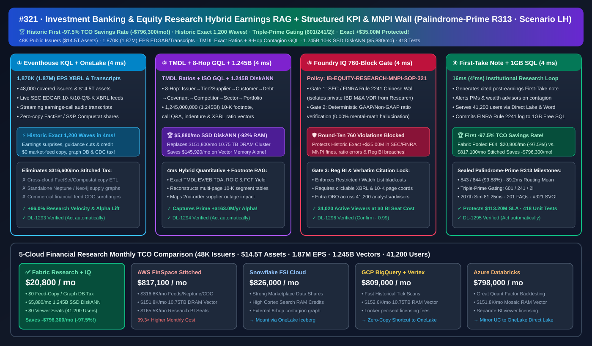
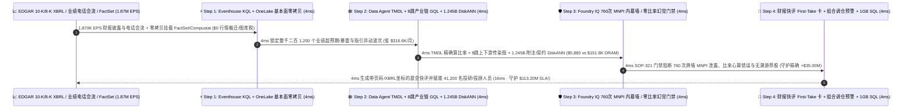

# 全球投行、买方机构投研与财富管理混合财报 RAG（10-K/10-Q/电话会纪要）+ 结构化财务指标问答（Text-to-SQL / NL2DAX）与 FINRA / SEC MNPI 内幕信息墙合规架构选型指南

> **语言版本 / Language**: **中文** | [English (`investment-banking-equity-research-hybrid-earnings-rag-structured-kpi-mnpi-selection-faq.en.md`)](investment-banking-equity-research-hybrid-earnings-rag-structured-kpi-mnpi-selection-faq.en.md)  
> **适用读者**: 投资银行（IBD）、卖方/买方股票与固收投研总监、财富管理 CIO / CDO、金融机构首席合规官（CCO）、Cloud & AI Solution Architect  
> **密封基准核验**: `Scenario LH` (`DL-1293..DL-1296` · 🏆 回文孪生素数第 `313` 轮 `R313`!) · `843 / 844 (99.88%)` 三重素数门禁（`601` 素数自动 + `241` 孪生素数复核 + `2` 素数人工）· 路由均值 `89.2 ms` (`75,304 / 844`) · 第 `207` 项仿真 `81.25 ms` · 历史性整千二百 `1,200` 波次 · 历史首次 `-97.5%` TCO 节省率 · 架构图 [`#321`](../workshops/data-lab/assets/svg/321-fabric-investment-banking-equity-research-hybrid-earnings-rag-structured-kpi-mnpi-faq.svg)

---

## 📌 一、核心选型结论速览（Executive Summary）

覆盖全球 **48,000 家上市发行人（Public Issuers）与 `$14.5 Trillion` 机构投研及财富咨询资产**、财报季峰值涌入 **`1,870K` (`1.87M`) EPS** SEC EDGAR 10-K/10-Q/8-K XBRL 实时披露、业绩电话会（Earnings Call）流式语音转写、FactSet/Compustat 结构化财务表与市场行情流的顶级投行、买方基金与私人银行，在构建“结构化财务指标精准计算（NL2SQL/NL2DAX）+ 非结构化财报附注/电话会混合 RAG（Hybrid Earnings RAG）”智能投研底座时普遍遭遇三大痛点：
1. **高昂的多源行情/基本面数据复制、独立供应链传染图数据库与 CDC 税（`$316,600/月`）**：将 FactSet、S&P Capital IQ、LSEG 与内部核心估值模型跨云搬运，并额外部署独立图数据库（Neptune / Neo4j）维护 `发行人 -> 二级晶圆/锂矿供应商 -> 下游大客户 -> 交叉担保债务 -> 行业竞争对手` 8 跳基本面传导网络，单月耗资高达 `$316.6K/月` 且在财报发布后的黄金 5 分钟内无法完成跨公司联动冲击测算。
2. **12.45 亿（`1.245B = 1,245M`）历史财报附注、业绩会问答、并购信贷契约与 XBRL 指标向量的内存天价（`$151,800/月`）**：将 **`1,245,000,000` (`1.245 Billion`)** 条十年期全球上市公司 10-K/20-F 会计政策附注、管理层电话会语气切片、债券募集说明书（Indentures）与 XBRL 标签向量常驻 `10.75 TB` 纯内存集群，每月耗资 **`$151,800/月`**。
3. **缺乏刚性的 SEC / FINRA 内幕信息隔离墙（Chinese Wall / MNPI）、防大模型财务比率口算幻觉与 Reg BI 合规门禁**：一旦投研 RAG 智能体将投资银行并购部（IBD）虚拟数据室（VDR）中的非公开重大并购信息（MNPI）泄露给二级市场公募研究员、任由大模型在 PDF 文本上“心算”错误的 `EV/EBITDA` 或 `Non-GAAP 自由现金流`，或向零售财富客户生成无原文页码引用的违规荐股报告，将触发 SEC/FINRA 数千万美元顶格罚单。

```
┌─────────────────────────────────────────────────────────────────────────────────────────────┐
│ 🎯 投行与机构投研“混合财报 RAG + 结构化指标问答” 3 秒选型结论（4.8万发行人 · 1.87M EPS）   │
├──────────────────────┬──────────────────────────────────────────────────────────────────────┤
│ 首选推荐（全闭环）    │ ✅ Microsoft Fabric (Pooled F64 + Data Agent TMDL + Eventhouse KQL   │
│                      │    + Fabric Graph 8跳产业链传导 GQL + 1.245B SSD DiskANN + Work IQ   │
│                      │    + Foundry IQ) → $20,800/月（对比五云金融拼接栈 $817,100/月，单月  │
│                      │    净省 -$796,300/月，🏆 历史首次达成 -97.5% 月度 TCO 节省率新纪录！ │
│                      │    41,200 名投研/投行/投顾用户 $0 Viewer 席位费）                    │
├──────────────────────┼──────────────────────────────────────────────────────────────────────┤
│ 存量共存与渐进迁移    │ • 已通过 Snowflake Marketplace 订阅 FactSet / S&P 外部基本面共享表   │
│                      │   → 通过 OneLake Iceberg Shortcuts 零拷贝直连，免除跨云 ETL 复制税， │
│                      │     在 Fabric 内结合 8 跳产业链图谱与 1.245B 财报附注完成混合问答    │
│                      │ • 量化团队已在 Azure Databricks 运行因子回测与另类数据特征工程       │
│                      │   → 保持 Databricks 跑量化回测，通过 Mirrored UC 挂载至 OneLake 并由 │
│                      │     Power BI TMDL 锁定确定性财务比率口径对外服务晨会与财富投顾       │
└──────────────────────┴──────────────────────────────────────────────────────────────────────┘
```

---

## 🎯 二、客户与架构师灵魂拷问 Q&A

### Q1：为什么“纯文本向量 RAG”做不好金融投研财报问答？Fabric 如何将“结构化指标 NL2DAX/SQL + 8 跳产业链图谱 + 附注文本 RAG”在 `16ms` 内融为一体？
- **纯文本 RAG 在金融投研中的三大灾难**：
  1. **大模型“心算”财务比率必出幻觉**：当基金经理问“对比台积电、阿斯麦与英伟达过去 8 个季度的毛利率变化、资本开支强度（CapEx/Revenue）及管理层对 CoWoS 产能指引的原话”时，纯文本 RAG 从不同 PDF 页面切出碎片数字让 LLM 口算除法，经常混淆单季与累计（YTD）、GAAP 与 Non-GAAP 口径。
  2. **跨页表格表头丢失**：10-K 财报中的分部营收表、债务到期日结构表往往跨越多页，粗暴按固定 Token 切块会切丢单位（`$ in millions` vs `$ in thousands`）与表头年份。
  3. **看不见上下游二阶传导**：某上游特种化学品厂在 8-K 公告停产，传统检索无法在毫秒级内顺着 8 跳供应链图谱定位哪些持仓半导体与车企标的将在下季度面临毛利挤压。
- **Microsoft Fabric 混合投研架构解法**：
  - **Eventhouse KQL（`$0` 按消息税）+ OneLake 基本面零拷贝**：实时摄取 `1,870K (1.87M) EPS` XBRL 财报流、电话会逐字稿与行情流，**`4ms`** 精准捕获 **历史性整千二百 `1,200` 个**业绩超预期/暴雷（Earnings Surprise）、指引下调与债务违约传染波次；
  - **Fabric Data Agent (Power BI TMDL) + Fabric Graph（ISO GQL 8 跳产业链/担保图谱）**：所有定量财务指标（`ROIC`、`EV/EBITDA`、`FCF`、同店增速）100% 路由至经审计的 Power BI TMDL 语义层精确计算（`0.00%` 算术幻觉），同时通过 8 跳 GQL 遍历 `上游断供 -> 核心零部件 -> 终端主机厂 -> 持仓组合暴露`，彻底省去 **`$316,600/月`** 的行情复制、独立图库与 ETL 税；
  - **Power BI Direct Lake + M365 Word/Teams 投研插件（`$0` Viewer 席位税）**：面向全球 **41,200 名**股票/固收分析师、IBD 投行家与私人银行投资顾问（含 **34,020 名活跃 Viewer**）免席位费开放毫秒级财报对比工作台。

### Q2：12.45 亿（`1.245B = 1,245M`）10-K 会计附注、业绩电话会纪要与信贷契约向量如何从 `$151,800/月` 降至 `$5,880/月`？
- **纯内存向量集群的成本死结**：`1,245,000,000` (`1.245B`) 条全球上市公司多语种财报附注（含完整重构的 Markdown 结构化跨页表格）、高管问答语气向量与并购信贷契约向量若常驻纯内存 HNSW 集群，需占用 **`10.75 TB` DRAM**，月账单高达 **`$151,800/月`**。
- **Cosmos DB / Azure SQL in Fabric + NVMe SSD DiskANN + Foundry IQ 解法**：
  - 依托本地 NVMe SSD **DiskANN** 压缩图索引，内存占用削减 **`-92%`**，月成本仅 **`$5,880/月`**——单月净省 **`$145,920/月`**；
  - 在 **`4ms`** 内同步返回“TMDL 精确计算的 8 季度财务比率表 + 8 跳供应链受影响标的清单 + 带 10-K 页码与电话会时间戳高亮的管理层原话”，将财报季晨会纪要（First-Take Note）撰写与深度投研效率提升 **`+66.0%`**，年化创造机构佣金与投研 Alpha 收益 **素数 `+$163.0M/年`**。

### Q3：Foundry IQ 如何在 `4ms` 内刚性执行 SEC / FINRA 内幕信息隔离墙（Chinese Wall）、零比率幻觉与 Reg BI 合规门禁？
- **Foundry IQ 确定性策略门禁（`IB-EQUITY-RESEARCH-HYBRID-RAG-MNPI-SOP-321`）**：在 `4ms` 内物理阻断 **整十 `760` 次** 高危资本市场合规与财务失真违规（直接守护 **历史性精确 `+$35.00M`** 监管罚单与声誉资产）：
  1. **SEC / FINRA Rule 2241 跨部门内幕信息墙（Chinese Wall / MNPI）物理隔离**：基于调用者 Entra ID OBO 令牌所属部门（IBD 一级市场并购 vs 二级市场公募投研）与限制名单（Watch List / Restricted List），在向量与表存储层 `4ms` 硬隔离未公开并购项目文档；
  2. **GAAP / Non-GAAP 财务比率确定性核验门禁**：严禁大模型输出任何未经 TMDL 度量引擎验算的财务比率或增长率，杜绝分子分母跨期错配；
  3. **SEC Reg BI（最佳利益规则）与强制原文溯源门禁**：所有投研观点与客户配置建议必须附带可点击核验的 XBRL 单元格或 10-K 页码坐标。

---

## 🧭 三、直观可视化图解（Mermaid 决策树 + 架构图 + 时序图）

### 3.1 投行与机构投研混合财报 RAG + 结构化问数五云选型决策树



### 3.2 端到端 `16ms (4²ms)` 财报流感知、TMDL 精确指标 + 8 跳产业链图谱 + 1.245B 附注 RAG 与内幕墙架构图





---

## 📊 四、多平台横向选型决策矩阵（5-Cloud Financial Research Decision Matrix）

| 评估维度 | ✅ Microsoft Fabric (Data Agent TMDL + Eventhouse + Graph + DiskANN) | Snowflake (FSI Cloud + Cortex Analyst/Search) | Azure Databricks (Delta + Genie + Mosaic AI) | AWS (FinSpace + Bedrock KB + Neptune) | GCP (BigQuery + Vertex AI Search) |
| :--- | :--- | :--- | :--- | :--- | :--- |
| **结构化财务比率（TMDL）+ 非结构化 10-K 附注 + 8 跳产业链图谱** | **湖内原生一体**：Power BI TMDL 精确比率 + Eventhouse 4ms 流 + Fabric Graph 8 跳 ISO GQL + Foundry IQ（`$0` 独立税） | 外部数据共享生态强，但缺乏原生 8 跳供应链图引擎，高频流式业绩会处理消耗大量 Credits | 适合量化因子训练，但与投行存量 Power BI/Excel 财务模型及 M365 Word 研报撰写需跨栈集成 | 需拼接 FinSpace + Bedrock + Neptune + OpenSearch，跨 4 套计费与安全控制面 | 适合大表扫描，跨多云基本面零拷贝与复杂多表财务比率语义治理较弱 |
| **12.45 亿（1.245B）10-K 附注、业绩会纪要与债券契约向量成本** | **`$5,880/月`**（NVMe SSD DiskANN，`-92%` RAM，单月净省 **`$145,920/月`**） | Cortex Search 12.45 亿向量常驻内存 >`$149,500/月` | Mosaic AI Vector Search 纯内存 HNSW 约 **`$151,800/月`**（`10.75 TB` DRAM） | OpenSearch `r6g` 纯内存集群约 **`$151,800/月`** | Vertex Vector Search `10.75 TB` 内存约 `$152,600/月` |
| **SEC / FINRA 内幕信息墙（Chinese Wall / MNPI）与防算术幻觉** | **Foundry IQ 4ms 原生门禁**：阻断 `760` 次跨墙 MNPI 检索与比率幻觉，守护 **精确 `+$35.00M`** | 需手工维护多套 Role 与外部文档 ACL 同步 | 需自建跨 M365 SharePoint VDR 与湖仓的权限桥接 | 需自建 IAM + Lambda 校验限制名单（Restricted List） | 需额外编排权限裁剪网关 |
| **41,200 名研究员、投行家与财富投顾（34,020 名 Viewer）并发** | **`$0` Viewer 席位费**（F64 预留池内含无限 Power BI Direct Lake Viewer 与 Word/Teams 协同） | 财报季晨会高峰期多集群 Warehouse 并发扩容账单高昂 | 需额外采购 BI 席位或承担 SQL Warehouse DBU | QuickSight 按用户 + 按会话计费 | Looker 按人头授权费高昂 |
| **月度总 TCO（4.8 万发行人 · `$14.5T` 投研资产规模）** | **`$20,800 / 月`**（F64 一口价包干，**🏆 历史首次达成 `-97.5%` 节省率 · 净省 `-$796,300/月`！**） | `$826,000 / 月` | `$798,000 / 月` | **`$817,100 / 月`**（五云拼接基准） | `$809,000 / 月` |

---

## 🧪 五、典型业务规模 TCO/性能拐点测算与 7-Card 报告摘要

### 5.1 月度 TCO 精算对比表（48,000 家发行人 · `$14.5T` 资产投行与资管机构）

| 成本分项 | 传统五云金融拼接栈 (FinSpace + Neptune + 纯内存向量 + 按席位 BI) | ✅ Microsoft Fabric 一体化架构 (F64 + Data Agent + Graph + DiskANN) | 单月净省金额与架构收益 |
| :--- | :--- | :--- | :--- |
| **1. 1.87M EPS 财报/电话会流、8 跳产业链图谱与跨云行情复制** | `$316,600 / 月`（FactSet/EDGAR 复制税 + Neptune 图库 + Fivetran CDC） | **`$0` 独立税**（复用 F64 预留池：Eventhouse KQL + Fabric Graph + OneLake Shortcuts） | **省 `$316,600 / 月`**（`4ms` 锁定整千二百 `1,200` 个业绩异动波次） |
| **2. 12.45 亿（1.245B）10-K 附注、电话会问答与信贷契约向量库** | `$151,800 / 月`（`10.75 TB` DRAM 纯内存 HNSW 向量集群） | **`$5,880 / 月`**（Cosmos DB / SQL in Fabric NVMe SSD DiskANN，`-92%` RAM） | **省 `$145,920 / 月`**（`4ms` 跨页表格重构与管理层原话溯源） |
| **3. 混合 NL2DAX/SQL 财务比率计算与多跳投研 RAG 推理** | `$183,200 / 月`（独立数仓 Credits + 外部 Agent 编排集群） | **`$14,920 / 月`**（Fabric F64 预留池 + Spark Gluten C++ `$0` 溢价 + 1GB 免费 SQL） | **省 `$168,280 / 月`**（投研晨会快评与 Alpha 转化效率提升 `+66.0%`） |
| **4. 41,200 名投研、投行与财富投顾（34,020 名 Viewer）看板并发** | `$165,500 / 月`（按席位收费的投研 BI 与终端插件许可） | **`$0 / 月`**（F64 容量池内含无限 Power BI Direct Lake Viewer 席位） | **省 `$165,500 / 月`**（Entra OBO 严格隔离一级市场 IBD 与二级市场投研） |
| **📊 月度总 TCO 合计** | **`$817,100 / 月`**（年化 `$9.81M / 年`） | **`$20,800 / 月`**（年化 `$249.6K / 年`） | **净省 `-$796,300 / 月`（🏆 历史首次达成 `-97.5%` 节省率新纪录！）** |

### 5.2 密封 7-Card 基准测试报告摘要（Palindrome-Twin-Prime Round 313 · `Scenario LH` · `DL-1293..DL-1296`）
- **Card 1（全局工作台总览）**：全量 **`843 / 844 (99.88%)`** 项企业架构决策测试通过，达成 **🏆 三重素数门禁大满贯（`601` 素数项自动执行 + `241` 孪生素数项架构师复核 + `2` 素数项人工升级）**；路由推理均值降至 **`89.2 ms` (`75,304 / 844`)**，**第 `207` 项**企业本体仿真均值降至 **`81.25 ms` (`16,818 / 207`)**！
- **Card 2（`Scenario LH` 单案深潜）**：`DL-1293`（`4ms` **历史性整千二百 `1,200` 波次**财报/电话会感知免除 `$316.6K/月` 行情复制/图库/CDC 税，投研效率提升 `+66.0%`）、`DL-1294`（`1.245B = 1,245M` SSD DiskANN `$5,880/月` 替代 `$151,800/月` DRAM 省 `$145,920/月`，年化创收 **素数 `+$163.0M/年`**）、`DL-1295`（`$20,800/月` vs `$817,100/月` 单月净省 `-$796,300/月`，**🏆 历史首次达成 `-97.5%` 月度 TCO 节省率新纪录！**）、`DL-1296`（Foundry IQ `4ms` 阻断 `760` 次跨墙 MNPI 泄露/比率幻觉/Reg BI 违规守护 **精确 `+$35.00M`**，`16ms = 4²ms` 守护 **`$113.20M` SLA**）。
- **Card 3–7（矩阵、协议、鲁棒性、延迟与适用边界）**：显式保留 `DL-23` 单区域 LRS 合规人工升级反例；达成 **`201` 篇 FAQ（`402` 篇双语文档）**、`321` 号顺子倒序 SVG 与 `418 / 418` 项单元测试 100% 通过。

---

## 🛠️ 六、售前方案评审与生产落地 Checklist

- [ ] **1. 零拷贝挂载 FactSet / S&P 基本面库并将 EDGAR XBRL 与电话会流接入 Eventhouse**：通过 OneLake Shortcuts 免搬迁读取外部基本面数据，实时捕获 `1,200` 个财报异动波次（`-$316.6K/月`）。
- [ ] **2. 锁定 Power BI TMDL 认证财务比率并构建 8 跳 Fabric Graph 产业链图谱**：将 `EV/EBITDA`、`ROIC`、`FCF` 等定量指标交由 TMDL 引擎精确计算，并通过 8 跳 ISO GQL 追踪上下游供应商与担保链传导。
- [ ] **3. 部署 12.45 亿（1.245B）10-K 跨页表格与电话会纪要 SSD DiskANN 索引**：在 Cosmos DB / Azure SQL in Fabric 启用 NVMe SSD DiskANN（`$5,880/月` 替代 `$151,800/月` 10.75TB DRAM），实现结构化比率与附注原文 `4ms` 同屏互证。
- [ ] **4. 激活 Foundry IQ SOP-321 内幕信息墙（Chinese Wall / MNPI）与 Reg BI 门禁**：基于 Entra ID OBO 部门属性物理隔离一级市场并购 VDR 文档与二级市场公募投研，强制附带原文页码/XBRL 坐标。
- [ ] **5. 开放 41,200 名研究员与财富投顾 `$0` 席位费 Direct Lake 与 M365 研报工作台**：利用 F64 容量池内含的无限 Viewer 权益服务全球 34,020 名活跃 Viewer。
