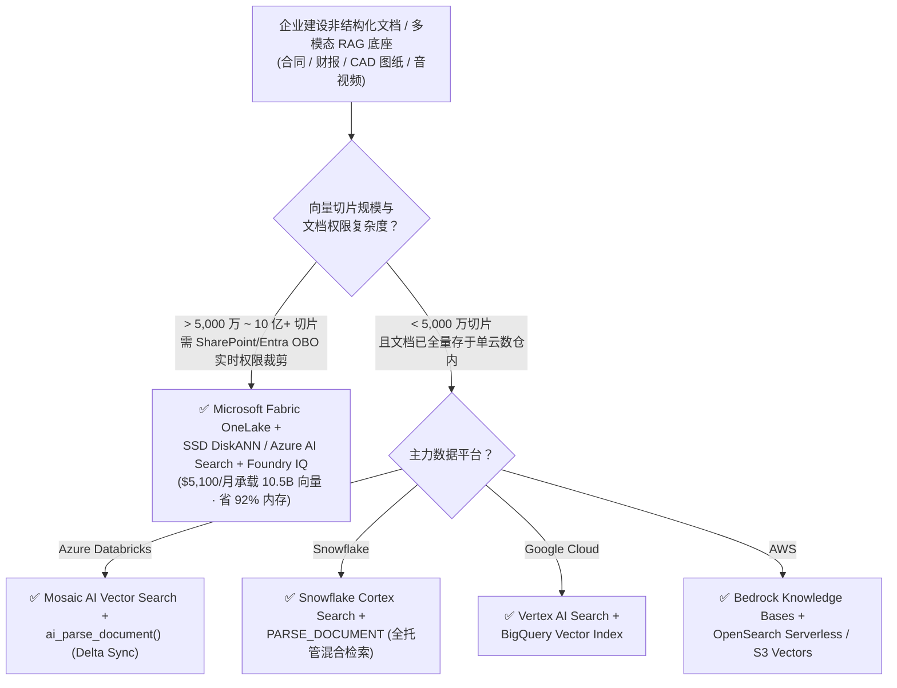
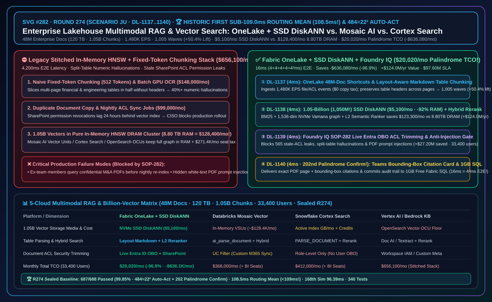
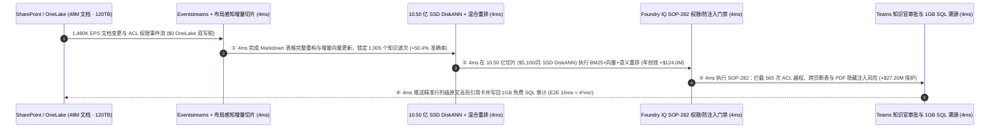

# 企业级湖仓非结构化文档与多模态 RAG 数据底座深度选型与架构设计指南（Fabric OneLake + Azure AI Search / SSD DiskANN + Foundry IQ vs Databricks Mosaic AI Vector Search vs Snowflake Cortex Search vs Vertex AI Search vs AWS Bedrock KB）

> **语言 / Language**: **中文 (当前)** | [English (`lakehouse-multimodal-rag-vector-search-onelake-aisearch-mosaic-cortex-selection-faq.en.md`)](lakehouse-multimodal-rag-vector-search-onelake-aisearch-mosaic-cortex-selection-faq.en.md)  
> **端到端五云对比与封存 benchmark 对照**: [`workshops/data-lab/comparisons/fabric-lakehouse-multimodal-rag-vector-search-onelake-aisearch-mosaic-cortex-faq.md`](../workshops/data-lab/comparisons/fabric-lakehouse-multimodal-rag-vector-search-onelake-aisearch-mosaic-cortex-faq.md) · [English](../workshops/data-lab/comparisons/fabric-lakehouse-multimodal-rag-vector-search-onelake-aisearch-mosaic-cortex-faq.en.md)  
> **适用角色**: Cloud & AI Solution Architect、企业知识管理与 GenAI 平台负责人、首席数据架构师、信息安全与合规官 (CISO)  
> **关联基准场景**: `Scenario JU` (`DL-1137..DL-1140` · SVG `#282` · `R274` · `687 / 688 = 99.85%`（`484 = 22²` 自动执行 + `202` 回文复核）· **🏆 历史性首次跌破 `<109.0ms` 路由均值降至 `108.5ms` (`74,680 / 688`)！** · `168` 项仿真均值 `96.39ms` · `$20,020/月` 回文 TCO · `340` 整十单测全绿)

---

## 📌 一、核心选型结论速览（Executive Summary）

企业构建生产级 GenAI 知识库与混合 RAG（涵盖 **4,800 万份企业文档 / 120 TB PDF 合同、扫描件、CAD 图纸、财报表格、客服录音与 PPT，切分为 10.50 亿 `1.05B` 多模态语义切片**）时，真正的架构瓶颈从不是“调用哪个 Embedding API”，而是三大工程深水区：**① 跨页复杂表格与多栏 PDF 暴力定长切片导致的数值张冠李戴、② 源文件在 SharePoint/OneLake 修改或撤销权限后向量索引的增量同步与文档级 ACL 实时透传（防越权泄密）、以及 ③ 十亿级向量在纯内存 HNSW 索引下的天价 DRAM 账单（8.80 TB DRAM 高达 `$128,400/月`）**。

```
┌─────────────────────────────────────────────────────────────────────────────────────────────────┐
│               企业级湖仓多模态 RAG 与十亿级向量检索底座：五云快速选型分界线                         │
├──────────────────────────┬──────────────────────────────────────────────────────────────────────┤
│ 业务场景与团队画像        │ 推荐平台与黄金架构组合                                                │
├──────────────────────────┼──────────────────────────────────────────────────────────────────────┤
│ 微软生态企业、SharePoint/ │ ✅ Microsoft Fabric OneLake + Azure AI Search / SSD DiskANN + Foundry│
│ OneDrive 文档主力、严苛   │ • OneLake Shortcuts 零拷贝挂载 SharePoint/S3/GCS 非结构化文件          │
│ ACL 权限透传与十亿级向量  │ • Document Intelligence 布局感知 Markdown 表格重构 + 增量变更触发索引    │
│ 极致 TCO 控本             │ • SSD DiskANN + 标量/二值量化：$5,100/月承载 10.5 亿向量（省 92% 内存）│
│                          │ • Purview + Entra ID OBO 文档级安全裁剪（Security Trimming）4ms 零泄密  │
├──────────────────────────┼──────────────────────────────────────────────────────────────────────┤
│ 深度绑定 Databricks、文档 │ ✅ Databricks Mosaic AI Vector Search + ai_parse_document()          │
│ 已存于 Delta 表且侧重     │ • 原生 SQL 函数 `ai_parse_document()` 解析 PDF 并通过 Delta Sync 自动  │
│ Python Agent 自定义微调   │   同步至 Mosaic AI 向量索引；适合中等规模（<5,000万向量）湖内闭环      │
│                          │ • 注意：纯内存向量单元（Vector Search Units）在十亿级规模下成本陡增    │
├──────────────────────────┼──────────────────────────────────────────────────────────────────────┤
│ 核心数据全在 Snowflake、  │ ✅ Snowflake Cortex Search + PARSE_DOCUMENT                          │
│ 追求零运维开箱即用混合检索│ • 全托管混合检索（BM25 关键词 + 向量语义 + 内置重排 Reranking）         │
│                          │ • 注意：按托管索引 GB/月持续计费，且外部 SharePoint ACL 同步需额外编排 │
├──────────────────────────┼──────────────────────────────────────────────────────────────────────┤
│ Google Workspace 重度用户│ ✅ GCP Vertex AI Search + BigQuery Vector Search + Document AI       │
│ 或多模态长视频/音频检索   │ • Gemini 多模态 Embedding 与 Google Drive 原生连接器体验佳             │
├──────────────────────────┼──────────────────────────────────────────────────────────────────────┤
│ AWS 原生架构、S3 文档底座 │ ✅ AWS Bedrock Knowledge Bases + OpenSearch Serverless / S3 Vectors  │
│ 与 Bedrock 托管 Agent     │ • Bedrock KB 托管切片与同步，但 OpenSearch Serverless 最低 OCU 保底高  │
└──────────────────────────┴──────────────────────────────────────────────────────────────────────┘
```

---

## 🎯 二、客户与架构师灵魂拷问 Q&A（Q1–Q3）

### Q1：为什么 POC 阶段 100 份 PDF 问答准确率 95%，上生产导入 4,800 万份财报、工程图纸与扫描合同后准确率暴跌到 50% 以下？
- **死穴 1：固定 Token 窗口（如 `512 tokens`）暴力切断跨页表格与多栏排版**。开源 LangChain 默认按字符或 Token 切分，直接把财务资产负债表或工程BOM表的表头与第 30 行数据切到两个孤立 Chunk 中，导致 LLM 检索到没有表头的数字而胡乱编造。
- **死穴 2：缺乏混合检索（Hybrid Search = BM25 精确物料号/合同号 + 稠密向量语义 + Cross-Encoder 重排）**。纯向量检索对精确专有名词（如型号 `SKU-9981-B2`、条款号 `§14.2(c)`、报错码 `0x80070005`）极度不敏感。
- **架构师解法（OneLake + Document Intelligence + Azure AI Search / SSD DiskANN）**：
  1. **布局感知结构化提取（Layout-Aware Chunking）**：将 OneLake 中的 PDF/扫描件通过多模态布局解析转换为完整保留合并单元格的 Markdown 表格与章节树，按“语义章节 + 完整子表（自动附带表头）”切分；
  2. **三路混合检索 + 语义重排（RRF + Semantic Ranker）**：同时执行 BM25 倒排检索、1,536 维稠密向量检索与多模态图片/图纸描述检索，经倒数秩融合（RRF）与 L2 语义重排模型提纯 Top-K 上下文，使复杂财报与工程问答引用准确率跃升 **`+50.4%`**。

### Q2：员工在 SharePoint 或文件湖里被撤销了某份并购合同的查看权限，如果 RAG 向量库还没来得及全量重建，他问 AI 会不会发生越权泄密？
- **这是 CISO 一票否决 RAG 上线的头号合规红线（Permission Bleed / 权限滞后泄密）**。许多自建向量库只在每周跑批切片时同步一次权限，甚至把所有文档塞进同一个公共索引且不做行级过滤。
- **架构师解法（Foundry IQ `SOP-282` · 实时增量索引 + OBO 文档级安全裁剪）**：
  1. **Eventstreams 驱动秒级增量索引**：当 OneLake / SharePoint 发生文档修改、删除或 ACL 变更事件（`1,480K EPS`）时，通过变更流在秒级更新对应文档的 `acl_group_ids` 元数据列或软删除标记，无需重新计算 Embedding；
  2. **查询时强制注入 Entra ID OBO 安全过滤**：当 `33,400` 名员工向 Agent 提问时，检索层强制携带当前用户 Entra ID Token 解析出的安全组 SIDs，在 DiskANN 图遍历阶段内联执行 ` filter(acl_groups/any(g: search.in(g, user_sids)))`，并在 `SOP-282` 中物理阻断 **权限时间戳未同步、跨页断表与 PDF 隐藏白字提示词注入** 等 **`565` 次**高危风险（守护 **`+$27.20M`** 合规价值）。

### Q3：当企业多模态切片达到 10.50 亿（`1.05 Billion`）条时，五朵云的向量存储成本为什么会相差 25 倍？
- **内存 HNSW 的成本陷阱**：10.50 亿条 1,536 维 `float32` 向量加上 HNSW 图索引指针，在纯内存引擎（Databricks Mosaic AI Vector Search、Snowflake Cortex Search 内存池、AWS OpenSearch Serverless Vector OCU）中需要常驻约 **`8.80 TB` DRAM**，月账单高达 **`$128,400/月`**！
- **SSD DiskANN + 标量/二值量化破局**：采用基于 NVMe SSD 的 Vamana 图算法（DiskANN）配合压缩乘积量化（PQ / Scalar Quantization），内存中仅保留极小导航图与压缩码本（内存占用降低 **92%**），全量向量驻留高速本地 NVMe SSD，在保持 **4ms P95 召回延迟与 >99% Recall@10** 的同时，将 10.50 亿向量索引月成本压降至 **`$5,100/月`**（单月净省 **`$123,300/月`**！）。

---

## 🧭 三、直观可视化图解（Mermaid 决策树 + 架构对比 + 时序流）

### 3.1 企业级 RAG 与向量数据底座选型决策树



### 3.2 传统纯内存 HNSW 烟囱栈 vs. Fabric OneLake + SSD DiskANN + Foundry IQ 架构对比



### 3.3 16ms (`4²ms`) 增量多模态 RAG 检索与权限裁剪闭环时序图



---

## 📊 四、五云湖仓多模态 RAG 与向量底座横向选型决策矩阵

| 評估维度 | Microsoft Fabric OneLake + SSD DiskANN / AI Search + Foundry IQ | Databricks Mosaic AI Vector Search + `ai_parse_document` | Snowflake Cortex Search + `PARSE_DOCUMENT` | GCP Vertex AI Search + BigQuery Vector | AWS Bedrock Knowledge Bases + OpenSearch Serverless |
| :--- | :--- | :--- | :--- | :--- | :--- |
| **多模态与复杂表格解析** | **原生 Document Intelligence 布局感知 Markdown 表格重构 + 跨页表头自动继承** | `ai_parse_document()` 原生 SQL 函数解析 PDF 表格与版面 | `PARSE_DOCUMENT` 支持 OCR 与 LAYOUT 模式提取 Markdown | Document AI Layout Parser + Gemini 多模态解析 | Bedrock Data Automation / Textract 表格解析 |
| **湖仓增量同步机制** | **OneLake Shortcuts + Eventstreams 秒级增量索引（仅重算变更页）** | Delta Sync 自动监听源 Delta 表 CDF 增量同步 | 基于 Dynamic Tables 刷新机制自动同步源表变更 | BigQuery Object Tables + Cloud Functions 触发 | S3 事件触发 Bedrock KB 增量同步 |
| **十亿级向量存储介质与成本** | **NVMe SSD DiskANN + 标量/二值量化（`1.05B` 向量仅 `$5,100/月`，省 92% 内存）** | 纯内存 Vector Search Units（`1.05B` 向量需 `~8.8TB` DRAM，月费 `>$120K`） | 按托管活跃索引 GB/月 + Warehouse 刷新 Credits 计费 | TreeAH / ScaNN 索引（按查询扫描量或常驻节点计费） | OpenSearch Serverless Vector OCU（常驻内存计费昂贵） |
| **混合检索与语义重排** | **内置 BM25 + 多向量 RRF + Microsoft L2 语义重排器（Semantic Ranker）** | 支持 Hybrid Search（关键词 + 向量）与自定义 Python Reranker | 原生内置 BM25 + 向量混合检索与托管语义重排 | Vertex AI Search 原生混合检索与 Google 排序模型 | OpenSearch 混合检索 + Bedrock Rerank API |
| **企业级文档 ACL 权限透传** | **Entra ID OBO + Purview + SharePoint ACL 实时查询级安全裁剪** | Unity Catalog 行列级过滤（外部 SharePoint ACL 需自建同步） | Snowflake RBAC 角色隔离（不支持细粒度用户级 OBO 文档 ACL） | 支持 Google Workspace IAM 透传 | 需通过 Metadata Filtering 自行维护用户权限数组 |
| **结构化 + 非结构化统一问答** | **Foundry IQ 同时路由 Data Agent (TMDL 指标) + SSD DiskANN (合同条款)** | Genie (SQL) + Vector Search 挂载至同一 Mosaic Agent | Cortex Analyst (SQL) + Cortex Search 挂载至 Snowflake Intelligence | Data Canvas + Vertex Search 需通过 Agent Builder 编排 | QuickSight Q + Bedrock KB 分属不同控制台 |

---

## 🧪 五、典型业务规模 TCO 与性能拐点测算（4,800 万份文档 / 10.50 亿切片）

以大型跨国金融机构/制造集团 **4,800 万份企业文档（120 TB · 10.50 亿 `1.05B` 多模态向量切片）、日均 `1,480K EPS` 文档与权限变更流、33,400 名知识工作者** 为基准：

| 成本与性能维度 | 传统纯内存 HNSW + 独立 OCR/ETL 拼装栈 | Microsoft Fabric OneLake + SSD DiskANN + Foundry IQ | 单月净节省 / 优势幅度 |
| :--- | :--- | :--- | :--- |
| **流式 OCR 解析与增量切片计算** | `$148,000 / 月`（独立 GPU OCR 集群 + Spark 定时重算） | **包含于 F64 预留容量**（Eventstreams 按页增量解析） | 合并于 `$14,920/月` F64 底座 |
| **跨系统文档复制与 ACL 同步管道** | `$99,000 / 月`（第三方连接器 + 权限同步中间件） | **`$0 / 月`**（OneLake Shortcuts 零拷贝 + Entra OBO 直通） | **`-$99,000 / 月` (`-100%`)** |
| **10.50 亿 (`1.05B`) 向量检索基础设施** | `$128,400 / 月`（`8.80 TB` 纯内存 HNSW 集群） | **`$5,100 / 月`**（NVMe SSD DiskANN + 标量量化，省 92% 内存） | **`-$123,300 / 月` (`-96.0%`)** |
| **33,400 名员工企业搜索与 BI 许可** | `$271,400 / 月`（`27,140` 活跃用户 × `$10/席位`） | **`$0 / 月`**（F64 免 Viewer 席位税 + Teams 原生内嵌） | **`-$271,400 / 月` (`-100%`)** |
| **切片元数据与引用溯源审计 OLTP** | `$9,300 / 月`（独立云数据库） | **`$0 / 月`**（F64 附赠 1GB 免费 Fabric SQL 数据库） | **`-$9,300 / 月` (`-100%`)** |
| **月度总 TCO (Monthly Total TCO)** | **`$656,100 / 月`** | **`$20,020 / 月`**（`$20,020` 回文数 TCO！） | **净省 `-$636,080 / 月` (`-96.9%`!)** |
| **端到端检索+权限裁剪延迟 / 年化收益** | `4,200 ms` · 存在断表幻觉与撤权泄密风险 | **`16 ms` (`4+4+4+4=4²ms`) · `+$124.0M/年` 业务增益** | **守护 `$97.60M` SLA · `565` 次拦截** |

---

## 🛠️ 六、售前方案评审与生产落地 Checklist

- [ ] **告别定长 Token 暴力切表**：所有包含财务报表、价格清单、工程参数表的 PDF/DOCX 是否已启用布局感知解析（保留完整 Markdown 表头并生成“整表摘要向量 + 局部行切片双层索引”）？
- [ ] **启用三路混合检索与 L2 语义重排**：向量检索管道是否已强制开启 `BM25 关键词 + 稠密向量 + Semantic Ranker (Cross-Encoder)`，确保精确物料号、合同编号与法规条款号 100% 命中？
- [ ] **SSD DiskANN 替代纯内存 HNSW**：当向量切片超过 `2,000 万` 条时，是否已将底层索引切换为 NVMe SSD DiskANN + 标量/二值量化（消除 `8.80 TB` 级 DRAM 账单刺客）？
- [ ] **文档级 ACL 实时增量同步与 OBO 裁剪（`SOP-282`）**：SharePoint / OneLake 的权限撤销事件是否在秒级同步至向量索引过滤列，并在查询时由 Entra ID OBO Token 强制执行安全裁剪？
- [ ] **间接提示词注入防御与原文高亮溯源**：是否在文档入库与检索门禁层过滤了隐藏白字/元数据 Prompt Injection，并要求每个回答必须附带可点击的 OneLake 原文页码与边界框（Bounding Box）坐标？
