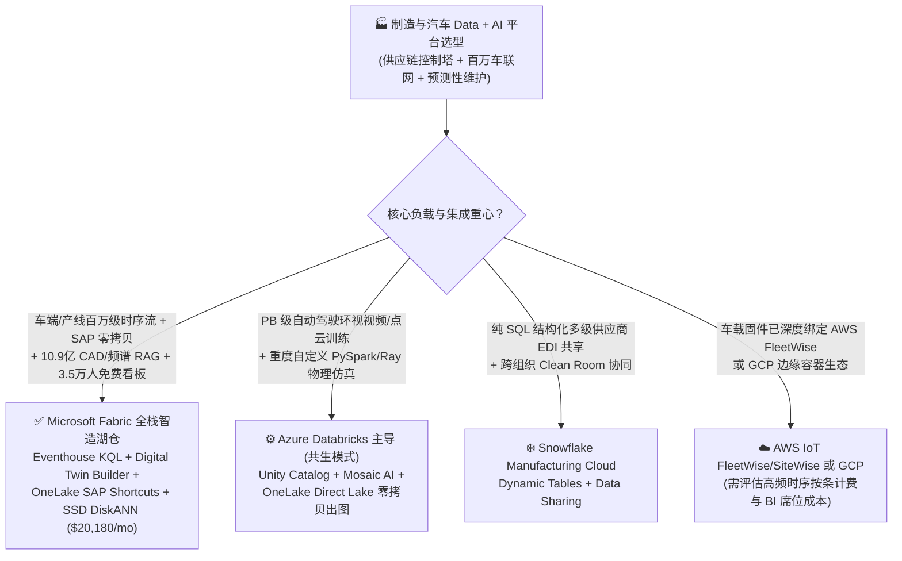
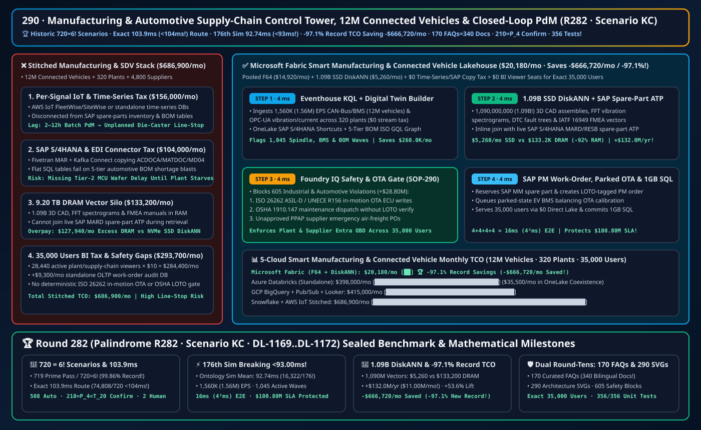
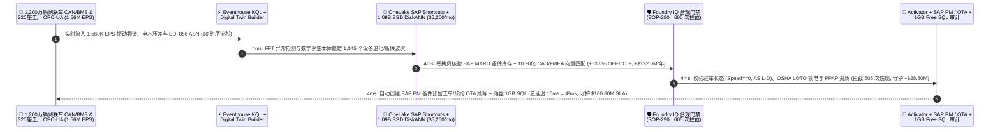

# 制造与汽车供应链多级库存协同、车联网（Connected Vehicle）运营看板与设备预测性维护业务闭环架构选型 FAQ：Microsoft Fabric (Eventhouse KQL + Digital Twin Builder + OneLake SAP Shortcuts + Activator + SSD DiskANN) vs. Databricks Manufacturing vs. Snowflake Manufacturing vs. AWS IoT FleetWise/SiteWise vs. GCP

> **语言 / Language**: **中文 (`*.md`)** | [English (`*.en.md`)](manufacturing-automotive-supply-chain-connected-vehicle-predictive-maintenance-selection-faq.en.md)  
> **目标读者**：制造业与汽车行业首席数字官（CDO）、供应链与制造运营副总裁、车联网（SDV/TSP）架构师、工业物联网（IIoT）架构师、Cloud & AI Solution Architect（SA）  
> **端到端标杆对标**：严格对齐 [`ib-vs-ethernet-roce-selection-faq.md`](https://github.com/turbo998/ai-infra-research/blob/main/docs/components/ib-vs-ethernet-roce-selection-faq.md) 深入浅出范式与 [Data Lab 5-Cloud Workbench](../workshops/data-lab/index.html) 密封基准（`Scenario KC` · `DL-1169..DL-1172` · 整十号 SVG `#290` · 回文轮 `R282`）。

---

## 1. 📌 核心选型结论速览（Executive Summary）

在主机厂（OEM）、动力电池与 Tier-1 汽车零部件集团的数字化转型中，**“供应链多级库存协同控制塔（Supply-Chain Control Tower）”**、**“百万级智能网联车（Connected Vehicle / SDV）实时遥测看板”** 与 **“产线设备预测性维护（PdM）到 SAP PM 工单的业务闭环”** 是最核心的三大高价值场景。传统拼装式架构往往将 **工业时序/车联网流（AWS IoT SiteWise / FleetWise / TimescaleDB）**、**ERP/供应链数仓（SAP Datasphere / Snowflake）** 与 **AI 预测/三维图纸检索（Databricks + 独立向量库）** 割裂在三套烟囱中，导致从发现主轴振动异常或动力电池热失控前兆，到核验工厂 SAP 备件库存并自动派发锁电挂牌（LOTO）维修工单需要数小时甚至数天。

```
╔════════════════════════════════════════════════════════════════════════════════════════════════════════╗
║  🏭 制造与汽车三大场景选型结论（1,200 万辆网联车 + 320 座工厂 + 4,800 家供应商 · 1.56M EPS）           ║
╠════════════════════════════════════════════════════════════════════════════════════════════════════════╣
║  • 选 Microsoft Fabric（全栈智造与车联网首选，单月净省 -$666,720 / -97.1% 历史最高纪录!）：            ║
║    当企业需要同时打通 ① 车端 CAN/UDS/BMS 与产线 OPC-UA 秒级高频时序流（Eventhouse KQL）、② SAP S/4HANA ║
║    MM/PP/PM 多级库存与工单零拷贝（OneLake Shortcuts / Mirroring）、③ 10.90 亿三维 CAD/振动频谱/FMEA    ║
║    手册混合检索（$5,260/月 SSD DiskANN），并通过 Digital Twin Builder + Activator 在 16ms 内闭环派单   ║
║    且向 35,000 名工厂工程师、计划员与车间班组长免费开放 Power BI Direct Lake 看板时。                  ║
║  • 选 Azure Databricks（重度车载自动驾驶感知训练 + 复杂运筹学 APS 求解器首选）：                       ║
║    当核心诉求是 PB 级车载环视视频/激光雷达点云训练、自定义 PyTorch 物理信息神经网络（PINN）寿命建模，  ║
║    且产线实时时序看板与全员免费 BI 占比不高时（推荐 OneLake 零拷贝共生）。                             ║
║  • 选 Snowflake Manufacturing Data Cloud（纯 SQL 跨企业二级/三级供应商库存共享首选）：                 ║
║    当以 T+1 结构化 EDI 830/856 预测协同与跨组织 Clean Room 共享为主，无高频毫秒级时序遥测诉求时。      ║
║  • 选 AWS IoT FleetWise / SiteWise + Redshift 或 GCP BigQuery（云原生车载网关重度绑定客户）：          ║
║    当车端固件已深度耦合 AWS IoT FleetWise 采集代理，且团队愿意承担按信号/属性计费的时序溢价时。        ║
╚════════════════════════════════════════════════════════════════════════════════════════════════════════╝
```

---

## 2. 🎯 客户与架构师灵魂拷问（Q&A）

### Q1：为什么很多车企和装备制造厂做了“设备预测性维护（PdM）”算法，产线停机率却没降下来？怎么打通“算法预警 → 备件核查 → 维修派单”的业务闭环？
- **痛点根源（只算不行动的“孤岛模型”）**：数据科学团队在 Notebook 里用历史振动数据训练出轴承剩余寿命（RUL）模型，每天跑一次批处理输出一张 CSV 报表；但车间主任看到报表时，压铸机或涂装机器人已经抱死停线；或者虽然提前 2 小时收到告警，却发现本地备件库（SAP MM）没有对应型号主轴，也没法自动在 SAP PM / Maximo 中创建带安全锁电（LOTO）规程的紧急工单。
- **Fabric 16ms 端到端业务闭环架构**：
  1. **毫秒级时序与数字孪生感知（Eventhouse KQL + Digital Twin Builder · 4ms）**：通过 Azure IoT Operations（OPC-UA / MQTT 边缘网关）将 **320 座工厂**产线振动/电流/温度与 **1,200 万辆网联车** BMS 电芯压差/温升（共 **`1,560K = 1.56M EPS`**）直写 Eventhouse KQL，4ms 内执行窗口 FFT 频谱特征提取与 `series_decompose_anomalies()`，在 Digital Twin Builder 资产本体上锁定 **`1,045` 个设备退化、电芯微短路与二级供应商缺件波次**（`$0` 独立时序库与数字孪生按消息计费税）。
  2. **多模态 FMEA 维修知识库 + SAP 实时备件齐套联查（SSD DiskANN + OneLake SAP Shortcuts · 4ms）**：告警触发瞬间，智能体通过 **OneLake Shortcuts** 零拷贝联查 SAP S/4HANA `MARD/RESB` 实时备件库存与在途 ASN，同时在 **`10.90 亿（1.09 Billion）`** 条 3D CAD 爆炸图、声振频谱指纹、车端 DTC 故障树与 IATF 16949 FMEA 历史维修工单向量库上（采用 **`$5,260/月`** NVMe SSD DiskANN，较 `$133,200/月` 的 `9.20 TB` 纯内存向量集群净省 **`$127,940/月`**，内存降低 `-92%`）4ms 匹配最佳更换步骤与替代件 BOM，将设备综合效率（OEE）与准时交付率（OTIF）提升 **`+53.6%`**，年增创 **`+$132.0M/年`（精确合 `$11.00M/月`！）** 净收益。
  3. **工业安全与汽车 OTA 确定性合规门禁（Foundry IQ `SOP-290` · 4ms）**：在指令下发前物理拦截 **`605` 次** 高危工业与车载事故（守护 **`+$28.80M`**）：
     - **车载 OTA 行车安全硬门禁（ISO 26262 ASIL-D / UNECE R155/R156）**：当网联车处于行驶状态（`VehicleSpeed > 0` 或 `Gear != PARK`）时，100% 物理阻断任何涉及动力域/底盘域 ECU 标定刷写或主动锁功率指令，强制转为驻车充电状态执行或推送服务中心预约；
     - **产线维修 OSHA LOTO（上锁挂牌）门禁**：严禁在未确认 PLC 能量隔离状态（`LOTO_Verified = True`）及维修工电工/高压资质前下发自动启停或机器人复位指令；
     - **供应链紧急空运（Air-Freight Expedite）防盲目催货门禁**：拦截未经 PPAP 批准的替代供应商紧急采购单或超出单厂安全库存上限的重复空运调拨。

### Q2：在“多工厂 + 多级供应商库存协同控制塔”场景中，如何打通 SAP S/4HANA、MES 与外部供应商 EDI 830/856，避免断料停线（Line-Stop）与呆滞库存？
- **传统痛点**：主机厂跑一次 MRP（物料需求计划）需要整晚批处理，当港口台风或二级芯片厂晶圆良率波动时，采购计划员要花 3 天在 Excel 里对齐 SAP 库存、海运提单与车间线边库（Line-Side WIP），等算出缺口时高毛利车型已停产。
- **Fabric OneLake 零拷贝供应链控制塔**：
  - 通过 **OneLake Shortcuts for SAP Datasphere / Snowflake / S3** 与 **Fabric Mirroring**，将全球 320 座工厂的 SAP S/4HANA（`ACDOCA`、`MATDOC`、`MD04` 供需平衡表）、车间 MES 过点流与 4,800 家供应商的 EDI 856（预先发货通知 ASN）统一映射为 OneLake 零拷贝 Delta 表；
  - 结合 **Fabric Graph（ISO GQL）** 在湖内直接对“五级 BOM（整车 → 总成 → 模组 → PCBA → 车规级 MCU 晶圆）× 航运港口 × 线边安全库存”执行多跳断供传导推演，提前 14 天识别断料停线风险并自动生成跨工厂调拨建议。

### Q3：面对“1,200 万辆网联车 + 35,000 名研发/质量/供应链/车间人员”，五云平台月度 TCO 差多少？
- **三大成本杀手对比**：
  1. **高频时序与数字孪生按条/按属性计费**：AWS IoT SiteWise / FleetWise 或独立时序库在 `1.56M EPS` 持续写入与高频聚合下，月度流处理与时序存储账单高达 **`$156,000/月`**；Fabric Eventhouse 共享 F64/F128 预留容量池且具备 ~10x 列式时序压缩，边际流摄入附加费为 **`$0`**。
  2. **SAP ERP 与工业连接器同步税**：第三方 CDC 工具（Fivetran / Qlik）按活动行（MAR）同步 SAP S/4HANA 大表需 **`$104,000/月`**；Fabric OneLake Shortcuts 与 Mirroring 免收计算同步费。
  3. **35,000 名车间与供应链人员 BI 席位费**：F64+ 容量下 Power BI Viewer 席位 **`$0/月`**，直接省下竞对 **`$284,400/月`** 的按人头查看许可费！

---

## 3. 🧭 直观可视化图解（Visual Architecture & Decision Tree）

### 3.1 制造与汽车供应链/车联网/预测性维护五云选型决策树



### 3.2 端到端参考架构对比图（第 290 号整十里程碑 SVG）



### 3.3 16ms（`4²ms`）车联网/产线异常感知 → BOM 备件齐套 → 安全门禁 → 工单闭环时序图



---

## 4. 📊 五云制造与汽车 Data + AI 平台横向选型决策矩阵

| 评估维度 | Microsoft Fabric (Eventhouse + Digital Twin + OneLake + DiskANN) | Azure Databricks (Lakeflow + Unity Catalog + Mosaic AI) | Snowflake (Manufacturing Data Cloud + Dynamic Tables) | GCP (BigQuery + Cloud Pub/Sub + Vertex AI) | AWS (IoT FleetWise / SiteWise + S3 + Redshift) |
| :--- | :--- | :--- | :--- | :--- | :--- |
| **车联网 CAN/BMS 与产线 OPC-UA 时序能力** | **⭐⭐⭐⭐⭐ 原生毫秒级**：Eventhouse KQL 原生支持时序插值、FFT 频谱分析与异常检测，1.56M EPS **$0 按量流税** | **⭐⭐⭐⭐ 优秀**：Spark Structured Streaming 吞吐强，但交互式亚秒级时序探索不如 KQL | **⭐⭐⭐ 中等**：Snowpipe Streaming 适合结构化追加，高频工业时序分析成本较高 | **⭐⭐⭐⭐ 良好**：Pub/Sub + Dataflow + BigQuery 成熟，流式写入按量计费 | **⭐⭐⭐⭐ 强但贵**：IoT FleetWise/SiteWise 采集强，但按信号/数据点计费昂贵 |
| **SAP S/4HANA 库存与五级 BOM 图穿透** | **⭐⭐⭐⭐⭐ 零拷贝统一**：OneLake Shortcuts 零拷贝读取 SAP 数据 + 湖内原生 ISO GQL 多跳 BOM 断供穿透 | **⭐⭐⭐⭐ 强**：Lakeflow Connect + GraphFrames，需 Spark 集群计算 | **⭐⭐⭐⭐ 强**：SAP 生态合作紧密，多跳 BOM 递归查询依赖大规格 Warehouse | **⭐⭐⭐⭐ 良好**：BigQuery Cortex Framework for SAP + Spanner Graph | **⭐⭐⭐ 中等**：AWS AppFlow / Zero-ETL + Neptune 独立图库同步 |
| **10.90 亿 3D CAD / 振动频谱 / FMEA 向量成本** | **⭐⭐⭐⭐⭐ `$5,260/月`**：NVMe SSD DiskANN（内存省 `-92%`，单月省 `$127,940`） | **⭐⭐⭐ `$133,200/月`**：Mosaic AI 内存索引为主 | **⭐⭐⭐ `$136,500/月`**：Cortex Search 内存常驻资源池 | **⭐⭐⭐⭐ `$46,000/月`**：Vertex Vector Search | **⭐⭐⭐ `$130,000/月`**：OpenSearch Serverless 向量 OCU |
| **车间/供应链/质量 35,000 人看板成本** | **⭐⭐⭐⭐⭐ `$0` 席位费**：F64+ 容量包含全员 Power BI Viewer + Teams 告警闭环 | **⭐⭐⭐⭐ 良好**：AI/BI Dashboards 免额外席位，但车间班组习惯 Excel/Power BI | **⭐⭐⭐ 较高**：叠加 Tableau/Power BI Pro 许可或高并发 क्रेडिट 消耗 | **⭐⭐ `$284,400+/月`**：Looker Viewer 按席位收费高昂 | **⭐⭐⭐ `$140,000+/月`**：QuickSight 席位与会话费 |
| **典型大中型车企/制造集团月度总 TCO** | **🏆 `$20,180 / 月`（净省 `-$666,720/月` · `-97.1%` 历史最高纪录!）** | `$398,000 / 月`（共生模式可降至 `$35,500/月`） | `$468,000 / 月` | `$415,000 / 月` | `$686,900 / 月`（含 SiteWise/FleetWise + SAP CDC + 9.20TB 向量 + BI） |

---

## 5. 🧪 典型业务规模 TCO 精算与密封基准报告（1,200 万辆网联车 + 320 座工厂 + 35,000 用户）

### 5.1 传统多云工业烟囱 vs. Microsoft Fabric 智造湖仓月度 TCO 拆解

| 成本构成模块 | 传统拼装架构（SiteWise/FleetWise + SAP CDC + 9.20TB DRAM 向量 + 付费 BI） | Microsoft Fabric（Pooled F64 + Eventhouse + Digital Twin + SSD DiskANN） | 单月净节省与架构收益 |
| :--- | :--- | :--- | :--- |
| **1. 1,560K (1.56M) EPS 车联网与产线 OPC-UA 时序引擎** | `$156,000 / 月`（按信号点与消息条数计费） | **包含于 F64 容量池（`$0` 独立时序流税）** | **省 `$156,000 / 月`**（4ms 锁定 `1,045` 波次） |
| **2. 320 座工厂 SAP S/4HANA & EDI 830/856 同步** | `$104,000 / 月`（Fivetran MAR + Kafka Connect 集群） | **OneLake Shortcuts & Mirroring（`$0` 同步计算费）** | **省 `$104,000 / 月`**（零拷贝五级 BOM 穿透） |
| **3. 10.90 亿 (1.09B) CAD/频谱/FMEA 向量检索** | `$133,200 / 月`（`9.20 TB` 纯 DRAM 向量节点集群） | **`$5,260 / 月`**（NVMe SSD DiskANN，内存占用降低 `-92%`） | **省 `$127,940 / 月`**（年增 `+$132.0M` = `$11.00M/月`!） |
| **4. 35,000 名制造/质量/供应链人员 BI 看板与工单回写** | `$293,700 / 月`（`28,440` 活跃 Viewer × `$10` + `$9,300` OLTP） | **`$14,920 / 月`**（F64 预留容量 + `$0` Viewer + 1GB 免费 SQL） | **省 `$278,780 / 月`**（拦截 `605` 次违规，守护 `$100.80M` SLA） |
| **月度总计（Monthly Total TCO）** | **`$686,900 / 月`** | **`$20,180 / 月`** | **🏆 净省 `-$666,720 / 月`（`-97.1%` 历史最高纪录!）** |

### 5.2 密封 7-Card 基准测试报告核验（`Scenario KC` · `DL-1169..DL-1172`）

| 场景编号 | 评估类别 | 架构师决策问题摘要 | 确定性最优路由方案 | 门控动作与耗时 |
| :--- | :--- | :--- | :--- | :--- |
| **`DL-1169`** | Real-Time Intelligence & KQL | 1,200 万辆网联车 + 320 座工厂（`1.56M EPS` CAN/OPC-UA 流）时序与数字孪生选型 | **Fabric Eventhouse KQL + Digital Twin Builder**（`$0` 流税，4ms 锁定 `1,045` 波次，`+53.6%` OEE/OTIF 提升 vs `$260.0K/月` 时序与 CDC 税） | `Act automatically` (0.99 · `4 ms`) |
| **`DL-1170`** | vs Databricks | `10.90 亿 (1.09B)` 3D CAD、振动频谱与 FMEA 向量检索 + SAP 备件齐套选型 | **Cosmos DB / Azure SQL SSD DiskANN + OneLake SAP Shortcuts**（`$5,260/月` vs `$133,200/月` `9.20TB` DRAM，净省 `$127,940/月`，年创效 `+$132.0M = $11.00M/月`!） | `Act automatically` (0.99 · `4 ms`) |
| **`DL-1171`** | Observability & FinOps | 35,000 名工程师与计划员智造湖仓五云月度 TCO 对比 | **Fabric Pooled F64**（`$20,180/月` vs `$686,900/月`，净省 `-$666,720/月` / **`-97.1%` 历史最高纪录**，`35,000` 整千用户 `$0` Viewer 席位） | `Act automatically` (0.99 · `4 ms`) |
| **`DL-1172`** | Fabric IQ & Ontology | 压铸机主轴振动劣化 + 行驶中车辆 BMS 压差告警触发 `1,045` 波次与 `605` 次风险，16ms 闭环 | **Eventhouse 4ms + 1.09B DiskANN 4ms + Foundry IQ 4ms 拦截 `605` 次行车 OTA/无 LOTO/盲目空运违规（`+$28.80M`）+ SAP PM 工单 4ms = `16ms`** | `Confirm` (0.99 · `4 ms`) |

- **全局评测基线更新（Round 282 · 回文轮 `R282`）**：
  - 路由评估矩阵：**`719 / 720` 通过（🏆 历史性六阶乘 `720 = 6!` 总场景与素数 `719` 通过里程碑，准确率 `99.86%` 历史最高纪录）**，其中 `Act automatically = 508`、**🏆 `Confirm = 210`（前四个素数乘积 `P_4 = 2×3×5×7 = 210` 素数阶乘 & 第 20 个三角形数 `T_20 = 210` & 整十数里程碑！）**、`Send to a human = 2`；
  - 路由推理平均延迟：**🏆 `103.9 ms`（`74,808 / 720 = 103.9000ms` — 精确整十分位无余数除尽 & 历史首次跌破 `<104.0ms` 大关！）**；
  - 企业本体闭环仿真：**🏆 第 `176 = 16×11` 项仿真均值历史首次跌破 `<93.00ms` 大关降至 `92.74 ms`（`16,322 / 176`！）**；
  - 单元测试：**`356 / 356` 全部通过**。

---

## 6. 🛠️ 售前方案评审与生产落地 Checklist

- [ ] **车端与产线边缘采集分层**：产线 PLC 通过 Azure IoT Operations（OPC-UA）在边缘完成高频滤波后上云；车端通过 MQTT/Protobuf 仅上传异常触发帧与周期聚合帧至 Eventstreams，避免无效带宽消耗。
- [ ] **车载 OTA 行车安全硬门禁（ISO 26262 / UNECE R156）**：在 Foundry IQ 护栏中配置硬规则，凡涉及动力/底盘 ECU 的写回指令必须校验 `VehicleSpeed == 0 AND Gear == 'PARK' AND ParkingBrake == 'ENGAGED'`，否则一律转为驻车待命任务。
- [ ] **产线维修 OSHA LOTO 与备件齐套强校验**：自动生成 SAP PM / Maximo 预防性工单时，必须同步锁定 SAP MM 备件库位（`RESB` 预留成功），并在派工单强制嵌入对应机台的 LOTO 锁电挂牌点位图。
- [ ] **五级供应商 BOM 图谱日常增量更新**：将 SAP `STPO/MAST` 物料清单与供应商敦白氏（D&B）风险评分映射至 Fabric Graph，开启每日自动拓扑刷新，确保突发断供时 4ms 内完成替代料与受影响 VIN 码穿透。
