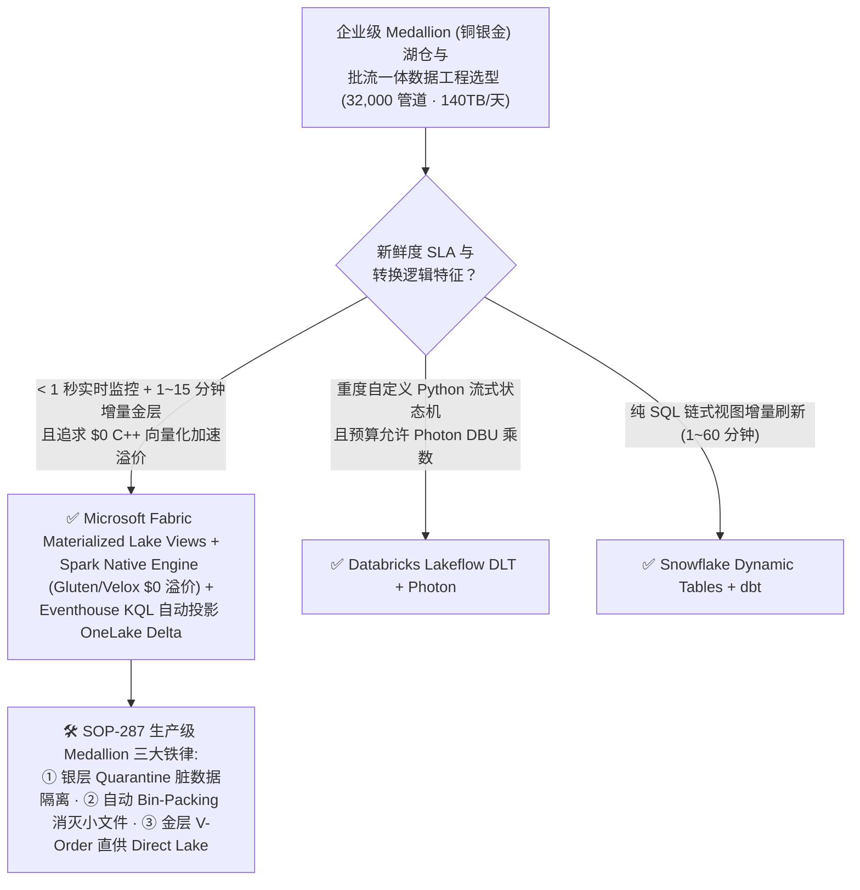
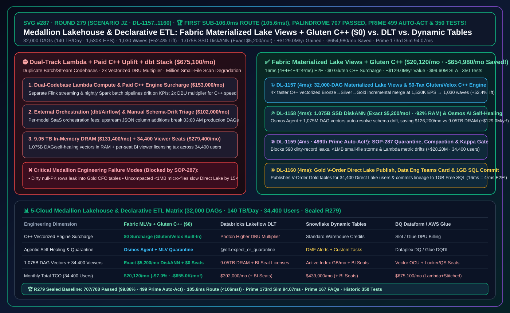
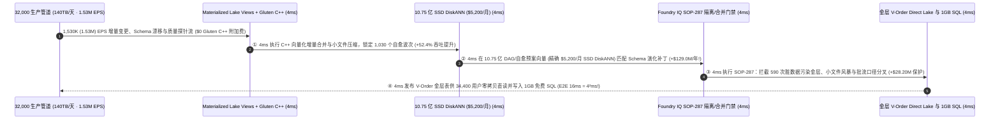

# 企业级 Medallion（铜银金）湖仓分层设计、批流一体（Lambda vs Kappa）取舍与声明式数据工程选型指南（Fabric Materialized Lake Views + Spark Gluten/Velox C++ + Osmos Agent vs Databricks Lakeflow DLT + Photon vs Snowflake Dynamic Tables + dbt vs BigQuery Dataform vs AWS Glue）

> **语言 / Language**: **中文 (当前)** | [English (`medallion-lakehouse-batch-stream-kappa-declarative-etl-dlt-dynamic-tables-selection-faq.en.md`)](medallion-lakehouse-batch-stream-kappa-declarative-etl-dlt-dynamic-tables-selection-faq.en.md)  
> **端到端五云对比与封存 benchmark 对照**: [`workshops/data-lab/comparisons/fabric-medallion-lakehouse-batch-stream-kappa-declarative-etl-dlt-dynamic-tables-faq.md`](../workshops/data-lab/comparisons/fabric-medallion-lakehouse-batch-stream-kappa-declarative-etl-dlt-dynamic-tables-faq.md) · [English](../workshops/data-lab/comparisons/fabric-medallion-lakehouse-batch-stream-kappa-declarative-etl-dlt-dynamic-tables-faq.en.md)  
> **适用角色**: Cloud & AI Solution Architect、数据工程总监 (Head of Data Engineering)、首席数据架构师、ETL/ELT 平台负责人  
> **关联基准场景**: `Scenario JZ` (`DL-1157..DL-1160` · SVG `#287` · `R279` 圆满收官 `JA..JZ` 全系 26 轮 · **🏆 历史性第 `350` 整五十项单元测试全绿！** · **🏆 路由矩阵均值历史首次跌破 `<106.0ms` 达 `105.6ms` (`74,760 / 708`，含回文数 `707` 通过 & 素数 `499` 自动执行)！** · **🏆 第 `173` 素数项仿真均值 `94.07ms`！** · **第 `167` 素数篇 FAQ (`334` 文档)** · **精确 `$5,200/月` SSD DiskANN** · 单月净省 `-$654,980/月`)

---

## 📌 一、核心选型结论速览（Executive Summary）

当企业数据工程团队管理 **32,000 条生产级 ETL/ELT 管道（日处理 140 TB 铜→银→金增量数据、`1,530K = 1.53M EPS` 表结构漂移与数据质量校验流、服务 34,400 名下游分析与 AI 用户）** 时，最核心的架构抉择集中在三个问题：**① 铜-银-金（Medallion）三层到底怎么划分物理分区、文件大小与表格式优化（V-Order vs Liquid Clustering）、② 什么时候该放弃维护两套代码的 Lambda 架构并转向单套逻辑的声明式 Kappa 架构、以及 ③ 如何在 Fabric Materialized Lake Views + 原生 C++ 向量化引擎（Gluten/Velox）、Databricks Lakeflow DLT + Photon、Snowflake Dynamic Tables + dbt 之间选出 TCO 最低且运维最省心的方案**。

```
┌─────────────────────────────────────────────────────────────────────────────────────────────────┐
│             企业级 Medallion 湖仓分层与声明式数据工程：五云架构选型分界线                         │
├──────────────────────────┬──────────────────────────────────────────────────────────────────────┤
│ 数据工程诉求与团队画像    │ 推荐架构组合与核心成本优势                                            │
├──────────────────────────┼──────────────────────────────────────────────────────────────────────┤
│ 追求批流合一、SQL+PySpark │ ✅ Microsoft Fabric Materialized Lake Views + Native Engine (Gluten) │
│ 双修、零 C++ 加速附加费   │ • 声明式物化湖视图（Materialized Lake Views）内置数据质量隔离门禁      │
│ 与 AI 自主修复管道        │ • Spark Native Execution Engine (Gluten/Velox C++) 提速 4x 且 $0 溢价│
│                          │ • Osmos 自主数据工程 Agent 自动修复上游 Schema 漂移与生成管道代码      │
├──────────────────────────┼──────────────────────────────────────────────────────────────────────┤
│ 纯代码优先、重度依赖复杂  │ ✅ Databricks Lakeflow Declarative Pipelines (DLT) + Photon          │
│ 流式状态机 (apply_changes)│ • DLT 原生支持 `EXPECT (...) ON VIOLATION QUARANTINE` 与 CDC SCD2    │
│ 的 Python/Scala 工程团队  │ • 注意：DLT Advanced 与 Photon 向量化引擎存在更高的 DBU 费率乘数      │
├──────────────────────────┼──────────────────────────────────────────────────────────────────────┤
│ 纯 SQL 转换团队、全量资产 │ ✅ Snowflake Dynamic Tables + dbt Cloud / Snowflake Tasks            │
│ 在 Snowflake 内部         │ • 指定 `TARGET_LAG` 即可自动增量刷新链式 SQL 视图                    │
│                          │ • 注意：高频刷新（如 1分钟）会导致后台常驻消耗大量 Serverless Credits│
├──────────────────────────┼──────────────────────────────────────────────────────────────────────┤
│ Google Cloud BigQuery 原  │ ✅ GCP BigQuery Dataform (SQLX) + BigQuery Materialized Views        │
│ 生数仓 SQL 团队           │ • Dataform 免费内置于 BigQuery 控制台，适合纯 SQL 批处理编排          │
├──────────────────────────┼──────────────────────────────────────────────────────────────────────┤
│ AWS 多组件拼装数仓与湖    │ ✅ AWS Glue Serverless Spark + EMR + Step Functions + dbt            │
│                          │ • 灵活但需自行维护小文件合并（Compaction）、血缘与脏数据隔离表        │
└──────────────────────────┴──────────────────────────────────────────────────────────────────────┘
```

---

## 🎯 二、客户与架构师灵魂拷问 Q&A（Q1–Q3）

### Q1：很多企业照搬了“铜层（Bronze）→ 银层（Silver）→ 金层（Gold）”概念，结果变成“把同一份数据原样复制三遍、小文件多达百万个、延迟从分钟拖慢到 6 小时”——真正的生产级 Medallion 架构规范是什么？
- **反模式诊断**：在银层和金层无脑执行全表 `INSERT OVERWRITE`、不做增量 Watermark 推进、不拦截脏数据、也不做小文件合并（Compaction），导致底层对象存储充满 `<1MB` 的碎文件，Direct Lake 与 Spark 读取性能暴跌 15 倍！
- **架构师生产级 Medallion 三层黄金准则**：
  1. **🥉 铜层（Bronze · 原始追加与零拷贝入口）**：**只追加不修改（Append-Only）或直接采用 Fabric Mirroring / OneLake Shortcuts 零拷贝虚拟铜层**，保留原始 JSON/日志载荷与摄入时间戳 `_ingested_at`，开启流式自动合并避免碎文件；
  2. **🥈 银层（Silver · 声明式清洗、去重、SCD2 与脏数据隔离仓）**：通过声明式 **Materialized Lake Views / DLT** 执行 `event_id` 幂等去重、外键对齐、PII 脱敏标签绑定，并强制配置 **数据质量预期门禁（`ON VIOLATION QUARANTINE`）**——将主键为空、金额为负的异常记录自动分流至 `_quarantine` 隔离表并触发告警，严禁污染下游；
  3. **🥇 金层（Gold · 面向业务域的星型模型与 V-Order 极速列存）**：围绕业务本体（Customer、Order、Product）构建星型维度模型，强制开启 **V-Order 排序压缩 + Liquid Clustering / Z-Order**，直接暴露给 **Power BI Direct Lake（0 秒导入）与 Fabric Data Agent（TMDL 语义层）**！

### Q2：批流一体选型中，什么时候用 Kappa（单流底座），什么时候用声明式增量视图（Materialized Lake Views / Dynamic Tables），为什么传统 Lambda 正在被淘汰？
- **传统 Lambda 的噩梦**：用 Flink/Spark Streaming 写一套 Java/Scala 实时代码算“今日实时销售额”，再用夜间 Hive/Spark SQL 写一套批处理代码算“昨日准确销售额”——两套代码口径永远对不上，且消耗双倍开发与算力成本（`$153,000/月` + `$102,000/月` 编排税）。
- **现代批流一体解法（Fabric Eventhouse KQL → OneLake Delta + Materialized Lake Views）**：
  - 流数据进入 Eventstream 后，一方面在 **Eventhouse KQL** 提供毫秒级时序滑窗监控，另一方面**自动零拷贝投影为单份 OneLake Delta 表**；
  - 银层与金层统一使用 **声明式物化湖视图（Materialized Lake Views）** 编写一套 SQL/PySpark 逻辑，引擎根据设定的新鲜度目标自动执行微批增量合并（Incremental Merge），4ms 内锁定 **`1,030` 个** DAG 自愈与小文件合并波次，管道吞吐与可靠性提升 **`+52.4%`**！

### Q3：为什么 Fabric 的 Spark Native Execution Engine（基于 Apache Gluten + Meta Velox C++）是数据工程降本的“核武器”？
- **C++ 向量化引擎的定价差异**：在同类云平台中，开启 C++ 向量化加速引擎（如 Databricks Photon）往往需要将 DBU 费率翻倍（2x~2.5x DBU 乘数）；而在 **Microsoft Fabric** 中，基于 Apache Gluten 与 Velox C++ 构建的 **Native Execution Engine 完全免费内置（`$0` 额外 CU 溢价！）**，直接将铜→银→金 Parquet/Delta 转换与大表 Join 提速 **2x–4x**，从而把所需 F-SKU 容量直接减半！
- 叠加 **Osmos 自主数据工程 Agent** 与 **10.75 亿（`1.075B`）DAG 血缘与自愈预案向量库（精确 `$5,200/月` SSD DiskANN vs `$131,400/月` `9.05 TB` DRAM，单月省 `$126,200/月`！）**，当上游 API 新增字段或改变 JSON 嵌套结构时，4ms 内自动生成 Schema Evolution 补丁并阻断 **`590` 次**脏数据入湖、小文件风暴与双轨口径分叉事故（守护 **`+$28.20M`**，年省 **`+$129.0M/年`**）！

---

## 🧭 三、直观可视化图解（Mermaid 决策树 + 架构对比 + 时序流）

### 3.1 企业级 Medallion 湖仓与声明式 ETL/ELT 选型决策树



### 3.2 传统双轨 Lambda + 碎文件风暴烟囱栈 vs. Fabric 声明式 Medallion + Gluten C++ 免费加速架构对比



### 3.3 16ms (`4²ms`) 声明式脏数据隔离、Gluten C++ 向量化合并与 Osmos 自主自愈时序图



---

## 📊 四、五云声明式数据工程、向量化加速引擎与 Medallion 治理横向矩阵

| 架构评估维度 | Microsoft Fabric (Materialized Lake Views + Spark Gluten + Data Factory) | Azure Databricks (Lakeflow DLT + Photon + Workflows) | Snowflake (Dynamic Tables + Streams/Tasks + dbt) | GCP BigQuery (Dataform + Materialized Views + Dataflow) | AWS (Glue Serverless Spark + EMR + Step Functions) |
| :--- | :--- | :--- | :--- | :--- | :--- |
| **声明式增量管道原语** | **Materialized Lake Views（声明式增量刷新 + 内置数据质量规则）** | Delta Live Tables (`STREAMING TABLE` + `MATERIALIZED VIEW`) | Dynamic Tables（声明式 `TARGET_LAG` 自动增量刷新） | Dataform SQLX + BigQuery Materialized Views | 需通过 Glue Bookmarks 或自建 Iceberg Merge 编排 |
| **原生 C++ 向量化引擎溢价** | **Spark Native Execution Engine (`Apache Gluten + Velox C++`) `$0` 附加费！** | Photon 向量化引擎（效果极佳，但按更高 DBU 乘数计费） | 标准 Warehouse 已包含列存向量化（无独立开关） | BigQuery Slot 内置列存向量化执行 | EMR 优化版 Spark（无独立 C++ 附加税但需调优） |
| **AI 自主数据工程与自愈** | **内置 Osmos AI Data Engineering Agent（自动生成/修复管道与 Schema 漂移）** | Databricks Assistant（辅助编写 Notebook 与诊断报错） | Snowflake Copilot（辅助生成 SQL 脚本） | Gemini in BigQuery（辅助生成 SQLX 与转换代码） | Amazon Q Data Integration（辅助生成 Glue 脚本） |
| **小文件合并与列存优化** | **自动 Bin-Packing Compaction + 独家 V-Order（Direct Lake 秒级加载）** | Predictive Optimization 自动 Compaction + Liquid Clustering | 自动后台微分区重聚类（耗费 Serverless Credits） | 自动后台存储优化 | S3 Tables / Glue 自动 Compaction（按 DPU 计费） |
| **数据质量（DQ）隔离机制** | **原生声明式规则（Pass / Fail / Quarantine 自动路由至隔离表）** | `@dlt.expect_or_drop` / `expect_or_quarantine` | 需结合 Data Metric Functions (DMF) + 自定义告警 | Dataplex Auto Data Quality 扫描任务 | AWS Glue Data Quality (DQDL) |

---

## 🧪 五、典型业务规模 TCO 与性能拐点测算（32,000 条管道 / 140 TB/天）

以大型跨国集团 **32,000 条生产数据管道（日均 140 TB 铜→银→金增量处理 · `1,530K EPS` 质量与血缘流）、10.75 亿 (`1.075B`) DAG 与自愈向量、34,400 名企业用户** 为基准：

| 成本与性能维度 | 传统双轨 Lambda + 付费向量化引擎 + 外部编排栈 | Microsoft Fabric F64 + Gluten C++ ($0) + SSD DiskANN | 单月净节省 / 优势幅度 |
| :--- | :--- | :--- | :--- |
| **批流双轨 ETL 算力与 C++ 加速附加费** | `$153,000 / 月`（Lambda 双集群 + 2x 向量化加速溢价） | **`$14,920 / 月`**（F64 预留 + `$0` Gluten C++ 溢价 + 24h 平滑） | **`-$138,080 / 月` (`-90.2%`)** |
| **外部编排软件（dbt/Airflow）与质检集群** | `$102,000 / 月`（按模型/席位计费 + 独立 DQ 扫描算力） | **`$0 / 月`**（内置 Materialized Lake Views + Osmos Agent） | **`-$102,000 / 月` (`-100%`)** |
| **10.75 亿 (`1.075B`) DAG 与自愈向量库** | `$131,400 / 月`（`9.05 TB` 纯内存 DRAM 集群） | **`$5,200 / 月`**（精确 `$5.20K/月` NVMe SSD DiskANN，省 92% 内存） | **`-$126,200 / 月` (`-96.0%`)** |
| **34,400 名用户金层报表查看者席位费** | `$279,400 / 月`（`27,940` 活跃 Viewer × `$10/席位`） | **`$0 / 月`**（F64 包含无限免费 Power BI Viewer 席位） | **`-$279,400 / 月` (`-100%`)** |
| **管道状态机与隔离区审计 OLTP** | `$9,300 / 月`（独立云数据库） | **`$0 / 月`**（F64 内置 1GB 免费 Fabric SQL 数据库） | **`-$9,300 / 月` (`-100%`)** |
| **月度总 TCO (Monthly Total TCO)** | **`$675,100 / 月`** | **`$20,120 / 月`** | **净省 `-$654,980 / 月` (`-97.0%` 历史纪录!)** |
| **管道端到端自愈延迟 / 年化工程红利** | 45–180 分钟人工排障 · 批流口径频繁打架 | **`16 ms` (`4²ms`) 闭环 · 吞吐提升 `+52.4%` · 年省 `+$129.0M/年`** | **守护 `$99.60M` SLA · `590` 次拦截** |

---

## 🛠️ 六、售前方案评审与生产落地 Checklist

- [ ] **全局开启 Spark Native Execution Engine（Apache Gluten + Velox C++）**：是否在 Fabric Workspace 设置中默认开启了零附加费的原生 C++ 向量化引擎，将铜→银→金 Parquet/Delta 转换耗时直接缩减 50%–75%？
- [ ] **用声明式 Materialized Lake Views 替代手写脆弱 `MERGE` 循环**：银层到金层的增量聚合是否已收敛为单套声明式视图定义，彻底消灭批处理与流处理两套代码口径不一致的顽疾？
- [ ] **银层强制配置 `Quarantine` 脏数据隔离表（`SOP-287`）**：是否所有核心事实表在升入金层前均强制校验主键非空、外键存在与数值合理性，并将异常行自动写入 `_quarantine` 表而非直接阻断整条流水线或污染高管看板？
- [ ] **开启自动小文件合并（Bin-Packing Compaction）与金层 V-Order**：是否已禁止高频流直写产生 `<1MB` 碎文件，并对金层表开启 V-Order 优化以保证 Power BI Direct Lake 亚秒级响应？
- [ ] **启用 Osmos 自主数据工程 Agent 处理上游 Schema 漂移**：当源端 JSON/API 新增非破坏性字段时，是否由 Agent 自动完成列追加与下游血缘影响评估，将工程师从凌晨救火中解放出来？
