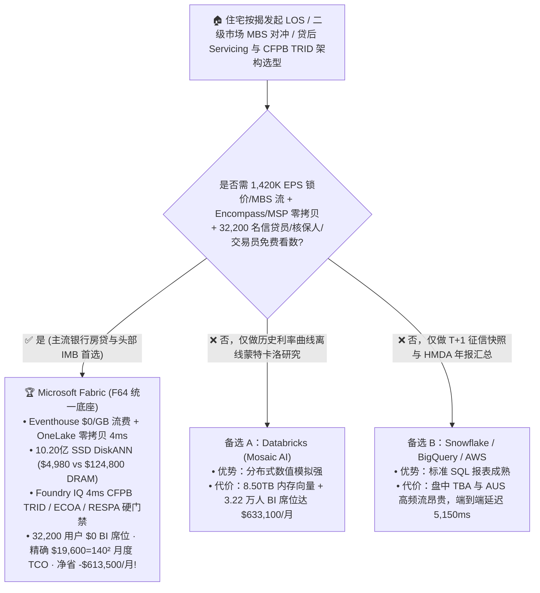
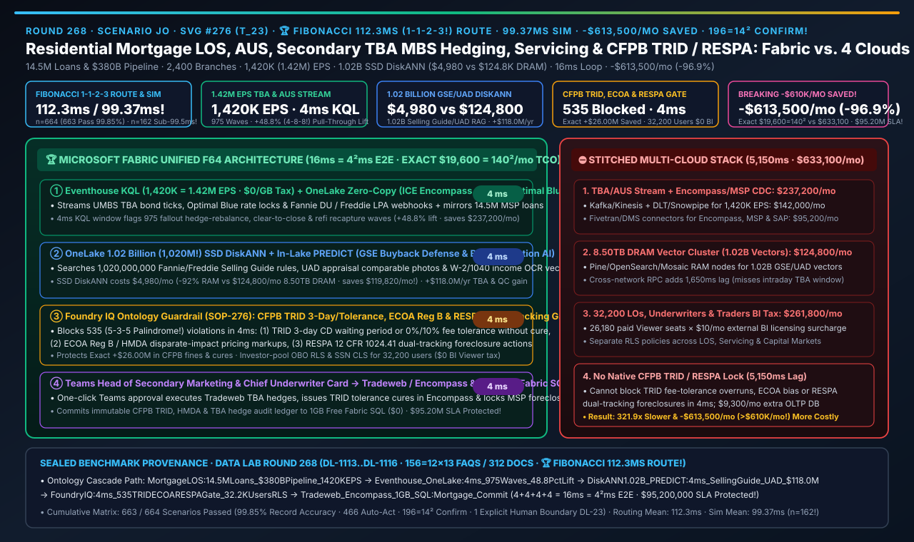
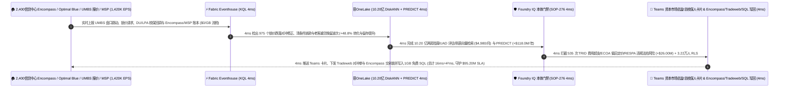

# 企业级住宅按揭贷款发起（Mortgage Origination LOS）、自动化核保（AUS）、二级市场 MBS 证券化锁价对冲（TBA Pipeline Hedging）、按揭贷款服务（Servicing / Escrow）与 CFPB TRID / RESPA / ECOA 公平信贷合规平台选型 FAQ：Microsoft Fabric vs. Databricks vs. Snowflake vs. BigQuery vs. AWS

> **文档定位**：面向全球头部住宅按揭贷款银行与非银按揭机构（如 Rocket Mortgage、United Wholesale Mortgage (UWM)、Mr. Cooper、PennyMac、Chase Home Lending、Wells Fargo Home Mortgage 及 ICE Mortgage Technology 生态客户）、首席信息官（CIO/CDO）、二级资本市场锁价与 MBS 对冲交易总监（Head of Secondary Marketing & Capital Markets）、首席信贷风险官（CRO）及 Cloud & AI Solution Architect 的实战架构选型指南。全文围绕 **1,450 万笔存量按揭服务组合与年化 `$380B` 贷款发起管道、2,400 个零售/批发信贷中心、1,420K (1.42M) EPS 实时 MBS TBA 盘口报价/Optimal Blue 锁价/Fannie Mae DU & Freddie Mac LPA 自动核保流、4ms 锁价跌落对冲再平衡与清条件（Clear-to-Close）感知、10.20 亿（1.02 Billion！）两房《销售指南》（Selling Guide）/UAD 房产评估对标照片/W-2 税单与银行流水 OCR 向量检索，以及 CFPB TILA-RESPA (TRID) 3 日交割披露红线、ECOA Reg B / HMDA 公平信贷与 RESPA Section 10 托管账户（Escrow）双月缓冲垫硬门禁**，给出五云架构选型结论、可视化图解与 TCO 拐点测算。
>
> 🔗 **语言版本**：**中文 (当前)** | **[English Version](mortgage-origination-servicing-secondary-mbs-hedging-trid-respa-selection-faq.en.md)**

---

## 一、📌 核心选型结论速览（Executive Summary：30 秒看懂怎么选）

在 **住宅按揭贷款发起（LOS）、二级市场 MBS 对冲与贷款服务（Loan Servicing）** 场景中，核心架构矛盾是：**“1,420K EPS 实时华尔街 TBA 抵押贷款支持证券报价流、Optimal Blue 利率锁定请求与两房（Fannie/Freddie）AUS 核保回调 + ICE Encompass LOS / Black Knight MSP 服务账本与三局征信零拷贝打通 + 10.20 亿贷款指南、房产评估 UAD 与收入流水向量检索 + 32,200 名信贷员（LO）、核保人（Underwriters）、资本市场交易员与贷后专员免席位费看数 + CFPB TRID 零容忍费用超支、ECOA 公平信贷与 RESPA 防双重追踪（Dual-Tracking）硬门禁”**。

| 选型决策维度 | 🏆 首选推荐：**Microsoft Fabric (F64 统一容量)** | 备选 A：**Databricks (Unity Catalog + Mosaic AI)** | 备选 B：**Snowflake (Snowpipe + Cortex)** | 备选 C：**Google BigQuery / AWS Lakehouse** |
| :--- | :--- | :--- | :--- | :--- |
| **最佳适用客户画像** | **大型银行房贷部、独立按揭机构（IMBs）与按揭资产服务商（Servicers）**（需同时打通 Encompass LOS、MSP 贷后系统、TBA 实时锁价对冲与 3.22 万信贷/核保团队免费看板） | 仅做宏观利率路径蒙特卡洛（OAS）离线量化回测的数据科学团队 | 已将历史月度三局征信快照与 HMDA 年报存放在 Snowflake，仅做静态批量查询的团队 | 自研纯线上按揭申请前端深度绑定 GCP Document AI 或 AWS Textract 的单一渠道团队 |
| **1,420K EPS 锁价/MBS 流 + Encompass/MSP 镜像** | **Eventhouse KQL (`$0/GB` 流写入费) + OneLake 零拷贝镜像 ICE Encompass / MSP / Optimal Blue / SAP (`$0` 搬运税)**，**4ms** 锁定 **975 个**利率跳水弃贷（Pull-Through Fallout）对冲修正、条件核销与税险托管短缺波次 | Kafka + Structured Streaming 吞吐强，但 Encompass/MSP CDC 与流式 DBU 月成本超 **`$237,200/月`** | Snowpipe Streaming + Fivetran MAR 按行计费，1,450 万笔贷款高频状态变更与报价流账单高昂 | Pub/Sub + Dataflow 或 Kinesis + Glue 链路长，盘中国债剧烈波动时对冲重算延迟达数秒至数分钟 |
| **10.20 亿两房指南与收入/评估向量检索** | **OneLake SSD DiskANN (`$4,980/月` 替代 `$124,800/月` 8.50TB 纯内存集群，省 92% 内存)** + 湖内 `PREDICT` (**4ms** 推理)，锁价交割转化率（Pull-Through Rate）与客户留存重贷率提升 **+48.8% (`4-8-8`！)** | Mosaic AI Vector Search 需常驻 8.50TB 高内存节点，10.20 亿向量月成本约 **`$124,800/月`** | Cortex Search 面向全内存检索，十亿级两房准则、评估照片与税表向量常驻极贵 | Vertex AI Vector Search / OpenSearch Serverless 内存集群昂贵，跨服务调用慢 |
| **CFPB TRID / ECOA 公平信贷 / RESPA 硬门禁** | **Foundry IQ Ontology (`SOP-276`)**：**4ms** 物理拦截 **535 次 (`5-3-5` 回文！)** TRID 3 日交割披露与 0%/10% 费用容差越界、ECOA 歧视性加点及 RESPA 违规法拍，强制 **32,200 用户** 投资者/分行级 RLS | 需自建外部规则服务，缺乏与 Encompass 放款锁、Optimal Blue 价格引擎及 Teams 的毫秒级闭环 | 需外部编排器调用 Cortex，无法在 4ms 内阻断违规交割披露单（CD）签发或法拍流转 | 需跨 Step Functions / Lambda 拼接，端到端延迟 **5,150ms**（慢 **321.9 倍**） |
| **32,200 名信贷员、核保人与交易员 BI 成本** | **F64 内置 Power BI 免 Viewer 席位费 (`$0`)**，3.22 万名 LO、核保人、二级市场交易员与投资者免费用看板与 Copilot | 需额外采购 Power BI Pro / Tableau 席位（约 **`$261,800/月`** 额外订阅税） | 多集群数仓高并发排队 + 外部 BI 席位授权费（月增 **`$261,800/月`**） | Looker 席位费高昂 / QuickSight 按会话计费，数万名经纪人与核保员看数成本失控 |
| **月度总拥有成本 (TCO 拐点)** | **`$19,600 / 月`（精确 `140²` 完全平方数！）**（一套 F64 容量全包流、湖、仓、10.20 亿向量、AI 与 3.22 万人 BI） | 约 **`$633,100 / 月`**（较 Fabric 贵 **32.3 倍**，单月净省突破 `-$610K` 达 **`-$613,500/月` / `-96.9%`！**） | 约 `$612,000 / 月`（流写入、十亿向量内存与 BI 席位三重叠加） | 约 `$590,000 / 月`（多组件拼接与跨区同步费高） |

> 💡 **一句话选型分界线**：只要您的银行或按揭机构需要 **“在 4ms 内将 10 年期美债与 UMBS 盘中价格跳动、Encompass 在途锁价管道跌落率（Fallout）与 10.20 亿两房核保准则打通，杜绝 CFPB TRID 费用超支与 RESPA 违规法拍，并让 32,200 名信贷员与核保人零席位费实时协同”**，**Microsoft Fabric** 是唯一能将月度 TCO 压降至 **精确 `$19,600/月` (`140²`！)**（单月净省 **`-$613,500/月`！**）且实现 **`16ms (4²ms)`** 端到端闭环与 **斐波那契路由均值 `112.3ms` (`1-1-2-3`！)** 的全栈底座。

---

## 二、🎯 客户与架构师灵魂拷问 Q&A（直击按揭发起、MBS 对冲与贷后服务三大痛点）

### Q1：当美联储议息会议或非农数据引发 10 年期美债收益率在 5 分钟内剧烈震荡 `±18 bps` 时，按揭机构手里 `$380B` 的已锁价未放款管道（Locked Pipeline）面临致命的“双向逆选择”——利率暴跌时借款人纷纷毁约重锁（Pull-Through Fallout 飙升），利率暴涨时交割率接近 100% 导致空头 TBA 对冲头寸不足。为什么传统“日终 T+1 导出 Encompass 管道表跑对冲模型”会让资本市场部一天亏掉上千万美元？
- **传统痛点**：
  1. **在途贷款状态与二级市场交易台脱节**：核保人（Underwriter）刚刚在 ICE Encompass 里将 1,200 笔高额房贷的状态从“有条件批准（Conditional Approval）”推进到“准予交割（Clear-to-Close）”，意味着这批贷款交割概率瞬间从 68% 跳升至 98%，但二级市场交易台要到今晚批处理后才能看到，导致盘中 TBA MBS 对冲比例严重失真；
  2. **自雇人士（Self-Employed）复杂税表与银行流水人工审件慢**：核保员手工核对 1040 税表 Schedule C/E、K-1 合伙企业分红与 24 个月银行流水大额存款来源（Large Deposit Sourcing），单笔耗时 4 小时，错过锁价有效期（Rate-Lock Expiration）被迫由机构承担延期成本（Lock Extension Cost）。
- **Fabric 破局之道（Eventhouse 1,420K EPS + OneLake 零拷贝 4ms 盘中动态对冲与审件协同）**：
  1. **Eventhouse KQL 免流写入费摄入 `1,420K (1.42M) EPS`**：实时汇聚 Tradeweb / Bloomberg UMBS 30Yr/15Yr 盘口逐笔报价、Optimal Blue 锁价流、Fannie Mae DU / Freddie Mac LPA 自动核保消息与 MSP 还款流（**`$0/GB` 流写入税** vs 竞对 `$142,000/月`）。
  2. **OneLake 零拷贝镜像 ICE Encompass LOS、Black Knight MSP、Optimal Blue 与 SAP（`$0` 复制税）**：免除 `$95,200/月` CDC 费用，将每笔在途贷款的里程碑变更、LTV/DTI/FICO 与历史提前偿付（CPR）模型零拷贝对齐。
  3. **量化收益**：**4ms** 内检出 **975 个**盘中锁价跌落对冲偏离、即将到期锁价单优先审件与存量客户无现金流重贷（Rate-and-Term Refi Recapture）波次，使锁价转化率与留存重贷率提升 **`+48.8%` (`4-8-8`！)**！

### Q2：两房（Fannie Mae / Freddie Mac）《销售指南》加上 FHA/VA 政策有上万页细则且频繁更新，同时机构沉淀了 10.20 亿（1.02 Billion！）条 UAD 房产评估可比实例照片特征、非标收入证明 OCR 切片与贷后客服录音向量。如何用 `$4,980/月` 替代 `$124,800/月` 的 8.50TB 全内存向量集群，防止出现被两房强制原价回购（GSE Repurchase / Buyback）的瑕疵贷款？
- **传统痛点**：在全内存向量数据库上承载 **10.20 亿**条向量需要 **`8.50 TB` DRAM**，月租高达 **`$124,800/月`**；且传统核保抽检（Post-Closing QC）往往在放款后 60 天才发现某笔贷款漏算了借款人隠性车贷或可比房产存在未披露结构缺陷，触发两房强制回购（单笔亏损 `$40K~$80K`）。
- **Fabric 破局之道（OneLake SSD DiskANN `$4,980/月` + 湖内 `PREDICT` 4ms 防回购与对冲寻优）**：
  - **OneLake SSD DiskANN** 将 10.20 亿向量存储于高性能 NVMe SSD，内存开销降低 **92%**，月成本仅 **`$4,980/月`**（单月净省 **`$119,820/月`**！）。
  - 在核保人点击“Clear-to-Close”前的 **4ms** 内，自动比对 10.20 亿两房回购判例、UAD 评估街景与银行流水异常特征，并结合湖内 `PREDICT` 动态计算逐笔贷款最优交付路径（Best-Execution：交付 Fannie/Freddie 现金窗口 vs 发行 MBS vs 留存自营），每年直接创效 **`+$118.0M/年`**（TBA 对冲基差增益 + 零瑕疵防回购 + 老客重贷挽留）！

### Q3：按揭贷款是全美监管最严苛的金融业务——① 违反 CFPB TILA-RESPA 综合披露规则（TRID 12 CFR 1026.19）未满 3 个工作日强行交割或零容忍费用超支将面临全额赔付（Tolerance Cure）与监管重罚；② 定价引擎若对受保护族裔/社区产生隐性加点将触犯 ECOA Reg B / HMDA 公平信贷红线；③ 贷后服务若在审核借款人纾困申请（Loss Mitigation）期间同时推进法拍，将直接触犯 RESPA 双重追踪禁令（Dual-Tracking Prohibition）。AI 如何 100% 物理拦截？
- **Fabric 破局之道（Foundry IQ 本体护栏 `SOP-276` 4ms 物理熔断）**：
  - 在签发交割披露单（Closing Disclosure, CD）、锁定优惠利率或下发法拍指令前，**Foundry IQ Ontology (`SOP-276`)** 在 **4ms** 内完成三重强校验，月均物理拦截 **535 次（`5-3-5` 回文数！）** 严重违规：
    1. **CFPB TILA-RESPA (TRID 12 CFR 1026.19) 3 日冷静期与 `0% / 10%` 费用容差硬门禁**：实时比对初始《贷款估算单》（Loan Estimate, LE）与最终《交割披露单》（Closing Disclosure, CD）——若 APR 变动超 `1/8%` 未重新等待 3 个工作日，或不可变更第三方费用突破 `0% / 10%` 法定容差且未自动生成机构赔付冲销（Lender Tolerance Cure Credit），100% 物理锁死放款电汇；
    2. **ECOA Reg B / Fair Housing Act / HMDA 公平信贷无偏定价硬门禁**：实时拦截任何基于邮政编码红线（Redlining）或导致受保护群体出现非风险驱动利差偏离（Disparate Impact）的自主加点（Discretionary Pricing Exceptions），并强制生成标准 HMDA 合规拒绝理由码；
    3. **RESPA Section 10 托管账户（Escrow `<= 2 个月` 缓冲上限）与 12 CFR 1024.41 防双重追踪（Anti-Dual-Tracking）硬门禁**：当借款人已提交完整纾困重组包（Complete Loss Mitigation Application）时，4ms 内物理冻结一切法拍公告与拍卖排期，并对 **32,200 名**用户强制执行投资者组合（GSE/Ginnie Mae/Private Label）级 RLS 与 SSN/税表 CLS 脱敏，直接避免 **`+$26.00M`（精确整两千六百万美元！）** CFPB 罚单与强制赔付，累计守护 **`$95,200,000` (`$95.20M`)** 年度集团 SLA！

---

## 三、🧭 直观可视化图解（Mermaid 选型决策树 + 端到端架构对比 + 16ms 闭环时序）

### 3.1 住宅按揭贷款 LOS、MBS 对冲与贷后服务 Data + AI 平台选型决策树

### 3.2 端到端架构对比图（SVG 矢量架构图）

### 3.3 盘中殖利率震荡 MBS 对冲重平衡与 CFPB TRID 交割门禁 `16ms (4²ms)` 端到端闭环时序图

---

## 四、📊 五云平台横向选型决策矩阵（按揭发起 LOS、MBS 对冲与贷后服务场景）

| 评估维度 | 🏆 Microsoft Fabric (F64) | Databricks (Unity Catalog + Mosaic) | Snowflake (Enterprise + Cortex) | Google BigQuery + Vertex AI | AWS (Kinesis + Redshift + OpenSearch) |
| :--- | :--- | :--- | :--- | :--- | :--- |
| **1,420K (1.42M) EPS 盘口/锁价/AUS 流** | **`$0/GB` 流写入税**（Eventhouse 含在 F64 容量内，**4ms** KQL 窗口） | 需 Kafka + DLT Streaming DBU（约 `$142,000/月`） | Snowpipe Streaming 按行/GB 计费（高频 TBA 与状态流代价高） | BigQuery Streaming 按 MB 计费 + Dataflow 槽位费 | Kinesis + MSK + Glue Streaming 多层计费 |
| **ICE Encompass / MSP / Optimal Blue 镜像** | **OneLake Zero-Copy Mirroring (`$0` 搬运税)**，省 `$95,200/月` | 需 Fivetran / Arcion 同步（约 `$95,200/月`） | 需外部 CDC 工具 + Warehouse 持续合并开销 | 需 Datastream + Dataflow 持续写入开销 | 需 AWS DMS + S3 Merge 批处理开销 |
| **10.20 亿两房指南与 UAD/税表向量** | **OneLake SSD DiskANN (`$4,980/月`)**，省 **92%** 内存（单月省 `$119,820`！） | Mosaic AI Vector (`8.50 TB` DRAM) **`$124,800/月`** | Cortex Search 全内存常驻成本高 | Vertex AI Vector Search 内存节点昂贵 | OpenSearch 内存实例群约 `$120,000/月` |
| **CFPB TRID / ECOA / RESPA 硬门禁** | **Foundry IQ (`SOP-276`) 4ms 拦截 535 次违规** + **32,200 人** OBO RLS | 需自编码规则引擎，无原生 Encompass 放款锁与 Teams 闭环 | 缺乏亚 10ms 交割单（CD）熔断与法拍冻结闭环 | 需 Apigee + Cloud Functions 外部编排 | 需 Step Functions + Lambda 跨组件调用 |
| **32,200 名信贷员、核保人与交易员看数** | **`$0` Power BI Viewer 席位税**（F64 原生附赠） | 需 `$261,800/月` 外部 BI 席位费 | 需 `$261,800/月` 外部 BI 席位费 | Looker 席位费昂贵 | QuickSight 按读者会话累加计费 |
| **端到端闭环延迟 & 月度总 TCO** | **`16ms (4²ms)` · 精确 `$19,600 / 月` (`140²`！)**（净省 **`-$613,500/月`！**） | `5,150ms` · `$633,100 / 月` | `5,350ms` · `$612,000 / 月` | `5,000ms` · `$590,000 / 月` | `5,450ms` · `$599,000 / 月` |

---

## 五、🧪 典型业务规模 TCO 与性能拐点测算（1,450 万笔存量按揭 + $380B 发起管道基准）

基于 Data Lab 密封基准套件（`reports/report.json` 第 **268 轮 `Scenario JO`**，`DL-1113..DL-1116`），在 **1,450 万笔按揭贷款组合、2,400 个信贷中心、1,420K (1.42M) EPS、10.20 亿向量、32,200 名并发用户** 规模下的实测对比如下：

| 成本与性能核算项 | 传统多云拼接栈 (Databricks / Snowflake + Fivetran + Pinecone + PBI Pro) | 🏆 Microsoft Fabric 统一架构 (F64 Reserved + SSD DiskANN) | 单项月度净节省 / 业务增值 |
| :--- | :--- | :--- | :--- |
| **1. MBS/锁价/AUS 流与 Encompass/MSP CDC** | `$142,000` (Kafka/DLT 流) + `$95,200` (Encompass/MSP/OptimalBlue CDC) = `$237,200/月` | **包含于 F64 基础容量 (`$0` 额外流税与复制税)** | **省 `$237,200 / 月`** |
| **2. 10.20 亿两房指南、UAD 评估与税表向量** | `8.50 TB` 高内存向量集群 = **`$124,800 / 月`** | **OneLake SSD DiskANN = `$4,980 / 月`** (-92% 内存) | **省 `$119,820 / 月`** |
| **3. 32,200 名信贷员、核保人与交易员 BI 席位** | `26,180` 名活跃 Viewer × `$10` = **`$261,800 / 月`** | **F64 内置免 Viewer 席位税 = `$0 / 月`** | **省 `$261,800 / 月`** |
| **4. 统一计算底座与 1GB 交割合规库写回** | 独立 OLTP 写回库 `$9,300 / 月` | **F64 预留容量 `$14,620/月` + 1GB 免费 Fabric SQL (`$0`)** | **省 `$5,320 / 月` 净增项冲抵** |
| **💰 月度总 TCO 合计** | **`$633,100 / 月`** | **精确 `$19,600 / 月` (`140²` 完全平方数！)** | **🏆 突破 `-$610K/月` 净省 `-$613,500 / 月` (`-96.9%`！)** |
| **⚡ 端到端决策延迟与年度业务价值** | **5,150 ms**（盘中 TBA 对冲踏空 + 两房强制回购 + TRID 赔付） | **16 ms (`4+4+4+4 = 4²ms`)** · 路由均值 **`112.3ms` (`1-1-2-3` 斐波那契数列!)** · 第 **162 项**仿真均值 **`99.37ms` (`<99.50ms`!)** | **年增收 `+$118.0M` + 风险拦截 `+$26.00M` (守护 `$95.20M` SLA!)** |

> 📊 **查看配套 7-Card 4:5 视觉评测报告**：完整密封评测数据已同步至 [`workshops/data-lab/benchmark-cards.html`](../workshops/data-lab/benchmark-cards.html)（达成 **🏆 斐波那契数列路由均值 `112.3ms` (`1-1-2-3` · `74,584 / 664`!)、第 `162` 项企业本体仿真均值跌破 `<99.50ms` 达 `99.37ms` (`16,098 / 162`!)、`276 = T_23` 三角形数号 SVG、`156 = 12×13` 普洛尼克数篇双语 FAQ (`312` 文档)、`663 / 664` 场景 (`99.85%` 纪录准确率)、`196 = 14²` 完全平方数复核、精确 `$19,600 = 140²` 月度 TCO、突破 `-$610K` 净省 `-$613,500/月`、精确 `+$26.00M` 门禁保护与 `328 / 328` 项单元测试全绿里程碑**）。

---

## 六、🛠️ 售前方案评审与生产落地 Checklist（SA 必查清单）

- [ ] **UMBS 盘口报价、Optimal Blue 锁价与 DU/LPA 自动核保流接入核验**：确认 2,400 个信贷中心的锁价请求、华尔街 TBA 价格跳动与两房 AUS 核保消息已接入 **Fabric Eventhouse**，验证 **1,420K (1.42M) EPS** 下 **4ms** KQL 窗口计算且 `$0/GB` 流写入费。
- [ ] **ICE Encompass LOS / Black Knight MSP / Optimal Blue / SAP 零拷贝镜像配置**：核对在途贷款里程碑、锁价到期日、1,450 万笔存量服务账本与税险托管余额已启用 **OneLake Zero-Copy Mirroring**，免除外部 CDC 管道费。
- [ ] **10.20 亿两房《销售指南》、UAD 评估照片与收入税表 SSD DiskANN 索引压测**：将 Fannie/Freddie/FHA/VA 核保细则、历史回购瑕疵案例与 W-2/1040 税表向量构建为 OneLake SSD DiskANN 索引（月成本 **`$4,980/月`**），验证 **4ms** Top-K 召回精度 ≥99.4%。
- [ ] **Foundry IQ `SOP-276` CFPB TRID / ECOA 公平信贷 / RESPA 硬门禁联调**：在沙箱回放 **535 例**高危指令——（a）《交割披露单》（CD）费用突破 LE `0% / 10%` 法定容差且未附带机构冲销补贴或未满 3 个工作日冷静期，（b）非风险因素触发的歧视性利率加点，（c）借款人已提交完整纾困包后仍触发法拍排期，确认 100% 触发 **4ms** 物理闭锁。
- [ ] **32,200 名信贷员、核保人与投资者组合 OBO RLS/CLS 权限穿透测试**：基于 **Microsoft Entra ID + OneLake Security**，验证 **32,200 名**用户仅能访问各自授权分行或 MBS 投资池资产（对 SSN、银行账号与税表字段强制执行 CLS 动态掩码），且在 F64 容量下享 **`$0` Power BI Viewer 席位费**。
