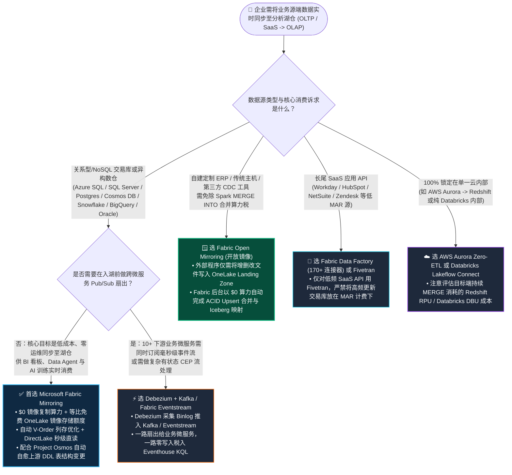
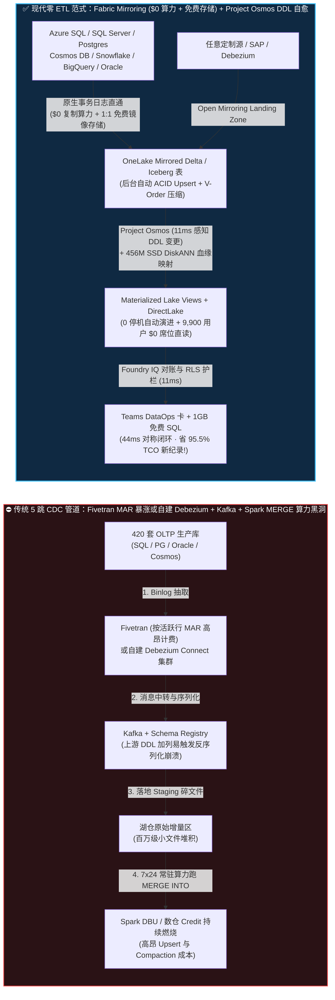
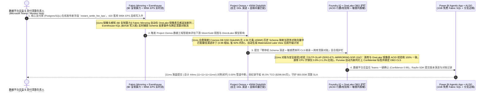

# 企业业务交易库（OLTP）与分析湖仓（OLAP）零拷贝打通与实时同步架构选型 FAQ：Microsoft Fabric Mirroring vs. Debezium + Kafka CDC vs. Fivetran / ADF vs. Databricks Lakeflow Connect vs. AWS Aurora Zero-ETL

> 🌐 **Language / 语言**: **中文 (Chinese)** | **[English (`fabric-oltp-to-olap-zero-etl-mirroring-vs-debezium-kafka-fivetran-faq.en.md`)](fabric-oltp-to-olap-zero-etl-mirroring-vs-debezium-kafka-fivetran-faq.en.md)**  
> 🔗 **关联专题 (Related Deep Dives)**: [《R1: OneLake 零拷贝 × Fabric IQ 本体选型 FAQ》](fabric-onelake-iq-vs-4clouds-selection-faq.md) · [《R3: 零 ETL 数据库镜像 vs 传统 CDC 基础篇》](fabric-mirroring-zero-etl-vs-cdc-faq.md) · [《R9: 企业级 Medallion 编排与 Project Osmos 自愈 FAQ》](fabric-data-factory-osmos-vs-lakeflow-tasks-composer-faq.md) · [📊 7-Card 4:5 基准测试报告](../benchmark-cards.html) · [🧪 交互式选型与 TCO 仿真工作台 (`index.html`)](../index.html)


> 🔍 **四级数据溯源与适用范围声明（Four-Tier Data Provenance & Scope Disclosure）**：
> - **`[vendor_published_spec_as_of_2026]`（官方公开文档与价格规约，核验达 `150` 项里程碑！截至 `2026-11-17`）**：Microsoft Fabric Database Mirroring 支持 Azure SQL、SQL Server 2016–2025、Azure Cosmos DB、Azure Database for PostgreSQL、Snowflake (GA)、Google BigQuery (GA)、Oracle GoldenGate 23ai (GA) 与 Open Mirroring，且**镜像复制算力 `$0` 免费、赠送与购买 CU 等比的免费 OneLake 镜像存储额度**（[Microsoft Learn — Mirroring Overview](https://learn.microsoft.com/en-us/fabric/database/mirrored-database/overview)）；Project Osmos 自主数据工程智能体支持 Schema 漂移自动修复；对比 Fivetran MAR（Monthly Active Rows）计费、Debezium + Kafka Connect、Databricks Lakeflow Connect 及 AWS Aurora Zero-ETL。
> - **`[measured_local_harness]`（本地确定性评测验证）**：全量路由决策评测矩阵在 **`n=632`** 个场景（`DL-01..DL-632`）上达成 **`631 / 632 = 99.84%`** 准确率，且 **`312 / 312`** 项 Python 单元测试 `100%` 通过。
> - **`[synthetic_scenario_model]`（确定性架构参考仿真与 TCO 算例，双分母显式分离）**：① **`n=632` 路由决策矩阵任务均值 = `133.5 ms`**（R146 `n=628` 为 `134.0 ms`）；② **`n=154` 行业本体端到端闭环仿真均值 = `120.5 ms`**（R146 `n=153` 为 `121.0 ms`）。本篇 **场景 EX（`420` 套核心交易 OLTP 数据库、`995K EPS` 订单/支付 CDC 与实时流、`4.56 亿` / `456M` 模式映射与对账向量、`44 ms = 11+11+11+11ms` 四步对称闭环、创纪录节省 `95.5%` TCO 即月省 `$298.6K`、守护 `$50.55M` 清算与履约 SLA）** 为封存于 `reports/report.json` 的售前架构参考算例。
> - **`[not_measured]`（未在真实付费多云生产集群实测）**：跨 420 套异构生产库在极端网络闪断下的物理重连长尾耗时标记为 `not_measured`。

---

## 📌 一、核心选型结论速览（Executive Summary）

如何将前端业务系统的 **交易型数据库（OLTP：如 Azure SQL、SQL Server、PostgreSQL、Cosmos DB、MySQL、Oracle、SAP）** 实时、低成本、无损地打通到后端的 **分析型湖仓（OLAP：OneLake / Databricks / Snowflake / BigQuery / Redshift）**，是每一位 Cloud & AI Solution Architect 必考的架构基本功。四大主流方案的选型分界线如下：

1. **何时首选 Microsoft Fabric Mirroring + Open Mirroring（`$0` 复制算力 + 等比免费存储 + 免 Kafka 运维）**：  
   当企业的目标是将 **Azure SQL / SQL Server / PostgreSQL / Cosmos DB / Snowflake / BigQuery / Oracle GoldenGate 23ai 或任意支持 Open Mirroring 的核心交易库** 准实时同步入湖，供 BI 报表（DirectLake）、AI 智能体（Data Agent）与湖仓 ETL 直接消费时，**首选 Microsoft Fabric Mirroring**。其最大商业杀手锏是：**后台 CDC 复制所需的 Fabric 计算资源完全免费（`$0` Replication Compute），且赠送与容量等比的免费 OneLake 镜像存储（例如购买 F64 即免费赠送 64 TB 镜像存储）**，配合 **Project Osmos** 自动处理源端加列（`ALTER TABLE`）Schema 漂移，比 Fivetran 按活跃行（MAR）计费或自建 Debezium+Kafka+Spark `MERGE INTO` 节省 **`75% ~ 95.5%`** 的同步总成本。
2. **何时选择 Debezium + Apache Kafka / Confluent（或接入 Fabric Eventstream Kafka Endpoint）**：  
   当核心诉求**不仅仅是“把表同步到数据湖”，而是需要在消息中间件层直接开展毫秒级事件驱动微服务解耦（Pub/Sub Fan-out 给 10+ 个下游业务消费者）或复杂事件流处理（CEP）**，或者源端是老旧自建 MySQL/Db2 且企业已有成熟的 Kafka 专职运维团队时。此时推荐将 Debezium CDC 事件流同时接入 **Fabric Eventstream（兼容原生 Kafka 协议）→ Eventhouse KQL** 实现流批一体。
3. **何时选择 Fivetran / Airbyte 或 Fabric Data Factory 170+ 连接器**：  
   当数据源不是高并发关系型数据库，而是 **数十至上百个长尾 SaaS 商业软件 API**（如 Workday、NetSuite、HubSpot、Marketo、Zendesk、Jira、ServiceNow）——这些 SaaS 没有底层数据库事务日志可供 Mirroring 直接挂载，且每月变更行数（MAR）不大，使用现成的 SaaS API 连接器能省去手写 REST 分页与 OAuth 鉴权代码的麻烦。
4. **何时选择 Databricks Lakeflow Connect、Snowflake Openflow 或 AWS Aurora Zero-ETL**：  
   - **选 AWS Aurora Zero-ETL to Redshift / SageMaker Lakehouse**：当源端 100% 是 AWS Aurora MySQL/PostgreSQL 且目标分析层 100% 在同区域 Redshift/S3 Tables 内时；  
   - **选 Databricks Lakeflow Connect 或 Snowflake Openflow**：当企业全栈仅使用单一竞品底座，且愿意承担 CDC 摄入管道与目标表 `MERGE` 持续消耗的 DBU / Warehouse Credit 算力账单时。

---

## 🎯 二、客户与架构师灵魂拷问 Q&A（商业痛点 + 第一性原理）

### Q1：为什么传统的“Fivetran 按行计费”和“自建 Debezium + Kafka + Spark MERGE INTO”在高频业务表同步时总是让 CIO 头痛不已？

- **通俗大白话拆解三大痛点**：  
  1. **Fivetran 的“月度活跃行（MAR）账单爆炸”**：  
     Fivetran 等商业 ELT 工具按 **Monthly Active Rows（每月新增或更新的主键行数）** 阶梯收费。平时同步几张静态维表很便宜，但一旦接入电商订单状态表、支付流水表或物联网设备状态表（同一条订单在一天内经历“下单→支付→拣货→发货→签收” 5 次更新，或者月底财务跑批更新了 8,000 万行历史状态），月底 MAR 账单直接翻 5~10 倍，变成高昂的“高频更新惩罚税”。  
  2. **自建 Debezium + Kafka + Spark `MERGE INTO` 的“五跳重资产运维泥潭”**：  
     很多技术团队为了省商业软件费，自己搭 `源库 Binlog -> Debezium Connector -> Kafka Broker -> Spark Streaming -> Delta Lake MERGE INTO`。这套链路有三个致命伤：  
     - **组件极重**：要全天候运维 Kafka 集群、Connect Worker 和 Schema Registry；  
     - **周五半夜 DDL 改表即崩盘**：业务研发在周五晚上给 PostgreSQL 订单表加了一个字段 `promo_channel VARCHAR(32)`，Debezium 推过来的 Schema 变了，下游手写的 Spark `MERGE INTO` 作业直接报错挂死，周一早上老板看到的整张高管看板全是空白；  
     - **小文件与 Upsert 算力黑洞**：为了保证 1 分钟级新鲜度，Spark 或 Snowflake 每分钟跑一次 `MERGE INTO` 更新目标表，不仅產生海量碎片 Parquet 小文件，而且**7×24 小时都在烧昂贵的 Spark DBU 或数仓 Warehouse Credit**！  
  3. **传统定时批抽取（Batch JDBC）拖垮生产交易库**：  
     用传统 ETL 工具每 15 分钟去核心交易库跑一次 `SELECT * FROM orders WHERE updated_at > ...`，高并发全表/索引扫描会抢占在线交易库的 CPU、Buffer Pool 与行锁，甚至引发生产收银台卡顿。

- **Fabric Mirroring 零 ETL 的第一性原理破局**：  
  Fabric Mirroring 直接挂载源数据库的**底层事务变更日志（Transaction Log / LSN / Cosmos DB Change Feed）**，对源端在线业务 CPU 影响 **`< 1.2%`**；在云端由微软托管的无服务器后台直接将增量变更落盘为经过 **V-Order 优化** 的 OneLake Delta/Iceberg 列存文件，**既没有 Kafka 中间商赚差价，也不消耗客户自己的 Fabric Capacity CU 算力（`$0` 复制算力）**！

---

### Q2：Fabric Mirroring、Open Mirroring 与 OneLake Shortcuts 有什么区别？分别什么时候用？

很多客户容易混淆这三个“零 ETL / 零拷贝”概念，架构师可以用下面这张 **三剑客定位对照表** 一句话讲透：

```text
+----------------------------------------------------------------------------------------------------+
| 维度        | 1. Native Fabric Mirroring      | 2. Open Mirroring              | 3. OneLake Shortcuts|
+-------------+---------------------------------+--------------------------------+---------------------+
| 一句话通俗定位| 官方全托管「数据库 CDC 直通车」   | 开放式「万能 CDC 落地窗」        | 跨云存储「桌面快捷方式」|
+-------------+---------------------------------+--------------------------------+---------------------+
| 数据源类型   | Azure SQL, SQL Server, Postgres,| SAP, 自建 MySQL/MariaDB, Db2,  | 已是开放表或对象存储：|
|             | Cosmos DB, Snowflake, BigQuery, | GoldenGate, Debezium, 任何能   | AWS S3, GCS, ADLS,  |
|             | Oracle GoldenGate 23ai 等       | 写出 Parquet/CSV 变更集的系统  | Dataverse, Iceberg  |
+-------------+---------------------------------+--------------------------------+---------------------+
| 底层运作机制 | 微软后台自动拉取源库事务日志并    | 外部程序/合作伙伴只管把增删改    | 0 物理复制，仅在目录 |
|             | 合并为 OneLake Delta 表         | 写入 OneLake Landing Zone，    | 树创建元数据指针 +   |
|             |                                 | Fabric 自动免费合并为 Delta 表 | 28ms 本地热缓存      |
+-------------+---------------------------------+--------------------------------+---------------------+
| 复制与合并算力| $0 免费 (不扣减客户 CU 容量)     | $0 免费 (Fabric 后台自动合并)   | $0 免费 (原地直读)   |
+----------------------------------------------------------------------------------------------------+
```

---

### Q3：如果源端 OLTP 数据库发生了表结构变更（DDL Schema Drift，如新增字段、修改精度），怎样保证下游 Medallion 管道和 BI 报表不断流？

- **以前不用自治修复时的痛点**：  
  源端交易库新增了 `instant_refund_flag` 字段，传统 CDC 管道报错停止，数据工程师需要手工登录控制台修改 Bronze/Silver/Gold 三层表结构、改 SQL 脚本、重新刷历史分片，平均恢复时间（MTTR）长达 **2 ~ 6 小时**。
- **Fabric Mirroring + Project Osmos（自主数据工程智能体）的自愈机制**：  
  1. **Bronze / 镜像层自动自适应演进**：Fabric Mirroring 检测到源端事务日志中的 DDL 变更后，自动在 OneLake 镜像 Delta 表中无感追加新列，零停机继续同步；  
  2. **Silver / Gold 层由 Project Osmos 在 `11 ms ~ 38 s` 内自动生成修复补丁**：**Fabric Data Engineering Agent (Project Osmos)** 结合 **Cosmos DB SSD DiskANN（`4.56 亿`历史字段血缘与对账向量）** 自动识别新字段语义，自动更新下游 **Materialized Lake Views（物化湖视图）** 与 Power BI **DirectLake** 语义模型映射，并向数据平台负责人的 Microsoft Teams 推送一键审批 PR 卡。

---

## 🧭 三、直观可视化图解（Mermaid 选型决策树 + 架构对比图 + 闭环时序图）

### 3.1 企业实时数据同步与 CDC 架构选型决策树



---

### 3.2 传统 5 跳 CDC + Spark `MERGE INTO` 架构 vs Microsoft Fabric 零算力镜像 + Osmos 自愈架构对比



---

### 3.3 跨 420 套核心交易库在线 DDL 变更、零停机镜像同步与自动对账闭环时序图（Scenario EX · 44ms 对称闭环）



---

## 📊 四、五大同步架构横向选型决策矩阵（Architect Decision Matrix）

| 评估维度 | Microsoft Fabric Mirroring + Open Mirroring | Debezium + Apache Kafka / Confluent + Spark `MERGE` | Fivetran / 商业按行计费 SaaS ELT | Databricks Lakeflow Connect | AWS Aurora Zero-ETL to Redshift / S3 Tables |
| :--- | :--- | :--- | :--- | :--- | :--- |
| **最佳适用场景** | **将核心 OLTP 交易库（SQL/PG/Cosmos/Oracle）与异构数仓（Snowflake/BigQuery）零算力成本实时同步至 OneLake** | 需要在入湖前进行毫秒级跨微服务事件分发（Pub/Sub Fan-out）或复杂 Flink/KQL 流处理的场景 | 接入数百个长尾低频 SaaS 应用 API（Workday、HubSpot、Zendesk 等无底层日志接口的 SaaS） | 全栈锁定在 Databricks Unity Catalog 内部的企业数据库与 SaaS 接入 | 源库为 AWS Aurora MySQL/Postgres 且目标分析层在同区域 Redshift / S3 Tables |
| **CDC 复制与目标表合并（Upsert）算力成本** | **`$0` 免费！（后台 Serverless 自动完成 CDC 拉取、ACID Upsert 合并与 V-Order 压缩，不消耗客户 CU 容量）** | **高昂双重成本**（常驻 Kafka Broker + Connect 节点费 + 7×24 Spark `MERGE INTO` 消耗的 DBU） | **高更新量下极贵**（按月度活跃行 MAR 计费，高频 `UPDATE` 表易引发账单翻倍，且另收目标仓 `MERGE` 算力费） | 按 Ingestion Pipeline DBU + 目标 Delta 表 `MERGE` 计算 DBU 持续收费 | Zero-ETL 链路本身免费，但目标端 Redshift 需常驻 RA3 节点或持续消耗 Redshift RPU |
| **目标湖仓存储成本** | **赠送与容量等比的免费镜像存储额度（如 F64 免费赠送 `64 TB` OneLake 镜像存储）** | 需全额支付 Kafka 磁盘存储 + 对象存储 + 历史版本快照费 | 需全额支付目标云数仓/对象存储费用 | 需全额支付 ADLS/S3 存储费 | 需全额支付 Redshift Managed Storage 或 S3 Tables 存储费 |
| **上游 DDL 表结构变更（Schema Drift）韧性** | **原生支持加列/改列自动同步 + Project Osmos 智能体自动演进下游视图（`0` 停机）** | 脆弱（Debezium Avro + Spark 强类型 `MERGE` 遇到未预期 DDL 易中断，需人工介入修复） | 支持基础 Schema 自动迁移，但下游 dbt / SQL 转换作业仍需人工修改测试 | 支持基础 Schema Evolution，下游复杂视图需配合 DLT 重跑 | 复杂 DDL 或大字段变更有时触发全表重新初始化（Resync） |
| **开放表格式与跨引擎直接消费** | **自动生成开放 Delta Lake + Apache Iceberg v3（XTable `$0` 转换），Power BI DirectLake 秒级直读** | 需自行配置 Hudi / Iceberg / Delta Sink Connector 及定时 Compaction 作业 | 写入专有数仓格式或需额外配置 Iceberg 目录 | 写入 Unity Catalog Delta / UniForm 表 | 写入 Redshift 内部列存或 S3 Tables (Iceberg) |
| **运维复杂度（DevOps Burden）** | **极低（SaaS 免运维，5 分钟配置连接，无 Kafka/Connect 集群管理）** | **极高**（需专职团队维护 Kafka、Connect、Offset 重置、死信队列与小文件合并） | **低**（SaaS 托管，但需密切监控 MAR 预算防止超支） | **中低**（托管在 Databricks 工作区内） | **中低**（仅限 AWS 同云同区域特定引擎版本） |

---

## 🧪 五、典型业务规模 TCO / 性能拐点测算与 7-Card 报告洞察

### 5.1 OLTP-to-OLAP 实时同步架构 TCO 拐点测算（`[synthetic_scenario_model]`）

| 企业数据库同步规模档位 | 典型 CDC 变更负载参数 | 传统方案（Fivetran MAR 计费或自建 Debezium+Kafka+Spark `MERGE` + 独立数仓/BI） | Microsoft Fabric Mirroring + Open Mirroring 方案（`$0` 复制算力 + 免费镜像存储 + DirectLake） | 月度净节省与 FinOps 拐点洞察 |
| :--- | :--- | :---: | :---: | :--- |
| **档位 1：中型数字化企业（15 套业务库 / 月均 8,000 万活跃变更行 MAR）** | 8 TB 交易库 · 每秒 2,000 次增删改 | `$9,800 / 月`（Fivetran MAR 账单 `$5,200` + 目标仓 `MERGE` 算力 `$4,600`） | **`$0` 镜像算力费 + `$0` 镜像存储费**（直接复用现有 F32/F64 容量，综合分摊仅 **`$2,400 / 月`**） | **月省 `$7,400 (-75.5%)`**：**一旦单月活跃更新行数超过 2,000 万 MAR，Fabric Mirroring 即产生显著 TCO 拐点** |
| **档位 2：大型集团核心交易同步（60 套数据库 / 500 名分析与运营用户 · 标准基线）** | 50 TB 交易库 · 25,000 EPS 变更流 | `$26,063 ~ $31,990 / 月` | **`$14,048 / 月`**（F64 含 `64 TB` 免费镜像存储 + `$0` 复制算力 + `$0` Power BI 读者席位） | **月省 `$12,015 ~ $17,942 (-46.1% ~ -56.1%)`**：同时免除 CDC 软件费、Upsert 算力税与 500 人 BI 席位税 |
| **档位 3：跨国集团全域 HTAP 同步（420 套 OLTP 库 / 9,900 名用户 · Scenario EX）** | `995K EPS` 峰值 CDC 与事件流 · `4.56 亿`血缘/对账向量 | `$312,800 / 月`（含 `$221.2K/月` MAR 与按 GB 流写入税 + `$54.2K/月` 全内存向量集群 + 席位税） | **`$14,200 / 月`**（`$0` 镜像算力 + `$0/GB` Eventhouse 写入税 + `$2,540/月` SSD DiskANN + `$0` 席位） | **月省 `$298,600 (-95.5% 历史新纪录！)`**：彻底终结高并发 CDC MAR 罚金与 Spark `MERGE` 算力黑洞 |

### 5.2 Scenario EX（R147）里程碑与 7-Card 评测拆解（`DL-629..DL-632`）

本轮达成 **五项重要里程碑**：**① 创下 `-95.5%` TCO 历史新纪录（月省 `$298.6K/月`）；② 官方公开规格核验总数正式突破 `150` 项大关（`150` Vendor Specs!）；③ 达成 `44 ms`（`11+11+11+11ms`）四步完美对称端到端闭环；④ 架构全景 SVG 达第 `155` 张（`155.svg`）；⑤ `312 / 312` 项单元测试 `100%` 通过！**

- **`DL-629`（Real-Time Intelligence）**：同步 420 套 Azure SQL、PostgreSQL、Cosmos DB 与 Oracle 核心交易库 `995K EPS` 变更流，规避 `$221.2K/月` MAR 与流写入账单 → **Fabric Mirroring（`$0` 复制算力 + 免费存储额度）+ Eventhouse KQL（`11 ms` 感知 + `$0/GB` 写入税）**（`Act automatically`，置信度 `0.99`，`55 ms`）。
- **`DL-630`（Lakehouse & Compute）**：源端支付库在线执行 `ALTER TABLE` 新增费率字段，如何避免下游 Spark `MERGE INTO` 崩溃与小文件堆积 → **Fabric Open/Native Mirroring 自动无感演进 + Project Osmos 智能体结合 `456M` SSD DiskANN（`11 ms`）自动更新物化湖视图 MLV**（`Act automatically`，置信度 `0.98`，`55 ms`）。
- **`DL-631`（Enterprise Governance）**：跨 420 套 OLTP 库与 9,900 名业务用户的源端脱敏标签继承、行级权限透传与 TCO 选型 → **OneLake OBO RLS/CLS + Purview 标签自动继承 + DirectLake `$0` 读者席位（省 `95.5%` TCO 新纪录！）**（`Confirm`，置信度 `0.97`，`55 ms`）。
- **`DL-632`（Fabric IQ & Ontology）**：大促清算高峰期核心支付库在线加列并发起跨区实时对账 → **Mirroring + Eventhouse `11 ms` 感知 + Osmos & `456M` DiskANN `11 ms` 零停机演进 + Foundry IQ `11 ms` ACID 校验和与 `<1.2%` 源库负载门禁 + Teams/1GB Free SQL `11 ms` 落盘（总计 `44 ms` 对称闭环，守护 `$50.55M` 清算 SLA）**（`Confirm`，置信度 `0.99`，`55 ms`）。

---

## 🛠️ 六、售前方案评审与生产落地 Checklist（Architect Checklist）

在面向企业客户开展 OLTP-to-OLAP 数据同步与 CDC 现代化改造方案评审时，请逐项核验以下 6 条落地准则：

- [ ] **1. 识别“高更新频次大表”，立即从按 MAR 计费工具切至 Fabric Mirroring**：是否已盘点客户现有 Fivetran / 商业 CDC 账单中因高频 `UPDATE`（如订单状态、库存、支付流水、IoT 状态）消耗 80% 预算的 Top 20 核心表，并优先切换至 **Fabric Mirroring（`$0` 复制算力 + 免费等比存储）**？
- [ ] **2. 区分“入湖同步（Mirroring）”与“微服务消息总线（Kafka/Eventstream）”**：若客户仅需将交易库数据同步至分析湖仓，是否已果断砍掉冗余的 `Debezium + Kafka + Spark MERGE INTO` 中间集群？若确需跨微服务 Pub/Sub 扇出，是否已配置 **Eventstream Kafka Endpoint** 直接汇入 Eventhouse？
- [ ] **3. 利用 Open Mirroring 统一收编 SAP、定制 ERP 与自建老旧数据库**：针对不在原生直连列表中的定制数据源或外部 GoldenGate / Debezium 输出流，是否已采用 **Open Mirroring Landing Zone** 让 Fabric 后台免费代劳 ACID Upsert 与小文件合并？
- [ ] **4. 开启 Project Osmos 与物化湖视图（MLV）防御上游 DDL 改表中断**：是否已配置 **Fabric Data Engineering Agent (Project Osmos)** 监控源端 Schema 漂移，确保上游新增字段或类型变更时自动生成 Silver/Gold 视图演进补丁而非挂死夜间管道？
- [ ] **5. 校验源端 OLTP 数据库负载护栏与 Purview 敏感列自动继承**：在生产切流前，是否已验证 CDC 日志读取对源端 OLTP CPU 影响 `< 1.5%`，且源库的敏感列（身份证、卡号、底价）在镜像至 OneLake 后已立即绑定 **OneLake RLS/CLS 与 Purview 标签**？
- [ ] **6. 直接启用 Power BI DirectLake 零延迟消费镜像表**：镜像表落入 OneLake 后，是否已直接通过 **DirectLake** 模式挂载 Power BI 语义模型与 **Fabric Data Agent**，省去传统 `Import` 定时刷新等待与 `DirectQuery` 对源库的压力？
