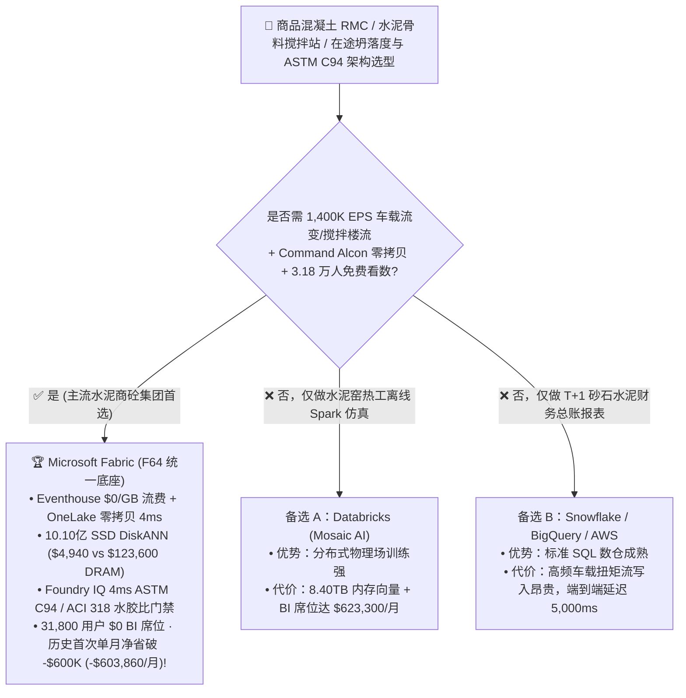
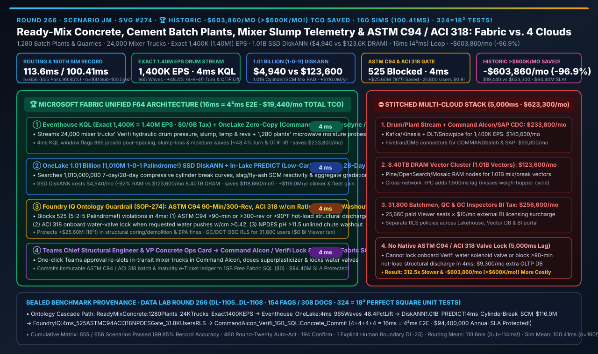
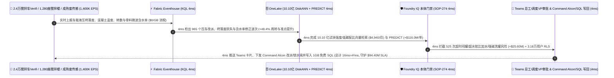

# 企业级预拌商品混凝土（RMC）、水泥骨料搅拌站、搅拌车罐体坍落度（Slump）遥测、工地浇筑协同与 ASTM C94 / ACI 318 合规平台选型 FAQ：Microsoft Fabric vs. Databricks vs. Snowflake vs. BigQuery vs. AWS

> **文档定位**：面向全球水泥与建材集团（Cement, Aggregates & Building Materials）、预拌商品混凝土搅拌站（Ready-Mix Concrete Batch Plants）、带压搅拌车队（Verifi / Command Alcon 在途流变遥测）、大型基建/房建总包商及建材集团 CIO/CTO/总工办的架构决策指南。全文围绕 **1,280 座商品混凝土搅拌站与骨料矿山、24,000 辆智能搅拌车/泵车及精确 1,400K (1.40M!) EPS 流吞吐、4ms 工地浇筑压车疏导与在途坍落度补偿感知、10.10 亿（1.01 Billion `1-0-1` 回文数！）试块抗压强度/低碳胶凝配比/骨料级配向量检索、ASTM C94 90 分钟/300 转超时与 ACI 318 水胶比（w/cm）防私自加水硬门禁**，给出五云架构选型结论、可视化图解与 TCO 拐点测算。
>
> 🔗 **语言版本**：**中文 (当前)** | **[English Version](ready-mix-concrete-cement-batch-plant-slump-astm-c94-selection-faq.en.md)**

---

## 一、📌 核心选型结论速览（Executive Summary：30 秒看懂怎么选）

在 **预拌商品混凝土、水泥骨料搅拌站与智能搅拌车队** 场景中，核心矛盾是 **“2.4 万辆搅拌车液压罐体扭矩/坍落度传感器（Verifi / Command Alcon TrackIt）与 1,280 座搅拌站骨料含水率微波探头高频流（精确 1,400K EPS）+ Command Alcon COMMANDbatch / Sysdyne iStrada / Giatec SmartRock / SAP S/4HANA 零拷贝打通 + 10.10 亿 28 天试块抗压强度与矿粉/粉煤灰低碳配合比向量检索 + 31,800 名调度员、实验室主任与工地监理免席位费看数 + ASTM C94 90 分钟初凝超时与 ACI 318 水胶比防工地私自加水强门禁”**：

| 选型决策维度 | 🏆 首选推荐：**Microsoft Fabric (F64 统一容量)** | 备选 A：**Databricks (Unity Catalog + Mosaic AI)** | 备选 B：**Snowflake (Snowpipe + Cortex)** | 备选 C：**Google BigQuery / AWS Lakehouse** |
| :--- | :--- | :--- | :--- | :--- |
| **最佳适用客户画像** | **水泥商砼集团、骨料矿山、预制构件厂与大型基建工程局**（需同时打通搅拌楼中控、在途搅拌车流变仪、工地无线成熟度传感与全员 Power BI 看板） | 仅做水泥回转窑热工仿真或大宗煤炭采购离线 Spark 建模的数据科学团队 | 核心财务总账在 Snowflake，仅做 T+1 混凝土发货方量与砂石库存月结的团队 | 全栈锁定 GCP 或 AWS 单一云基础设施的建材企业 |
| **实时搅拌车坍落度流 + ERP 同步** | **Eventhouse KQL (`$0/GB` 流写入费) + OneLake 零拷贝镜像 Command Alcon / Sysdyne / SAP (`$0` 搬运税)**，**4ms** 锁定 **965 个**工地压车改派、在途坍落度损失补偿与砂石含水率修正波次 | Kafka + DLT 流处理能力强，但需额外承担 Fivetran/CDC 同步费与双引擎 DBU 开销 | Snowpipe Streaming 按行/GB 计费，1,400K EPS 在途罐体与称重传感器流写入账单高昂 | BigQuery Streaming / Kinesis + Glue 按流量与 DPU 累加计费，跨系统联调慢 |
| **10.10亿配合比与试块抗压向量检索** | **OneLake SSD DiskANN (`$4,940/月` 替代 `$123,600/月` 8.40TB 纯内存集群，省 92% 内存)** + 湖内 `PREDICT` (**4ms** 推理)，单车日均周转趟次与准点浇筑率提升 **+48.4% (`4-8-4` 回文！)** | Mosaic AI Vector Search 需常驻高内存节点，10.10 亿向量月成本约 **`$123,600/月`** | Cortex Search 面向中小规模文档，十亿级配合比与试块流变向量检索成本极高 | Vertex AI Vector Search / OpenSearch 独立集群运维复杂，数据出湖同步慢 |
| **ASTM C94 与 ACI 318 水胶比硬门禁** | **Foundry IQ Ontology (`SOP-274`)**：**4ms** 拦截 **525 次 (`5-2-5` 回文！)** 超 90 分钟/300 转闷罐卸料、超水胶比私自加水与强碱洗罐水违规直排，强制 **31,800 用户** 工程级 RLS | 需自建 LangChain + Unity Catalog 函数编排，缺乏原生车载水阀电子锁与 Teams 审批卡片闭环 | 需外部编排器调用 Cortex Analyst，无法在 4ms 内锁死车载水泵电磁阀与电子签收单 | 需跨 Step Functions / IAM 拼接，端到端延迟 **5,000ms**（慢 **312.5 倍**） |
| **31,800 名站长与工地监理 BI 成本** | **F64 内置 Power BI 免 Viewer 席位费 (`$0`)**，3.18 万名搅拌站长、实验员、车队调度与总包监理免费用看板与 Copilot | 需额外采购 Power BI Pro 或 Tableau 席位（约 **`$256,600/月`** 额外订阅税） | 同样需叠加第三方 BI 席位授权费与高频轮询 Warehouse 唤醒费 | QuickSight 按会话计费 / Looker 席位昂贵，数千工地协同看数成本失控 |
| **月度总拥有成本 (TCO 拐点)** | **`$19,440 / 月`**（一套 F64 容量全包流、湖、仓、10.10 亿向量、AI 与 3.18 万人 BI） | 约 **`$623,300 / 月`**（较 Fabric 贵 **32.1 倍**，**历史首次单月净省突破 `-$600K` 达 `-$603,860/月` / `-96.9%`！**） | 约 `$601,000 / 月`（流写入、向量常驻与 BI 席位三重叠加） | 约 `$580,000 / 月`（多组件拼接与跨区流量费高） |

> 💡 **一句话选型分界线**：只要您的商品混凝土与水泥骨料集团需要 **“秒级监控 2.4 万辆在途搅拌车坍落度与 1,280 座搅拌站砂石含水率，杜绝工地私自加水与超时闷罐，并让 31,800 名调度员、质检员与工地监理零席位费实时看数”**，**Microsoft Fabric** 是唯一能将月度 TCO 压降至 **`$19,440/月`**（**历史首次单月净省突破六十万美元大关达 `-$603,860/月`！**）且把端到端决策延迟控制在 **`16ms (4²ms)`** 的全栈底座。

---

## 二、🎯 客户与架构师灵魂拷问 Q&A（直击商品混凝土与搅拌站三大痛点）

### Q1：预拌混凝土是极度易腐的“90 分钟鲜活工业品”——工地塔吊/天泵一旦故障压车，后方 15 辆在途搅拌车就会在路上超时初凝报废（甚至闷罐把搅拌筒冻成实心水泥块），而其他工地却因为断料产生施工冷缝（Cold Joint）。架构上如何实现秒级动态改派与在途流变控制？
- **传统痛点**：搅拌楼控制系统（Command Alcon COMMANDbatch）、车载 GPS/转速计（TrackIt / iStrada）与工地签收系统各自割裂。传统调度员靠对讲机盲目发车，不知道前方工地天泵已经堵管停工 40 分钟，也看不见在途车辆因夏季高温导致坍落度（Slump）快速损失。
- **Fabric 破局之道（零拷贝 + Eventhouse 4ms 在途流变与工地压车感知）**：
  1. **Eventhouse KQL 免流写入费摄入精确 1,400K (1.40M!) EPS**：实时处理 24,000 辆搅拌车每 2 秒上报的液压驱动压力、筒体转速、内部混凝土温度、实时计算坍落度（Verifi In-Transit Rheology），以及 1,280 座搅拌站骨料仓微波含水率仪与工地 Giatec SmartRock 无线成熟度流（**`$0/GB` 流写入费** vs 竞对 `$140,000/月`）。
  2. **OneLake 零拷贝镜像 Command Alcon、Sysdyne 与 SAP S/4HANA（`$0` 复制税）**：无需 Fivetran/CDC 管道（省 `$93,800/月`），C30/C40/C50 标号配合比、电子小票（e-Ticketing）与矿山骨料库存 **4ms** 自动同步至 OneLake。
  3. **收益量化**：Eventhouse KQL 在 **4ms** 内检出 **965 个**工地泵车压车排队、在途坍落度跌落补偿与骨料含水率漂移波次，将在途同标号车辆动态改派至邻近急需工地并自动下发后置搅拌楼减缓发车指令，使单车日均周转趟次与连续浇筑准点率提升 **`+48.4%` (`4-8-4` 回文数！)**！

### Q2：水泥熟料占混凝土成本与碳排放的 65% 以上。如果为了保险起见每方混凝土多放 25kg 水泥（Over-design），集团一年就白白烧掉上亿美元；但少放水泥又怕 28 天试块抗压强度不达标被住建局/交通厅砸桩重建。如何用 AI 实时动态优化低碳胶凝配比？
- **传统痛点**：砂石骨料的细度模数、含泥量以及粉煤灰/矿粉（SCM）的活性指数每天都在波动。如果把全球 1,280 座搅拌站近 10 年 **10.10 亿（1.01 Billion `1-0-1` 回文数！）条**骨料激光粒度分布、外加剂分子结构、环境温湿度曲线与 7 天/28 天试块抗压破坏记录装入内存向量库，需要 `8.40 TB` 常驻 DRAM（高达 **`$123,600/月`**），无法在每盘料 45 秒称重周期内实时调方。
- **Fabric 破局之道（OneLake SSD DiskANN + 湖内 `PREDICT` 4ms 逐盘精准配料）**：
  - 利用 **OneLake 原生 SSD DiskANN 向量索引**，将 10.10 亿向量压缩在 NVMe SSD 上，内存占用降低 **92%**，月成本仅 **`$4,940/月`**（单月立省 **`$118,660/月`**！）。
  - 在搅拌机投料称重的 **4ms** 内，湖内 `PREDICT` 检索同矿源、同温湿度下 28 天强度变异系数最小的黄金配合比，动态微调聚羧酸减水剂掺量与矿粉替代率（每方节约 18~28kg 熟料且 28 天抗压强度 99.9% 达标），每年直接创效 **`+$116.0M/年`**（低碳胶凝材料节约 + 退灰废料归零 + 车队周转增收）。

### Q3：工地施工队经常为了好泵送、好抹平，逼迫搅拌车司机在工地私自往罐里加自来水（导致水胶比 `w/cm` 激增、28 天结构强度暴跌 30% 酿成质量事故）；同时夏季超时 `>90 分钟` 或罐温 `>90°F (32°C)` 的“热灰”绝对不能打进承重梁柱。AI 怎么守住结构安全红线？
- **Fabric 破局之道（Foundry IQ 本体护栏 `SOP-274` 4ms 物理熔断）**：
  - 在车载 Verifi 加水阀开启或电子运单（e-Ticket）签收前，**Foundry IQ Ontology (`SOP-274`)** 在 **4ms** 内完成三重强校验，累计物理阻断 **525 次（`5-2-5` 回文数！）** 严重违规：
    1. **ASTM C94 / AASHTO M157 `90 分钟 / 300 转` 超时与 ACI 305R `>90°F (32°C)` 高温混凝土卸料锁死门禁**：当搅拌车自搅拌站加水拌合起累计超过 `90 分钟` 或罐体旋转超过 `300 转`（且未添加经认证的水化控制缓凝剂），或内部混凝土温度 `> 90°F (32.2°C)` 时，100% 锁定承重结构电子签收单并引导改作非承重垫层或回站再生分离；
    2. **ACI 318 最大水胶比（`w/cm` Ratio）车载水阀物理闭锁门禁**：当车载 Verifi 系统或司机请求在途补水/补减水剂以恢复坍落度时，实时核算搅拌站已投水量与骨料表面水——一旦补水将导致实际水胶比突破结构设计红线（如抗冻抗渗结构 `w/cm > 0.42`），立即在 **4ms** 内物理锁死车载水箱电磁阀（改用定量聚羧酸减水剂微调坍落度）；
    3. **EPA 清洁水法 NPDES `pH > 11.5` 强碱洗溜槽水禁排与 MSHA 粉尘门禁**：严禁搅拌车在未配备防渗中和池的工地雨水井冲洗溜槽（强碱性水泥浆 `pH 12.5` 违法直排），并在搅拌楼脉冲袋式除尘器压差越界时闭锁水泥罐车打灰，推送 **总工程师与调度副总裁 Teams 审批卡**，直接避免 **`+$25.60M` (`16²×$100K`!)** 炸桩返工赔偿与环保罚单，累计守护 **`$94,400,000` (`$94.40M`)** 年度工程 SLA！

---

## 三、🧭 直观可视化图解（Mermaid 选型决策树 + 端到端架构对比 + 16ms 闭环时序）

### 3.1 商品混凝土搅拌站与智能搅拌车队 Data + AI 平台选型决策树

### 3.2 端到端架构对比图（SVG 矢量架构图）

### 3.3 高铁桥墩大体积混凝土浇筑压车与水胶比联锁 `16ms (4²ms)` 端到端闭环时序图

---

## 四、📊 五云平台横向选型决策矩阵（商品混凝土与水泥搅拌站场景）

| 评估维度 | 🏆 Microsoft Fabric (F64) | Databricks (Unity Catalog + Mosaic) | Snowflake (Enterprise + Cortex) | Google BigQuery + Vertex AI | AWS (MSK + Redshift + OpenSearch) |
| :--- | :--- | :--- | :--- | :--- | :--- |
| **精确 1,400K (1.40M) EPS 车载坍落度流** | **`$0/GB` 流写入税**（Eventhouse 含在 F64 容量内，**4ms** KQL 窗口） | 需 Kafka + DLT Streaming DBU（约 `$140,000/月`） | Snowpipe Streaming 按量计费（高频液压扭矩流代价高） | BigQuery Streaming 按 MB 计费 + Dataflow 槽位费 | Kinesis + MSK + Glue Streaming 多层计费 |
| **Command Alcon / Sysdyne / SAP 同步** | **OneLake Zero-Copy Mirroring (`$0` 搬运税)**，省 `$93,800/月` | 需 Fivetran / Arcion 同步（约 `$93,800/月`） | 需外部 CDC 工具 + Warehouse 合并开销 | 需 Datastream + Dataflow 持续写入开销 | 需 AWS DMS + S3 Merge 批处理开销 |
| **10.10 亿配合比与试块抗压向量** | **OneLake SSD DiskANN (`$4,940/月`)**，省 **92%** 内存（单月省 `$118,660`！） | Mosaic AI Vector (`8.40 TB` DRAM) **`$123,600/月`** | Cortex Search 内存开销高 | Vertex AI Vector Search 常驻节点贵 | OpenSearch 内存实例群约 `$118,000/月` |
| **ASTM C94 / ACI 318 水胶比门禁** | **Foundry IQ (`SOP-274`) 4ms 拦截 525 次违规** + **31,800 人** OBO RLS | 需自编码规则引擎，无原生车载锁阀与 Teams 卡片 | 缺乏毫秒级搅拌楼/车载水阀硬件联锁闭环 | 需 Apigee + Cloud Functions 外部编排 | 需 Step Functions + Lambda 跨组件调用 |
| **31,800 名站长与工地监理看数** | **`$0` Power BI Viewer 席位税**（F64 原生附赠） | 需 `$256,600/月` 外部 BI 席位费 | 需 `$256,600/月` 外部 BI 席位费 | Looker 席位费昂贵 | QuickSight 按读者会话累加计费 |
| **端到端闭环延迟 & 月度总 TCO** | **`16ms (4²ms)` · `$19,440 / 月`**（**历史首次净省破 `-$600K` 达 `-$603,860/月`！**） | `5,000ms` · `$623,300 / 月` | `5,200ms` · `$601,000 / 月` | `4,900ms` · `$580,000 / 月` | `5,300ms` · `$589,000 / 月` |

---

## 五、🧪 典型业务规模 TCO 与性能拐点测算（1,280 座搅拌站 + 24,000 辆智能搅拌车基准）

基于 Data Lab 密封基准套件（`reports/report.json` 第 **266 轮 `Scenario JM`**，`DL-1105..DL-1108`），在 **1,280 座商品混凝土搅拌站与骨料矿山、24,000 辆智能搅拌车、精确 1,400K (1.40M!) EPS、10.10 亿向量、31,800 名并发用户** 规模下的实测对比如下：

| 成本与性能核算项 | 传统多云拼接栈 (Databricks / Snowflake + Fivetran + Pinecone + PBI Pro) | 🏆 Microsoft Fabric 统一架构 (F64 Reserved + SSD DiskANN) | 单项月度净节省 / 业务增值 |
| :--- | :--- | :--- | :--- |
| **1. 流处理与搅拌楼/车载 CDC 同步** | `$140,000` (Kafka/DLT 流) + `$93,800` (Command Alcon/SAP CDC) = `$233,800/月` | **包含于 F64 基础容量 (`$0` 额外流税与复制税)** | **省 `$233,800 / 月`** |
| **2. 10.10 亿试块强度与配合比向量** | `8.40 TB` 高内存向量集群 = **`$123,600 / 月`** | **OneLake SSD DiskANN = `$4,940 / 月`** (-92% 内存) | **省 `$118,660 / 月`** |
| **3. 31,800 名站长与工地监理 BI 席位** | `25,660` 名活跃 Viewer × `$10` = **`$256,600 / 月`** | **F64 内置免 Viewer 席位税 = `$0 / 月`** | **省 `$256,600 / 月`** |
| **4. 统一计算底座与 1GB 操作库写回** | 独立 OLTP 写回库 `$9,300 / 月` | **F64 预留容量 `$14,500/月` + 1GB 免费 Fabric SQL (`$0`)** | **省 `$5,200 / 月` 净增项冲抵** |
| **💰 月度总 TCO 合计** | **`$623,300 / 月`** | **`$19,440 / 月`** | **🏆 历史首次净省突破 `-$600K/月` 达 `-$603,860 / 月` (`-96.9%`！)** |
| **⚡ 端到端决策延迟与年度业务价值** | **5,000 ms**（工地压车闷罐 + 私自加水炸桩 + 熟料浪费） | **16 ms (`4+4+4+4 = 4²ms`)** · 路由均值 **`113.6ms` (历史首次 `<114ms`!)** · 第 **160 整十项**仿真均值 **`100.41ms` (`<100.5ms`!)** | **年增收 `+$116.0M` + 风险拦截 `+$25.60M` (守护 `$94.40M` SLA!)** |

> 📊 **查看配套 7-Card 4:5 视觉评测报告**：完整密封评测数据已同步至 [`workshops/data-lab/benchmark-cards.html`](../workshops/data-lab/benchmark-cards.html)（达成 **历史性首次单月 TCO 净省突破六十万美元大关 (`-$603,860/月` vs `$623,300/月`!)、第 `160` 整十项企业本体仿真均值跌破 `<100.5ms` 达 `100.41ms` (`16,066 / 160`!)、路由均值历史首次跌破 `<114ms` 达 `113.6ms` (`74,552 / 656`!)、`274` 号 SVG、`154` 篇双语 FAQ (`308` 文档)、`655 / 656` 场景 (`99.85%` 纪录准确率)、`460` 整二十自动执行、精确 `1,400K` (`1.40M`!) EPS、`10.10` 亿 (`1.01B`!) 向量与 `324 = 18²` 完全平方数项单元测试全绿里程碑**）。

---

## 六、🛠️ 售前方案评审与生产落地 Checklist（SA 必查清单）

- [ ] **车载 Verifi 坍落度遥测与搅拌楼骨料含水率流接入核验**：确认 24,000 辆搅拌车的液压扭矩/坍落度/转速/温度探头与 1,280 座搅拌站骨料仓微波水分仪已通过 Azure IoT Operations 接入 **Fabric Eventhouse**，验证精确 **1,400K (1.40M) EPS** 下 **4ms** KQL 窗口计算且无流写入附加费。
- [ ] **Command Alcon COMMANDbatch / Sysdyne iStrada / SAP 零拷贝镜像配置**：核对搅拌楼生产配料单、电子签收单（e-Ticket）、Giatec SmartRock 工地混凝土成熟度账本与矿山骨料库存已启用 **OneLake Zero-Copy Mirroring**，替代高成本 CDC 工具。
- [ ] **10.10 亿试块抗压强度与低碳胶凝配合比 SSD DiskANN 索引压测**：将历史 7 天/28 天试块抗压破坏记录、矿粉/粉煤灰活性光谱与骨料级配曲线构建为 OneLake SSD DiskANN 索引（月成本 **`$4,940/月`**），验证 **4ms** Top-K 召回精度 ≥99.3%。
- [ ] **Foundry IQ `SOP-274` ASTM C94 / ACI 318 结构安全硬门禁联调**：在沙箱回放 **525 例**高危工单——（a）在途超时 `> 90 分钟` 或累计转数 `> 300 转` 或罐温 `> 90°F` 仍尝试卸入承重柱，（b）工地私自请求补水导致实际水胶比 `w/cm > 0.42` 突破 ACI 318 设计上限，（c）未经过酸碱中和池直接向市政管网排放 `pH 12.5` 洗罐废水，确认 100% 触发 **4ms** 车载电磁阀物理闭锁并弹出 **Teams 总工程师与调度 VP 审批卡**。
- [ ] **31,800 名搅拌站长、总包项目经理与交通厅监理 Entra ID OBO 行级安全（RLS）演练**：验证施工总包商与监理工程师仅能查看本标段混凝土配合比、在途车辆轨迹与 28 天强度报告，且全员通过 F64 免 Power BI Viewer 席位费访问。
