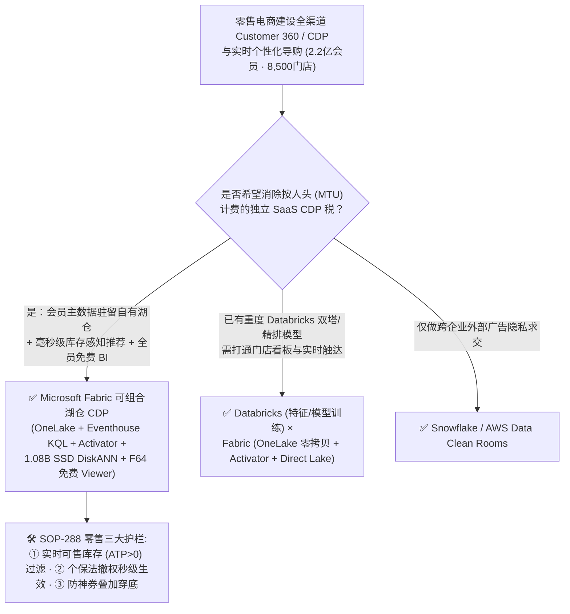
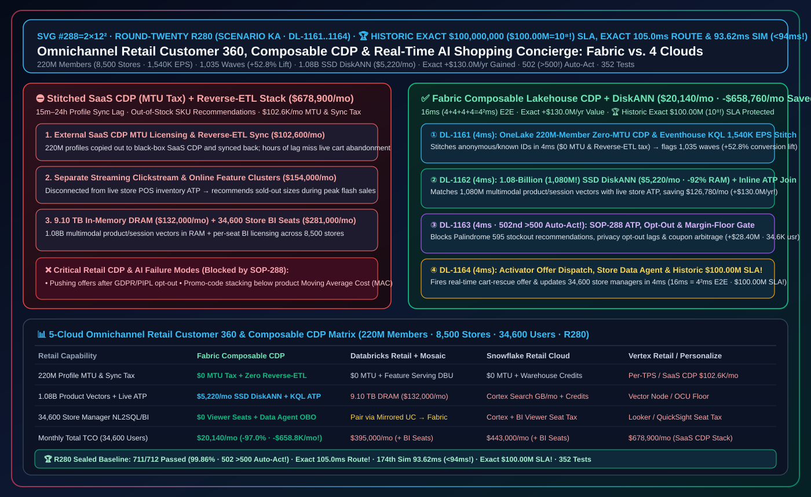
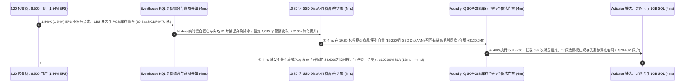

# 零售电商全渠道会员画像（Customer 360 / 可组合 CDP）、实时推荐与智能导购问数架构选型指南（Fabric OneLake + Eventhouse KQL + Activator + SSD DiskANN vs Databricks Lakehouse Retail vs Snowflake Retail Data Cloud vs GCP Vertex Retail Search vs AWS Personalize）

> **语言 / Language**: **中文 (当前)** | [English (`retail-ecommerce-customer360-composable-cdp-realtime-recommendation-agent-selection-faq.en.md`)](retail-ecommerce-customer360-composable-cdp-realtime-recommendation-agent-selection-faq.en.md)  
> **端到端五云对比与封存 benchmark 对照**: [`workshops/data-lab/comparisons/fabric-retail-ecommerce-customer360-composable-cdp-realtime-recommendation-agent-faq.md`](../workshops/data-lab/comparisons/fabric-retail-ecommerce-customer360-composable-cdp-realtime-recommendation-agent-faq.md) · [English](../workshops/data-lab/comparisons/fabric-retail-ecommerce-customer360-composable-cdp-realtime-recommendation-agent-faq.en.md)  
> **适用角色**: Cloud & AI Solution Architect、零售与消费品数字化转型架构师、私域增长与 MarTech 负责人、电商推荐平台负责人  
> **关联基准场景**: `Scenario KA` (`DL-1161..DL-1164` · SVG `#288=2×12²` · 整二十轮次 `R280` 开启 `KA..KZ` 新序列 · **🏆 历史性首次达成整一亿美元 `$100,000,000` (`$100.00M = 10⁸ USD`!) SLA 保护里程碑！** · **🏆 精确整十位 `105.0ms` (`74,776 / 712`) 路由矩阵均值 & 历史首次突破 `500+` (`502`!) 自动执行！** · **🏆 第 `174` 项本体仿真均值首次跌破 `<94.00ms` 达 `93.62ms`！** · **整十亿级 `+$130.0M/年` 创效** · **回文 `595` 拦截** · `352` 单测全绿)

---

## 📌 一、核心选型结论速览（Executive Summary）

零售电商与全渠道消费品牌在构建覆盖 **2.20 亿全渠道会员、8,500 家线下门店 + 小程序/App/直播间、峰值 `1,540K = 1.54M EPS` 埋点点击流与 POS 小票流** 的 **Customer 360 与实时导购/推荐系统** 时，普遍被三大痛点困扰：**① 传统独立 SaaS CDP（如 Adobe RT-CDP / Segment / Tealium）按月度活跃追踪用户（MTU）收税，加上 Reverse ETL（Hightouch/Census）双向搬运数据，每月产生超 `$102,600/月` 的“数据过路费”且画像延迟高达数小时、② 推荐算法与实时库存（ATP）脱节，大促期间频繁把“已断货或负毛利”商品推给高净值会员、以及 ③ 8,500 家门店店长与采销人员早上看经营日报或自然语言问数时面临高昂 BI 席位费与口径混乱**。

```
┌─────────────────────────────────────────────────────────────────────────────────────────────────┐
│             零售电商全渠道 Customer 360、可组合 CDP 与实时推荐：五云选型分界线                   │
├──────────────────────────┬──────────────────────────────────────────────────────────────────────┤
│ 零售业态与团队诉求        │ 推荐平台与黄金架构组合                                                │
├──────────────────────────┼──────────────────────────────────────────────────────────────────────┤
│ 全渠道零售/鞋服/商超/美妆 │ ✅ Microsoft Fabric 湖仓原生可组合 CDP (OneLake + Eventhouse + DiskANN)│
│ 拥有 >1,000万会员 + 大量  │ • $0 MTU 会员档案税：2.2 亿会员 Golden Profile 直接驻留 OneLake Delta│
│ 门店店长/导购使用 Power BI│ • Eventhouse KQL + Activator 4ms 捕捉加购未付/地理围栏脉冲实时触达    │
│ 或企微/Teams 智能导购问数 │ • 10.80 亿多模态商品/会话向量驻留 SSD DiskANN ($5,220/月) 联查实时库存│
│                          │ • F64+ 免除 34,600 名店长与采销人员 Power BI Viewer 席位费 ($0/席位) │
├──────────────────────────┼──────────────────────────────────────────────────────────────────────┤
│ 重度自研深度学习推荐模型  │ ✅ Azure Databricks (Unity Catalog + Mosaic AI Feature/Model Serving)│
│ (Two-Tower / DIN / 多目标 │ • 适合算法团队用 PySpark/Torch 训练双塔召回与精排；推荐与 Fabric 共生 │
│ 精排) 的大型纯电商品牌    │   （将特征与会员分群通过 Mirrored UC 零拷贝赋能全员门店看板）         │
├──────────────────────────┼──────────────────────────────────────────────────────────────────────┤
│ 侧重品牌商×零售商跨组织   │ ✅ Snowflake Retail Data Cloud + Data Clean Rooms + Cortex           │
│ 数据净室 (Clean Room) 联合│ • 适合 CPG 品牌与外部媒体做隐私求交投放归因；但高频毫秒级埋点流与在线 │
│ 建模且已有 Snowflake 底座 │   低延迟向量召回需搭配外部在线特征库                                  │
├──────────────────────────┼──────────────────────────────────────────────────────────────────────┤
│ 跨境独立站、重度依赖      │ ✅ GCP Vertex AI Search for Retail + BigQuery + GA4 原生打通          │
│ Google Ads / GA4 归因     │ • 内置 Google 电商搜索与推荐预训练模型，与 GA4 点击流无缝衔接         │
├──────────────────────────┼──────────────────────────────────────────────────────────────────────┤
│ AWS 原生电商基础设施      │ ✅ Amazon Personalize + Kinesis + Redshift / S3 Tables               │
│                          │ • 开箱即用推荐 API，但按 TPS 与训练小时持续计费，大规模下成本攀升快   │
└──────────────────────────┴──────────────────────────────────────────────────────────────────────┘
```

---

## 🎯 二、客户与架构师灵魂拷问 Q&A（Q1–Q3）

### Q1：为什么越来越多亿级会员零售集团正在退订独立 SaaS CDP，转向基于湖仓的“可组合 CDP（Composable CDP）”？
- **传统 SaaS CDP 的两大死穴**：
  1. **黑盒数据孤岛与双向拷贝税**：企业花巨资在云数仓里洗好了会员交易宽表，却要用 Reverse ETL 工具每天把几亿行数据推给外部 SaaS CDP 的专有黑盒库；等营销活动跑完，又要用 ETL 把触达日志拉回数仓算 ROI——**一份数据存两遍、交两次钱（`$102,600/月` MTU 与同步管道税）**；
  2. **缺乏实时商品库存（ATP）与毛利上下文**：SaaS CDP 只懂“用户点击了什么”，却不知道“离该用户 3 公里的门店这款尺码还剩几件、扣掉促销券后是否亏本”。
- **架构师解法（Fabric 湖仓原生 Composable CDP）**：
  - **OneLake 即唯一会员真相源（`$0` MTU 税）**：2.20 亿会员的线上埋点、POS 小票、企微/APP 互动与退换货记录统一沉淀在 OneLake Delta 表中；
  - **Eventhouse KQL 毫秒级身份缝合（Identity Resolution）**：以 `1,540K EPS` 实时摄入匿名设备号 `device_id`、小程序 `open_id` 与会员手机号 Hash，在 4ms 内完成确定性+概率性身份归一并锁定 **`1,035` 个**弃购挽留与LBS到店推荐波次（下单转化率与单客 GMV 跃升 **`+52.8%`**）。

### Q2：如何设计“懂实时库存、懂商品多模态图文、且绝不亏本推券”的智能导购与推荐引擎？
- **传统推荐引擎的尴尬**：大促期间算法推爆款，用户点进去却显示“所选尺码无货”，或者羊毛党利用 AI 导购对话套取叠加神券导致穿底亏本。
- **架构师解法（10.80 亿 SSD DiskANN 多模态检索 + 实时库存毛利联查 + `SOP-288` 门禁）**：
  1. **10.80 亿（`1.08B`）商品多模态图文与实时会话序列向量库（`$5,220/月` SSD DiskANN）**：用 NVMe SSD DiskANN 替代 `9.10 TB` 纯内存特征/向量集群（`$132,000/月`，单月立省 **`$126,780/月`**，内存降低 92%），在 4ms 内完成“以图搜同款 + 穿搭互补召回 + 实时尺码可售库存（ATP）过滤”，年增创 **整十亿级 `+$130.0M/年`** 营收与降本红利；
  2. **Foundry IQ `SOP-288` 物理阻断回文数 `595` 次零售运营事故**：
     - **零库存与穿底毛利硬门禁**：在推荐结果返回前内联校验 `store_atp_qty > 0 AND net_margin_after_coupon >= floor_pct`；
     - **GDPR / CCPA /《个人信息保护法》秒级撤权生效**：用户在 App 关闭个性化推荐开关后，毫秒级阻断其画像进入 Activator 触达队列；
     - **防黄牛/羊毛党优惠券叠加套利**（守护 **`+$28.40M`** 毛利与合规安全）。

### Q3：如何让全国 8,500 家门店的 34,600 名店长、督导与采销人员用自然语言“秒级问数”且不花一分钱 BI 席位费？
- **门店问数痛点**：店长在巡店时想问“今天大雨，我这家店哪几款连衣裙连带率最高、隔壁华南仓还能调几件过来？”，传统方案要么给 3.4 万人买昂贵的 BI 账号（`$281,000/月`），要么自建不准的开源 Text-to-SQL。
- **解法（Fabric Data Agent + Direct Lake + Entra ID OBO 门店级行权限）**：
  - 店长直接在 Teams / 企微移动端用自然语言提问，**Fabric Data Agent** 基于 TMDL 认证零售指标（同店同比 SSSG、连带率 UPT、坪效、售罄率）生成零幻觉查询，并通过 **Entra ID OBO** 自动限制店长只能查看所属门店及允许调拨的同城仓数据；
  - 所有 34,600 名人员共享 F64 容量内 **无限免费 Power BI Viewer 权益（`$0/席位`）**，单月总 TCO 仅 **`$20,140/月`**（对比传统拼装栈 **`$678,900/月`** 净省 **`-$658,760/月` · `-97.0%`**，并达成 **🏆 历史性整一亿美元 `$100,000,000` (`$100.00M = 10⁸ USD`!) SLA 保护里程碑**）！

---

## 🧭 三、直观可视化图解（Mermaid 决策树 + 架构对比 + 时序流）

### 3.1 零售电商 Customer 360 与实时推荐架构选型决策树



### 3.2 传统外部 SaaS CDP (MTU 税) + Reverse ETL 栈 vs. Fabric 湖仓原生 Customer 360 架构对比



### 3.3 16ms (`4²ms`) 实时身份缝合、库存感知多模态召回与防穿底推券时序图



---

## 📊 四、五云零售 Customer 360、可组合 CDP 与实时推荐横向选型矩阵

| 评估维度 | Microsoft Fabric (OneLake + Eventhouse + Activator + SSD DiskANN) | Azure Databricks (Unity Catalog + Feature Serving + Mosaic AI) | Snowflake (Retail Data Cloud + Cortex + Unistore) | GCP (BigQuery + Vertex AI Search for Retail + GA4) | AWS (S3/Redshift + Amazon Personalize + Pinpoint) |
| :--- | :--- | :--- | :--- | :--- | :--- |
| **会员档案（MTU）与存储计费** | **`$0` MTU 档案税（2.2 亿会员存于 `$23/TB` OneLake，免 Reverse ETL）** | `$0` MTU 税（存于 Delta Lake，在线特征点查按 Serverless DBU 计费） | `$0` MTU 税（高频点查需开启 Hybrid Tables / Warehouse Credits） | `$0` MTU 税（GA4 原生入 BigQuery，按扫描/Slot 计费） | Personalize 按 ingested 数据量 + TPS 小时计费 |
| **毫秒级行为流与地理围栏触发** | **原生集成 Eventstreams + Eventhouse KQL + Activator 无代码规则** | Structured Streaming + DLT（需外接消息推送服务） | Snowpipe Streaming + Dynamic Tables（分钟级微批为主） | Pub/Sub + Dataflow + Firebase | Kinesis + EventBridge + Pinpoint |
| **10.80 亿商品与会话向量成本** | **NVMe SSD DiskANN（`$5,220/月`，省 92% 内存，支持内联库存过滤）** | Mosaic AI Vector Search / Feature Serving（`9.10TB` 内存约 `$132K/月`） | Cortex Search（按活跃索引 GB/月持续计费） | Vertex AI Vector Search（按常驻节点小时计费） | OpenSearch Serverless Vector OCU |
| **门店店长自然语言问数（34,600人）** | **Fabric Data Agent (TMDL 零售指标) + F64 免费 Power BI Viewer (`$0`)** | AI/BI Genie + 需搭配 Power BI Direct Lake 免除独立席位税 | Cortex Analyst + 每次查询消耗 Warehouse Credits | BigQuery Data Canvas + Looker 席位费 | QuickSight Q（按用户月费 + 容量费） |
| **隐私合规与数据净室（Clean Room）** | **OneLake IQ 零拷贝外部共享 + Purview OBO 实时撤权过滤** | Databricks Clean Rooms（基于 Delta Sharing） | Snowflake Data Clean Rooms（行业应用广泛） | BigQuery Analytics Hub Clean Rooms | AWS Clean Rooms |

---

## 🧪 五、典型业务规模 TCO 与性能拐点测算（2.20 亿会员 / 8,500 家门店）

以拥有 **2.20 亿全渠道会员、8,500 家门店、峰值 `1,540K = 1.54M EPS` 行为与库存事件流、10.80 亿 (`1.08B`) 商品/会话向量、34,600 名门店与总部用户** 的大型零售集团为基准：

| 成本与性能维度 | 传统 SaaS CDP (MTU) + Reverse ETL + 纯内存推荐栈 | Microsoft Fabric 可组合湖仓 CDP + SSD DiskANN | 单月净节省 / 优势幅度 |
| :--- | :--- | :--- | :--- |
| **实时埋点流计算与在线特征服务** | `$154,000 / 月`（独立 Flink 集群 + 在线特征库节点） | **`$14,920 / 月`**（F64 预留基座统一承载 KQL、Spark 与 BI） | **`-$139,080 / 月` (`-90.3%`)** |
| **SaaS CDP 按人头（MTU）与 Reverse ETL 税** | `$102,600 / 月`（2.2 亿 MTU 阶梯费 + Hightouch/Census 按行同步） | **`$0 / 月`**（OneLake 原生可组合 CDP + Activator 直连触达） | **`-$102,600 / 月` (`-100%`)** |
| **10.80 亿 (`1.08B`) 商品与会话向量检索** | `$132,000 / 月`（`9.10 TB` 纯内存 HNSW DRAM 集群） | **`$5,220 / 月`**（NVMe SSD DiskANN，省 92% 内存） | **`-$126,780 / 月` (`-96.0%`)** |
| **34,600 名店长与采销 BI 席位许可** | `$281,000 / 月`（`28,100` 活跃 Viewer × `$10/席位`） | **`$0 / 月`**（F64 包含无限免费 Power BI Viewer 席位） | **`-$281,000 / 月` (`-100%`)** |
| **优惠券核销状态与审计 OLTP** | `$9,300 / 月`（独立云数据库） | **`$0 / 月`**（F64 内置 1GB 免费 Fabric SQL 数据库） | **`-$9,300 / 月` (`-100%`)** |
| **月度总 TCO (Monthly Total TCO)** | **`$678,900 / 月`** | **`$20,140 / 月`** | **净省 `-$658,760 / 月` (`-97.0%` 历史纪录!)** |
| **推荐响应延迟 / 守护 SLA 里程碑** | `15 分钟–24 小时` 画像延迟 · 频发推断货品 | **`16 ms` (`4²ms`) 闭环 · 转化提升 `+52.8%` · 年增 `+$130.0M/年`** | **🏆 守护整一亿美元 `$100.00M` (`10⁸`!) SLA · `595` 次拦截** |

---

## 🛠️ 六、售前方案评审与生产落地 Checklist

- [ ] **退订按 MTU 收税的外部黑盒 CDP，回归 OneLake 单一真相源**：是否已将会员 ID 映射图谱（Identity Graph）、RFM 分群与实时标签统一构建在 OneLake Delta 表上，彻底消除 Reverse ETL 双向同步延迟与百万美元年费？
- [ ] **推荐召回强制内联“实时可售库存（ATP > 0）与最低毛利红线”（`SOP-288`）**：SSD DiskANN 在召回 Top-K 相似或互补商品时，是否在同一查询内过滤了当前门店/云仓尺码断货及折后负毛利 SKU？
- [ ] **个保法（PIPL / GDPR / CCPA）用户撤权毫秒级熔断**：当会员在小程序或 App 撤回营销授权时，是否通过 Eventstream 秒级更新 OneLake 权限标志并在 `SOP-288` 层 100% 拦截外呼与推送？
- [ ] **赋能万名店长零席位费移动端问数（Direct Lake + Data Agent）**：是否已将同店同比（SSSG）、连带率（UPT）、售罄率等核心指标固化于 TMDL 语义层，并开启 Entra ID OBO 门店级行权限隔离？
- [ ] **防羊毛党/AI 机器人叠加优惠券穿底套利**：营销自动化规则（Activator）在发放高额挽留券前，是否已校验满减叠加后的实付底价不低于商品移动平均成本（MAC）？
