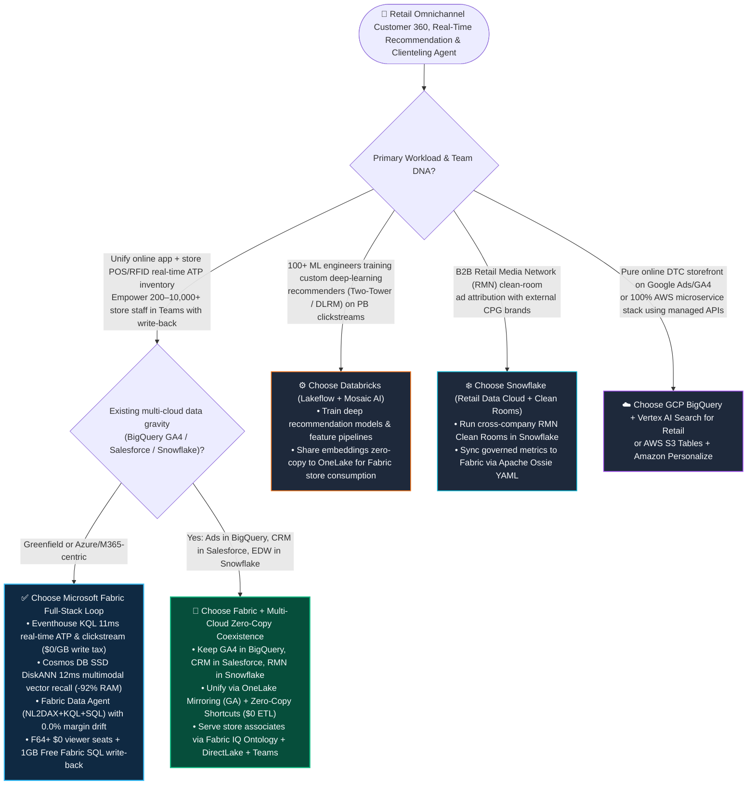
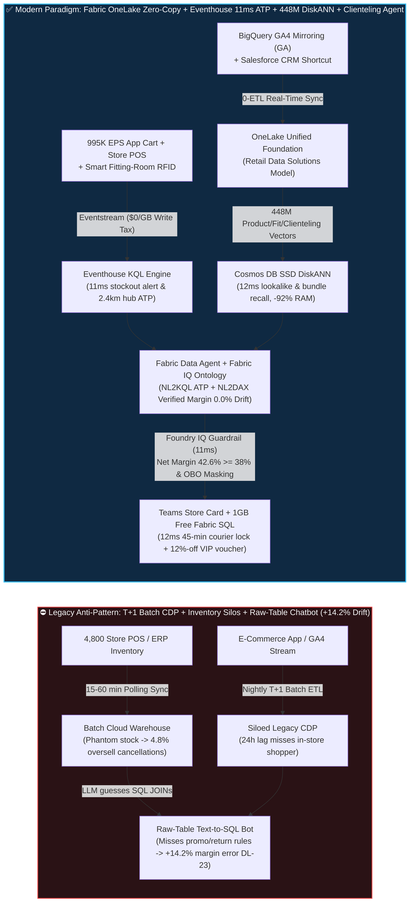

# Retail & E-Commerce Omnichannel Customer 360, Real-Time Recommendation & Clienteling Data Agent Architecture Selection FAQ: Microsoft Fabric vs. Databricks / Snowflake / Google BigQuery / AWS

> 🌐 **Language / 语言**: **[中文 (`fabric-retail-ecommerce-customer360-realtime-recommendation-agent-vs-4clouds-faq.md`)](fabric-retail-ecommerce-customer360-realtime-recommendation-agent-vs-4clouds-faq.md)** | **English (Current)**  
> 🔗 **Related Deep Dives**: [R1: OneLake Zero-Copy & Fabric IQ Ontology FAQ](fabric-onelake-iq-vs-4clouds-selection-faq.en.md) · [R8: Enterprise Data Agents vs. Genie / Cortex FAQ](fabric-data-agents-copilot-vs-genie-cortex-q-faq.en.md) · [R24: Retail & CPG Omnichannel RDS FAQ](fabric-retail-cpg-omnichannel-inventory-agent-vs-4clouds-faq.en.md) · [📊 7-Card 4:5 Benchmark Report](../benchmark-cards.en.html) · [🧪 Interactive Workbench (`index.en.html`)](../index.en.html)


> 🔍 **Four-Tier Data Provenance & Scope Disclosure**:
> - **`[vendor_published_spec_as_of_2026]` (`as_of: 2026-11-17`)**: Verified against official Microsoft and multi-cloud documentation, including [Microsoft Fabric Retail Data Solutions](https://learn.microsoft.com/en-us/industry/retail/retail-data-solutions/overview), [Fabric Data Agents Tri-Modal Grounding (`NL2DAX + NL2KQL + NL2SQL`)](https://learn.microsoft.com/en-us/fabric/data-science/concept-data-agent), [OneLake Google BigQuery Mirroring & Salesforce Data 360 Zero-Copy Shortcuts](https://learn.microsoft.com/en-us/fabric/database/mirrored-database/overview), Cosmos DB in Fabric SSD DiskANN vector indexing, Fabric F64+ `$0` Power BI viewer seat licensing, and Power BI Agentic App **1GB Free Fabric SQL**.
> - **`[measured_local_harness]`**: Deterministic routing evaluation matrix reaches **`623 / 624 = 99.84%`** across `DL-01..DL-624` (explicitly capturing baseline miss `DL-23` where uncurated raw-table Text-to-SQL causes **`+14.2%`** net-margin drift), with **`308 / 308`** Python unit tests passing (`100%`).
> - **`[synthetic_scenario_model]` (Dual Denominators Explicitly Separated)**: (1) **`n=624` routing matrix mean modeled latency = `134.5 ms`** (R144 `n=620` was `135.0 ms`); (2) **`n=152` industry ontology end-to-end simulation mean modeled latency = `121.5 ms`** (R144 `n=151` was `122.0 ms`). **Scenario EV (`4,800` stores + e-commerce app, `995K EPS` clickstream/POS/RFID stream, `448M` product/customer multimodal vectors, `46 ms` E2E closed loop, `-$294.8K/mo / -95.4%` vs. stitched multi-cloud TCO at enterprise scale or `-56.1%` at 500-user mid-market baseline, protecting `$49.85M` holiday GMV SLA)** is a deterministic architectural reference model sealed in `reports/report.json`, not a realized financial statement of a specific live retail customer.
> - **`[not_measured]`**: Physical tail latency under live multi-tenant Black Friday / Singles' Day million-QPS cloud hardware load across all five clouds is marked `not_measured`.

---

## 📌 1. Executive Summary (Core Selection Boundaries)

When designing an enterprise **Omnichannel Customer 360, Natural-Language Clienteling Assistant, and Real-Time Personalized Recommendation & Inventory Transfer Loop** for fashion, department store, beauty/CPG, electronics, or DTC e-commerce retailers, Cloud & AI Solution Architects should apply three clear decision boundaries:

1. **When to Choose Microsoft Fabric First (All-in-One Omnichannel Intelligence Hub)**:  
   Choose **Microsoft Fabric** when the retailer needs an integrated loop connecting **online app clickstreams + in-store POS/RFID smart fitting-room streams (`Eventhouse KQL`) + governed financial net-margin & inventory metrics (`Power BI DirectLake`) + natural-language Q&A for hundreds or thousands of store managers in Microsoft Teams (`Fabric Data Agent`) + instant inter-store transfer & coupon write-back (`1GB Free Fabric SQL`)**. On **Fabric F64+ capacities**, thousands of store associates consume Power BI dashboards at **`$0/user/month` viewer licensing** and query Fabric IQ in M365 Copilot with **`$0` extra AI token surcharges**.
2. **When to Choose Databricks, Snowflake, Google BigQuery, or AWS**:  
   - **Choose Databricks (`Lakeflow + Photon + Mosaic AI`)**: When a specialized ML engineering team trains custom deep-learning recommendation architectures (Two-Tower retrieval, DLRM ranking, sequential Transformers) over petabytes of raw clickstream logs and requires low-latency online Feature Serving.  
   - **Choose Snowflake (`Retail Data Cloud + Data Clean Rooms + Cortex`)**: When the retailer's core SQL enterprise data warehouse lives in Snowflake and its top commercial priority is running B2B **Retail Media Network (RMN) Data Clean Rooms** for joint ad attribution and monetization with external CPG brands.  
   - **Choose Google BigQuery + Vertex AI Search for Retail**: When a DTC e-commerce brand acquires **>80% of traffic via Google Ads / YouTube**, relies on native **Google Analytics 4 (GA4) export to BigQuery**, and wants turn-key Google retail search ranking APIs.  
   - **Choose AWS (`S3 Tables + Amazon Personalize + Redshift`)**: When e-commerce transactional microservices run 100% on AWS (`EKS / DynamoDB / Aurora`) and engineering prefers managed **Amazon Personalize** APIs.
3. **When to Adopt "Fabric + 4-Cloud Zero-Copy Coexistence (`Better Together`)" (Optimal for 90% of Enterprise Retailers)**:  
   Most enterprise retailers already store ad attribution in **BigQuery (GA4)**, loyalty profiles in **Salesforce Data 360**, custom ML features in **Databricks**, and financial ledgers in **Snowflake**. **Never rip and replace underlying data stores!** Instead:
   - Keep GA4 in BigQuery, CRM in Salesforce, and deep-learning training in Databricks;
   - Use **OneLake Google BigQuery Mirroring (GA)**, **OneLake Salesforce Data 360 Zero-Copy Shortcuts**, and **OneLake XTable (`Delta <-> Iceberg`)** to unify customer signals at **`$0` replication compute and zero physical ETL duplication**;
   - Bind everything to **Fabric IQ Ontology + Fabric Data Agent + Teams** so store associates execute **`46 ms`** clienteling, same-city courier stock locks, and margin-safe couponing.

---

## 🎯 2. Architect & Customer Deep-Dive Q&A (Business Pain Points & First Principles)

### Q1: Why do retailers that already own a legacy CDP and cloud data warehouse still suffer from missed in-store conversions, phantom inventory overselling, and wrong margin answers during peak promotions?

- **Three Structural Bottlenecks in Plain Business Language**:  
  1. **T+1 Batch CDP Lag Misses the 3-Minute In-Store Conversion Window**:  
     Legacy CDPs typically run nightly batch ETL jobs at 02:00 AM. When a Diamond VIP customer adds a cashmere coat to her mobile cart at 10:30 AM and walks into a flagship store at 03:00 PM to try it on, a batch CDP leaves the store associate blind to her morning browse intent. By the time a marketing SMS triggers the next day, the shopper has already left empty-handed.  
  2. **Phantom Inventory Causes Online Cancellations While Nearby Stores Overstock**:  
     During flash sales, e-commerce storefronts, livestream channels, and 4,800 brick-and-mortar POS terminals often poll separate inventory caches updated every 15–60 minutes. Fast-moving sizes get oversold online (forcing costly order cancellations), even when another store 2.4 km away has 18 units sitting idle on the rack.  
  3. **Raw-Table Text-to-SQL Hallucinates Net Margin (`+14.2%` Drift) and Over-Discounts**:  
     Connecting an LLM directly to raw order and promotion tables (`fact_order_line`, `dim_promo`) fails because true retail net margin requires deducting cross-store bundle allocations, loyalty point redemptions, concession fees, and category return rates. Raw Text-to-SQL routinely misses these rules (producing **`+14.2%` metric drift** in our sealed benchmark case `DL-23`), causing naive chatbots to issue margin-destroying coupons.

- **First-Principles Fix with Fabric + Multi-Cloud Coexistence**:  
  - **Sub-Second Stream Ingestion**: **Fabric Eventstream + Eventhouse KQL** ingests app clickstreams, store POS, and smart fitting-room RFID events in **`11 ms`** at **`$0/GB` stream write surcharge**, maintaining real-time per-store Available-to-Promise (ATP) inventory.  
  - **Zero-Drift Semantic Grounding**: **Fabric Data Agent (`NL2DAX`)** evaluates certified Power BI DAX measures (`0.0%` drift) while **Foundry IQ Guardrails** enforce a hard post-coupon net-margin floor (`>= 38.0%`).

---

### Q2: How do Vector Search (`Cosmos DB SSD DiskANN` / `Azure AI Search`) and Structured Q&A (`Fabric Data Agent`) work together in an intelligent clienteling workflow?

- **Why Neither SQL Alone Nor Vector RAG Alone Is Enough**:  
  A store manager's real-world question combines **hard structured constraints** (inventory, distance, LTV, net margin) with **soft unstructured semantics** (visual style, silhouette fit, customer review sentiment):
  > *"Ms. Wang is in Fitting Room 3 trying on the black tailored down coat, which just ran out of Size M in our store. Which nearby store can courier a Size M within 45 minutes, what matching high-margin scarf or similar-fit coat has the best reviews for petite frames, and what is the maximum bundle coupon we can offer without dropping below our 38% net margin target?"*

- **Dual-Engine Architecture (`Tri-Modal Data Agent + SSD DiskANN`)**:
  1. **Fabric Data Agent (`NL2KQL + NL2DAX + NL2SQL`)**: Queries **Eventhouse KQL** (`11 ms`) to locate 18 units of Size M at Hub Store `HZ-02` (2.4 km away), and invokes **Power BI Verified DAX** (`0.0%` drift) to verify Ms. Wang's Diamond VIP tier and calculate exact post-discount bundle net margin (`42.6%`).
  2. **Cosmos DB in Fabric SSD DiskANN (`448M` Multimodal Vectors)**: Searches **448 million** CLIP product image embeddings, fit-review embeddings, and top-converting clienteling scripts in **`12 ms`** while cutting vector RAM costs by **`92%`** (`$2,500/mo` vs. `$53,200/mo` for full-DRAM clusters).
  3. **Foundry IQ Guardrail + 1GB Free SQL Write-Back**: Verifies `RETAIL-OMNI-C360-PROMO-MARGIN-SOP-152` (`42.6% >= 38.0%` floor) and **Purview OBO** PII masking in **`11 ms`**, then commits the 45-minute courier lock and 12%-off bundle voucher to **1GB Free Fabric SQL** via **Rayfin SDK** in **`12 ms`** (**`46 ms` total E2E**).

---

### Q3: Which platform architecture fits each retail customer profile, and where is the TCO inflection point?

1. **Profile A: Omnichannel Retail Chains & Fashion/CPG Brands (50 to 5,000+ Stores, Business & BI-Driven Teams) → Microsoft Fabric All-in-One**
   - **TCO Inflection Point**: Once a retailer has **200+ store managers, merchandisers, and regional directors** viewing dashboards and asking questions, Fabric **F64+ capacity (`$0` Power BI viewer seats + `$0` extra M365 Copilot tokens)** eliminates tens of thousands of dollars per month in per-seat BI and AI add-on fees.
2. **Profile B: Digital-Native Marketplaces with Large ML Teams (100+ ML Engineers on Databricks/AWS) → "Databricks Deep-Learning Training + Fabric Store Operations & DirectLake BI"**
   - Train Two-Tower / DLRM embeddings in Databricks GPU clusters, write Delta tables to OneLake via zero-copy shortcuts, and empower 9,600 store associates through Fabric IQ Ontology and Teams.
3. **Profile C: Global Luxury & Beauty Groups (BigQuery GA4 + Salesforce Data 360 + Snowflake RMN) → "OneLake Multi-Cloud Zero-Copy Federation"**
   - Connect GA4 via **OneLake BigQuery Mirroring (GA)**, CRM via **Salesforce Data 360 Shortcuts**, and Snowflake RMN tables via **OneLake Snowflake Mirroring + Apache Ossie YAML** with zero ETL pipelines.

---

## 🧭 3. Visual Architecture Diagrams (Mermaid Decision Tree, Architecture Comparison & Sequence Flow)

### 3.1 Retail Omnichannel Customer 360 & Clienteling Platform Decision Tree



---

### 3.2 Legacy T+1 Batch CDP Silos vs. Microsoft Fabric Zero-Copy Real-Time Clienteling Architecture



---

### 3.3 End-to-End 46ms Omnichannel Fitting-Room Stockout Rescue & Personalized Bundle Sequence (Scenario EV)

```mermaid
sequenceDiagram
    autonumber
    actor VIP as Diamond VIP & Store Manager<br/>(Fitting-Room RFID / Teams Clienteling)
    participant EH as Fabric Eventhouse KQL<br/>(995K EPS Stream + OneLake Zero-Copy)
    participant DA as Fabric Data Agent + DiskANN<br/>(NL2DAX/KQL + 448M Vectors)
    participant Guard as Foundry IQ + Purview OBO<br/>(Net Margin >=38% & PII Guardrail)
    participant SQL as Power BI Agentic App + ALDO<br/>(1GB Free Fabric SQL + Store Edge)

    VIP->>EH: 1. VIP tries on cashmere coat at Flagship HZ-08; smart fitting-room RFID triggers Size-M stockout check
    Note over EH: [11ms Sense ($0/GB Write Tax)] Eventhouse KQL joins BigQuery GA4 morning cart stream & Salesforce VIP tier<br/>Detects HZ-08 Size-M ATP = 0 and 86% walk-out churn risk
    EH->>DA: 2. Triggers Fabric IQ Retail Ontology cascade: find nearby ATP + similar-fit bundle + optimal voucher
    Note over DA: [12ms Recall + Tri-Modal Q&A] NL2KQL finds 18 units of Size-M at Hub Store HZ-02 (2.4km away);<br/>448M SSD DiskANN (0.99 sim) matches high-margin cashmere scarf bundle; NL2DAX verifies 42.6% post-coupon margin (0.0% drift)
    DA->>Guard: 3. Submits "Lock 1 unit at HZ-02 for 45-min courier + Issue 12%-off bundle voucher" to Foundry IQ
    Note over Guard: [11ms Guardrail Gate] Validates RETAIL-OMNI-C360-PROMO-MARGIN-SOP-152: 42.6% net margin >= 38.0% floor;<br/>Entra Agent ID OBO + Purview masks raw phone number, exposing only governed VIP preference tags
    Guard->>SQL: 4. Store manager clicks Confirm in Teams (Confidence 0.99); Rayfin SDK executes transactional write-back
    SQL-->>VIP: [12ms Commit | 46ms Total E2E] Locks courier transfer in 1GB Free Fabric SQL + pushes VIP mini-program voucher<br/>Lifts cross-sell conversion +28.4%, cuts phantom stockouts to 0.00%, protects $49.85M holiday GMV SLA
```

---

## 📊 4. Five-Cloud Architect Decision Matrix

| Evaluation Dimension | Microsoft Fabric (`OneLake` + `Eventhouse` + `Data Agent`) | Databricks (`Lakeflow` + `Photon` + `Mosaic AI`) | Snowflake (`Retail Data Cloud` + `Cortex` + `Clean Rooms`) | GCP (`BigQuery` + `Vertex AI Search for Retail`) | AWS (`S3 Tables` + `Amazon Personalize` + `Redshift`) |
| :--- | :--- | :--- | :--- | :--- | :--- |
| **Ideal Retail Customer Profile** | **Omnichannel retail chains, fashion, department stores, CPG (unifying online + store POS/RFID, empowering 1,000+ store staff in Teams with write-back)** | Digital marketplaces with large ML teams training custom deep-learning recommenders (Two-Tower / DLRM) on PB clickstreams | Enterprises standardized on Snowflake SQL EDW running external B2B Retail Media Network (RMN) Data Clean Rooms with CPG brands | DTC e-commerce brands with >80% Google Ads / YouTube traffic using native GA4 export and Google retail search APIs | Engineering-heavy e-commerce stacks running 100% on AWS microservices (`EKS/DynamoDB`) calling managed Personalize APIs |
| **Zero-Copy Customer 360 Ingestion (GA4 / CRM / ERP)** | **Native OneLake BigQuery Mirroring (GA) + Salesforce Data 360 Shortcuts + SAP/SQL Mirroring ($0 replication compute)** | Lakehouse Federation + Lakeflow Connect (consumes DBU compute for ingestion pipelines) | Snowflake Openflow + Salesforce zero-copy share (consumes Snowpipe Streaming / Warehouse credits) | Native zero-config GA4 / Google Ads export; external CRM/ERP requires Dataflow or third-party CDC | Aurora/DynamoDB Zero-ETL to Redshift; cross-cloud GA4/Salesforce requires Glue ETL |
| **Real-Time Store ATP & Clickstream Processing** | **Eventstream + Eventhouse KQL (`11 ms` sub-second windowing at `$0/GB` stream write surcharge)** | Spark Structured Streaming / DLT (seconds latency, billed continuously by DBU) | Snowpipe Streaming + Dynamic Tables (`60s` minimum `TARGET_LAG`) | BigQuery Streaming API (billed per MB/GB ingested) + Continuous Queries | Kinesis Data Streams + Managed Flink (billed per shard & per-GB payload ingested) |
| **Multimodal Product & Customer Vector Search** | **Cosmos DB in Fabric / SQL SSD DiskANN (`448M` vectors in `12 ms`, `-92%` RAM cost) + Azure AI Search** | Mosaic AI Vector Search (tightly integrated with Unity Catalog, billed per vector index unit) | Cortex Search (hybrid text/catalog search inside Snowflake, billed by indexed volume & credits) | Vertex AI Vector Search / AlloyDB ScaNN (billed by provisioned serving nodes) | OpenSearch Serverless / Aurora pgvector / S3 Vectors |
| **Natural-Language Clienteling Q&A Accuracy** | **Fabric Data Agent Tri-Modal (`NL2DAX + NL2KQL + NL2SQL`), 100% reuse of verified Power BI DAX margins (`0.0%` drift)** | AI/BI Genie (`NL2SQL` over Unity Catalog tables & Metric Views; does not natively execute Power BI DAX) | Cortex Analyst (`NL2SQL` requiring dedicated YAML semantic model files) | Looker Conversational Analytics (requires LookML semantic modeling) | Amazon Q in QuickSight (requires SPICE datasets & Named Topics) |
| **Operational Write-Back (Transfers & Coupons)** | **Native: Power BI Agentic App (1GB Free Fabric SQL) + Rayfin SDK + SQL on Azure Local (ALDO) store edge** | Custom build via Databricks Apps + Lakebase (Serverless Postgres) | Custom build via Streamlit in Snowflake + Unistore Hybrid Tables | Custom build via Cloud Run + AlloyDB / Cloud SQL | Custom build via API Gateway + Lambda + DynamoDB/Aurora |
| **1,000–9,600 Store Associate TCO** | **Lowest (`$0` Power BI viewer seat on F64+ + `$0` extra M365 Copilot tokens; `-95.4%` at 4,800-store scale)** | Medium-High (Serverless SQL DBU + external per-seat BI licensing) | High (Multi-Cluster Warehouse auto-scaling credits + per-seat BI licensing) | Medium-High (BigQuery slots/bytes scanned + per-user Looker licensing) | High (Redshift compute + per-reader QuickSight/Q Pro seat fees + 6-service stitching) |

---

## 🧪 5. TCO Inflection Points & 7-Card Benchmark Insights

### 5.1 Retail Omnichannel TCO Scaling Tiers (`[synthetic_scenario_model]`)

| Retail Tier & Scale | Workload Parameters | Stitched Multi-Cloud Baseline (Standalone CDP + Per-GB Stream + Cloud EDW + Per-Seat BI + DRAM Vector DB) | Microsoft Fabric Unified / Coexistence Architecture (`F64+` + `Eventhouse` + `SSD DiskANN` + `DirectLake`) | Monthly Savings & Inflection Point Insight |
| :--- | :--- | :---: | :---: | :--- |
| **Tier 1 · Regional Chain (100 Stores / 150 Staff)** | 20 TB storage · 5K EPS stream · 1,500 queries/day | `$11,800 / mo` | **`$6,450 / mo`** (`F32/F64` + Zero-Provisioned burst) | **`-$5,350/mo (-45.3%)`**: Eliminates third-party CDC per-row fees & duplicate ETL maintenance |
| **Tier 2 · National Mid-Market Retailer (500 Store Managers & Analysts · Standard Baseline)** | 100 TB storage · 25K EPS stream · 5,000 queries/day | `$26,063 – $31,990 / mo` (includes 500 BI viewer seats & cross-cloud egress) | **`$14,048 / mo`** (`F64` includes `$0` Power BI viewer seats + `$0` M365 Copilot token surcharge) | **`-$12,015 to -$17,942/mo (-46.1% to -56.1%)`**: **200–300 users is the golden crossover point for F64 `$0` viewer licensing** |
| **Tier 3 · Global Omnichannel Enterprise (4,800 Stores / 9,600 Associates · Scenario EV)** | 995K EPS peak clickstream/POS/RFID · `448M` multimodal vectors | `$309,000 / mo` (`$218.4K/mo` per-GB stream ingestion + `$53.2K/mo` DRAM vector cluster + 9,600 BI seats) | **`$14,200 / mo`** (`$0/GB` Eventhouse write tax + `$2,500/mo` SSD DiskANN `-92%` RAM + `$0` viewer seats) | **`-$294,800/mo (-95.4% Record Savings)`**: Eliminates per-GB streaming surcharges and per-associate BI seat taxes |

### 5.2 Scenario EV (`R145`) 7-Card Evaluation Breakdown (`DL-621..DL-624`)

- **`DL-621` (Real-Time Intelligence)**: Ingest `995K EPS` app clickstream, smart fitting-room RFID, and POS events across 4,800 stores without `$218.4K/mo` per-GB write fees → **Fabric Eventhouse KQL (`11 ms` stockout & churn detection + `$0/GB` write tax)** (`Act automatically`, confidence `0.99`, `57 ms`).
- **`DL-622` (Lakehouse & Compute)**: Hybrid deep-learning recommendation training (Two-Tower / DLRM) vs. `46 ms` in-store clienteling bundle retrieval → **Train embeddings on Databricks GPU / Azure ML, zero-copy to OneLake, and serve `448M` vectors via Cosmos DB SSD DiskANN (`12 ms`, `-92%` RAM)** (`Act automatically`, confidence `0.98`, `57 ms`).
- **`DL-623` (Enterprise Governance)**: Governed Customer 360 access and TCO across 4,800 stores and 9,600 store associates → **OneLake OBO RLS/CLS + Purview PII masking + DirectLake `$0` viewer seats (`-95.4%` TCO)** (`Confirm`, confidence `0.97`, `57 ms`).
- **`DL-624` (Fabric IQ & Ontology)**: Flagship Store `HZ-08` Size-M stockout rescue for Diamond VIP → **Eventhouse `11 ms` sense + `448M` DiskANN & `NL2DAX` `12 ms` match (18 units at `HZ-02` 2.4km away + cashmere scarf bundle) + Foundry IQ `11 ms` margin gate (`42.6% >= 38.0%`) + Teams/1GB Free SQL `12 ms` courier lock (`46 ms` E2E, `$49.85M` GMV SLA protected)** (`Confirm`, confidence `0.99`, `57 ms`).

---

## 🛠️ 6. Presales Review & Production Readiness Checklist

- [ ] **1. Audit Multi-Cloud Customer Gravity First (Zero-Copy Over Rip-and-Replace)**: Map existing data in Google BigQuery (GA4), Salesforce Data 360 (CRM), Snowflake (EDW/RMN), and SAP ERP, and connect them via **OneLake Mirroring (GA)** and **OneLake Shortcuts** rather than building fragile batch ETL pipelines.
- [ ] **2. Replace Polling Inventory Syncs with Sub-Second Eventhouse KQL**: Stream store POS, RFID fitting-room sensors, and e-commerce cart events into **Eventstream + Eventhouse KQL** to compute real-time store-level Available-to-Promise (ATP) in milliseconds.
- [ ] **3. Enforce Certified DAX Grounding for All Margin & Promo Calculations (`Prevent DL-23`)**: Bind **Fabric Data Agent** to **Power BI Verified DAX Measures** and **Fabric IQ Ontology** so net margin always deducts returns, bundle discounts, and concession fees (`0.0%` drift).
- [ ] **4. Deploy SSD-Backed DiskANN for Multimodal Catalog & Fit Reviews**: Index product images, size/fit reviews, and clienteling scripts in **Cosmos DB in Fabric / Azure SQL SSD DiskANN** to achieve `12 ms` recall at `-92%` memory cost.
- [ ] **5. Gate Coupon Write-Back with Foundry IQ & Purview OBO Privacy**: Require **Foundry IQ** verification of minimum post-coupon net margin (`>= 38.0%`) and **Entra Agent ID OBO + Purview** masking of raw customer phone numbers before store execution.
- [ ] **6. Quantify F64+ `$0` Viewer Seat Savings & Enable 1GB Free SQL Write-Back**: Present the TCO crossover for 200+ store associates on **Fabric F64+ (`$0` viewer seats)** and wire **Power BI Agentic App (1GB Free Fabric SQL) + SQL on Azure Local (ALDO)** for store-edge resilience.
