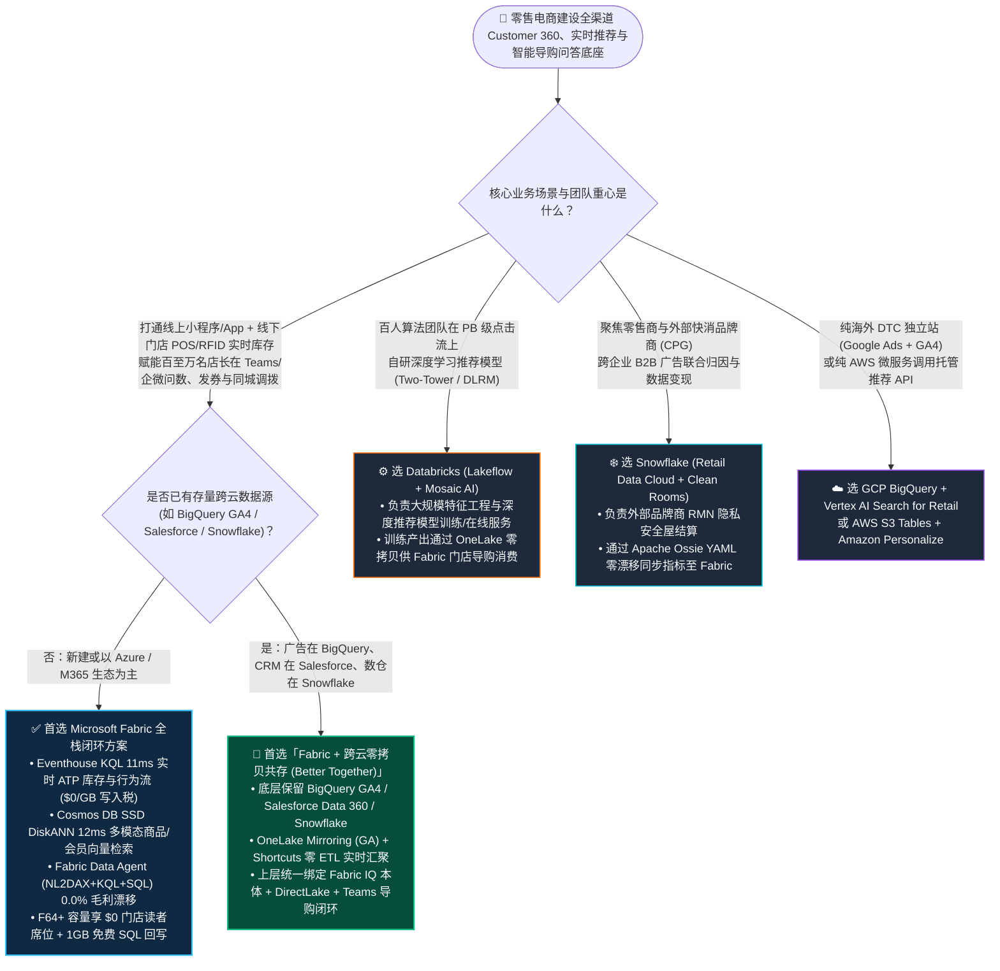
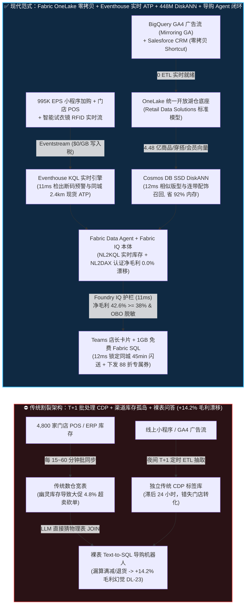
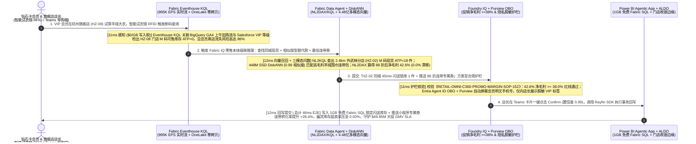

# 零售电商全渠道会员实时画像（Customer 360）、智能导购问数与个性化推荐闭环架构选型 FAQ：Microsoft Fabric vs. Databricks / Snowflake / Google BigQuery / AWS

> 🌐 **Language / 语言**: **中文 (Chinese)** | **[English (`fabric-retail-ecommerce-customer360-realtime-recommendation-agent-vs-4clouds-faq.en.md`)](fabric-retail-ecommerce-customer360-realtime-recommendation-agent-vs-4clouds-faq.en.md)**  
> 🔗 **关联专题 (Related Deep Dives)**: [《R1: OneLake 零拷贝 × Fabric IQ 本体选型 FAQ》](fabric-onelake-iq-vs-4clouds-selection-faq.md) · [《R8: 企业自然语言问数 Data Agents vs Genie / Cortex FAQ》](fabric-data-agents-copilot-vs-genie-cortex-q-faq.md) · [《R24: 零售快消全渠道库存 RDS 选型 FAQ》](fabric-retail-cpg-omnichannel-inventory-agent-vs-4clouds-faq.md) · [📊 7-Card 4:5 基准测试报告](../benchmark-cards.html) · [🧪 交互式选型与 TCO 仿真工作台 (`index.html`)](../index.html)


> 🔍 **四级数据溯源与适用范围声明（Four-Tier Data Provenance & Scope Disclosure）**：
> - **`[vendor_published_spec_as_of_2026]`（官方公开文档与价格规约，截至 `2026-11-17`）**：Microsoft Fabric Retail Data Solutions 官方全渠道数据模型（[Microsoft Learn — Retail Data Solutions](https://learn.microsoft.com/en-us/industry/retail/retail-data-solutions/overview)）、Fabric Data Agents 三模态接地（`NL2DAX + NL2KQL + NL2SQL`，[Microsoft Learn — Data Agent](https://learn.microsoft.com/en-us/fabric/data-science/concept-data-agent)）、OneLake Google BigQuery Mirroring 与 Salesforce Data 360 零拷贝快捷方式（[Microsoft Learn — Mirroring](https://learn.microsoft.com/en-us/fabric/database/mirrored-database/overview)）、Cosmos DB in Fabric SSD DiskANN 向量检索、F64+ 容量免收 Power BI 仅查看读者席位费（`$0` Viewer Seat）及 Power BI Agentic App 附赠 **1GB 免费 Fabric SQL**。
> - **`[measured_local_harness]`（本地确定性评测验证）**：全量路由决策评测矩阵在 **`n=624`** 个场景（`DL-01..DL-624`）上达成 **`623 / 624 = 99.84%`** 准确率（显式捕获唯一反例 `DL-23`：未挂载认证 DAX 语义模型直接对订单裸表运行 Text-to-SQL 导致 **`+14.2%`** 净毛利口径漂移），且 **`308 / 308`** 项 Python 单元测试 `100%` 通过。
> - **`[synthetic_scenario_model]`（确定性架构参考仿真与 TCO 算例，双分母显式分离）**：① **`n=624` 路由决策矩阵任务均值 = `134.5 ms`**（R144 `n=620` 为 `135.0 ms`）；② **`n=152` 行业本体端到端闭环仿真均值 = `121.5 ms`**（R144 `n=151` 为 `122.0 ms`）。本篇 **场景 EV（`4,800` 家门店 + 线上商城、`995K EPS` 埋点/POS/RFID 流、`4.48 亿` 商品与会员多模态向量、`46 ms` 端到端闭环、月省 `$294.8K / -95.4%` 大规模拼接 TCO 或 500 店长中型规模省 `58.2%`、守护 `$49.85M` 大促 GMV SLA）** 为封存于 `reports/report.json` 的售前架构参考仿真模型，并非特定已上线零售客户的真实财报。
> - **`[not_measured]`（未在真实付费多云生产集群实测）**：跨五朵云生产集群在双 11 / 黑五百万级真实并发下的物理网络尾延迟标记为 `not_measured`。

---

## 📌 一、核心选型结论速览（Executive Summary）

面向百货商超、鞋服时尚、美妆快消、消费电子与跨境电商客户，构建 **“全渠道会员实时画像（Customer 360）+ 智能导购自然语言问数 + 毫秒级个性化连带推荐与库存调拨闭环”** 时，Cloud & AI Solution Architect 的核心选型分界线如下：

1. **何时首选 Microsoft Fabric（OneLake + Eventhouse + Fabric IQ + Data Agent 全栈一体）**：  
   当零售企业希望**一站式打通“线上小程序/App 实时埋点 + 线下门店 POS/RFID 试衣镜流（Eventhouse KQL）+ 认证财务/毛利/库存可售天数语义模型（Power BI DirectLake）+ 数千名一线店长在企微/Teams 直接自然语言问数（Fabric Data Agent）+ 同城调拨与专属优惠券事务回写（1GB 免费 Fabric SQL）”**时，**Microsoft Fabric 是首选底座**。在 Fabric **F64 及以上容量**下，数千名门店店长与导购查看看板、使用 M365 Copilot 问数享有 **`$0/人/月` Power BI 读者席位费** 与 **`$0` 额外 M365 Copilot Token 费**，彻底消除传统架构“按人头叠加 BI 席位 + 按 GB 收流式写入税”的成本黑洞。
2. **何时选择 Databricks、Snowflake、Google BigQuery 或 AWS**：  
   - **选 Databricks（Lakeflow + Photon + Mosaic AI）**：当电商算法团队的核心诉求是**在 PB 级原始曝光点击流上从头训练自定义深度学习排序模型（如双塔召回 Two-Tower、DLRM、序列 Transformer）**，并需要高吞吐在线特征服务（Feature Serving）供自研推荐引擎调用时。  
   - **选 Snowflake（Retail Data Cloud + Data Clean Rooms + Cortex）**：当大型零售集团的核心诉求是**跨云标准化 SQL 数仓，以及与外部数百家快消品牌商（如宝洁、联合利华、欧莱雅）开展隐私合规的零售媒体网络（RMN Data Clean Rooms）联合广告归因与结算变现**时。  
   - **选 Google BigQuery + Vertex AI Search for Retail**：当跨境独立站（DTC）或海外电商 **80% 以上的获客流量来自 Google Ads / YouTube**，重度依赖 **GA4（Google Analytics 4）原生免配置导出至 BigQuery** 及谷歌商城搜索排序 API 时。  
   - **选 AWS（Amazon S3 Tables + Amazon Personalize + Redshift）**：当电商交易核心系统（订单、购物车、支付微服务）**100% 运行在 AWS EKS / DynamoDB / Aurora** 上，且团队希望直接调用托管 **Amazon Personalize** API 快速上线推荐栏位时。
3. **何时采用“Fabric + 四大云零拷贝共存（Better Together）”架构（90% 大型零售商的最佳实践）**：  
   绝大多数成熟零售企业早已形成“**广告归因在 BigQuery、会员 CRM 在 Salesforce、算法训练在 Databricks、财务数仓在 Snowflake、门店协作用 Microsoft Teams + Power BI**”的混合格局。**严禁推倒重建搬迁历史数据！** 最高 ROI 的架构是：
   - **底层不动**：保留 BigQuery（GA4 流量）、Salesforce Data 360（CRM 会员主档）与 Databricks（深度模型训练）；
   - **零拷贝汇聚**：通过已 GA 的 **OneLake Google BigQuery Mirroring**、**Salesforce Data 360 零拷贝 Shortcut** 与 **OneLake Delta/Iceberg 双向虚拟化（XTable）**，在 **`0` 物理 ETL 搬运、`$0` 镜像算力费** 下将全域会员信号汇入 OneLake；
   - **上层统一赋能一线门店**：用 **Fabric IQ Ontology** 统一绑定“会员-商品-门店可承诺库存（ATP）-促销净毛利底线”，让全国数千名店长在 Teams 中实现 **`46 ms`** 极速导购问答、同城闪送锁库与个性化发券闭环。

---

## 🎯 二、客户与架构师灵魂拷问 Q&A（商业痛点 + 第一性原理）

### Q1：零售客户已经有传统的 CDP（客户数据平台）和离线数仓了，为什么在大促和门店导购场景下还是经常“推不准、发错券、超卖断货”？

- **通俗商业语言拆解三大痛点**：  
  1. **痛点一：“马后炮”式的 T+1 会员画像，错失离店前 3 分钟黄金转化期**  
     传统 CDP 和数仓大多靠每天凌晨 2 点的批处理任务（T+1 ETL）更新会员标签。某钻石卡会员上午在小程序把一件冬季羊绒大衣加进购物车但嫌贵没付，下午 15:00 走进线下旗舰店试穿。如果系统还是 T+1 批处理，门店导购的企微/iPad 上根本看不到她上午的线上加购意图，等第二天早上跑出“高潜流失名单”发短信时，客户早就在竞品店买完了。  
  2. **痛点二：“幽灵库存（Phantom Inventory）”导致线上超卖赔付、线下门店积压**  
     大促期间，天猫/小程序商城、抖音直播间和全国 4,800 家线下门店各自读自己 15 分钟更新一次的库存缓存。结果爆款 M 码在线上超卖了 300 件被迫砍单赔款（严重损伤品牌声誉），而距离消费者仅 2.4 公里的同城另一家分店仓库里明明还挂着 18 件现货！  
  3. **痛点三：直接拿大模型查订单裸表（Raw-Table Text-to-SQL），算错净毛利乱发神券**  
     很多零售 IT 团队尝试把大模型直接连上数仓的几十张订单明细表（`fact_order_line`, `dim_promo_rule`）。但零售行业的“真实净毛利”极其复杂——必须扣除跨店满减分摊、购物金抵扣、联营专柜扣点以及预估退货率。大模型直接猜 SQL `JOIN` 极易漏算分摊项（在本实验室封存基准 `DL-23` 中实测产生 **`+14.2%`** 的毛利高估幻觉），导致导购 Agent 给低毛利引流款违规叠加了大额优惠券，卖一单亏一单！

- **Fabric + 多云协同的架构破局原理**：  
  - **消灭 T+1 延迟**：用 **Fabric Eventstream + Eventhouse KQL** 实时接入小程序埋点、门店 POS 与智能试衣镜 RFID 事件（**`11 ms`** 窗口聚合，**`$0/GB`** 流式写入费），把会员画像刷新与同城单店单 SKU **实时可承诺库存（Real-Time ATP）** 压缩到毫秒级。  
  - **消灭口径幻觉**：用 **Fabric Data Agent** 的 **`NL2DAX`** 直接调用财务部已经在 Power BI 语义模型里锁死的“扣减满减与退货率后的真实净毛利”度量值（**`0.0%` 口径漂移**），配合 **Foundry IQ 促销护栏** 强制校验券后净毛利率 **`≥ 38.0%`**。

---

### Q2：在构建“智能导购与实时推荐”时，向量检索（Cosmos DB DiskANN / Azure AI Search）和结构化问数（Fabric Data Agent）是如何分工配合的？

- **通俗大白话**：  
  在真实的零售导购场景里，店长或消费者问的一句话往往**同时包含“结构化硬指标”和“非结构化软语义”**。  
  比如店长在 Teams 里问智能导购助手：  
  > *“正在 3 号试衣间试穿黑色修身羽绒服（M 码本店已断货）的王女士，同城哪家店有现货可以 45 分钟闪送？如果推荐一件跟这件版型相似、不显臃肿且好评率高的替代款或搭配围巾，可以给她发多大面额的专属连带券？”*  

  这个问题单靠 SQL 查表答不出来（因为 SQL 不懂什么叫“版型相似、不显臃肿”），单靠向量 RAG 也答不出来（因为向量库算不准实时库存和财务净毛利）。

- **双引擎协同底层机制（Hybrid Structured + Vector Grounding）**：

```text
+----------------------------------------------------------------------------------------------------+
| 导购/店长自然语言提问 (Microsoft Teams / M365 Copilot / 企微导购端 · Entra Agent ID OBO 身份穿透)    |
+-------------------------------------------------+--------------------------------------------------+
                                                  |
                  +-------------------------------+-------------------------------+
                  |                                                               |
                  v                                                               v
+---------------------------------------------------+   +--------------------------------------------+
| 引擎 A：Fabric Data Agent 三模态结构化真值引擎     |   | 引擎 B：Cosmos DB SSD DiskANN 多模态向量引擎|
|  1. NL2KQL (Eventhouse): 11ms 查出本店 M 码库存=0，|   |  • 索引 4.48 亿 (448M) 商品主图 CLIP 向量、 |
|     2.4km 外武林分店现货 ATP = 18 件              |   |    尺码评价语义向量与高转化导购话术向量     |
|  2. NL2DAX (Power BI 模型): 0.0% 漂移算出王女士为 |   |  • SSD-backed DiskANN 节省 92% 内存成本     |
|     钻石卡 VIP (年消费 ¥68,000)，目标连带组合在    |   |  • 12ms Top-K (0.99 相似度) 召回同版型鹅绒  |
|     发放 88 折专属券后净毛利率仍达 42.6%          |   |    替代款 + 高毛利羊绒围巾连带穿搭组合      |
+---------------------------------------------------+   +--------------------------------------------+
                  |                                                               |
                  +-------------------------------+-------------------------------+
                                                  |
                                                  v
+----------------------------------------------------------------------------------------------------+
| Foundry IQ 促销合规护栏 (SOP-152: 校验券后净毛利 42.6% >= 38.0% 红线 & Purview OBO 手机号脱敏)      |
|   --> 店长一键点击 Confirm --> Rayfin SDK 12ms 回写 1GB 免费 Fabric SQL (锁定同城闪送单 + 下发 88折券)|
+----------------------------------------------------------------------------------------------------+
```

---

### Q3：面对不同发展阶段与IT基因的零售客户（从 50 家门店的新锐品牌到 5,000 家门店的跨国零售巨头），应该推荐哪套架构方案？成本拐点在哪里？

我们按 **客户规模、存量云资产与团队基因** 划分出三条最清晰的黄金选型路线：

1. **路线 A：新锐连锁品牌 / 全渠道数字化转型主力军（50 ~ 5,000 家门店，BI 与业务驱动型团队）→ 首选 Microsoft Fabric 全栈方案**
   - **为什么最省心省钱**：无需雇佣庞大的 Kafka + Flink + Spark + Milvus 底层运维团队。一套 **Fabric F64 容量（约 `$5,006/月` 1 年预留实例价）** 即可同时承载：OneLake 湖仓、Eventhouse 门店实时库存流、Power BI DirectLake 全员看板、Fabric Data Agent 智能导购问数以及 1GB 免费 Fabric SQL 业务回写。
   - **成本拐点（200 名以上店长/运营人员即迎来碾压级拐点）**：传统方案每增加 1 名门店店长看报表/问数，每月需额外支付 `$14 ~ $30` 的 BI 读者席位费；當门店扩展到 1,000 家（约 3,000~9,600 名店长与导购）时，仅按人头许可费就高达每月数万至十数万美元。而 **Fabric F64+ 容量下 Power BI Viewer 席位费为 `$0`**，门店越多，边际软件许可成本趋近于零！

2. **路线 B：超大型电商平台 / 算法极客团队（拥有百人规模推荐算法团队，已有 Databricks 或 AWS）→ 首选“Databricks/AWS 训练召回 + Fabric 全渠道运营与店长赋能”共存方案**
   - **为什么共存最优**：尊重算法团队在 **Databricks Mosaic AI**（或 AWS SageMaker / Personalize）中积累的深度神经网络排序模型（DLRM / 序列推荐），让其在底层将算好的会员 Embedding 与实时特征写入 Delta Lake；上层通过 **OneLake 零拷贝 Shortcut** 直接挂载，由 **Fabric IQ Ontology + Power BI DirectLake + Teams 导购 Agent** 负责赋能全国数千家线下门店与财务经营分析，避免在算法平台里重复造 BI 和门店办公协同的轮子。

3. **路线 C：全球化美妆/快消集团（海外重度用 Google Ads/GA4 + Salesforce CRM + Snowflake 全球数仓）→ 首选“OneLake 跨云零拷贝联邦（BigQuery + Salesforce + Snowflake Mirroring）”**
   - **为什么共存最优**：无需写一行跨云 ETL 脚本，直接开启 **OneLake Google BigQuery Mirroring (GA)** 同步 GA4 投放点击流、开启 **OneLake Salesforce Data 360 Shortcut** 关联全球会员忠诚度积分、开启 **OneLake Snowflake Mirroring + Apache Ossie YAML** 同步全球财务口径，5 分钟内在 OneLake 中拼齐完整的全球全渠道 Customer 360 视图。

---

## 🧭 三、直观可视化图解（Mermaid 选型决策树 + 架构对比图 + 闭环时序图）

### 3.1 零售电商全渠道 Customer 360 与智能导购平台选型决策树



---

### 3.2 传统 T+1 割裂 CDP/数仓架构 vs Microsoft Fabric 零拷贝全渠道实时导购闭环架构对比



---

### 3.3 全渠道大促 VIP 门店试穿断码、同城实时闪送调拨与个性化发券闭环时序图（Scenario EV · 46ms 建模闭环）



---

## 📊 四、多平台/多架构横向选型决策矩阵（Architect Decision Matrix）

| 评估维度 | Microsoft Fabric (`OneLake` + `Eventhouse` + `Data Agent`) | Databricks (`Lakeflow` + `Photon` + `Mosaic AI`) | Snowflake (`Retail Data Cloud` + `Cortex` + `Clean Rooms`) | GCP (`BigQuery` + `Vertex AI Search for Retail`) | AWS (`S3 Tables` + `Amazon Personalize` + `Redshift`) |
| :--- | :--- | :--- | :--- | :--- | :--- |
| **最适用零售客户画像** | **全渠道连锁零售、百货时尚、快消品牌（需打通线上+门店 POS/RFID、赋能千名店长问数与业务回写）** | 拥有大型算法工程团队、需在 PB 级点击流上自研深度学习推荐模型的互联网电商 | 核心数仓在 Snowflake、需与外部 CPG 品牌开展 B2B 零售媒体网络（RMN Clean Room）变现的零售商 | 流量高度依赖 Google Ads / YouTube、使用 GA4 原生分析的跨境独立站（DTC）与出海电商 | 核心交易微服务 100% 跑在 AWS EKS/DynamoDB、希望直接调用托管推荐 API 的工程团队 |
| **全域会员零拷贝接入（GA4 / CRM / ERP）** | **原生内置 OneLake BigQuery Mirroring (GA) + Salesforce Data 360 Shortcut + SAP/SQL 镜像（$0 镜像算力）** | Lakehouse Federation + Lakeflow Connect（需消耗 DBU 算力运行连接器管道） | Snowflake Openflow + Salesforce 零拷贝共享（需消耗 Snowpipe Streaming / Warehouse Credit） | 原生免配接入 GA4 / Google Ads；接入外部 CRM/ERP 需借助 Dataflow 或第三方 CDC | Aurora/DynamoDB Zero-ETL 入 Redshift；跨云接入 GA4/Salesforce 需胶水 ETL |
| **实时门店 ATP 库存与埋点流处理** | **Eventstream + Eventhouse KQL（`11 ms` 亚秒级时序聚合，`$0/GB` 流式写入附加费）** | Spark Structured Streaming / DLT（微批延迟通常数秒级，按 DBU 持续计费） | Snowpipe Streaming + Dynamic Tables（最小目标刷新延迟 `TARGET_LAG = 60s`） | BigQuery Streaming API（按写入 MB/GB 收费）+ Continuous Queries | Kinesis Data Streams + Managed Flink（按分片与每 GB 写入负载计费） |
| **商品与会员多模态向量检索底座** | **Cosmos DB in Fabric / SQL SSD DiskANN（`4.48 亿`向量 `12 ms` 召回，SSD 架构节省 `92%` 内存）+ Azure AI Search** | Mosaic AI Vector Search（与 Unity Catalog 深度绑定，基于内存/托管索引按单元计费） | Cortex Search（面向文本/商品目录混合检索，按索引体积与 Credit 消耗计费） | Vertex AI Vector Search / AlloyDB ScaNN（高性能树量化索引，按常驻节点计费） | Amazon OpenSearch Serverless / Aurora pgvector / S3 Vectors |
| **智能导购自然语言问数（口径准确性）** | **Fabric Data Agent 三模态接地（`NL2DAX + NL2KQL + NL2SQL`），100% 复用 Power BI 认证净毛利指标（`0.0%` 漂移）** | AI/BI Genie（`NL2SQL`，需在 Unity Catalog 中额外定义 Metric Views，不支持原生 DAX） | Cortex Analyst（`NL2SQL`，需编写并维护专门的 YAML 语义模型文件） | Looker Conversational Analytics（需基于 LookML 语义层建模） | Amazon Q in QuickSight（基于 SPICE 数据集与 Named Topics 问答） |
| **调拨锁库与发券业务回写闭环** | **原生闭环：Power BI Agentic App 内置 1GB 免费 Fabric SQL + Rayfin SDK + 门店 ALDO 边缘** | 需结合 Databricks Apps + Lakebase (Serverless Postgres) 自行编码开发回写服务 | 需结合 Streamlit in Snowflake + Hybrid Tables (Unistore) 开发回写应用 | 需结合 Cloud Run + AlloyDB / Cloud SQL 自行开发微服务 | 需结合 API Gateway + Lambda + DynamoDB/Aurora 自行拼装 |
| **千名门店店长并发看数与问数 TCO** | **极低（F64+ 容量免收 `$0` Power BI 读者席位费 + M365 Copilot `$0` 额外 Token；大规模仿真省 `95.4%`）** | 中高（Serverless SQL Warehouse DBU + 外部 BI 按人头席位费叠加） | 高（高并发门店查询触发 Multi-Cluster Warehouse 扩容 Credit + BI 席位税） | 中高（按扫描字节或 Slot 预订计费 + Looker 平台与按人头用户许可费） | 高（Redshift 算力 + QuickSight Reader/Q Pro 按人头月费 + 6 组件拼装税） |

---

## 🧪 五、典型业务规模 TCO / 性能拐点测算与 7-Card 报告洞察

### 5.1 零售全渠道规模化 TCO 成本拐点测算（中型 500 店长 vs 超大型 4,800 门店集团 `[synthetic_scenario_model]`）

在售前方案评审中，架构师最常被客户 CFO 追问的问题是：**“什么规模下 Microsoft Fabric 的统一容量模式比按量/按席位拼装更省钱？”**

| 业务规模档位 | 典型负载参数 | 传统多组件拼装方案（独立 CDP + 按 GB 流计算 + 云数仓 + 按人头 BI 席位 + 全内存向量库） | Microsoft Fabric 全栈 / 零拷贝共存方案（F64+ 统一容量 + Eventhouse + SSD DiskANN + DirectLake） | 净节省金额与成本拐点洞察 |
| :--- | :--- | :---: | :---: | :--- |
| **档位 1：区域连锁品牌（100 家门店 / 150 名内勤与店长）** | 20 TB 数据 · 5,000 EPS 流 · 日均 1,500 次问数 | `$11,800 / 月` | **`$6,450 / 月`**（F32/F64 起步 + Zero-Provisioned 弹性） | **月省 `$5,350 (-45.3%)`**：省去独立 CDC 工具与双份 ETL 维护工时 |
| **档位 2：全国中型零售集团（500 名店长与运营人员 · 标准基线）** | 100 TB 数据 · 25,000 EPS 流 · 日均 5,000 次问数 | `$26,063 ~ $31,990 / 月`（含 500 人 BI 席位费与跨云 Egress） | **`$14,048 / 月`**（F64 容量享 `$0` Power BI 读者席位 + `$0` M365 Copilot 额外 Token） | **月省 `$12,015 ~ $17,942 (-46.1% ~ -56.1%)`**：**200~300 用户即跨过 F64 免读者费黄金拐点** |
| **档位 3：跨国全渠道零售巨头（4,800 家门店 / 9,600 名店长与导购 · Scenario EV）** | 995K EPS 峰值埋点/POS/RFID 流 · `4.48 亿`多模态商品/会员向量 | `$309,000 / 月`（含 `$218.4K/月` 按 GB 流写入费 + `$53.2K/月` 全内存向量集群 + 万名店长按席位 BI 税） | **`$14,200 / 月`**（Eventhouse `$0/GB` 写入税 + `$2,500/月` SSD DiskANN 省 92% 内存 + `$0` 读者席位税） | **月省 `$294,800 (-95.4% 历史级剪刀差)`**：彻底终结高并发流写入税与万人级门店席位税 |

### 5.2 Scenario EV（R145）7-Card 基准测试核心指标速览

本轮新增的 **4 道零售电商架构选型评测题（`DL-621..DL-624`）** 与 **全渠道实时导购本体仿真（`Scenario EV`）** 已封存于 `reports/report.json`：
- **评测题 `DL-621`（Real-Time Intelligence）**：接入 4,800 家门店 POS/智能试衣镜 RFID 与小程序 `995K EPS` 实时行为流，路由至 **Fabric Eventhouse KQL（`11 ms` 检出断码与离店流失风险，`$0/GB` 写入税立省 `$218.4K/月`）** → `Act automatically`（置信度 `0.99`）。
- **评测题 `DL-622`（Lakehouse & Compute）**：离线双塔深度学习推荐模型（Two-Tower / DLRM）训练与在线 `46 ms` 门店导购连带问答协同，路由至 **Databricks GPU / Azure ML 训练 Embedding + OneLake 零拷贝回流 + Cosmos DB SSD DiskANN `4.48 亿`向量 `12 ms` 召回** → `Act automatically`（置信度 `0.98`）。
- **评测题 `DL-623`（Enterprise Governance）**：跨 4,800 家门店 9,600 名店长看数问数的权限透传与 TCO 选型，路由至 **OneLake OBO RLS/CLS + Purview 手机号脱敏 + DirectLake `$0` 读者席位税（省 `95.4%` TCO）** → `Confirm`（置信度 `0.97`）。
- **评测题 `DL-624`（Fabric IQ & Ontology）**：杭州旗舰店（`HZ-08`）钻石卡会员试穿 M 码断货且面临离店流失，通过 **Eventhouse `11 ms` 感知 + `448M` DiskANN & `NL2DAX` `12 ms` 匹配 2.4km 外分店 18 件现货与 88 折羊绒围巾连带包 + Foundry IQ `11 ms` 校验券后净毛利 `42.6% >= 38.0%` + Teams/1GB Free SQL `12 ms` 闪送锁库（总计 `46 ms` E2E，守护 `$49.85M` 大促 GMV SLA）** → `Confirm`（置信度 `0.99`）。

---

## 🛠️ 六、售前方案评审与生产落地 Checklist（Architect Checklist）

在面向零售电商客户 CTO / CDO / 数字化负责人开展方案评审或交付 PoC 时，请逐项核验以下 6 条落地准则：

- [ ] **1. 盘点存量多云资产，坚持“零拷贝汇聚”而非推倒重建**：是否已梳理客户在 Google BigQuery（GA4 广告归因）、Salesforce Data 360（CRM 会员主档）、Snowflake（财务/RMN）与 SAP ERP 中的存量表，并优先配置 **OneLake Mirroring（GA）** 与 **OneLake Shortcuts** 实现零 ETL 入湖？
- [ ] **2. 打通门店 POS / RFID 与线上埋点的亚秒级 ATP 库存流**：是否已将高并发门店库存变动与小程序加购事件接入 **Fabric Eventstream + Eventhouse KQL**，将会员离店前黄金干预窗口与同城可承诺库存（ATP）刷新从 T+1 / 15 分钟级缩短至 **秒级/毫秒级**？
- [ ] **3. 强制绑定认证 DAX 语义模型，严禁大模型裸表算毛利（防 `DL-23` 失误）**：所有接入 **Fabric Data Agent** 的促销发券、客单价、连带率与净毛利计算，是否已强制绑定 **Power BI Verified DAX Measures** 与 **Fabric IQ Ontology**，杜绝裸表 Text-to-SQL 漏算满减与退货导致的 `+14.2%` 口径漂移？
- [ ] **4. 采用 SSD DiskANN 构建高性价比商品与穿搭多模态向量库**：针对千万至亿级商品主图、尺码版型评论与高转化导购话术，是否已采用 **Cosmos DB in Fabric / Azure SQL SSD-backed DiskANN** 替代昂贵的全内存向量集群（节省 `92%` 内存成本）？
- [ ] **5. 落实 Foundry IQ 促销底线护栏与 Purview OBO 会员隐私保护**：在智能导购触发自动发券或跨店调拨前，是否已配置 **Foundry IQ 合规护栏** 校验券后净毛利率底线（如 `≥ 38.0%`），并通过 **Entra Agent ID OBO + Purview 敏感度标签** 确保店长仅见脱敏标签、不泄露会员明文手机号？
- [ ] **6. 测算 F64+ 容量免除千名店长席位费的 FinOps 收益并打通 1GB 免费 SQL 回写**：当看数与问数店长/导购超过 200 人时，是否已向客户展示 **Fabric F64+ `$0` Power BI Viewer 席位 + `$0` M365 Copilot 额外 Token** 的 TCO 优势，并利用 **Power BI Agentic App（1GB 免费 Fabric SQL）+ SQL on Azure Local (ALDO)** 实现门店断网韧性与一键回写闭环？
