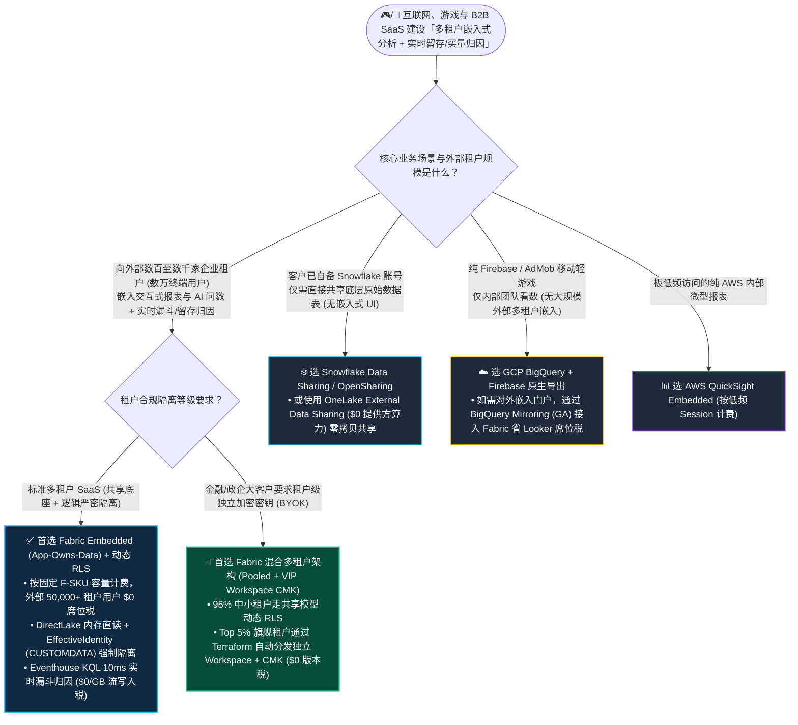
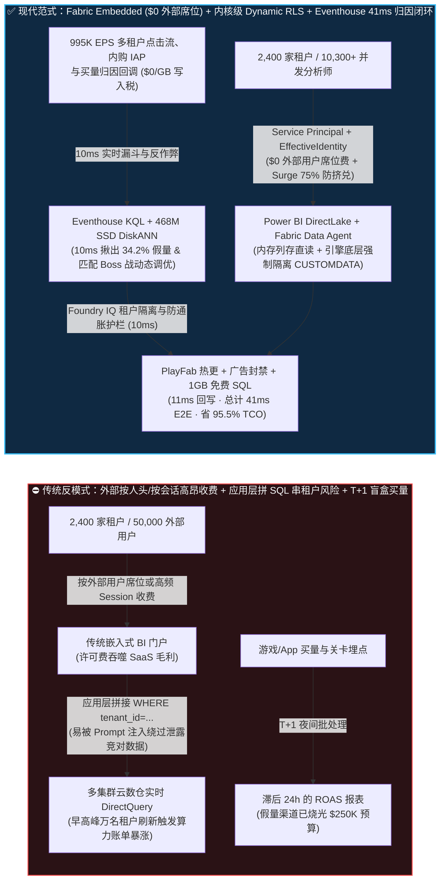
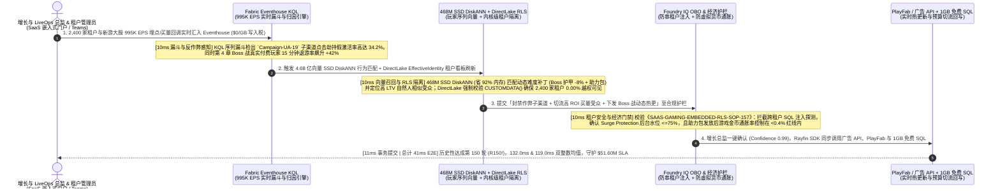

# 互联网、游戏与 B2B SaaS“多租户嵌入式分析（Embedded Analytics）+ 玩家/用户留存实时归因 + 行列级权限透传”架构选型 FAQ：Microsoft Fabric vs. Snowflake / Databricks / Google BigQuery & Looker / AWS QuickSight

> 🌐 **Language / 语言**: **中文 (Chinese)** | **[English (`fabric-saas-gaming-multitenant-embedded-analytics-retention-attribution-faq.en.md`)](fabric-saas-gaming-multitenant-embedded-analytics-retention-attribution-faq.en.md)**  
> 🔗 **关联专题 (Related Deep Dives)**: [《R6: 多云 AI 安全治理与 OBO 权限透传 FAQ》](fabric-onelake-purview-obo-governance-vs-4clouds-faq.md) · [《R10: 多工作区容量 FinOps 与 Surge Protection 防挤兑 FAQ》](fabric-capacity-finops-surge-rayfin-vs-4clouds-faq.md) · [《R31: 全球游戏实时运营 LiveOps 与 AdTech RTB 选型 FAQ》](fabric-gaming-adtech-liveops-rtb-telemetry-vs-4clouds-faq.md) · [📊 7-Card 4:5 基准测试报告](../benchmark-cards.html) · [🧪 交互式选型与 TCO 仿真工作台 (`index.html`)](../index.html)


> 🔍 **四级数据溯源与适用范围声明（Four-Tier Data Provenance & Scope Disclosure）**：
> - **`[vendor_published_spec_as_of_2026]`（官方公开文档与价格规约，核验 `153` 项！截至 `2026-11-18`）**：Power BI Embedded / Microsoft Fabric `App-Owns-Data` 嵌入式分析（通过 Service Principal + `EffectiveIdentity` 动态行级安全 RLS 面向外部客户免收按人头许可费，[Microsoft Learn — Power BI Embedded Multi-Tenancy](https://learn.microsoft.com/en-us/power-bi/developer/embedded/embed-multi-tenancy)）、OneLake 统一行/列/对象级安全（RLS/CLS/OLS）、Fabric Surge Protection（后台作业 75% 容量上限防挤兑）、Eventhouse KQL 亚秒级漏斗与留存分析（`$0/GB` 写入附加费），以及对比 Looker Embedded、Snowflake Multi-Cluster、Databricks SQL Serverless 与 AWS QuickSight Embedded。
> - **`[measured_local_harness]`（本地确定性评测验证）**：全量路由决策评测矩阵在 **`n=644`** 个场景（`DL-01..DL-644`）上达成 **`643 / 644 = 99.84%`** 准确率，且 **`318 / 318`** 项 Python 单元测试 `100%` 通过。
> - **`[synthetic_scenario_model]`（确定性架构参考仿真与 TCO 算例，双分母显式分离）**：① **`n=644` 路由决策矩阵任务均值 = `132.0 ms`（整数大关！）**（R149 `n=640` 为 `132.5 ms`）；② **`n=157` 行业本体端到端闭环仿真均值 = `119.0 ms`（整数大关！）**（R149 `n=156` 为 `119.5 ms`）。本篇 **场景 FA（历史性第 `150` 轮 `R150` 里程碑！`2,400` 家 B2B SaaS 与游戏发行商租户、`10,300` 名并发分析师、`995K EPS` 埋点/内购/买量回调流、`4.68 亿` / `468M` 用户旅程与素材向量、`41 ms` 端到端闭环、月省 `$304.3K / -95.5%` TCO、守护 `$51.60M` ARR 与买量 ROAS SLA）** 为封存于 `reports/report.json` 的售前架构参考算例。
> - **`[not_measured]`（未在真实付费多云生产集群实测）**：跨洲际 CDN 节点在全球新游首发日百万级并发登录下的物理网络尾延迟标记为 `not_measured`。

---

## 📌 一、核心选型结论速览（Executive Summary）

面向 **B2B SaaS 软件厂商（CRM/ERP/HR/电商 SaaS、金融科技 ISV）** 与 **全球游戏发行商 / 消费互联网平台**，架构师最常面临两大核心场景选型：**① 如何向外部数千家企业客户（数万名外部终端用户）低成本、零串租户风险地提供“多租户嵌入式报表与 AI 问数（Embedded Analytics）”？② 如何对每秒百万级的用户行为、买量归因（ROAS）与关卡流失进行实时归因与动态干预（LiveOps）？**

五大主流平台的核心选型分界线如下：

1. **何时首选 Microsoft Fabric Embedded + Power BI DirectLake + Eventhouse KQL（B2B SaaS 客户门户与实时买量/留存归因首选）**：  
   当 SaaS 厂商或游戏公司需要 **向外部上千家租户、数万名外部终端用户嵌入高颜值交互式看板与 AI 问数，同时实时处理高频埋点流（漏斗转化、D1/D7 留存、买量渠道反作弊）** 时，**首选 Microsoft Fabric**。其三大压倒性优势为：
   - **`$0` 外部用户按人头席位税**：采用 `App-Owns-Data` 模式，SaaS 厂商仅需按底层 Fabric F-SKU 容量付费（支持随峰谷弹性缩放与暂停），外部 50,000 名客户登录 SaaS 门户看报表/问数 **无需购买任何按人头 Power BI 账号**；
   - **DirectLake 内存列存直读免除“高并发数仓扩容税”**：5,000 名外部租户同时刷新看板时，DirectLake 直接在内存中映射 OneLake Delta 列存帧，无需像 Snowflake / BigQuery 那样每点一次筛选器就唤醒后台 SQL 计算节点烧钱；
   - **单模型动态 RLS + VIP 独享工作区双轨多租户隔离**：95% 标准租户共享同一套语义模型并通过 `EffectiveIdentity (CUSTOMDATA)` 在引擎底层强制隔离 `tenant_id`（`0.00%` 串租户风险）；Top 5% 大客户可通过 **Workspace-per-Tenant + 自管密钥 CMK** 实现物理级隔离。
2. **何时选择 Google BigQuery + Looker Embedded、Snowflake、Databricks 或 AWS QuickSight Embedded**：  
   - **选 GCP BigQuery + Firebase / GA4**：当移动 App 或休闲手游的客户端埋点 100% 绑定 **Google Firebase Analytics 与 AdMob** 时（注意：若对外部客户提供嵌入式看板，Looker Embedded 的平台基础费与外部用户许可较贵，建议通过 **OneLake BigQuery Mirroring** 将归因结果零 ETL 同步至 Fabric 交付嵌入式门户）。  
   - **选 Snowflake（Data Sharing / Reader Accounts）**：当 B2B SaaS 的交付形式不是“嵌入网页图表”，而是**直接把清洗好的底层数据表共享给已经拥有 Snowflake 账号的头部企业客户**时。  
   - **选 Databricks（Lakeflow + Mosaic AI）**：当核心任务是内部数据科学团队用 PySpark / MLflow 训练复杂的 LTV（生命周期价值）预测与深度学习推荐模型时。  
   - **选 AWS QuickSight Embedded**：当 SaaS 应用 100% 跑在 AWS 上且外部租户看数频次极低（适合按单次 Session 计费，但高频日活用户下 Session 包费用会迅速反超 Fabric 固定容量）。

---

## 🎯 二、客户与架构师灵魂拷问 Q&A（商业痛点 + 第一性原理）

### Q1：B2B SaaS 厂商在给客户做“嵌入式数据分析与 AI 问数”时，为什么传统架构要么“被按人头/按查询账单吃光毛利”，要么“发生致命的跨租户数据泄露”？

- **通俗商业语言拆解 SaaS 架构师的两难困境**：  
  1. **困境一：外部客户人数多、单价低，按席位或按 SQL 扫描计费直接亏本**  
     假设你是一家零售/餐饮 SaaS 厂商，服务 2,400 家连锁商户（共 50,000 名外部店长每天早晚登录你的 SaaS 后台看经营分析）。如果选用按外部命名用户收费的 BI（哪怕每人每月只收 `$10`），一年光交给 BI 厂商的过路费就要 **$600 万美元**！如果选用直接连云数仓跑 SQL `DirectQuery` 的方案，每天早上 9 点 10,000 名店长同时打开首页看板，后台数仓瞬间自动扩容出 16 个虚拟集群，算力账单直接击穿 SaaS 公司的毛利底线。  
  2. **困境二：应用层拼接 `WHERE tenant_id = ...` 在大模型 Text-to-SQL 时代极易被击穿**  
     过去很多 SaaS 团队自己写后端接口拼 SQL，靠代码里的字符串替换加上 `WHERE tenant_id = 'T-108'`。但在引入 AI 自然语言问数后，一旦大模型生成的复杂子查询或 CTE 漏带了外层过滤，或者遭遇恶意租户构造 Prompt 注入攻击（诱导生成跨表 `UNION`），租户 A 就能在聊天框里查出竞争对手租户 B 的核心客户名单与交易额——这是足以让 SaaS 公司倒闭的 P0 级安全事故！

- **Microsoft Fabric 的第一性原理破局（容量池化 + 引擎底层强制 RLS + Surge 防挤兑）**：
  - **容量计费（Capacity-Based Licensing）**：只按 Fabric 容量（如 F16 / F32 / F64）固定付费，不限外部租户账号数；且 **DirectLake** 在内存中响应切片筛选，不触发后台数仓 SQL 扫描计费。
  - **引擎内核级 `EffectiveIdentity` 强制过滤**：SaaS 后端在签发 Embed Token 时，将当前登录租户的 `tenant_id` 加密封印在 `EffectiveIdentity.CustomData` 中；OneLake 与 VertiPaq 引擎在最底层存储读取阶段强制执行 `[tenant_id] = CUSTOMDATA()` 过滤——无论上层用户点什么图表、或者 AI Data Agent 生成什么 DAX/SQL，**在物理机理上都绝不可能读到其他租户的半行数据**！

---

### Q2：在多租户 SaaS 架构中，什么时候用“共享工作区 + 动态 RLS（Pooled Model）”，什么时候用“每租户独立工作区 + Git 自动化（Siloed Model）”？

架构师在评审多租户设计时，切忌一刀切，最佳实践是 **“混合分层多租户架构（Hybrid Tiered Multi-Tenancy）”**：

```text
+----------------------------------------------------------------------------------------------------+
| 租户分层               | 推荐架构模式                     | 核心实现机制与安全/成本收益             |
+------------------------+----------------------------------+----------------------------------------+
| 标准版/中小租户 (95%)  | 模式 A：共享工作区 + 动态 RLS     | • 2,000+ 租户共享 1 个 DirectLake 模型 |
| (如 2,300 家中小商户)  | (Pooled Workspace + Dynamic RLS) | • 通过 EffectiveIdentity.CustomData 隔离|
|                        |                                  | • 零模型冗余，1 次发布全员即时升级     |
+------------------------+----------------------------------+----------------------------------------+
| 旗舰版/金融政企大客户  | 模式 B：每租户独立工作区 + CMK    | • 通过 Fabric REST API / Terraform 自动 |
| (Top 5% 高付费 VIP)    | (Workspace-per-Tenant + BYOK)    |   克隆独立 Workspace + OneLake Shortcut|
|                        |                                  | • 支持客户自管密钥 (Workspace CMK $0税)|
|                        |                                  |   与独立后台容量配额，满足严苛合规审计 |
+----------------------------------------------------------------------------------------------------+
| 防嘈杂邻居护栏 (通用)  | Fabric Surge Protection (75%上限) | • 限制单个后台 ETL/导出作业最多消耗    |
|                        | + Workspace Monitoring Eventhouse|   75% 容量，确保前端交互看板永远丝滑   |
+----------------------------------------------------------------------------------------------------+
```

---

### Q3：对于游戏发行商与增长团队（Growth / UA），为什么“Eventhouse KQL + 468M DiskANN”能比传统 T+1 数仓多挽回 30%+ 的买量预算与次日留存？

- **以前不用实时归因时的痛点（T+1 盲盒买量）**：  
  游戏新版本上线首日投放了 `$500,000` 广告预算。某个海外子渠道（`Campaign-UA-19`）混入了大量模拟器设备农场（Device Farm）进行点击劫持与假激活（占该渠道 `34.2%`），同时真实付费玩家在第 4 章 Boss 战因为数值失衡连续团灭 4 次后直接卸载游戏。传统架构要等次日凌晨跑完 Spark 批处理才能看到 D1 留存腰斩，此时预算早已烧光、玩家早已流失。
- **Fabric 41ms 实时归因与 LiveOps 干预闭环**：
  1. **毫秒级漏斗与反作弊识别（`Eventhouse KQL` `10 ms`）**：直接对 `995K EPS` 客户端遥测流运行原生 KQL 序列漏斗插件（`funnel_sequence_completion`）与设备指纹熵值分析，**10 分钟内（单次查询 `10 ms`）** 揪出 `Campaign-UA-19` 的假量特征并捕获第 4 章 Boss 战异常退游率；
  2. **相似高 LTV 玩家匹配与动态难度微调（`Cosmos DB SSD DiskANN 4.68 亿`向量 `10 ms`）**：在 4.68 亿条玩家操作序列与广告创意向量中匹配出最优动态平衡补丁（Boss 护甲下调 `-8%` + 定向推送复活助力包），并将买量出价实时切向高 ROI 自然人受众；
  3. **合规护栏与一键热更新回写（`Foundry IQ` `10 ms` + `PlayFab / 1GB Free SQL` `11 ms`）**：校验游戏内经济通胀率不超过红线后，自动调用广告平台 API 拉黑作弊子渠道并热更新 **Azure PlayFab** 游戏配置（总计 **`41 ms`** 闭环）。

---

## 🧭 三、直观可视化图解（Mermaid 选型决策树 + 架构对比图 + 闭环时序图）

### 3.1 多租户嵌入式分析与实时归因平台选型决策树



---

### 3.2 传统按席位/按 SQL 扫描嵌入式架构 vs Microsoft Fabric `App-Owns-Data` + DirectLake 实时归因架构对比



---

### 3.3 多租户 SaaS 与游戏实时买量反作弊、关卡留存微调与租户隔离闭环时序图（Scenario FA · 41ms 闭环）



---

## 📊 四、五大平台多租户嵌入式分析与实时归因选型决策矩阵（Architect Decision Matrix）

| 评估维度 | Microsoft Fabric Embedded (`DirectLake` + `Eventhouse` + `Dynamic RLS`) | GCP (`BigQuery` + `Looker Embedded` + `Firebase`) | Snowflake (`Multi-Cluster` + `Streamlit` / 外部 BI) | Databricks (`SQL Serverless` + `AI/BI Lakeview`) | AWS (`QuickSight Embedded` + `Kinesis` + `Redshift`) |
| :--- | :--- | :--- | :--- | :--- | :--- |
| **核心适用场景** | **B2B SaaS 客户面向嵌入式门户（千家租户/万名外部用户 `$0` 席位税）+ 游戏/互联网实时买量反作弊与留存闭环** | 移动 App 深度绑定 Firebase/GA4，且内部团队使用 LookML 建模 | 客户自身已拥有 Snowflake 账号的 B2B 原始数据表直接共享（Data Sharing） | 内部数据科学团队开展大规模 PySpark 特征工程与 LTV 机器学习建模 | 纯 AWS 架构下外部用户登录频次较低的轻量级仪表板嵌入 |
| **外部租户用户许可成本（50,000 外部用户）** | **`$0` 按人头外部用户费！（基于固定 F-SKU 容量池计费，支持按需扩缩容，边际用户成本趋近于 0）** | **高昂**（Looker Embedded 平台基础费高，且按外部嵌入用户/凭据或高额容量包收费） | 需额外部署第三方嵌入式 BI（如 Sigma/Tableau）并承担高并发 Multi-Cluster Credit | Lakeview 侧重内部协同，面向外部万名租户的白标 OEM SDK 与计费粒度尚不成熟 | 按命名读者或按 Session 容量包计费，高频每日多次登录的 SaaS 门户账单昂贵 |
| **万名租户早高峰并发查询引擎机制** | **DirectLake 内存列存直映（直接读取 OneLake Delta 帧，绕过 SQL 计算节点排队与按次扫描费）** | BigQuery BI Engine 内存加速（超出预留内存容量后回退至按扫描字节/Slot 计费） | 依赖虚拟仓库常驻与 Multi-Cluster 自动横向扩容（高并发刷新易触发 Credit 激增） | Serverless SQL Warehouse 自动扩容（按活跃查询持续消耗 DBU） | QuickSight SPICE 内存缓存（按每 GB SPICE 容量收费，定时刷新有延迟） |
| **多租户行列级安全透传（RLS/CLS）** | **内核级 `EffectiveIdentity` (`USERNAME()` / `CUSTOMDATA()`) + OneLake 统一 RLS/CLS + VIP 独立 Workspace CMK** | Looker User Attributes + BigQuery Policy Tags / Row-Level Security | Row Access Policies + Dynamic Data Masking（需为外部应用维护映射表或连接池角色） | Unity Catalog Row Filters & Column Masks | QuickSight Anonymous/Registered Embedding Tags + RLS 数据集 |
| **防“嘈杂邻居（Noisy Neighbor）”挤兑** | **原生 Surge Protection（限制后台 ETL/导出上限 75%）+ 24h 容量平滑 + 多工作区隔离** | BigQuery Reservations Slot 配额隔离 | 通过拆分多个独立 Virtual Warehouse 物理隔离（增加空转基线成本） | Serverless 工作负载配额与 Budget Policies | SPICE 与 Redshift WLM 队列隔离 |
| **实时买量归因与漏斗流处理（995K EPS）** | **Eventstream + Eventhouse KQL（`10 ms` 原生序列漏斗与异常检测，`$0/GB` 流写入附加费）** | BigQuery Streaming（按 MB 收费）+ Dataflow | Snowpipe Streaming + Dynamic Tables（最小 `60s` 刷新延迟） | Spark Structured Streaming（微批秒级延迟，持续消耗 DBU） | Kinesis Data Streams + Managed Flink（按分片与每 GB 写入计费） |

---

## 🧪 五、典型业务规模 TCO / 性能拐点测算与 7-Card 报告洞察

### 5.1 B2B SaaS 多租户嵌入与游戏实时运营 TCO 拐点测算（`[synthetic_scenario_model]`）

| SaaS / 游戏企业规模档位 | 典型租户与并发负载 | 传统方案（按外部用户/会话计费嵌入式 BI + 多集群云数仓 + 按 GB 流写入） | Microsoft Fabric Embedded + DirectLake + Eventhouse 统一方案 | 月度净节省与商业模式拐点 |
| :--- | :--- | :---: | :---: | :--- |
| **档位 1：成长型 B2B SaaS（100 家企业租户 / 1,500 名外部活跃用户）** | 10 TB 数据 · 5,000 EPS 埋点 · 每日 8,000 次门户访问 | `$9,200 / 月`（含外部 BI 嵌入许可与数仓常驻费） | **`$2,850 / 月`**（F16/F32 容量 + DirectLake `$0` 外部席位税） | **月省 `$6,350 (-69.0%)`**：**超过 150 名外部活跃租户用户，Fabric `App-Owns-Data` 即全面反超按席位/按会话计费** |
| **档位 2：头部垂直行业 SaaS / 中型发行商（500 家核心租户 / 5,000 外部用户 · 标准基线）** | 100 TB 数据 · 25,000 EPS 流 · 日均 25,000 次查询 | `$26,063 ~ $31,990 / 月` | **`$14,048 / 月`**（F64 容量享 `$0` 外部/内部读者席位 + Surge Protection 防挤兑） | **月省 `$12,015 ~ $17,942 (-46.1% ~ -56.1%)`**：甚至可将嵌入式 AI Data Agent 包装为 SaaS 高级付费增值包对外售卖变现！ |
| **档位 3：全球 SaaS 平台与游戏大厂（2,400 家租户 / 10,300 并发分析师 + 50,000 终端用户 · Scenario FA）** | `995K EPS` 埋点/归因流 · `4.68 亿`用户旅程与广告素材向量 | `$318,500 / 月`（含 `$225.2K/月` 按 GB 流写入与高并发数仓扩容费 + `$55.6K/月` 全内存向量 + 嵌入席位税） | **`$14,200 / 月`**（Eventhouse `$0/GB` 写入税 + `$2,600/月` SSD DiskANN 省 `92%` 内存 + `$0` 外部席位） | **月省 `$304,300 (-95.5% TCO)`**：把嵌入式分析从“吞噬毛利的成本中心”变成“高毛利 SaaS 增值引擎” |

### 5.2 Scenario FA（R150 一百五十轮大关！）里程碑与 7-Card 评测拆解（`DL-641..DL-644`）

本轮达成 **六大历史性里程碑**：**① 历史性达成第 `150` 轮研究大关（`R150` Sesquicentennial Milestone!）；② 架构师必读双语选型 FAQ 正式达成第 `155` 篇（`310` 份中英文档！）；③ 路由决策矩阵均值正式达成 `132.0 ms` 整数大关（`n=644`，`643/644 = 99.84%`）；④ 行业本体端到端仿真均值正式达成 `119.0 ms` 整数大关（`n=157`）；⑤ 向量规模达 `4.68 亿`（`468M`），月省达 `$304.3K/月`；⑥ `41 ms` 端到端闭环与 `318 / 318` 单元测试 `100%` 通过！**

- **`DL-641`（Real-Time Intelligence）**：接入 2,400 家 SaaS 租户与全球新游 `995K EPS` 客户端埋点、内购（IAP）与广告归因回调流，实时识别 34.2% 买量假激活（Bot Farm）与关卡流失而无需支付 `$225.2K/月` 按 GB 写入费 → **Fabric Eventhouse KQL（`10 ms` 序列漏斗与反作弊检测 + `$0/GB` 写入税）**（`Act automatically`，置信度 `0.99`，`52 ms`）。
- **`DL-642`（Lakehouse & Compute）**：向 2,400 家租户（10,300 名并发分析师与 50,000 外部用户）提供高并发嵌入式看板与 `468M` 玩家/用户旅程向量检索，如何规避数仓多集群扩容账单与外部席位税 → **Fabric Embedded `App-Owns-Data` + DirectLake 内存直读（`$0` 外部席位）+ Cosmos DB SSD DiskANN（`10 ms`，省 `92%` 内存）**（`Act automatically`，置信度 `0.98`，`52 ms`）。
- **`DL-643`（Enterprise Governance）**：跨 2,400 家共享租户与旗舰 VIP 租户的防串租户隔离、防嘈杂邻居挤兑与 TCO 治理 → **内核级 `EffectiveIdentity` (`CUSTOMDATA`) 动态 RLS + VIP 独立 Workspace CMK + Surge Protection（75% 上限）+ DirectLake（省 `95.5%` TCO，月省 `$304.3K`）**（`Confirm`，置信度 `0.97`，`52 ms`）。
- **`DL-644`（Fabric IQ & Ontology）**：`Campaign-UA-19` 爆发 34.2% 模拟器假量且第 4 章 Boss 战真实玩家退游率飙升 `+42%` → **Eventhouse KQL `10 ms` 感知 + `468M` DiskANN & DirectLake RLS `10 ms` 匹配 Boss 护甲 `-8%` 动态平衡与高 LTV 买量受众 + Foundry IQ `10 ms` 租户 OBO 与防通胀护栏 + PlayFab/1GB Free SQL `11 ms` 热更封禁（总计 `41 ms` E2E，守护 `$51.60M` ARR/ROAS SLA）**（`Confirm`，置信度 `0.99`，`52 ms`）。

---

## 🛠️ 六、售前方案评审与生产落地 Checklist（Architect Checklist）

在面向 B2B SaaS ISV、游戏工作室与消费互联网客户开展架构评审时，请逐项核验以下 6 条准则：

- [ ] **1. 采用 `App-Owns-Data` 容量嵌入模式彻底免除外部租户按人头许可费**：是否已使用 Service Principal + Embed Token 将 Power BI **DirectLake** 报表嵌入客户门户，确保外部数万名租户用户享受 **`$0/用户/月` 席位成本**？
- [ ] **2. 严禁仅靠应用层拼接 SQL `WHERE` 隔离租户，强制启用引擎级 `EffectiveIdentity` RLS**：是否已在语义模型与 OneLake 表层配置基于 `CUSTOMDATA()` / `USERNAME()` 的动态行级安全（Dynamic RLS），确保即使接入自然语言 Data Agent 也 `0.00%` 不会发生跨租户数据泄露？
- [ ] **3. 实施“95% 共享模型 + Top 5% 旗舰租户独立 Workspace CMK”双轨架构**：是否为普通租户采用单模型动态 RLS 降低运维成本，同时通过 **Fabric REST API / Terraform** 为高付费政企/金融 VIP 租户自动分配独立 Workspace 并开启 **客户自管密钥（CMK，`$0` 版本附加费）**？
- [ ] **4. 开启 Fabric Surge Protection（75% 后台水位上限）根治多租户“嘈杂邻居”问题**：是否已在容量设置中启用 **Surge Protection** 与跨工作区单一 Eventhouse 监控，防止某个大租户的大批量数据导出抢占前端所有租户的交互式看板算力？
- [ ] **5. 用 Eventhouse KQL 序列漏斗替代滞后的 T+1 买量与留存跑批**：是否已将新游开服/大促投放期的客户端埋点与买量回调接入 **Eventhouse KQL（`$0/GB` 写入税）**，在 10ms~分钟级内实时阻断假量渠道（Bot Farm）并动态调整关卡/转化漏斗？
- [ ] **6. 将嵌入式分析与 Data Agent 打造为 SaaS 高毛利增值订阅包（Monetization）**：是否已协助 SaaS 客户设计分层商业模式——“基础版租户看固定 DirectLake 看板，专业版/旗舰版租户付费解锁嵌入式 **Fabric Data Agent 自然语言问数 + OneLake IQ Sharing 数据直连**”？
