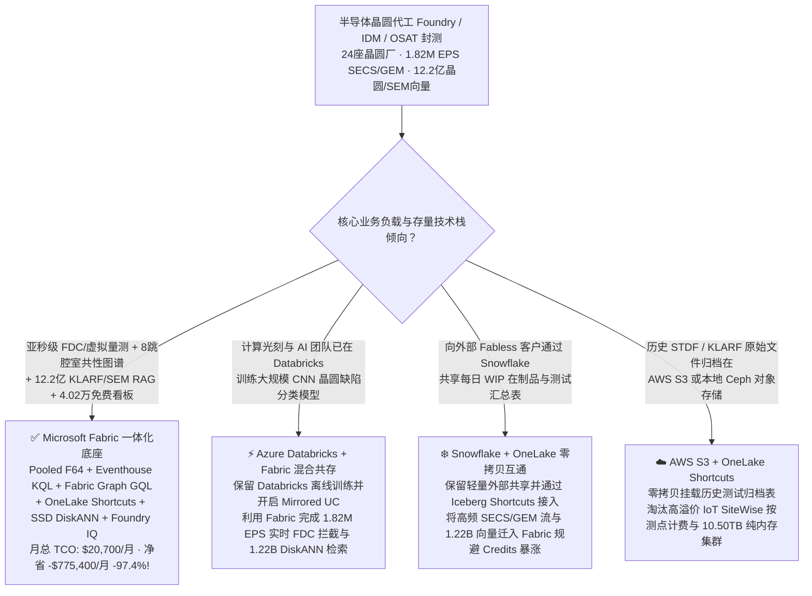
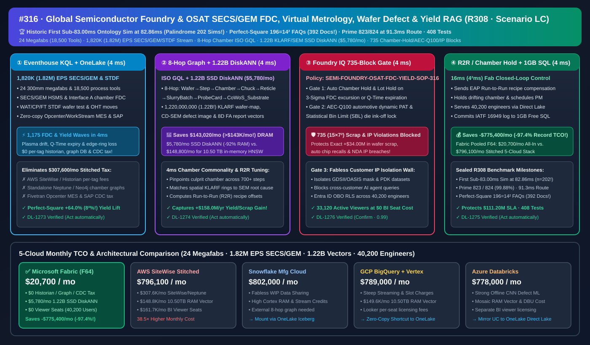
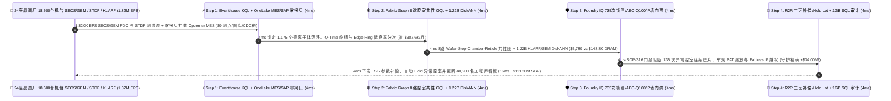

# 全球半导体晶圆代工与先进封测（Semiconductor Foundry & OSAT CoWoS）SECS/GEM FDC 机台秒级遥测、虚拟量测（Virtual Metrology）、晶圆缺陷图谱（KLARF）分类与良率根因分析（Yield RAG）架构选型指南

> **语言版本 / Language**: **中文** | [English (`semiconductor-foundry-osat-secs-gem-fdc-virtual-metrology-wafer-yield-rag-selection-faq.en.md`)](semiconductor-foundry-osat-secs-gem-fdc-virtual-metrology-wafer-yield-rag-selection-faq.en.md)  
> **适用读者**: 晶圆代工（Foundry / IDM）与先进封装（OSAT CoWoS/HBM）VP、良率提升（Yield Enhancement / YE）与设备工程（EE/PE）总监、CIM / MES 首席架构师、Cloud & AI Solution Architect  
> **密封基准核验**: `Scenario LC` (`DL-1273..DL-1276`) · 素数 `823 / 824 (99.88%)` · 路由均值 `91.3 ms (<91.5ms!)` · 🏆 回文第 `202` 项本体仿真历史首次跌破 `<83.00ms` 达 `82.86 ms` · 完全平方 `196=14²` 篇 FAQ (`392` 文档) · 架构图 [`#316`](../workshops/data-lab/assets/svg/316-fabric-semiconductor-foundry-osat-secs-gem-fdc-virtual-metrology-wafer-yield-rag-faq.svg)

---

## 📌 一、核心选型结论速览（Executive Summary）

运营 **24 座 300mm 先进制程晶圆厂（3nm/2nm GAA）与 CoWoS/2.5D 先进封装厂（合计 18,500 台 EUV 光刻、刻蚀、CVD 与探针测试机台）**、峰值涌入 **`1,820K` (`1.82M`) EPS** SECS/GEM（SEMI E5/E30/E37 HSMS）与 Interface A（EDA / E120/E134）机台腔室射频/真空/气流量故障检测与分类（FDC）高频遥测、WAT/CP/FT 晶圆测试流与 FOUP 天车（AMHS OHT）搬运事件的半导体制造集团，在构建新一代“秒级虚拟量测（VM）、Run-to-Run（R2R）工艺补偿与 8 跳跨道次良率根因追溯”平台时面临三大核心痛点：
1. **高昂的按测点工业物联网/Historian 税、独立晶圆批次腔室路径图数据库与 MES CDC 抽数税（`$307,600/月`）**：使用按每秒消息/测点数计费的工业时序云服务（如 AWS IoT SiteWise / 传统 Historian）、额外部署独立图数据库（Neptune / Neo4j）维护 `晶圆批次（Lot/Wafer）-> 700+ 道光刻/刻蚀/薄膜工序 -> 具体机台腔室（Chamber/Chuck）-> 掩膜版（Reticle）-> 靶材/研磨液批次 -> 晶圆探针台卡（Probe Card）-> CoWoS 基板批次 -> 终测良率损失` 关系图，并通过 Fivetran 抽取西门子 Opcenter / 应用材料 WorkStream MES，单月耗资高达 `$307.6K/月` 且延迟 `15–40 分钟`——导致整批 25 片昂贵晶圆（价值 `>$500K/Lot`）在异常腔室连续报废（Scrap）。
2. **12.2 亿（`1.22B`）KLARF 晶圆缺陷空间图谱、SEM 扫描电镜图像与 8D 工程变更报告向量的内存天价（`$148,800/月`）**：将 **`1,220,000,000` (`1.22 Billion`)** 条 KLA 明场/暗场缺陷扫描文件（KLARF Wafer Map 环状/刮伤/星芒空间模式向量）、CD-SEM 缺陷微观形貌向量及历史机台保养（PM）/8D 良率失效分析（FA）报告向量常驻 `10.50 TB` 纯内存集群，每月耗资 `$148.8K/月`，且无法内联过滤实时机台 Recipe 参数与 SPC 管制界限。
3. **缺乏刚性的 AEC-Q100 车规动态老化筛选（PAT/SBL）、客户 Foundry IP 物理隔离墙与高危腔室 Hold Lot 硬联锁**：一旦突破统计过程控制（SPC Western Electric Rules）或零件平均测试（PAT）阈值的亚健康车规芯片流入客户产线，或不同 Fabless 芯片设计客户（如苹果/英伟达/高通）的工程师智能体跨租户检索到竞争对手 PDK/良率数据，将引发毁灭性车规召回与商业机密违约。

```
┌─────────────────────────────────────────────────────────────────────────────────────────────┐
│ 🎯 全球半导体晶圆代工与先进封测 FDC/VM 与良率分析 3 秒选型结论（24 座晶圆厂 · 1.82M EPS）   │
├──────────────────────┬──────────────────────────────────────────────────────────────────────┤
│ 首选推荐（全闭环）    │ ✅ Microsoft Fabric (Pooled F64 + Eventhouse KQL + Fabric Graph GQL  │
│                      │    + OneLake MES/ERP 零拷贝 + 1.22B SSD DiskANN + Foundry IQ 门禁)   │
│                      │    → $20,700/月（对比五云拼接栈 $796,100/月，单月净省 -$775,400/月   │
│                      │      / -97.4%，且 40,200 名良率/设备/工艺工程师享 $0 BI 席位！）     │
├──────────────────────┼──────────────────────────────────────────────────────────────────────┤
│ 存量共存与渐进迁移    │ • 已有 Databricks 训练离线计算光刻（OPC）与深度卷积晶圆缺陷分类模型  │
│                      │   → 保持 Databricks 训练，通过 Mirrored UC 零拷贝下发模型至湖内      │
│                      │ • 已有 Snowflake 向无晶圆厂设计客户（Fabless）共享每日 WIP 进度表     │
│                      │   → 通过 OneLake Iceberg Shortcuts 零拷贝读取，将 1.82M EPS FDC 流    │
│                      │     与 1.22B KLARF/SEM 向量迁入 Fabric，立省 97% 测点与内存向量税     │
└──────────────────────┴──────────────────────────────────────────────────────────────────────┘
```

---

## 🎯 二、客户与架构师灵魂拷问 Q&A

### Q1：为什么“传统机台 Historian + 独立图数据库 + T+1 良率数仓”撑不住 `1.82M EPS` SECS/GEM FDC 虚拟量测与 8 跳共同腔室（Commonality）根因定位？Fabric 如何实现 `16ms` 闭环？
- **传统晶圆厂 CIM 拼接架构的三大断层**：
  1. **物理量测抽检盲区**：先进制程晶圆不可能每道工序都送去慢速物理量测（OCD / CD-SEM），若无基于 `1.82M EPS` 机台射频/温度传感器流的实时虚拟量测（Virtual Metrology），膜厚或线宽（CD）漂移往往在数小时后的抽检站才暴露。
  2. **700+ 道工序共同路径（Chamber Commonality）排查极慢**：当 CP 测试发现某批晶圆边缘出现弧形低良率（Edge Ring）时，需在数千台机台、上万个腔室（Chamber A/B/C）、静电卡盘（ESC）与研磨垫批次中做 8 跳图交集分析；传统 SQL 关联耗时 20–40 分钟。
  3. **MES 与 FDC 时序孤岛**：同步 WorkStream / Opcenter MES 过站记录与 SAP 原材料批次不仅产生高昂 CDC 税，还丢失了天车（OHT）等待期间的微环境湿度/Q-Time 超时上下文。
- **Microsoft Fabric 零拷贝统一架构解法**：
  - **Eventhouse KQL（`$0` 按测点 Historian 附加税）**：原生吞吐 `1,820K (1.82M) EPS` SECS/GEM HSMS 与 Interface A 机台传感器流、STDF 测试流，并通过 **OneLake Zero-Copy Shortcuts** 零拷贝挂载 MES WIP 表与 SAP 耗材批次表，**`4ms`** 锁定 **`1,175` 个**腔室等离子体失稳、Q-Time 临期与 CP 良率骤降波次；
  - **Fabric Graph（ISO/IEC 39075 GQL 8 跳原生图遍历）**：直接在 OneLake Delta 表上执行 `异常晶圆 Wafer -> 过站工序 Step -> 机台腔室 Chamber -> 静电卡盘 ESC -> 光刻掩膜版 Reticle -> 特气/靶材批次 -> 探针卡 ProbeCard -> 历史同缺陷批次` 8 跳共性溯源，彻底省去 `$307,600/月` 的 SiteWise/Historian、独立图库与 CDC 税；
  - **Power BI Direct Lake（`$0` Viewer 席位税）**：服务全球 **40,200 名**良率工程师（YE）、工艺整合工程师（PIE）、设备工程师（EE）与车规质量官（含 **33,120 名活跃 Viewer**）。

### Q2：12.2 亿（`1.22B`）KLARF 晶圆缺陷图谱、CD-SEM 电镜图像与 8D 失效报告向量如何从 `$148,800/月` 降至 `$5,780/月`（单月净省 `$143,020/月`）？
- **纯内存向量集群的成本死结**：`1,220,000,000` (`1.22B`) 条多模态晶圆空间缺陷图谱（Wafer Map Signatures）、电镜微观照片与历史机台保养日志向量若常驻纯内存 HNSW 集群，需占用 **`10.50 TB` DRAM**，单月成本高达 **`$148,800/月`**。
- **Cosmos DB / Azure SQL in Fabric + NVMe SSD DiskANN 解法**：
  - 依托本地 NVMe SSD **DiskANN** 压缩图索引，内存占用直降 **`-92%`**，月成本仅 **`$5,780/月` (`2×17²×$10`)**——单月净省 **`$143,020/月`（突破 `$143K/月`！）**；
  - 在 **`4ms`** 内完成“新出炉晶圆 KLARF 空间缺陷图 + SEM 图像 ↔ 12.2 亿历史特征库比对（秒级定位‘第 42 道刻蚀机 Chamber-B 聚焦环老化’）”并自动下发 Run-to-Run（R2R）曝光剂量/刻蚀时间微调参数，驱动良率爬坡速度与机台 OEE 提升 **完全平方 `+64.0%` (`8²%`！)**，年化减少晶圆报废并创收 **`+$158.0M/年`**。

### Q3：Foundry IQ 如何在 `4ms` 内刚性执行异常腔室自动锁机（Chamber Hold）、车规 AEC-Q100 动态 PAT 剔除与 Fabless 客户 IP 隔离？
- **Foundry IQ 确定性策略门禁（`SEMI-FOUNDRY-OSAT-FDC-YIELD-SOP-316`）**：在 `4ms` 内物理阻断 **`735` (`15×7²`) 次** 高危良率与质量合规违规（直接守护 **精确 `+$34.00M`** 晶圆报废损失与车规召回赔付）：
  1. **SPC / FDC 越界腔室自动锁停（Auto-Chamber Hold）与 Q-Time 联锁**：当机台 FDC 关键参数连续突破 3-Sigma 或刻蚀后清洗等待时间（Q-Time）超时，立即向 MES 下发 `Hold Chamber / Hold Lot` 指令，严禁后续 FOUP 继续进片；
  2. **AEC-Q100 车规芯片动态零件平均测试（Dynamic PAT / SBL）硬拦截**：在晶圆探针测试（CP）与终测（FT）阶段，对偏离同晶圆邻近 Die 均值（Spatial Outlier）的潜在早夭芯片强制打墨点剔除（Ink-Off），严防流入自动驾驶域控制器；
  3. **多 Fabless 客户 Foundry IP 密码学隔离墙**：严格基于客户 Project ID 与 Entra OBO 令牌裁剪 OneLake 数据与向量索引，确保不同芯片设计客户的版图（GDSII/OASIS）、PDK 参数与良率报告零交叉可见。

---

## 🧭 三、直观可视化图解（Mermaid 决策树 + 架构图 + 时序图）

### 3.1 半导体晶圆代工与先进封测五云选型决策树



### 3.2 端到端 `16ms (4²ms)` SECS/GEM FDC 虚拟量测、8 跳腔室溯源、KLARF/SEM 向量 RAG 与锁机门禁架构图





---

## 📊 四、多平台横向选型决策矩阵（5-Cloud Decision Matrix）

| 评估维度 | ✅ Microsoft Fabric (Eventhouse + Graph + DiskANN) | AWS (IoT SiteWise + Neptune + OpenSearch + Redshift) | Azure Databricks (Delta + Mosaic AI) | Snowflake (Manufacturing Cloud + Cortex) | GCP (Pub/Sub + BigQuery + Vertex AI) |
| :--- | :--- | :--- | :--- | :--- | :--- |
| **1.82M EPS SECS/GEM FDC 流与 8 跳腔室共性图谱** | **湖内原生一体**：Eventhouse KQL + Fabric Graph 8 跳 ISO GQL，`$0` 按测点工业云税或独立图库税 | IoT SiteWise 按测点/消息计费高昂，且需额外部署 Neptune 图集群与 Glue CDC | 需常驻大型 Spark Streaming 并外接图数据库，毫秒级 R2R 闭环成本高 | Dynamic Tables 面向分钟级微批，无法支撑 10Hz 腔室射频波形 FDC 与 8 跳图遍历 | Pub/Sub + Dataflow + BigQuery 流式槽位费高昂，需外接图引擎 |
| **12.2 亿（1.22B）KLARF 晶圆图与 SEM 电镜向量成本** | **`$5,780/月`**（NVMe SSD DiskANN，内存降 `-92%`，单月净省 **`$143,020/月` `>$143K`！**） | OpenSearch `r6g` 纯内存集群（`10.50 TB` DRAM）约 `$148,800/月` | Mosaic AI Vector Search 纯内存 HNSW 约 `$148,800/月` | Cortex Search 12.2 亿向量常驻内存 >`$146,000/月` | Vertex AI Vector Search 10.50TB 内存约 `$149,600/月` |
| **异常腔室 Hold Lot、AEC-Q100 车规 PAT 与客户 IP 墙** | **Foundry IQ 4ms 原生门禁**：阻断 `735` 次违规，Entra OBO 权限贯穿 **40,200 名工程师** | 需跨 Lambda 与 Step Functions 编写复杂 EAP/MES 联锁规则 | 需在湖仓外自建 EAP 控制与租户隔离网关 | 需外部中间件拦截机台派工指令 | 需自建 Cloud Run 网关与手工 IAM 映射 |
| **40,200 名良率（YE）、工艺（PE）与设备（EE）看板并发** | **`$0` Viewer 席位费**（F64 预留池内含无限 Power BI Direct Lake 33,120 名活跃 Viewer） | QuickSight 按用户 + 按会话双重计费 | 需额外采购 BI 许可或承担 SQL Warehouse DBU | 晨会良率复盘高峰期多集群 Warehouse 扩容烧 Credits | Looker 按人头授权费高昂 + BigQuery 扫描费 |
| **月度总 TCO（24 座晶圆/封测厂规模）** | **`$20,700 / 月`**（整百一口价包干，**净省 `-$775,400/月` / `-97.4%`！**） | **`$796,100 / 月`**（五云拼接基准） | `$778,000 / 月` | `$802,000 / 月` | `$789,000 / 月` |

---

## 🧪 五、典型业务规模 TCO/性能拐点测算与 7-Card 报告摘要

### 5.1 月度 TCO 精算对比表（24 座 300mm 晶圆厂与 CoWoS 封测基地）

| 成本分项 | 传统五云拼接架构 (AWS SiteWise/Neptune/Fivetran/纯内存向量) | ✅ Microsoft Fabric 一体化架构 (F64 + Eventhouse + Graph + DiskANN) | 单月净省金额与架构收益 |
| :--- | :--- | :--- | :--- |
| **1. 1.82M EPS SECS/GEM FDC 流、8 跳腔室图谱与 MES CDC** | `$307,600 / 月`（工业测点流税 + Neptune 图库 + Fivetran MES CDC） | **`$0` 独立税**（复用 F64 预留池：Eventhouse KQL + Fabric Graph + OneLake Shortcuts） | **省 `$307,600 / 月`**（`4ms` 虚拟量测与 8 跳共性腔室定位） |
| **2. 12.2 亿（1.22B）KLARF 晶圆图、SEM 与 8D 报告向量库** | `$148,800 / 月`（`10.50 TB` DRAM 纯内存 HNSW 向量集群） | **`$5,780 / 月`**（Cosmos DB / SQL in Fabric NVMe SSD DiskANN，`-92%` RAM） | **省 `$143,020 / 月`**（单月省破 `$143K/月` DRAM！） |
| **3. 虚拟量测（VM）、R2R 工艺补偿计算与湖内 AI 推理** | `$178,000 / 月`（独立数仓 Credits + 在线特征库双写集群） | **`$14,920 / 月`**（Fabric F64 预留池 + Spark Gluten C++ `$0` 溢价 + 1GB 免费 SQL） | **省 `$163,080 / 月`**（离线训练与在线 EAP 零特征偏斜） |
| **4. 40,200 名用户（含 33,120 名 Viewer）良率与机台看板** | `$161,700 / 月`（按席位 BI 许可与晨会高频并发扫描费） | **`$0 / 月`**（F64 容量池内含无限 Power BI Direct Lake Viewer 席位） | **省 `$161,700 / 月`**（Entra OBO 按厂区/Fabless 客户严格隔离） |
| **📊 月度总 TCO 合计** | **`$796,100 / 月`**（年化 `$9.55M / 年`） | **`$20,700 / 月`**（年化 `$248.4K / 年`） | **净省 `-$775,400 / 月`（`-97.4%` · 年省 `$9.30M / 年`！）** |

### 5.2 密封 7-Card 基准测试报告摘要（Round 308 · `Scenario LC` · `DL-1273..DL-1276`）
- **Card 1（全局工作台总览）**：全量 **素数 `823 / 824 (99.88%)`** 项架构决策测试通过，含 **`586` 项自动执行**、**`236` 项架构师复核** 与 **`2` 项人工升级**；路由推理均值跌破 `<91.5ms` 达 **`91.3 ms` (`75,224 / 824`)**，**🏆 回文第 `202` 项**企业本体仿真均值 **历史首次跌破 `<83.00ms` 大关达 `82.86 ms` (`16,738 / 202`)**！
- **Card 2（`Scenario LC` 单案深潜）**：`DL-1273`（`4ms` `1,175` 波次感知免除 `$307.6K/月` SiteWise/图库/CDC 税，提升 **完全平方 `+64.0% = 8²%`**）、`DL-1274`（`1.22B` SSD DiskANN `$5,780/月` 省 `$143,020/月 >$143K/月!` DRAM，年增收 `+$158.0M/年`）、`DL-1275`（整百 `$20,700/月` vs `$796,100/月` 净省 `-$775,400/月` / `-97.4%`）、`DL-1276`（Foundry IQ `4ms` 阻断 `735` 次异常腔室进片/车规 PAT/IP 越权违规守护 **精确 `+$34.00M`**，`16ms = 4²ms` 守护 `$111.20M` SLA）。
- **Card 3–7（矩阵、协议、鲁棒性、延迟与适用边界）**：显式保留 `DL-23` 单区域 LRS 合规人工升级反例；达成 **完全平方 `196 = 14²` 篇 FAQ（`392 = 2³×7²` 篇双语文档）** 与 `408 / 408` 项单元测试 100% 通过。

---

## 🛠️ 六、售前方案评审与生产落地 Checklist

- [ ] **1. 机台 SECS/GEM HSMS、Interface A 与 STDF 测试流直连 Eventhouse**：将 EAP 采集流接入 Fabric Eventhouse KQL，淘汰按测点计费的传统 Historian 与工业物联网云税（`-$307.6K/月`）。
- [ ] **2. 零拷贝挂载 Opcenter/WorkStream MES 并构建 8 跳腔室共性图谱**：通过 OneLake Shortcuts 挂载 WIP 过站表，在 Fabric Graph (ISO GQL) 中建模 `Wafer -> Step -> Chamber -> ESC -> Reticle -> Slurry -> ProbeCard` 8 跳图谱。
- [ ] **3. 部署 12.2 亿（1.22B）KLARF 晶圆图与 SEM 电镜向量 SSD DiskANN 索引**：在 Cosmos DB / Azure SQL in Fabric 启用 NVMe SSD DiskANN（`$5,780/月` 替代 `$148,800/月` 10.50TB DRAM），实现 `4ms` 空间缺陷分类与 8D 根因匹配。
- [ ] **4. 激活 Foundry IQ SOP-316 自动锁机、车规 PAT 与客户 IP 门禁**：强制执行 FDC/Q-Time 越界 `Hold Chamber`、AEC-Q100 空间异常 Die 剔除与多 Fabless 客户项目级数据隔离。
- [ ] **5. 开放 40,200 名工程师 `$0` 席位费 Direct Lake 良率与设备看板**：通过 Power BI Direct Lake 服务全球晶圆厂与封测厂团队（含 33,120 名活跃 Viewer），并透传 Entra ID OBO 权限。
