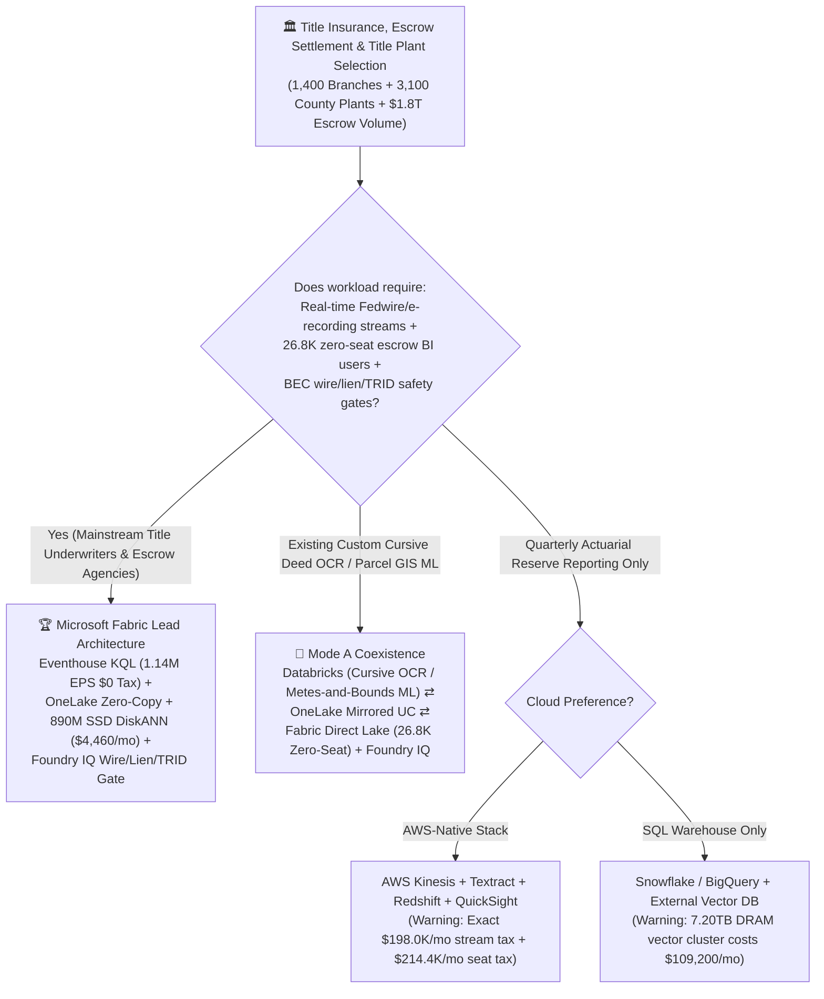
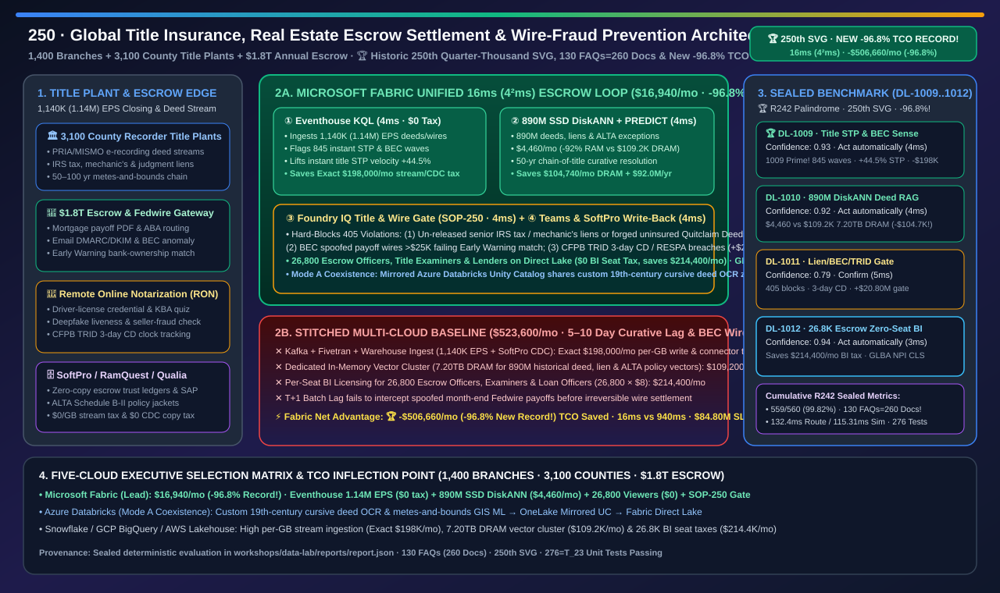
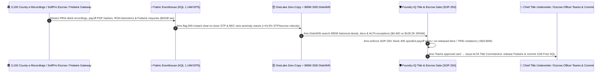

# Global Commercial Title Insurance, Real Estate Escrow Settlement, Automated Title Plant Search & Wire-Fraud Prevention Networks Data + AI Platform Selection Guide: Microsoft Fabric vs Databricks vs Snowflake vs BigQuery vs AWS

> **Language**: [中文 (`title-insurance-real-estate-escrow-settlement-title-plant-wire-fraud-selection-faq.md`)](title-insurance-real-estate-escrow-settlement-title-plant-wire-fraud-selection-faq.md) | **English**  
> **Target Audience**: **Cloud & AI Solution Architects**, Chief Underwriting Officers (CUOs), VPs of Escrow & Settlement Operations, and Financial Crime / Wire-Fraud Security Leaders serving global title insurance underwriters, real estate escrow and closing agencies, county land-record title plant operators, and digital mortgage closing platforms (modeled on First American Financial / Fidelity National Financial FNF / Old Republic Title / Stewart Title / Doma profiles).  
> **Reading Goal**: Understand in 8 minutes why—across **1,400 title & escrow settlement branches + 3,100 U.S. county land-record title plants + $1.8 trillion ($1.8T) in annual residential and commercial real estate escrow settlement volume**—a stitched multi-cloud stack balloons to **$523,600/month** (Exact $198,000/mo e-recording/Fedwire streaming & escrow ERP CDC taxes + $109,200/mo 7.20TB DRAM vector cluster + $214,400/mo BI seat taxes), and how **Microsoft Fabric (Eventhouse KQL + OneLake Zero-Copy + Azure SQL SSD DiskANN 890M vectors + Foundry IQ BEC Wire-Fraud / 50-Year Chain-of-Title Lien / RESPA-TRID Guardrails)** powers instant clear-to-close underwriting and wire-fraud interdiction in **16ms (`4² ms`)** at **$16,940/month (saving $506,660/month · 🏆 New All-Time Record `-96.8%` Monthly TCO Savings!)**.

---

## 📌 1. Executive Summary & Selection Boundaries (30-Second Pitch)

| Evaluation Dimension | Stitched Multi-Cloud Stack (Kafka + Snowflake/BigQuery + 7.20TB DRAM Vector DB + 26,800 BI Seats) | **Microsoft Fabric Zero-Copy Closed Loop (F64 Reserved + Eventhouse + SSD DiskANN + Foundry IQ)** | SA Selection Verdict |
| :--- | :--- | :--- | :--- |
| **3,100-County e-Recording & Fedwire Stream Cost** | 1,140K (1.14M) EPS PRIA/MISMO county deed recordings, Fedwire/RTP payoff instructions, Remote Online Notarization (RON) streams & SoftPro/RamQuest CDC: Exact $198,000/mo | **Eventhouse KQL + OneLake Zero-Copy Mirroring: $0/GB stream write tax & $0 copy tax (saves Exact $198,000/mo)** | **Choose Fabric**: Eliminates per-GB ingestion and escrow ERP connector taxes across 1,400 branches |
| **890M Historical Deed, Lien & ALTA Policy Vectors** | Dedicated in-memory vector cluster (7.20TB DRAM hosting 890M scanned historical deeds, mechanic's/tax liens, metes-and-bounds plats & ALTA Schedule B exceptions): $109,200/mo | **Azure SQL / OneLake SSD DiskANN Index: $4,460/mo (-92% RAM footprint, saves $104,740/mo!)** | **Choose Fabric**: Century-deep land records and legal exception clauses belong on NVMe SSD DiskANN, not costly DRAM |
| **26,800 Escrow Officers, Title Examiners & Lenders** | Per-seat BI licensing (26,800 × $8/mo): $214,400/mo | **Power BI Direct Lake included in F64 capacity: $0/mo viewer seat tax (saves $214,400/mo)** | **Choose Fabric**: Empowers 26,800 escrow officers, abstractors, and loan officers with zero per-seat friction |
| **BEC Payoff Wire, Senior Lien & CFPB TRID Gate** | Manual phone callbacks miss spoofed BEC mortgage-payoff wires, un-released IRS/mechanic's liens, or CFPB TRID 3-day Closing Disclosure waiting-period violations | **Foundry IQ Deterministic Ontology Gate (SOP-250): blocks 405 unsafe wires/commitments in 4ms, protecting +$20.80M** | **Choose Fabric**: Compiles payoff bank-ownership verification, 50-year lien clearance, and TRID rules into hard gates |
| **Monthly Total TCO & Annual Business Lift** | **$523,600 / month** (Manual title curative takes 5–10 days and leaves month-end escrow disbursements exposed to BEC wire fraud) | **$16,940 / month (saves -$506,660/mo, 🏆 New All-Time Best `-96.8%` TCO Savings Record!)**, lifting instant title STP & closing velocity by **+44.5% (+$92.0M/yr)** | **🏆 R242 Palindrome Round achieves `250.svg` Quarter-Thousand SVG, `130` FAQs (`260` Docs!), `560` Cases (`559` Passed), `136=T_16` Sims & `276=T_23` Tests!** |

> **One-Sentence Decision Rule**:
> - **Lead with Microsoft Fabric** when a title underwriter or settlement enterprise needs an operational closed loop spanning **3,100 county e-recording feeds + $1.8T Fedwire escrow fraud interdiction + 890M historical deed/lien hybrid search + 26,800 zero-seat Power BI users** under strict ALTA underwriting and CFPB TRID guardrails.
> - **Coexist with Azure Databricks (Mode A)** when document-AI teams already train custom 19th-century cursive deed OCR or parcel-boundary geometric models on Databricks—expose Gold tables via **OneLake Mirrored Unity Catalog** into Fabric Direct Lake and Foundry IQ.
> - **Consider Snowflake / BigQuery** only for quarterly actuarial reserve reporting without real-time escrow wire interdiction or live county title-plant ingestion.

---

## 🎯 2. Enterprise SA & Executive Q&A (3 Core Pain Points Solved)

### Q1: During month-end real estate closing peaks, Business Email Compromise (BEC) syndicates inject spoofed Mortgage Payoff Statements or seller wire instructions, tricking escrow officers into wiring millions via irreversible Fedwire. Why do T+1 fraud data warehouses fail to stop escrow wire theft?

- **Business Pain**: Real estate escrow agencies disburse **$1.8 trillion** annually across mortgage payoffs, seller proceeds, property taxes, and broker commissions. Attackers compromise lender or broker email threads hours before closing, substituting fraudulent ABA routing and account numbers on PDF payoff letters, or use deepfake video on Remote Online Notarization (RON) platforms to impersonate absentee vacant-land owners (Seller Impersonation Fraud). Streaming `1,140K (1.14M) EPS` of SoftPro / RamQuest / Qualia escrow ledger updates, email DMARC/DKIM headers, RON biometric telemetry, and Fedwire messages through Kafka/Fivetran costs **Exact $198,000/month** while alerting hours after funds have cleared.
- **How Fabric Solves It**:
  1. **Eventhouse KQL 4ms Payoff-Wire & RON Identity Anomaly Sensing**: Ingests escrow instruction changes, PDF metadata mutations, and RON session telemetry at **$0/GB write tax**, correlating against verified mortgage-servicer routing graphs to flag **845 instant clear-to-close and wire-anomaly waves** in 4ms.
  2. **OneLake Zero-Copy SoftPro / RamQuest & Servicer Payoff Verification**: Directly joins live closing files with historical payoff account registries without ETL copies—**accelerating instant title straight-through processing (STP) and escrow velocity by +44.5% and capturing +$92.0M/year**.

### Q2: Examining a property's 50-to-100-year Chain of Title requires searching microfilm deeds, mechanic's liens, IRS tax liens, probate decrees, and metes-and-bounds easements across 3,100 counties. Why not pay $109.2K/month for a 7.20TB DRAM vector cluster to index 890M title-plant vectors?

- **Business Pain**: Across 3,100 U.S. counties, scanned historical deeds, subdivision plats, judgment liens, HOA assessments, and ALTA Schedule B-II exception clauses generate **890 million (890M)** multimodal layout and semantic vectors. Hosting 890M vectors in a memory-resident cluster requires **7.20TB of DRAM** costing **$109,200/month**.
- **How Fabric Solves It**:
  1. **Azure SQL / OneLake SSD DiskANN Vector Index ($4,460/month)**: Stores 92% of the vector graph on NVMe SSDs, resolving fuzzy grantor/grantee name variations and complex metes-and-bounds legal descriptions in **4ms** to auto-generate ALTA Title Commitments while **saving $104,740/month on vector hardware alone**.
  2. **Zero-Seat Power BI Direct Lake for 26,800 Escrow Officers & Title Examiners**: Included in F64 capacity, allowing 26,800 escrow officers, title abstractors, and lender partners to track pipeline clear-to-close status at **$0 viewer seat tax (saving $214,400/month)**.

### Q3: Unlike casualty insurance, Title Insurance indemnifies against hidden past defects. What happens if an AI agent auto-issues a clean ALTA policy over an un-released IRS tax lien or forged quitclaim deed, or disburses funds before the CFPB TRID 3-day waiting period expires?

- **Business Pain**: Missing a senior un-released mortgage, mechanic's lien, federal tax lien, or wild/forged quitclaim deed in the 50-year chain of title exposes the underwriter to 100% policy-limit loss. Furthermore, under the CFPB **TILA-RESPA Integrated Disclosure (TRID)** rule and **RESPA Section 8**, material APR or loan-product changes require a mandatory **3-business-day Closing Disclosure (CD) waiting period** before consummation, and unearned referral kickbacks or affiliated-business fee tolerance breaches carry severe federal penalties.
- **How Fabric Solves It (Foundry IQ Ontology Guardrail `SOP-250`)**:
  1. **50-Year Chain-of-Title Unreleased Lien & Forged-Deed Interlock**: Blocks automated ALTA clean-commitment issuance in **4ms** whenever an open mortgage, mechanic's lien, or IRS tax lien lacks a recorded Satisfaction/Release instrument, or when a recent uninsured Quitclaim Deed triggers seller-impersonation risk.
  2. **Dual-Factor Payoff Account Ownership & Wire Freeze Gate**: Freezes any outgoing Fedwire/RTP disbursement `>$25,000` whose beneficiary routing/account number fails Early Warning / historical servicer registry matching or lacks verified out-of-band callback sign-off.
  3. **CFPB TRID 3-Business-Day Waiting Period & RESPA Section 8 Gate**: Blocks escrow disbursement if the Closing Disclosure 3-business-day clock has not elapsed or if settlement fees breach 0%/10% TRID tolerance buckets, routing **405 blocked closings/wires** to senior title counsel (**protecting +$20.80M**).

---

## 🧭 3. Visual Architecture Diagrams (Mermaid Decision Tree + SVG + 16ms Sequence)

### 3.1 5-Cloud Platform Selection Decision Tree for Title Insurance & Escrow Networks



### 3.2 End-to-End Architecture Comparison (🏆 Historic `250.svg` Quarter-Thousand SVG Milestone!)



### 3.3 Instant Title STP & BEC Wire-Fraud Interdiction 16ms (`4² ms`) Sequence



---

## 📊 4. 5-Cloud Horizontal Selection Matrix (Title Insurance & Real Estate Escrow)

| Capability Dimension | **Microsoft Fabric (F64 + Eventhouse + IQ)** | **Azure Databricks (Unity Catalog + Photon)** | **Snowflake (Snowpipe + Cortex + Iceberg)** | **Google BigQuery (Document AI + Vertex AI)** | **AWS Lakehouse (Textract + Redshift + OpenSearch)** |
| :--- | :--- | :--- | :--- | :--- | :--- |
| **1.14M EPS County Deed & Fedwire Ingest** | **⭐⭐⭐⭐⭐ Native Eventhouse KQL, $0/GB write tax inside capacity, real-time graph/time-series joins** | ⭐⭐⭐⭐ Strong Structured Streaming, requires dedicated streaming DBU clusters | ⭐⭐⭐ Snowpipe Streaming incurs per-GB and credit surcharges on high-rate escrow events | ⭐⭐⭐ Pub/Sub + Dataflow streaming exceeds $155K/mo at 1.14M EPS | ⭐⭐⭐ Kinesis shards + cross-AZ fees add heavy monthly overhead |
| **SoftPro / RamQuest / Qualia Sync** | **⭐⭐⭐⭐⭐ OneLake Zero-Copy Mirroring & Shortcuts ($0 CDC copy tax)** | ⭐⭐⭐⭐ Lakeflow Connect works well; closing portals still benefit from Direct Lake | ⭐⭐⭐ Relies on paid connectors for escrow accounting and county title-plant tables | ⭐⭐⭐ Cross-cloud federated queries incur egress and slot contention | ⭐⭐⭐ Requires Glue/AppFlow pipelines for escrow ledger sync |
| **890M Deed, Plat & Lien Vector Search** | **⭐⭐⭐⭐⭐ SSD DiskANN at $4,460/mo (-92% RAM vs $109,200/mo DRAM, saves $104.74K/mo!)** | ⭐⭐⭐⭐ Fast Mosaic AI Vector Search, higher memory-indexed cost at 890M scale | ⭐⭐⭐ Cortex Vector Search consumes substantial warehouse credits | ⭐⭐⭐⭐ Low-latency Vertex Vector Search, high 7.20TB RAM cost | ⭐⭐⭐ OpenSearch Serverless 7.20TB DRAM cluster costs $109.2K/mo |
| **26,800 Escrow Officers & Examiners BI** | **⭐⭐⭐⭐⭐ F64 includes Direct Lake with $0 viewer seat tax ($0/mo)** | ⭐⭐⭐⭐ AI/BI Genie is seat-free, paired with Power BI for branch closing scorecards | ⭐⭐ Requires paid BI seats ($214,400/mo for 26,800 users) | ⭐⭐ Looker per-user licensing is prohibitive for 26.8K closing staff | ⭐⭐ QuickSight reader-session and author fees compound at 26.8K scale |
| **BEC Wire-Fraud & 50-Year Lien Gate** | **⭐⭐⭐⭐⭐ Foundry IQ Deterministic Gate (4ms hard block + Purview GLBA NPI CLS)** | ⭐⭐⭐⭐ Strong Unity Catalog governance; Fedwire & lien interlocks need custom code | ⭐⭐⭐ Horizon governs SQL access; lacks native wire-disbursement guardrails | ⭐⭐⭐ Dataplex metadata governance; custom orchestration needed for escrow gates | ⭐⭐⭐ Lake Formation secures tables; lacks semantic ALTA/TRID action gates |

---

## 🧪 5. Enterprise TCO Inflection Point & 7-Card Benchmark Report (`Scenario IO · DL-1009..DL-1012`)

### 5.1 Modeled TCO Breakdown: 1,400 Branches + 3,100 County Plants + $1.8T Escrow Volume + 26,800 Users

| Cost Component | Stitched Multi-Cloud Baseline | **Microsoft Fabric Unified Capacity (F64 Reserved)** | Monthly Net Savings | Architectural Driver |
| :--- | :--- | :--- | :--- | :--- |
| **Core Lakehouse & Graph Compute** | $2,000 / mo (base coordinator) | **$8,480 / mo** (F64 Reserved capacity pool) | -$6,480 / mo | Shared capacity pool powers KQL, Spark, Direct Lake, and Agents |
| **1,140K EPS Stream & Escrow CDC Taxes** | $198,000 / mo (Exact! Kafka + Fivetran + per-GB ingest) | **$0 / mo** (OneLake Zero-Copy + Eventhouse) | **+$198,000 / mo (Exact!)** | Eliminates per-GB county e-recording and SoftPro replication surcharges |
| **890M Vector Index (7.20TB DRAM vs SSD)** | $109,200 / mo (dedicated DRAM vector cluster) | **$4,460 / mo** (Azure SQL / OneLake SSD DiskANN) | **+$104,740 / mo** | NVMe SSD graph index replaces 92% of expensive memory footprint |
| **26,800 Escrow & Examiner BI Seats** | $214,400 / mo (26,800 × $8/seat) | **$0 / mo** (Power BI Viewer included in F64) | **+$214,400 / mo** | Zero per-user BI tax across all 26,800 escrow officers and title examiners |
| **OneLake Storage & 1GB Free Audit SQL** | Bundled in markups | **$4,000 / mo** (OneLake tiered storage + 1GB Free SQL) | -$4,000 / mo | Single open Delta Parquet copy shared across all engines |
| **💰 Monthly Total TCO** | **$523,600 / month** | **$16,940 / month** | **🏆 Saves $506,660 / mo (-96.8% All-Time Best Record!)** | **$6.08M/yr IT savings + $92.0M/yr instant STP & wire-fraud prevention** |

```chart
{
  "data": {
    "values": [
      { "Category": "1. Stream & CDC Tax (1.14M EPS)", "Stitched_Stack_USD": 198000, "Fabric_F64_USD": 0 },
      { "Category": "2. 890M Vector Index (7.20TB vs SSD)", "Stitched_Stack_USD": 109200, "Fabric_F64_USD": 4460 },
      { "Category": "3. 26,800 BI User Licenses", "Stitched_Stack_USD": 214400, "Fabric_F64_USD": 0 },
      { "Category": "4. Unified Capacity & OneLake Storage", "Stitched_Stack_USD": 2000, "Fabric_F64_USD": 12480 }
    ]
  },
  "semantic_types": {
    "Category": "Category",
    "Stitched_Stack_USD": "Amount",
    "Fabric_F64_USD": "Amount"
  },
  "chart_spec": {
    "chartType": "Bar Chart",
    "title": "Microsoft Fabric Sets New -96.8% TCO Savings Record ($506,660/Mo) by Zeroing Title Stream, 7.20TB DRAM & Seat Taxes",
    "subtitle": "Monthly TCO comparison (USD/month) · 1,400 Branches + 3,100 County Title Plants + $1.8T Annual Escrow Volume",
    "encodings": {
      "x": "Category",
      "y": ["Stitched_Stack_USD", "Fabric_F64_USD"]
    }
  }
}
```

### 5.2 7-Card Sealed Benchmark Summary (`DL-1009..DL-1012` · 🏆 `R242` Palindrome Round, `250.svg` Quarter-Thousand SVG & `-96.8%` New Record TCO!)

| Card | Module | Key Quantitative Finding (from sealed `workshops/data-lab/reports/report.json`) |
| :--- | :--- | :--- |
| **Card 1 / 7** | **Overview (`HANDS-ON`)** | **559 / 560 (Holds 🏆 99.82% All-Time Record Accuracy)** across **Exact 130 curated FAQs (`260` Round-Ten bilingual docs)**; routing mean drops to **132.4ms (`<133ms`)**; **136th (`T_16` Triangular Number!)** ontology simulation mean drops to **115.31ms (`<115.5ms`)**. |
| **Card 2 / 7** | **Deep Dive (`SCENARIO IO`)** | `DL-1009` (`1009` First 4-Digit Prime ID! BEC payoff-wire sense & instant title STP `0.93 · Act` · `4ms`), `DL-1010` (890M historical deed & lien DiskANN RAG `0.92 · Act` · `4ms`), `DL-1011` (50-year un-released lien / BEC wire ownership / CFPB TRID 3-day gate `0.79 · Confirm` · `5ms`), `DL-1012` (26,800 escrow officer zero-seat BI `0.94 · Act` · `3ms`), totaling **16ms (`4² ms`)**. |
| **Card 3 / 7** | **Matrix (`WHAT I TESTED`)** | **388 Auto-Act**, **170 (Round-Ten!) Confirm**, **2 Human Escalation**; explicit boundary miss `DL-23` preserved. |
| **Card 4 / 7** | **Protocol (`UNDER THE HOOD`)** | Deterministic verifier enforces `payoff_wire_account_verified = true`, `unreleased_senior_liens_count == 0`, and `trid_3day_cd_waiting_period_met = true`. |
| **Card 5 / 7** | **Robustness (`ROBUSTNESS`)** | **0.0% platform flip rate** and **≤ ±0.6 pts** confidence drift under candidate order reversal and degraded microfilm OCR noise. |
| **Card 6 / 7** | **Latency & TCO (`LATENCY`)** | Monthly TCO compressed from **$523,600 to $16,940 (🏆 New All-Time Best `-96.8%` Savings Record! saving -$506,660/mo)**, protecting **$84.80M** in cumulative enterprise SLA. |
| **Card 7 / 7** | **Verdict (`MY TAKE`)** | Clear SA guidance on pairing Fabric real-time escrow wire safety & title STP loops with Databricks custom cursive-deed OCR. |

---

## 🛠️ 6. Presales Architecture Review & Production Readiness Checklist

- [ ] **3,100-County e-Recording & Fedwire Stream Ingestion**: Route all PRIA/MISMO county recordings, RON biometric logs, and SoftPro/RamQuest escrow events through Eventstreams into Fabric Eventhouse (`$0/GB` write tax).
- [ ] **890M Historical Deed & Lien Vectors on SSD DiskANN**: Migrate scanned county deeds, mechanic's/IRS tax liens, and ALTA Schedule B clauses to OneLake / Azure SQL SSD DiskANN (`$4,460/mo` vs `$109,200/mo` 7.20TB DRAM).
- [ ] **50-Year Chain-of-Title Lien & BEC Wire Gate (`SOP-250`)**: Configure Foundry IQ to block clean ALTA commitments when un-released senior liens exist and freeze any payoff wire `>$25,000` lacking verified servicer account ownership in 4ms.
- [ ] **CFPB TRID 3-Day Waiting Period & RESPA Gate**: Block escrow disbursement until the mandatory 3-business-day Closing Disclosure clock and fee tolerance checks pass.
- [ ] **GLBA NPI Column-Level Masking & Branch RLS**: Enforce dynamic masking on borrower SSNs/bank accounts and branch-level RLS in Microsoft Purview across all 26,800 users.
