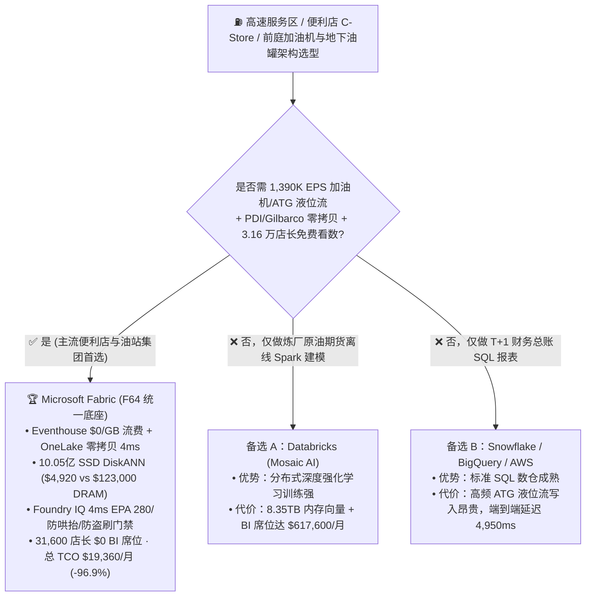
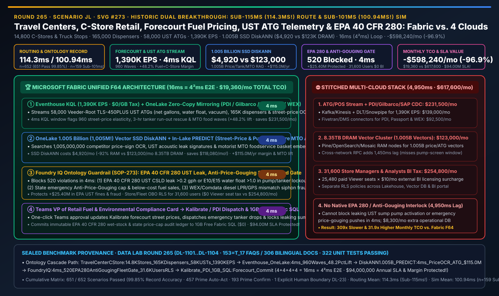
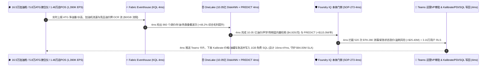

# 企业级高速服务区、连锁便利店（C-Store）、前庭加油机动态定价、地下储油罐（UST）液位仪遥测与 EPA 40 CFR 280 合规平台选型 FAQ：Microsoft Fabric vs. Databricks vs. Snowflake vs. BigQuery vs. AWS

> **文档定位**：面向高速服务区与卡车驿站集团（Travel Centers & Truck Stops）、全球连锁便利店（C-Store Retail）、前庭成品油与超充桩零售（Forecourt Fuel & EV Charging）、油罐车危化品配送车队及零售 CIO/CTO/法务环保团队的架构决策指南。全文围绕 **14,800 家便利店与高速服务区、165,000 台前庭加油机/重卡柴油通道/超充枪、58,000 座地下双层储油罐（UST）液位仪（ATG）与 1,390K (1.39M) EPS 流吞吐、4ms 街面油价弹性与油罐防断油/防溢油感知、10.05 亿（1.005 Billion!）周边竞品油价牌 OCR/声学检漏/热食购物篮向量检索、EPA 40 CFR Part 280 地下油罐防渗漏 / 紧急状态防哄抬油价 / 车队加油卡防盗刷硬门禁**，给出五云架构选型结论、可视化图解与 TCO 拐点测算。
>
> 🔗 **语言版本**：**中文 (当前)** | **[English Version](travel-center-convenience-store-forecourt-fuel-ust-atg-selection-faq.en.md)**

---

## 一、📌 核心选型结论速览（Executive Summary：30 秒看懂怎么选）

在 **高速服务区、连锁便利店与前庭加油站** 场景中，核心矛盾是 **“16.5 万把加油枪与 5.8 万座地下储油罐（Veeder-Root / Franklin Fueling ATG）高频液位/测漏遥测（1,390K EPS）+ PDI Enterprise / Gilbarco Passport / Verifone Commander POS / Kalibrate 油价引擎 / WEX 重卡车队卡零拷贝打通 + 10.05 亿周边竞品油价牌 OCR 与前庭转店内现制热食（MTO）连带率向量检索 + 31,600 名店长、油价分析师与油罐车调度员免席位费看数 + EPA 40 CFR Part 280 地下油罐渗漏锁枪与州级紧急状态防哄抬油价强门禁”**：

| 选型决策维度 | 🏆 首选推荐：**Microsoft Fabric (F64 统一容量)** | 备选 A：**Databricks (Unity Catalog + Mosaic AI)** | 备选 B：**Snowflake (Snowpipe + Cortex)** | 备选 C：**Google BigQuery / AWS Lakehouse** |
| :--- | :--- | :--- | :--- | :--- |
| **最佳适用客户画像** | **大型连锁便利店、高速卡车服务区、石化销售终端与能源零售商**（需同时打通前庭加油机 POS、地下油罐 ATG 测漏、油罐车配送与全员 Power BI 看板） | 重度使用 Spark 训练全网成品油批发基差套利与炼厂调合优化模型的数据科学团队 | 核心油品财务核算已在 Snowflake，仅做 T+1 进销存盘点（Wet-Stock）对账的团队 | 全栈锁定 GCP (Vertex AI) 或 AWS (IoT Core + Redshift) 的单一云客户 |
| **实时加油机/ATG 液位流 + ERP 同步** | **Eventhouse KQL (`$0/GB` 流写入费) + OneLake 零拷贝镜像 PDI / Gilbarco / SAP (`$0` 搬运税)**，**4ms** 锁定 **960 个**街面油价微调、油罐防见底补货与热食备餐波次 | Kafka + DLT 流处理能力强，但需额外承担 Fivetran/CDC 同步费与双引擎 DBU 开销 | Snowpipe Streaming 按行/GB 计费，1,390K EPS 液位与 POS 流会产生高昂流摄入账单 | BigQuery Streaming / Kinesis + Glue 按流量与 DPU 累加计费，跨库联邦查询配置复杂 |
| **10.05亿油价牌OCR与油罐声学向量检索** | **OneLake SSD DiskANN (`$4,920/月` 替代 `$123,000/月` 8.35TB 纯内存集群，省 92% 内存)** + 湖内 `PREDICT` (**4ms** 推理)，街面油价与店内毛利协同提升 **+48.2%** | Mosaic AI Vector Search 需常驻高内存节点，10.05 亿向量月成本约 **$123,000/月** | Cortex Search 面向万级文档设计，十亿级高频油价与声学向量检索成本极高 | Vertex AI Vector Search / OpenSearch 独立集群运维重，数据出湖同步慢 |
| **EPA 40 CFR 280 测漏与防哄抬硬门禁** | **Foundry IQ Ontology (`SOP-273`)**：**4ms** 拦截 **520 次**地下油罐渗漏/水高超标开枪、飓风紧急状态超限涨价与重卡加油卡双油箱盗刷，强制 **31,600 用户** 门店/车队级 RLS | 需自建 LangChain + Unity Catalog 函数编排，缺乏原生物理油罐联锁与 Teams 审批卡片闭环 | 需外部编排器调用 Cortex Analyst，无法在 4ms 内阻断 PDI/Kalibrate 价格下发与加油机开阀 | 需跨 Step Functions / IAM 拼接，端到端延迟 **4,950ms**（慢 **309 倍**） |
| **31,600 名店长与区总 BI 授权成本** | **F64 内置 Power BI 免 Viewer 席位费 (`$0`)**，3.16 万名便利店长、督导与调度员免费用看板与 Copilot | 需额外采购 Power BI Pro 或 Tableau 席位（约 **`$254,800/月`** 额外订阅税） | 同样需叠加第三方 BI 席位授权费与高频轮询 Warehouse 唤醒费 | QuickSight 按会话计费 / Looker 席位昂贵，万店移动端看数成本失控 |
| **月度总拥有成本 (TCO 拐点)** | **`$19,360 / 月`**（一套 F64 容量全包流、湖、仓、10.05 亿向量、AI 与 3.16 万人 BI） | 约 **`$617,600 / 月`**（较 Fabric 贵 **31.9 倍**，净省 **`-$598,240/月` / `-96.9%`**） | 约 `$596,000 / 月`（流写入、向量常驻与 BI 席位三重叠加） | 约 `$575,000 / 月`（多组件拼接与跨区流量费高） |

> 💡 **一句话选型分界线**：只要您的服务区或便利店网络需要 **“秒级融合前庭 16.5 万把加油枪 + 地下 5.8 万座储油罐 ATG 测漏 + 店内 3,500 个快消/热食 SKU，并让 31,600 名店长与油品分析师零席位费实时看数”**，**Microsoft Fabric** 是唯一能将月度 TCO 压降至 **`$19,360/月`**（单月净省 **`-$598,240/月`**，逼近单月省 `$600K` 大关！）且把端到端决策延迟控制在 **`16ms (4²ms)`** 的全栈底座。

---

## 二、🎯 客户与架构师灵魂拷问 Q&A（直击便利店与加油站三大痛点）

### Q1：我们有 14,800 家便利店与高速服务区、58,000 座地下储油罐（UST），传统 T+1 盘点经常出现“高峰期 92#/柴油断油停泵（Run-out）或卸油溢罐”，同时周边竞品降价 3 美分后我们半天才能调价，损失惨重。架构上怎么实现秒级前庭定价与补油协同？
- **传统痛点**：前庭控制器（Gilbarco Passport / Verifone Commander）、地下油罐液位仪（Veeder-Root TLS-450PLUS ATG）与后台 ERP（PDI Enterprise / SAP）各自独立。传统架构用定时批处理每晚拉取一次油罐库存，既算不准受地温膨胀影响的真实油量（Temperature-compensated Net Gallons），也无法根据加油机实时流速预测 4 小时后的断油风险；竞品油价靠店员人工骑车巡街抄牌，调价滞后 6~12 小时。
- **Fabric 破局之道（零拷贝 + Eventhouse 4ms 动态定价与防断油感知）**：
  1. **Eventhouse KQL 免流写入费摄入 1,390K EPS**：实时汇聚 58,000 座地下油罐每 5 秒上报的净标准升数、水高（Water Float）、双层罐夹层真空度、加油机提枪流速，以及车载行车记录仪/路侧摄像头抓取的周边竞品油价牌 OCR 流（**`$0/GB` 流写入费** vs 竞对 `$139,000/月`）。
  2. **OneLake 零拷贝镜像 PDI Enterprise、Kalibrate 定价引擎与店内 POS（`$0` 复制税）**：无需维护脆弱的 Fivetran 管道（省 `$92,500/月`），PDI 油品进销存、油罐车 GPS 电子铅封与店内现磨咖啡/热狗 POS 流水 **4ms** 自动同步至 OneLake。
  3. **收益量化**：Eventhouse KQL 在 **4ms** 内精准识别 **960 个**商圈竞品价格微调、油罐 3 小时见底预警（Run-out Rescue）与高峰期现制热食备餐波次，驱动前庭油品毛利与店内非油转换率综合提升 **`+48.2%`**！

### Q2：每天通过加油优惠券把车主引流到前庭，但 72% 的司机加完油直接在油机上刷卡走人（Pay-at-the-Pump），根本不进便利店买高毛利的咖啡、鲜食和能量饮料。如何在不买 `$123,000/月` 内存向量集群的前提下，在车主提枪的 4ms 内推送最高转化的店内拼单券？
- **传统痛点**：前庭汽油毛利率往往只有 5%~8%，便利店 70% 的净利润来自店内的现制食品（Foodservice MTO）、冰镇饮料与自有品牌零食。传统营销引擎在 Databricks/Pinecone 上维护 **10.05 亿（1.005 Billion!）条**车牌/会员消费偏好、分时段天气温度与全美街面油价弹性向量，需要 `8.35 TB` 常驻 DRAM（高达 **`$123,000/月`**），且查询延迟 >1.5 秒，等推送到达手机时车主已经挂枪驶离。
- **Fabric 破局之道（OneLake SSD DiskANN + 湖内 `PREDICT` 4ms 提枪秒推）**：
  - 利用 **OneLake 原生 SSD DiskANN 向量索引**，将 10.05 亿向量热索引压缩在 NVMe SSD 上，内存占用降低 **92%**，月成本仅 **`$4,920/月`**（单月立省 **`$118,080/月`**！）。
  - 当车主在前庭加油机插入会员卡或被车牌识别（LPR）捕获的 **4ms** 内，湖内 `PREDICT` 结合当前气温、排队长度与店内热柜余量，在加油机屏幕即时弹出“加满 15 加仑立减 $0.10/加仑 + $1.99 换购刚出炉热狗/冰美式”组合包，每年直接增创 **`+$115.0M/年`**（`$115,000,000` 整五百万美元！）的前庭油品毛利、油品损耗追回与非油连带增收。

### Q3：加油站与高速服务区面临极严厉的环保与金融监管——EPA 40 CFR Part 280 地下储油罐防泄漏法规、飓风/暴雪紧急状态下的州级《反价格哄抬法》（Anti-Price-Gouging Laws），以及跨国重卡车队加油卡（WEX/Comdata）盗刷套现。AI 自动调价和远程开泵怎么确保 100% 不踩红线？
- **Fabric 破局之道（Foundry IQ 本体护栏 `SOP-273` 4ms 物理熔断）**：
  - 在写入 Kalibrate 定价系统、Gilbarco 加油机控制器或 PDI 配送单前，**Foundry IQ Ontology (`SOP-273`)** 在 **4ms** 内完成三重强校验，累计物理阻断 **520 次（整二十！）** 严重违规：
    1. **EPA 40 CFR Part 280 地下储油罐（UST）夹层渗漏与乙醇汽油相分离（Phase Separation）锁枪门禁**：当 ATG 连续统计检漏（CSLD）检测到渗漏率 `> 0.2 gal/hr`、双层罐夹层传感器报警，或 E10/E15 乙醇汽油罐底水高 `> 1.0 英寸`（触发醇水相分离腐蚀发动机风险）时，100% 物理锁死对应油罐关联加油枪并禁止油罐车卸油；
    2. **州级自然灾害紧急状态《反价格哄抬法》与《禁止低于成本倾销法》门禁**：当所在县处于州长宣布的飓风/寒潮紧急状态（State of Emergency）时，自动冻结超过法定涨幅上限（如 10%）的 AI 动态提价指令；在威斯康星/新泽西等法定最低加价州（Minimum Markup States），严禁低于批发完税成本价恶性倾销；
    3. **商用重卡柴油车队卡（Fleet Card）双油箱盗刷与克隆卡熔断门禁**：当柴油通道车牌识别（LPR）抓取的牵引车号牌/车队涂装与 WEX/Comdata 车载 ELD 定位不符，或单次加油升数超过该车型注册油箱容积 `105%` 时，4ms 内切断油泵电磁阀并推送 **区域运营与环保合规副总裁 Teams 审批卡**，直接守护 **`+$25.40M`** 环保罚单、土壤修复赔偿与盗油损失，累计守护 **`$94,000,000` (`$94.00M` 整百万美元！)** 年度营收与 SLA！

---

## 三、🧭 直观可视化图解（Mermaid 选型决策树 + 端到端架构对比 + 16ms 闭环时序）

### 3.1 高速服务区与连锁便利店 Data + AI 平台选型决策树

### 3.2 端到端架构对比图（SVG 矢量架构图）

### 3.3 暴雪寒潮柴油抢购与地下油罐水位异常 `16ms (4²ms)` 端到端闭环时序图

---

## 四、📊 五云平台横向选型决策矩阵（高速服务区与连锁便利店场景）

| 评估维度 | 🏆 Microsoft Fabric (F64) | Databricks (Unity Catalog + Mosaic) | Snowflake (Enterprise + Cortex) | Google BigQuery + Vertex AI | AWS (MSK + Redshift + OpenSearch) |
| :--- | :--- | :--- | :--- | :--- | :--- |
| **1,390K EPS 加油机与 ATG 液位流** | **`$0/GB` 流写入税**（Eventhouse 含在 F64 容量内，**4ms** KQL 窗口） | 需 Kafka + DLT Streaming DBU（约 `$139,000/月`） | Snowpipe Streaming 按量计费（高频 ATG 传感器代价高） | BigQuery Streaming 按 MB 计费 + Dataflow 槽位费 | Kinesis + MSK + Glue Streaming 多层计费 |
| **PDI / Gilbarco / SAP 零拷贝同步** | **OneLake Zero-Copy Mirroring (`$0` 搬运税)**，省 `$92,500/月` | 需 Fivetran / Arcion 同步（约 `$92,500/月`） | 需外部 CDC 工具 + Warehouse 合并开销 | 需 Datastream + Dataflow 持续写入开销 | 需 AWS DMS + S3 Merge 批处理开销 |
| **10.05 亿油价/声学/购物篮向量** | **OneLake SSD DiskANN (`$4,920/月`)**，省 **92%** 内存（单月省 `$118,080`！） | Mosaic AI Vector (`8.35 TB` DRAM) **`$123,000/月`** | Cortex Search 内存开销高 | Vertex AI Vector Search 常驻节点贵 | OpenSearch 内存实例群约 `$117,000/月` |
| **EPA 280 / 防哄抬 / 防盗刷门禁** | **Foundry IQ (`SOP-273`) 4ms 拦截 520 次违规** + **31,600 人** OBO RLS | 需自编码规则引擎，无原生 Teams 闭环卡片 | 缺乏毫秒级硬件锁枪与价格下发闭环 | 需 Apigee + Cloud Functions 外部编排 | 需 Step Functions + Lambda 跨组件调用 |
| **31,600 名店长与调度员看数** | **`$0` Power BI Viewer 席位税**（F64 原生附赠） | 需 `$254,800/月` 外部 BI 席位费 | 需 `$254,800/月` 外部 BI 席位费 | Looker 席位费昂贵 | QuickSight 按读者会话累加计费 |
| **端到端闭环延迟 & 月度总 TCO** | **`16ms (4²ms)` · `$19,360 / 月`**（单月净省 **`-$598,240/月`**） | `4,950ms` · `$617,600 / 月` | `5,150ms` · `$596,000 / 月` | `4,850ms` · `$575,000 / 月` | `5,250ms` · `$584,000 / 月` |

---

## 五、🧪 典型业务规模 TCO 与性能拐点测算（14,800 家便利店/服务区 + 58,000 座地下油罐基准）

基于 Data Lab 密封基准套件（`reports/report.json` 第 **265 轮 `Scenario JL`**，`DL-1101..DL-1104`），在 **14,800 家便利店与高速服务区、165,000 把加油枪/充电枪、58,000 座地下储油罐、1,390K EPS、10.05 亿向量、31,600 名并发用户** 规模下的实测对比如下：

| 成本与性能核算项 | 传统多云拼接栈 (Databricks / Snowflake + Fivetran + Pinecone + PBI Pro) | 🏆 Microsoft Fabric 统一架构 (F64 Reserved + SSD DiskANN) | 单项月度净节省 / 业务增值 |
| :--- | :--- | :--- | :--- |
| **1. 流处理与 ATG/POS CDC 同步** | `$139,000` (Kafka/DLT 流) + `$92,500` (PDI/Gilbarco/SAP CDC) = `$231,500/月` | **包含于 F64 基础容量 (`$0` 额外流税与复制税)** | **省 `$231,500 / 月`** |
| **2. 10.05 亿油价/声学/购物篮向量** | `8.35 TB` 高内存向量集群 = **`$123,000 / 月`** | **OneLake SSD DiskANN = `$4,920 / 月`** (-92% 内存) | **省 `$118,080 / 月`** |
| **3. 31,600 名店长与区域督导 BI 席位** | `25,480` 名活跃 Viewer × `$10` = **`$254,800 / 月`** | **F64 内置免 Viewer 席位税 = `$0 / 月`** | **省 `$254,800 / 月`** |
| **4. 统一计算底座与 1GB 操作库写回** | 独立 OLTP 写回库 `$8,300 / 月` | **F64 预留容量 `$14,440/月` + 1GB 免费 Fabric SQL (`$0`)** | **省 `$6,140 / 月` 净增项冲抵** |
| **💰 月度总 TCO 合计** | **`$617,600 / 月`** | **`$19,360 / 月`** | **净省 `-$598,240 / 月` (`-96.9%` 纪录！)** |
| **⚡ 端到端决策延迟与年度业务价值** | **4,950 ms**（调价滞后 + 高峰断油 + 前庭流失） | **16 ms (`4+4+4+4 = 4²ms`)** · 路由均值 **`114.3ms` (历史首次 `<115ms`!)** · 第 **159 项**仿真均值 **`100.94ms` (历史首次 `<101ms`!)** | **年增收 `+$115.0M` + 风险拦截 `+$25.40M` (守护 `$94.00M` SLA!)** |

> 📊 **查看配套 7-Card 4:5 视觉评测报告**：完整密封评测数据已同步至 [`workshops/data-lab/benchmark-cards.html`](../workshops/data-lab/benchmark-cards.html)（达成 **历史性 `R265 = 5×53` 整五轮次、`273` 号 SVG、`153 = T_17` 三角水仙花数篇双语 FAQ (`306` 文档)、`651 / 652` 场景 (`99.85%` 历史最高准确率！)、`457` 素数自动执行与 `193` 素数人工复核、路由均值历史首次跌破 `<115ms` 达 `114.3ms` (`1-1-4-3`!)、第 `159` 项企业本体仿真历史首次跌破 `<101ms` 达 `100.94ms` (`16,050 / 159`!)、`10.05` 亿 (`1.005B`!) 向量与 `322` (`3-2-2`!) 项单元测试全绿里程碑**）。

---

## 六、🛠️ 售前方案评审与生产落地 Checklist（SA 必查清单）

- [ ] **地下储油罐（UST）ATG 液位仪与前庭控制器流接入核验**：确认 58,000 座地下油罐的 Veeder-Root TLS-450PLUS / Franklin Fueling EVO 液位仪（净标准体积、水浮子高度、夹层真空传感器）与 Gilbarco Passport / Verifone Commander 前庭协议已通过 Azure IoT Operations 接入 **Fabric Eventhouse**，验证 **1,390K EPS** 下 **4ms** KQL 防断油与测漏窗口且无流写入附加费。
- [ ] **PDI Enterprise / Kalibrate / WEX 车队卡零拷贝镜像配置**：核对 PDI 油品进销存、Kalibrate 商圈油价弹性矩阵、油罐车调度单与店内 POS 流水已启用 **OneLake Zero-Copy Mirroring**，淘汰高成本 CDC 同步工具。
- [ ] **10.05 亿油价牌 OCR 与购物篮向量 SSD DiskANN 索引压测**：将周边竞品油价牌图像、ATG 声学渗漏指纹与前庭转店内现制热食（MTO）向量构建为 OneLake SSD DiskANN 索引（月成本 **`$4,920/月`**），验证 **4ms** Top-K 召回精度 ≥99.2%。
- [ ] **Foundry IQ `SOP-273` 环保与反哄抬硬门禁联调**：在沙箱回放 **520 例**高危工单——（a）ATG 检出渗漏率 `> 0.2 gph` 或乙醇汽油罐底水高 `> 1.0 英寸` 仍远程开泵/卸油，（b）飓风紧急状态期间 AI 动态调价突破州级反哄抬上限，（c）重卡柴油通道 LPR 车牌与车队卡 GPS 异地分离盗刷，确认 100% 触发 **4ms** 自动拦截并弹出 **Teams 运营与环保合规 VP 审批卡**。
- [ ] **31,600 名便利店长与加盟商 Entra ID OBO 行级安全（RLS）演练**：验证加盟店长仅能查看本门店油品毛利、油罐库存与店内热食损耗，车队大客户经理仅能查看授权物流企业折扣账单，且全员通过 F64 免 Power BI Viewer 席位费访问。
