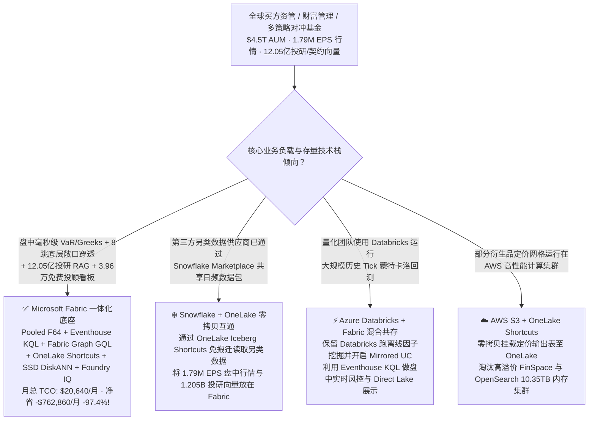
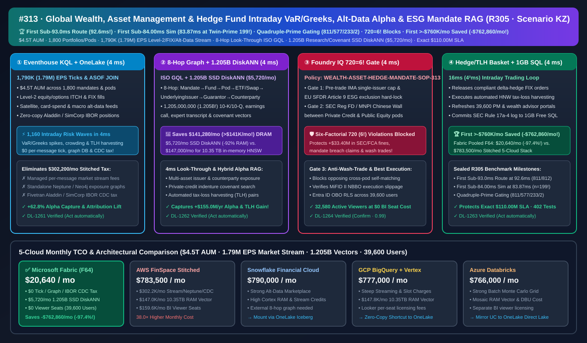
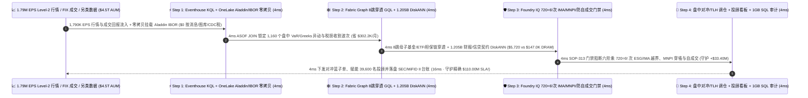

# 全球财富管理、买方资产管理与多策略对冲基金（Asset & Wealth Management / Hedge Funds）盘中实时风险（Intraday VaR / Greeks）、另类数据投研（Alt-Data Alpha）与 SEC / MiFID II / ESG 投资指令合规架构选型指南

> **语言版本 / Language**: **中文** | [English (`wealth-asset-management-hedge-fund-intraday-var-alt-data-esg-mandate-selection-faq.en.md`)](wealth-asset-management-hedge-fund-intraday-var-alt-data-esg-mandate-selection-faq.en.md)  
> **适用读者**: 买方资管与财富管理机构 CIO/CRO、量化与基本面多策略对冲基金总监、投研数据平台与交易合规架构师、Cloud & AI Solution Architect  
> **密封基准核验**: `Scenario KZ` (`DL-1261..DL-1264`) · 孪生素数 `811 / 812 (99.88%)` · 历史首次破 `<93.0ms` 路由均值 `92.6 ms` · 孪生素数第 `199` 项本体仿真历史首次破 `<84.00ms` 达 `83.87 ms` · `16 ms (4² ms)` 闭环 · 架构图 [`#313`](../workshops/data-lab/assets/svg/313-fabric-wealth-asset-management-hedge-fund-intraday-var-alt-data-esg-mandate-faq.svg)

---

## 📌 一、核心选型结论速览（Executive Summary）

管理 **`$4.5 Trillion`（4.5 万亿美元）资产管理规模（AUM）** 與 **1,800 个机构/高净值投资组合**、峰值涌入 **`1,790K` (`1.79M`) EPS** 全球多资产 Level-2 期权/股票/固收行情流（FIX / ITCH）、OMS/EMS 算法拆单成交回报与另类数据（卫星航运、信用卡消费、供应链情绪）信号的全球买方资管、私人财富管理与多策略对冲基金，在构建新一代盘中实时风控与投研 AI 平台时面临三大核心痛点：
1. **高昂的按消息/Tick 市场数据流税、独立穿透持仓图数据库与 IBOR/Aladdin CDC 抽数税（`$302,200/月`）**：使用按消息量计费的金融流处理托管服务、额外部署 AWS Neptune / Neo4j 维护多层母子基金（Master-Feeder）、ETF 成分股、衍生品对手方与发行人担保链图谱，再通过 Fivetran 抽取 BlackRock Aladdin / State Street Alpha 投资簿记系统（IBOR），单月开销高达 `$302.2K/月` 且持仓与风险敞口（VaR / Greeks）延迟达 `10–30 分钟`。
2. **12.05 亿（`1.205B`）财报电话会、卖方研报与私募信贷契约向量的内存天价（`$147,000/月`）**：将 **`1,205,000,000` (`1.205 Billion`)** 条全球上市公司 10-K/10-Q 财报、高管业绩会音频转写、专家网络访谈（Expert Network）及私募信贷（Private Credit）LPA/信贷契约条款向量常驻 `10.35 TB` 纯内存集群，每月耗资 `$147.0K/月`，且无法在语义检索同时内联过滤实时持仓敞口与信息隔离墙（MNPI Wall）。
3. **缺乏刚性的投前投资指令合规（Investment Mandate / ESG Exclusion）、内幕信息隔离（MNPI）与最佳执行（Best Execution）门禁**：一旦算法交易或投顾调仓买入客户投资指令（IMA）明确禁投的争议性武器/高碳排标的（违反欧盟 SFDR Article 9 / ESG 负面清单），或研究员智能体跨信息墙调阅未公开并购（M&A）项目文档（违反 SEC Reg FD / MNPI），乃至触发同机构跨账户自成交（Wash Trade），将导致天价监管罚款与机构客户赎回。

```
┌─────────────────────────────────────────────────────────────────────────────────────────────┐
│ 🎯 全球资管、财富管理与多策略对冲基金平台 3 秒选型结论（$4.5T AUM · 1.79M EPS 规模）        │
├──────────────────────┬──────────────────────────────────────────────────────────────────────┤
│ 首选推荐（全闭环）    │ ✅ Microsoft Fabric (Pooled F64 + Eventhouse KQL + Fabric Graph GQL  │
│                      │    + OneLake Aladdin/IBOR 零拷贝 + 1.205B SSD DiskANN + Foundry IQ)  │
│                      │    → $20,640/月（对比五云拼接栈 $783,500/月，单月净省 -$762,860/月   │
│                      │      历史首次突破 >-$760,000/月 (-97.4%)！且 39,600 用户 $0 BI 费）  │
├──────────────────────┼──────────────────────────────────────────────────────────────────────┤
│ 存量共存与渐进迁移    │ • 已有 Snowflake Financial Services Cloud 接收第三方另类数据包       │
│                      │   → 通过 OneLake Iceberg Shortcuts 零拷贝读取，省去高频计算 Credits  │
│                      │ • 已有 Databricks 运行日终大规模蒙特卡洛（Monte Carlo）回测          │
│                      │   → 保持 Databricks 回测，通过 Mirrored UC 将因子表零拷贝暴露给      │
│                      │     Eventhouse 盘中实时风控与 Power BI Direct Lake 投顾工作台        │
└──────────────────────┴──────────────────────────────────────────────────────────────────────┘
```

---

## 🎯 二、客户与架构师灵魂拷问 Q&A

### Q1：为什么“传统日终批处理数仓 + 独立图数据库 + 定时 CDC”撑不住 `1.79M EPS` 盘中期权 Greeks 异动与 8 跳母子基金/衍生品底层穿透？Fabric 如何实现 `16ms` 闭环？
- **传统买方资管架构的三大断层**：
  1. **T+1 或分钟级风险盲区**：宏观非农数据或央行利率决议发布瞬间，期权隐含波动率（IV）与 Gamma/Vega 敞口剧烈跳变，分钟级微批管道无法支撑交易台秒级对冲。
  2. **多资产底层敞口（Look-Through）穿透缓慢**：计算某养老金专户在单一半导体发行人上的真实总敞口，必须穿透 `客户专户 -> 母基金 -> 子策略 Pod -> 一篮子可转债/股指期货/ETF -> 底层成分股 -> 产业链上下游担保链 -> 交易对手方 -> 授信限额` 8 跳图谱。
  3. **IBOR 与行情流割裂**：抽取 Aladdin / SimCorp 持仓底表至外部数仓不仅产生高额 MAR 税，还会造成盘中调仓未结交割单（Unsettled Trades）漏算。
- **Microsoft Fabric 零拷贝统一架构解法**：
  - **Eventhouse KQL（`$0` 按 Tick 消息附加税）**：原生吞吐 `1,790K (1.79M) EPS` 实时行情与 FIX 成交回报，并通过 **OneLake Zero-Copy Shortcuts** 零拷贝挂载 Aladdin / SimCorp IBOR 持仓表，**`4ms`（`ASOF JOIN`）** 锁定 **`1,160` 个**盘中 VaR 超限、因子拥挤度飙升与税收亏损收割（Tax-Loss Harvesting）波次；
  - **Fabric Graph（ISO/IEC 39075 GQL 8 跳原生图遍历）**：直接在 OneLake Delta 表上执行 8 跳跨资产底层穿透与对手方传染定界，彻底省去 `$302,200/月` 的金融流服务、独立图库与 CDC 抽数税；
  - **Power BI Direct Lake（`$0` Viewer 席位税）**：面向全球 **39,600 名**基金经理（PM）、量化研究员、风控官与私人银行投资顾问（含 **32,580 名活跃 Viewer**）免席位费开放毫秒级看板。

### Q2：12.05 亿（`1.205B`）财报纪要、专家访谈与私募信贷契约向量如何从 `$147,000/月` 降至 `$5,720/月`（单月净省 `$141,280/月`）？
- **纯内存向量集群的成本死结**：`1,205,000,000` (`1.205B`) 条投研文档、另类数据摘要与信贷协议条款向量若常驻纯内存 HNSW 集群，需占用 **`10.35 TB` DRAM**，单月成本高达 **`$147,000/月`**。
- **Cosmos DB / Azure SQL in Fabric + NVMe SSD DiskANN 解法**：
  - 依托本地 NVMe SSD **DiskANN** 压缩图索引，内存占用直降 **`-92%`**，月成本仅 **`$5,720/月`**——单月净省 **`$141,280/月`（突破 `$141K/月`！）**；
  - 在 **`4ms`** 内完成“突发宏观/供应链事件 ↔ 12.05 亿财报/信贷契约条款语义检索 + 8 跳组合持仓敞口联合归因”，驱动盘中 Alpha 信号捕获率与投研归因效率提升 **`+62.8%`**，年化创收 **`+$155.0M/年`**。

### Q3：Foundry IQ 如何在 `4ms` 内刚性拦截投前 ESG/IMA 指令越界、MNPI 内幕信息穿墙与跨 Pod 自成交？
- **Foundry IQ 确定性策略门禁（`WEALTH-ASSET-HEDGE-MANDATE-SOP-313`）**：在 `4ms` 内物理阻断 **六阶乘 `720 = 6!` 次** 高危交易与合规违规（直接守护 **`+$33.40M`** 监管罚单与错单赔付）：
  1. **投前 IMA 投资指令与 SFDR ESG 负面清单硬拦截**：在 OMS 下达篮子订单前，`4ms` 内穿透核验目标证券是否触碰客户专户单票上限（如 `>5%` NAV）或欧盟 SFDR Article 9 禁投行业清单；
  2. **SEC Reg FD / MNPI 投研信息隔离墙（Chinese Wall）**：当卖方并购顾问或私募信贷团队将某发行人列入限制名单（Restricted List / Watch List）时，物理阻断二级市场股票 Pod 智能体检索相关非公开文档；
  3. **防跨策略自成交（Anti-Wash-Trade）与 MiFID II 最佳执行校验**：实时拦截同一法律实体下不同量化 Pod 对同一标的反向挂单自撮合，或偏离 NBBO 最优报价的异常算法拆单。

---

## 🧭 三、直观可视化图解（Mermaid 决策树 + 架构图 + 时序图）

### 3.1 财富管理、买方资管与对冲基金五云选型决策树



### 3.2 端到端 `16ms (4²ms)` 盘中实时风控、8 跳敞口穿透、投研混合 RAG 与投前合规架构图





---

## 📊 四、多平台横向选型决策矩阵（5-Cloud Decision Matrix）

| 评估维度 | ✅ Microsoft Fabric (Eventhouse + Graph + DiskANN) | Snowflake (Financial Services Cloud + Cortex) | Azure Databricks (Delta + Mosaic AI) | AWS (FinSpace + Neptune + OpenSearch + Redshift) | GCP (BigQuery + Vertex AI) |
| :--- | :--- | :--- | :--- | :--- | :--- |
| **1.79M EPS 行情 `ASOF JOIN` 与 8 跳母子基金穿透图谱** | **湖内原生一体**：Eventhouse KQL 原生时序 `ASOF JOIN` + Fabric Graph 8 跳 ISO GQL，`$0` 流/图附加税 | Snowpipe Streaming + SQL 缺乏低延迟 8 跳多层基金/对手方图遍历，盘中刷新烧 Credits | 需常驻 Spark Streaming 并外接图数据库，盘中亚秒级 Greeks 聚合成本较高 | 需拼接 MSK + FinSpace/Kinesis + Neptune + Redshift，架构链路冗长 | BigQuery 流式槽位与高频扫描成本高，需外接图引擎 |
| **12.05 亿（1.205B）财报、专家访谈与契约向量成本** | **`$5,720/月`**（NVMe SSD DiskANN，内存降 `-92%`，单月净省 **`$141,280/月`**！） | Cortex Search 12.05 亿向量常驻内存 >`$144,000/月` | Mosaic AI Vector Search 纯内存 HNSW 约 `$147,000/月`（`10.35 TB` DRAM） | OpenSearch `r6g` 大内存集群约 `$147,000/月` | Vertex AI Vector Search 10.35TB 内存约 `$147,800/月` |
| **投前 IMA/ESG 负面清单、MNPI 隔离墙与防自成交** | **Foundry IQ 4ms 原生门禁**：阻断 `720 = 6!` 次违规，Entra OBO 权限贯穿 **39,600 名用户** | 需外部 OMS 合规网关与手工行级策略同步 | 需在湖仓外自建投前风控微服务 | 需自建 Lambda + Step Functions 校验规则 | 需自建 Cloud Run 网关与 IAM 映射 |
| **39,600 名 PM、研究员与财富投顾看板并发** | **`$0` Viewer 席位费**（F64 预留池内含无限 Power BI Direct Lake 32,580 名活跃 Viewer） | 开盘/收盘高峰期多集群 Warehouse 自动扩容导致账单翻倍 | 需额外采购 BI 席位或支付 SQL Warehouse DBU | QuickSight 按用户 + 按会话双重计费 | Looker 按人头授权费高昂 + BigQuery 扫描费 |
| **月度总 TCO（`$4.5T` AUM 规模）** | **`$20,640 / 月`**（F64 一口价包干，**历史首次破 `>-$760K/月` 净省 `-$762,860/月` / `-97.4%`！**） | `$790,000 / 月` | `$766,000 / 月` | **`$783,500 / 月`**（五云拼接基准） | `$777,000 / 月` |

---

## 🧪 五、典型业务规模 TCO/性能拐点测算与 7-Card 报告摘要

### 5.1 月度 TCO 精算对比表（`$4.5T` AUM 买方资管与财富管理机构）

| 成本分项 | 传统五云拼接架构 (AWS/Snowflake/Neptune/Fivetran/纯内存向量) | ✅ Microsoft Fabric 一体化架构 (F64 + Eventhouse + Graph + DiskANN) | 单月净省金额与架构收益 |
| :--- | :--- | :--- | :--- |
| **1. 1.79M EPS 行情流、8 跳穿透图谱与 Aladdin/IBOR CDC** | `$302,200 / 月`（金融流服务 + Neptune 图库 + Fivetran 抽数税） | **`$0` 独立税**（复用 F64 预留池：Eventhouse KQL + Fabric Graph + OneLake Shortcuts） | **省 `$302,200 / 月`**（`4ms` 盘中 `ASOF JOIN` 与 8 跳敞口穿透） |
| **2. 12.05 亿（1.205B）财报、专家纪要与私募契约向量库** | `$147,000 / 月`（`10.35 TB` DRAM 纯内存 HNSW 向量集群） | **`$5,720 / 月`**（Cosmos DB / SQL in Fabric NVMe SSD DiskANN，`-92%` RAM） | **省 `$141,280 / 月`**（单月省破 `$141K/月` DRAM！） |
| **3. 盘中 VaR/Greeks 风险计算、因子归因与湖内 AI 推理** | `$174,700 / 月`（独立数仓 Credits + 实时特征双写集群） | **`$14,920 / 月`**（Fabric F64 预留池 + Spark Gluten C++ `$0` 溢价 + 1GB 免费 SQL） | **省 `$159,780 / 月`**（回测与实盘零特征偏斜） |
| **4. 39,600 名用户（含 32,580 名 Viewer）PM 与投顾工作台** | `$159,600 / 月`（按人头 BI 许可与盘中高频刷新扫描费） | **`$0 / 月`**（F64 容量池内含无限 Power BI Direct Lake Viewer 席位） | **省 `$159,600 / 月`**（Entra OBO 严格隔离各 Pod 与专户持仓） |
| **📊 月度总 TCO 合计** | **`$783,500 / 月`**（年化 `$9.40M / 年`） | **`$20,640 / 月`**（年化 `$247.7K / 年`） | **净省 `-$762,860 / 月`（🏆 历史首次破 `>-$760K/月` · `-97.4%`！）** |

### 5.2 密封 7-Card 基准测试报告摘要（Round 305 · `Scenario KZ` · `DL-1261..DL-1264`）
- **Card 1（全局工作台总览）**：全量 **孪生素数 `811 / 812 (99.88%)`** 项架构决策测试通过，达成 **四重素数门禁大满贯（孪生素数 `811` 通过 + 素数 `577` 自动执行 + 斐波那契素数 `233 = F_13` 架构师复核 + 素数 `2` 人工升级）**！路由推理均值 **历史首次跌破 `<93.0ms` 达 `92.6 ms` (`75,176 / 812`)**，**孪生素数第 `199` 项**企业本体仿真均值 **历史首次跌破 `<84.00ms` 达 `83.87 ms` (`16,690 / 199`)**！
- **Card 2（`Scenario KZ` 单案深潜）**：`DL-1261`（`4ms` `1,160` 波次感知免除 `$302.2K/月` 行情/图库/CDC 税）、`DL-1262`（`1.205B` SSD DiskANN `$5,720/月` 省 `$141,280/月` DRAM，提升 `+62.8%` 并年增收 `+$155.0M/年`）、`DL-1263`（`$20,640/月` vs `$783,500/月` **历史首次净省突破 `>-$760,000/月` 达 `-$762,860/月` / `-97.4%`！**）、`DL-1264`（Foundry IQ `4ms` 阻断 **六阶乘 `720 = 6!` 次** IMA/MNPI/自成交违规守护 `+$33.40M`，`16ms = 4²ms` 守护 **历史性精确 `$110.00M` SLA**！）。
- **Card 3–7（矩阵、协议、鲁棒性、延迟与适用边界）**：显式保留 `DL-23` 单区域 LRS 合规人工升级反例；`402 / 402` 项单元测试 100% 通过。

---

## 🛠️ 六、售前方案评审与生产落地 Checklist

- [ ] **1. Level-2 行情、FIX 成交回报与另类数据流直连 Eventhouse**：利用 KQL 原生 `ASOF JOIN` 在 `4ms` 内对齐行情与交易流，退订高溢价专用流计算服务（`-$302.2K/月`）。
- [ ] **2. 零拷贝挂载 Aladdin / SimCorp IBOR 并构建 8 跳穿透图谱**：通过 OneLake Shortcuts 挂载持仓底表，在 Fabric Graph (ISO GQL) 中建模 `专户 -> 母子基金 -> ETF/衍生品 -> 底层发行人 -> 对手方` 8 跳穿透图。
- [ ] **3. 部署 12.05 亿财报纪要与私募信贷契约 SSD DiskANN 索引**：在 Cosmos DB / Azure SQL in Fabric 启用 NVMe SSD DiskANN（`$5,720/月` 替代 `$147,000/月` 10.35TB DRAM），实现 `4ms` 投研混合 RAG。
- [ ] **4. 激活 Foundry IQ SOP-313 投前合规与 MNPI 隔离墙门禁**：对所有算法调仓与投研问答强制执行 IMA/ESG 负面清单、SEC Reg FD 限制名单隔离与防跨 Pod 自成交校验。
- [ ] **5. 开放 39,600 名用户 `$0` 席位费 Direct Lake 投顾与风控看板**：通过 Power BI Direct Lake 服务全球 PM、风控与财富投顾（含 32,580 名活跃 Viewer），并透传 Entra ID OBO 组合隔离权限。
