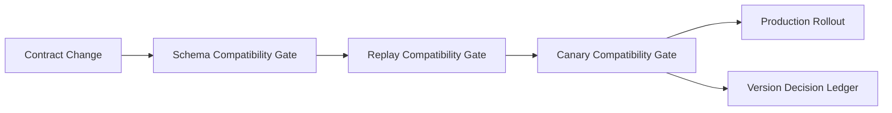

# A2A Contract Versioning and Compatibility Gates Selection FAQ (Cycle 1767)

## 1) Three-minute decision
- **A frequent root cause of A2A production incidents is contract-version drift rather than single-service outage.**
- **Recommendation:** semantic versioning plus three compatibility gates (schema, replay, canary).
- **Goal:** prevent contract mutation from triggering cross-agent cascade failures in parallel delivery.

## 2) Core questions (Q1/Q2/Q3)
### Q1: Why incidents still happen even with version numbers?
1) version bumps without compatibility replay,
2) non-breaking semantics are not explicitly defined,
3) downstream agents interpret constraints differently.

### Q2: What should compatibility gates include?
- static schema compatibility,
- historical traffic replay compatibility,
- canary real-traffic compatibility.

### Q3: What defines release readiness?
- all three gates pass,
- no new failure mode on critical paths,
- rollback package and version mapping are ready.

## 3) Reference architecture

## 4) Decision matrix
| Dimension | Semantic version only | Version + 3 compatibility gates (Recommended) |
|---|---:|---:|
| Delivery speed | High | Medium |
| Contract safety | Low | High |
| Cross-team stability | Low | High |
| Ops complexity | Low | Medium |
| Rollback confidence | Medium | High |

## 5) Evidence and reproducibility
- Evidence files:
  - `workshops/azure-agent-infra/evidence/cycle-1767-benchmark.json`
  - `workshops/azure-agent-infra/evidence/cycle-1767-latency.csv`
  - `workshops/azure-agent-infra/evidence/cycle-1767-throughput.csv`
  - `workshops/azure-agent-infra/evidence/cycle-1767-policy.csv`
- Labels: `measured / synthetic / anonymized_reported`.
- validation7 requires bilingual structure, CSP self-contained cards, evidence consistency, and replayability trace.

## 6) Production checklist
- [ ] Every contract change includes compatibility declaration.
- [ ] Replay dataset covers critical agent chains.
- [ ] Canary gate has automatic rollback thresholds.
- [ ] Version decision ledger traces commit-to-traffic evidence.
- [ ] FAQ/H5/SVG/7-card references are cycle-aligned.
