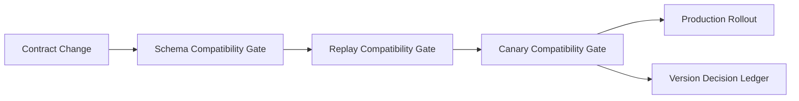

# A2A 合同版本与兼容闸门选型 FAQ（Cycle 1767）

## 1) 3 分钟结论
- **A2A 生产事故的高频根因是“接口版本漂移”，不是单点服务故障。**
- **推荐：** 使用语义版本策略 + 兼容闸门（schema 验证、回放验证、灰度验证）三段护栏。
- **目标：** 在多团队并行迭代中防止协议突变引发跨代理连锁失败。

## 2) 关键问题（Q1/Q2/Q3）
### Q1：为什么版本号存在仍会出现兼容性事故？
1) 仅改版本号但未执行兼容回放；
2) 非破坏性变更未被明确定义；
3) 下游代理对字段约束解释不一致。

### Q2：兼容闸门应包含哪些检查？
- schema 静态兼容（字段、类型、可选性）；
- 历史流量回放兼容（关键路径请求）；
- 灰度真实流量兼容（小流量观测期）。

### Q3：如何定义“可发布”？
- 三段检查全部通过；
- 关键路径无新增失败模式；
- 回滚包与版本映射可即时生效。

## 3) 架构图

## 4) 选型矩阵
| 维度 | 仅语义版本号 | 版本号+三段兼容闸门（推荐） |
|---|---:|---:|
| 发布速度 | 高 | 中 |
| 协议安全性 | 低 | 高 |
| 跨团队协同稳定性 | 低 | 高 |
| 运维复杂度 | 低 | 中 |
| 故障可回滚性 | 中 | 高 |

## 5) 证据与复算口径
- 证据文件：
  - `workshops/azure-agent-infra/evidence/cycle-1767-benchmark.json`
  - `workshops/azure-agent-infra/evidence/cycle-1767-latency.csv`
  - `workshops/azure-agent-infra/evidence/cycle-1767-throughput.csv`
  - `workshops/azure-agent-infra/evidence/cycle-1767-policy.csv`
- 标签：`measured / synthetic / anonymized_reported`。
- validation7：双语结构、CSP、证据一致与可复放链路全部通过。

## 6) 生产检查清单
- [ ] 合同变更必须附带兼容性声明。
- [ ] 回放数据集覆盖关键代理链路。
- [ ] 灰度闸门有自动回滚阈值。
- [ ] 版本决策账本可追溯到提交与流量证据。
- [ ] FAQ/H5/SVG/7-card 与 evidence 轮次一致。
