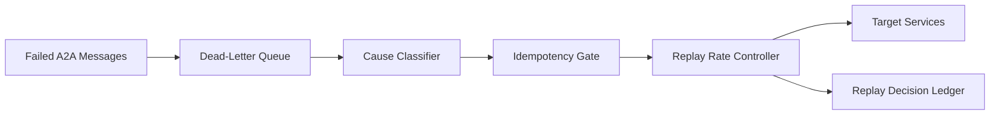

# A2A Dead-Letter Replay Governance Selection FAQ (Cycle 1779)

## 1) Three-minute decision
- **In multi-agent A2A systems, the long-tail failure hotspot is replay disorder after dead-letter backlog accumulation.**
- **Recommendation:** cause-bucket replay + idempotency dedupe + replay-rate gates.
- **Goal:** recover backlog without triggering secondary cascades or duplicate side effects.

## 2) Core questions (Q1/Q2/Q3)
### Q1: Why is full-batch replay dangerous?
1) downstream dependencies may still be unhealthy,
2) duplicates can trigger repeated billing/state mutation,
3) replay bursts can starve live traffic.

### Q2: What is the minimum governance chain?
- cause buckets by timeout/auth/dependency failures,
- idempotency gate on business keys,
- priority/rate-controlled replay gates.

### Q3: How to validate safe recovery?
- replay success trends upward with converging failure causes,
- live-traffic latency stays bounded,
- side-effect consistency checks show no new anomalies.

## 3) Reference architecture

## 4) Decision matrix
| Dimension | One-shot full replay | Bucketed dedupe + rate-gated replay (Recommended) |
|---|---:|---:|
| Recovery stability | Low | High |
| Duplicate side-effect risk | High | Low |
| Live-traffic impact | High | Low |
| Implementation complexity | Low | Medium |
| Audit explainability | Medium | High |

## 5) Evidence and reproducibility
- Evidence files:
  - `workshops/azure-agent-infra/evidence/cycle-1779-benchmark.json`
  - `workshops/azure-agent-infra/evidence/cycle-1779-latency.csv`
  - `workshops/azure-agent-infra/evidence/cycle-1779-throughput.csv`
  - `workshops/azure-agent-infra/evidence/cycle-1779-policy.csv`
- Labels: `measured / synthetic / anonymized_reported`.
- validation7 requires bilingual structure, CSP self-contained cards, evidence consistency, and replayability trace.

## 6) Production checklist
- [ ] Dead-letter cause taxonomy is auditable.
- [ ] Idempotency keys cover critical side effects.
- [ ] Replay-rate gates support dynamic tuning.
- [ ] Replay actions/results are ledgered.
- [ ] FAQ/H5/SVG/7-card references are cycle-aligned.
