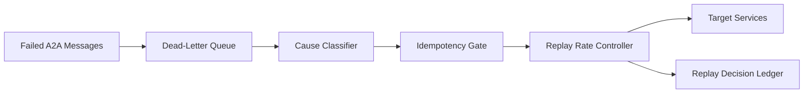

# A2A Dead-Letter 回放治理选型 FAQ（Cycle 1779）

## 1) 3 分钟结论
- **多代理 A2A 生产系统的长尾故障核心在于 Dead-Letter 堆积后的回放失序。**
- **推荐：** 按失败原因分桶 + 幂等键去重 + 回放速率闸门三段治理。
- **目标：** 在恢复积压消息时避免二次雪崩与重复执行副作用。

## 2) 关键问题（Q1/Q2/Q3）
### Q1：为什么直接全量回放风险很高？
1) 下游依赖尚未恢复会再次失败；
2) 重复消息会触发幂等冲突或重复扣费；
3) 回放洪峰挤占实时流量。

### Q2：治理链路最小配置是什么？
- 原因分桶：按超时/鉴权/依赖不可用分类；
- 幂等去重：以业务键限制重复副作用；
- 回放闸门：按优先级与速率分层放行。

### Q3：如何验证回放恢复是安全的？
- 回放成功率持续上升且失败原因收敛；
- 实时流量延迟不被回放拖垮；
- 副作用一致性检查无新增异常。

## 3) 架构图

## 4) 选型矩阵
| 维度 | 一次性全量回放 | 分桶去重限速回放（推荐） |
|---|---:|---:|
| 恢复稳定性 | 低 | 高 |
| 重复副作用风险 | 高 | 低 |
| 实时流量影响 | 高 | 低 |
| 实施复杂度 | 低 | 中 |
| 审计可解释性 | 中 | 高 |

## 5) 证据与复算口径
- 证据文件：
  - `workshops/azure-agent-infra/evidence/cycle-1779-benchmark.json`
  - `workshops/azure-agent-infra/evidence/cycle-1779-latency.csv`
  - `workshops/azure-agent-infra/evidence/cycle-1779-throughput.csv`
  - `workshops/azure-agent-infra/evidence/cycle-1779-policy.csv`
- 标签：`measured / synthetic / anonymized_reported`。
- validation7：双语结构、CSP、证据一致、可回放链路全部通过。

## 6) 生产检查清单
- [ ] Dead-letter 原因分类规则可审计。
- [ ] 幂等键覆盖关键业务副作用。
- [ ] 回放速率闸门支持动态调节。
- [ ] 回放事件与结果进入审计账本。
- [ ] FAQ/H5/SVG/7-card 与 evidence 轮次一致。
