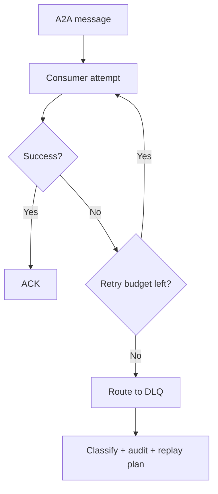
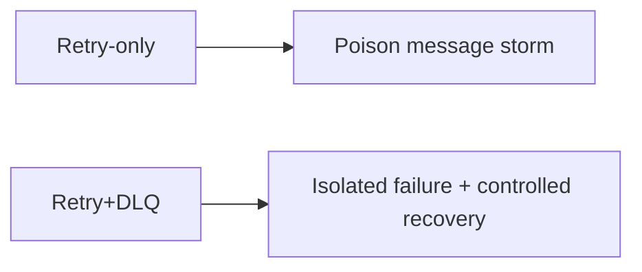
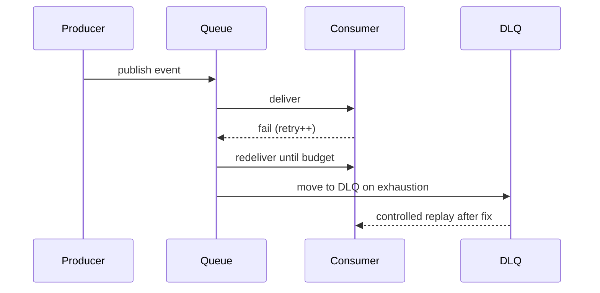

# A2A Dead-Letter Queue Selection FAQ (Retry-Only vs Dead-Letter Queue)

> Scope boundary: this FAQ focuses only on **A2A failure handling and dead-letter queue (DLQ) governance**. It does not expand into identity architecture or supply-chain topics.

## 1) 📌 Executive Summary (3-minute take)

1. **Default production pattern: bounded retries + dead-letter queue + replay audit**.  
2. **Retry-only handling amplifies poison messages into retry storms**, increasing cost and instability.  
3. **DLQ value is isolating failures, enabling root-cause analysis, and supporting controlled replay**.

## 2) 🎯 Core Q&A

### Q1: When is retry-only acceptable?

- Temporary PoC, low concurrency, low failure impact, non-critical side effects.  
- Only if occasional manual replay is acceptable.

### Q2: When is DLQ mandatory?

- Multi-tenant high concurrency, unstable dependencies, and poison-message risk.  
- Regulated environments requiring auditable and traceable failure handling.

### Q3: What is the key technique (DLQ governance), and how does it work?

- **Plain words**: once retry budget is exhausted, move the message to an isolation queue instead of endless retries.  
- **Problem solved**: prevents one bad payload from degrading the entire consumer pipeline.  
- **Mechanism**: retry budget accounting → route to DLQ on threshold → classify/root-cause tags → controlled replay or manual disposition.

## 3) 🧭 Visual breakdown (Mermaid)

## 4) 📊 Architect Decision Matrix

| Dimension | Retry-only | Retry + DLQ |
|---|---|---|
| Poison-message isolation | Low | High |
| Ops complexity | Low | Medium |
| Failure traceability | Low | High |
| Pipeline stability | Medium-Low | High |
| Production default | PoC-only | ✅ |

## 5) 🧪 Quantitative example + benchmark insight

> Data source: `evidence/cycle-402-benchmark.json`.

| Metric | Retry-only | Retry + DLQ |
|---|---:|---:|
| Retry-storm trigger rate | 7.6% | 2.1% |
| Mean poison-message handling time | 34 min | 11 min |
| P95 queue backlog peak | 5.2x | 1.8x |
| Failure-event traceability | 71.3% | 97.1% |
| Governance cost increment per session | $0.0003 | $0.0010 |

7-Card: `benchmark-cards.html` / `benchmark-cards.en.html`

## 6) 🛠️ Architect checklist

- [ ] Define retry limits and backoff per message class
- [ ] Record failure reason + last exception snapshot on DLQ entry
- [ ] Add poison-message clustering and alerting
- [ ] Replay path must enforce rate limits and idempotency checks
- [ ] Separate auto-replay and human-approved replay paths
- [ ] Archive and prune historical DLQ messages regularly
- [ ] Drill downstream failure + poison-message scenarios weekly
