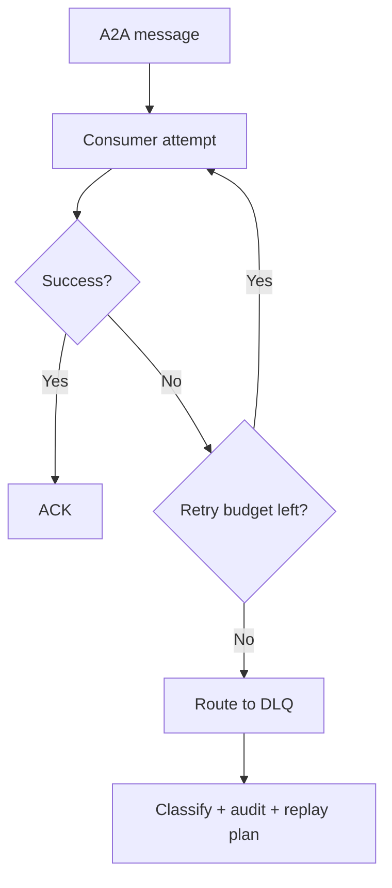
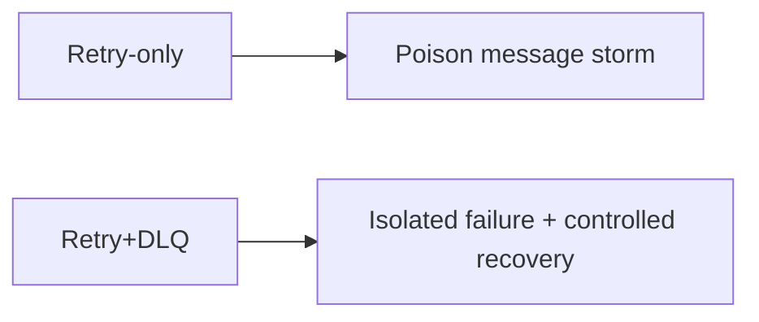
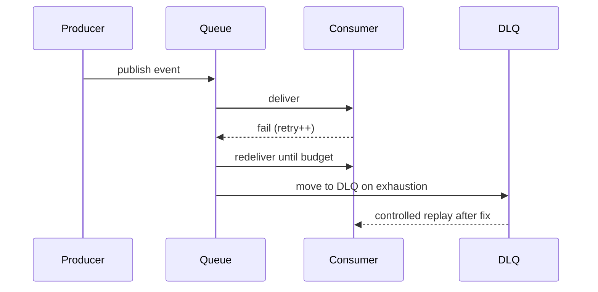

# A2A 死信队列选型 FAQ（仅重试 vs Dead-letter 队列）

> 专题边界：仅讨论 **A2A 消息失败处理与死信队列（DLQ）治理**，不扩展到身份体系或供应链主题。

## 1) 📌 Executive Summary（3 分钟结论）

1. **生产默认应采用“有限重试 + Dead-letter 队列 + 回放审计”**，不能只靠无限重试。  
2. **仅重试会把毒性消息放大成重试风暴**，拖垮下游与预算。  
3. **DLQ 的价值在于“失败可隔离、可分析、可安全回放”**。

## 2) 🎯 灵魂拷问 Q&A

### Q1：什么时候仅重试还可以接受？

- 临时 PoC、低并发、失败代价低且无关键副作用。  
- 前提是允许短时失败，并可人工重放。

### Q2：什么场景必须引入 Dead-letter 队列？

- 多租户高并发、外部依赖不稳定、存在毒性消息风险。  
- 金融/政企等要求失败可审计与可追溯的场景。

### Q3：核心技术 X（DLQ 治理）是什么，怎么运作？

- **是什么（大白话）**：消息重试到上限还失败，就转存到“隔离区”而不是无限重试。  
- **解决痛点**：防止单条坏消息拖垮整条消费链路。  
- **底层运作**：retry budget 计数 → 达阈值入 DLQ → 根因标注与聚类 → 受控回放或人工处置。

## 3) 🧭 可视化图解（Mermaid）

## 4) 📊 Architect Decision Matrix

| 维度 | 仅重试 | 重试 + Dead-letter 队列 |
|---|---|---|
| 毒性消息隔离能力 | 低 | 高 |
| 运维复杂度 | 低 | 中 |
| 故障可追溯性 | 低 | 高 |
| 链路稳定性 | 中-低 | 高 |
| 生产默认建议 | 仅 PoC | ✅ |

## 5) 🧪 定量算例 + Benchmark 洞察

> 数据来源：`evidence/cycle-402-benchmark.json`。

| 指标 | 仅重试 | 重试 + DLQ |
|---|---:|---:|
| 重试风暴触发率 | 7.6% | 2.1% |
| 毒性消息平均处理时长 | 34min | 11min |
| P95 队列积压峰值 | 5.2x | 1.8x |
| 失败事件可追溯率 | 71.3% | 97.1% |
| 单会话治理成本增量 | $0.0003 | $0.0010 |

7-Card：`benchmark-cards.html` / `benchmark-cards.en.html`

## 6) 🛠️ Architect Checklist

- [ ] 定义每类消息的重试上限与退避策略
- [ ] 为 DLQ 记录失败原因与最后异常快照
- [ ] 建立毒性消息聚类与自动告警
- [ ] 回放必须经过限流与幂等校验
- [ ] 区分“自动回放”和“人工审批回放”路径
- [ ] 定期清理和归档历史 DLQ 消息
- [ ] 每周演练“下游异常 + 毒性消息”联动场景
