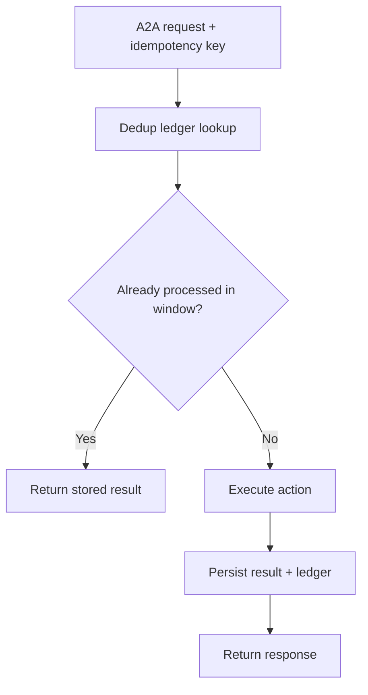
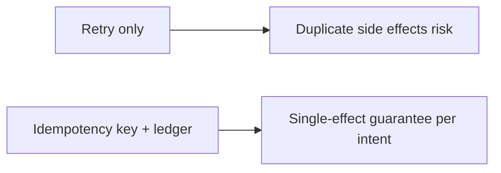
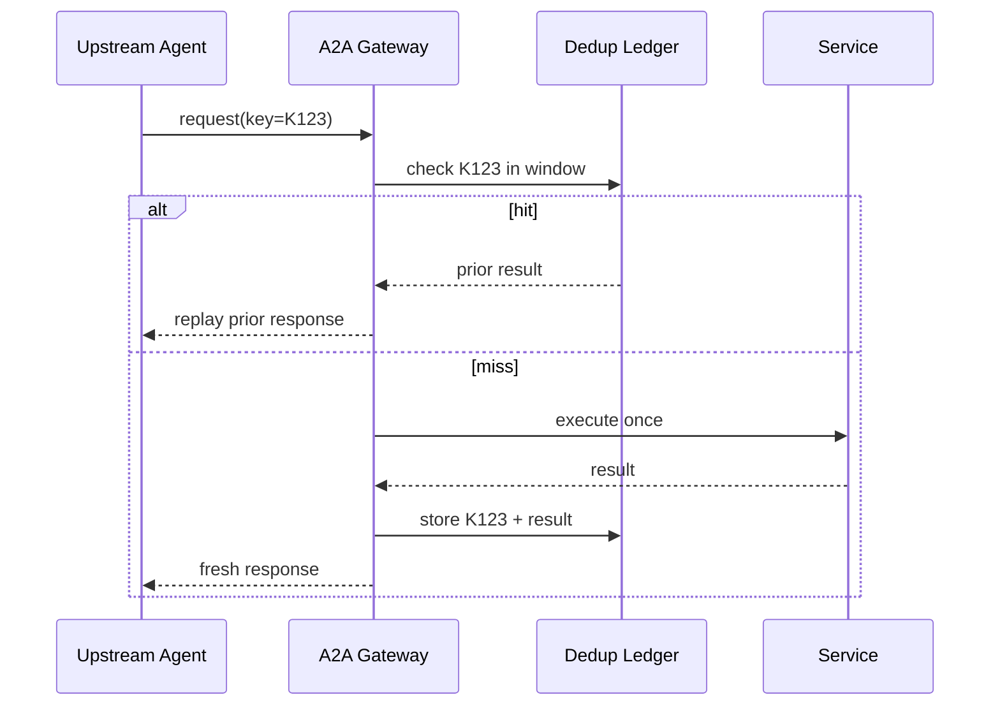

# A2A Idempotency Key FAQ (Retry-Only vs Keyed Deduplication Window)

> Scope boundary: this FAQ focuses only on **A2A message idempotency and duplicate-delivery control**. It does not expand into identity architecture or supply-chain topics.

## 1) 📌 Executive Summary (3-minute take)

1. **Default production pattern: idempotency key + deduplication window + result ledger**.  
2. **Retry-only control amplifies duplicate side effects** (double charge, duplicate tickets, repeated external API calls).  
3. **Idempotency governance means one business intent takes effect once, with auditable traceability**.

## 2) 🎯 Core Q&A

### Q1: When is retry-only acceptable?

- Read-only operations, no side effects, short-lived PoC environments.  
- Only when duplicate execution cannot corrupt business state.

### Q2: When are idempotency keys mandatory?

- Payments, quota decrements, ticket creation, notification delivery, or any side-effectful write.  
- Multi-tenant high-concurrency systems with unstable networks and at-least-once upstream delivery.

### Q3: What is the key technique (idempotency dedup window), and how does it work?

- **Plain words**: every business intent carries a unique key; duplicates reuse the first result.  
- **Problem solved**: prevents retries from turning transient failures into multiple committed side effects.  
- **Mechanism**: request with idempotency-key → ledger lookup in window → hit returns stored result, miss executes once and records.

## 3) 🧭 Visual breakdown (Mermaid)

## 4) 📊 Architect Decision Matrix

| Dimension | Retry-only | Idempotency key + dedup window |
|---|---|---|
| Duplicate side-effect risk | High | Low |
| Implementation complexity | Low | Medium |
| Traceability | Low | High |
| Multi-tenant stability | Medium | High |
| Production default | Read-only only | ✅ |

## 5) 🧪 Quantitative example + benchmark insight

> Data source: `evidence/cycle-400-benchmark.json`.

| Metric | Retry-only | Idempotency dedup window |
|---|---:|---:|
| Duplicate side-effect incidence | 6.8% | 0.7% |
| Idempotency replay hit rate | N/A | 11.9% |
| P50 latency jitter | 180 ms | 205 ms |
| Mean incident recovery duration | 26 min | 10 min |
| Governance cost increment per session | $0.0002 | $0.0009 |

7-Card: `benchmark-cards.html` / `benchmark-cards.en.html`

## 6) 🛠️ Architect checklist

- [ ] Define idempotency key rules for every side-effect request
- [ ] Set dedup window TTL and cleanup policy
- [ ] Isolate dedup ledger by tenant and business domain
- [ ] Replay path returns deterministic signed result
- [ ] Handle “execution succeeded but response lost” recovery
- [ ] Monitor duplicate delivery rate, hit rate, and false decisions
- [ ] Drill upstream retry storms and ledger degradation regularly
