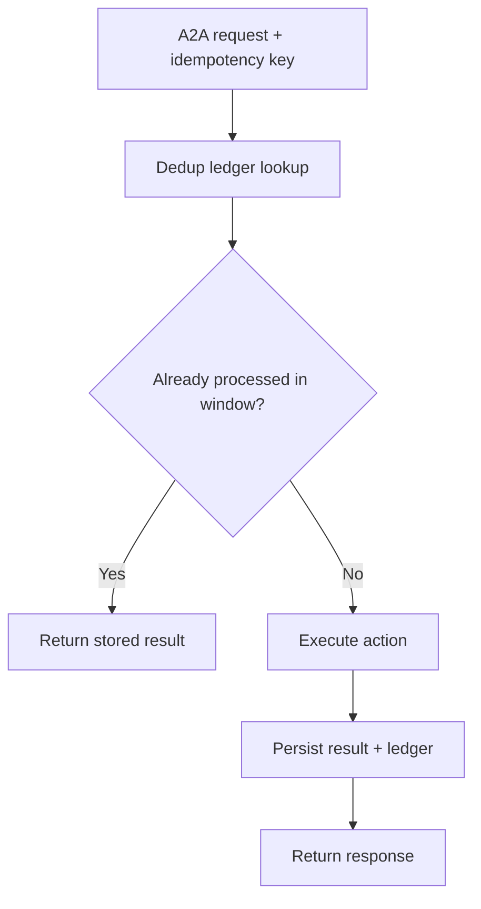
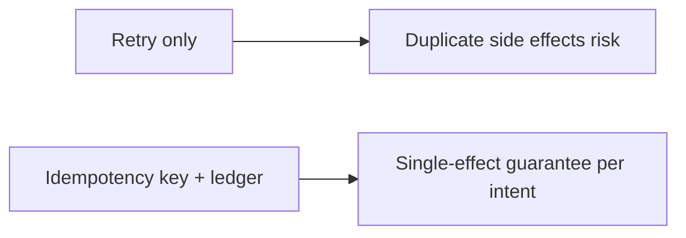
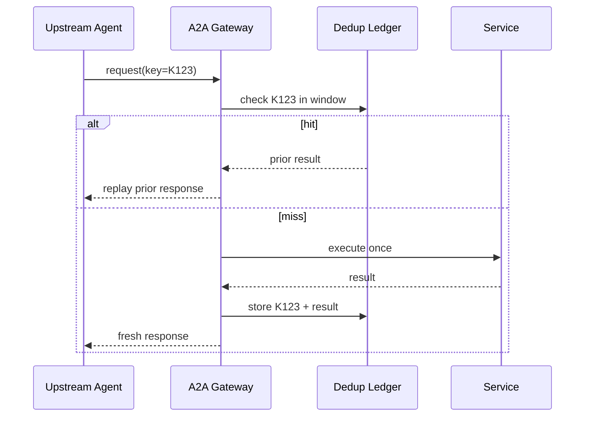

# A2A 幂等键选型 FAQ（仅重试 vs 幂等键去重窗口）

> 专题边界：仅讨论 **A2A 消息幂等与重复投递治理**，不扩展到身份体系或供应链主题。

## 1) 📌 Executive Summary（3 分钟结论）

1. **生产默认应采用“幂等键 + 去重窗口 + 结果账本”**，而不是只靠重试策略。  
2. **只有重试没有幂等键会放大重复副作用**（重复扣费、重复工单、重复调用外部 API）。  
3. **幂等治理的本质是“同一业务意图只生效一次”并可追溯。**

## 2) 🎯 灵魂拷问 Q&A

### Q1：什么时候“只重试”还能接受？

- 纯只读查询、无副作用操作、短生命周期 PoC。  
- 前提是重复执行不会产生业务污染。

### Q2：什么场景必须上幂等键？

- 支付、配额扣减、工单写入、通知发送等有副作用的操作。  
- 多租户高并发、网络抖动频繁、上游存在 at-least-once 投递时。

### Q3：核心技术 X（幂等键去重窗口）是什么，怎么运作？

- **是什么（大白话）**：给每次业务意图发一个唯一编号，重复请求只认第一次。  
- **解决痛点**：防止重试链把“临时失败”变成“多次生效”。  
- **底层运作**：请求携带 idempotency-key → 去重存储检查窗口内是否已处理 → 命中返回历史结果，未命中执行并落账。

## 3) 🧭 可视化图解（Mermaid）

## 4) 📊 Architect Decision Matrix

| 维度 | 仅重试 | 幂等键去重窗口 |
|---|---|---|
| 重复副作用风险 | 高 | 低 |
| 实施复杂度 | 低 | 中 |
| 追溯能力 | 低 | 高 |
| 多租户稳定性 | 中 | 高 |
| 生产默认建议 | 仅无副作用场景 | ✅ |

## 5) 🧪 定量算例 + Benchmark 洞察

> 数据来源：`evidence/cycle-400-benchmark.json`。

| 指标 | 仅重试 | 幂等键去重窗口 |
|---|---:|---:|
| 重复副作用发生率 | 6.8% | 0.7% |
| 幂等命中返回率 | N/A | 11.9% |
| P50 延迟抖动 | 180ms | 205ms |
| 故障恢复平均耗时 | 26min | 10min |
| 单会话治理成本增量 | $0.0002 | $0.0009 |

7-Card：`benchmark-cards.html` / `benchmark-cards.en.html`

## 6) 🛠️ Architect Checklist

- [ ] 为每个副作用请求定义幂等键生成规则
- [ ] 设定去重窗口与过期回收策略
- [ ] 去重账本按租户与业务域隔离
- [ ] 重放返回必须包含一致结果签名
- [ ] 异常路径要支持“执行成功但响应丢失”恢复
- [ ] 监控重复投递率、命中率、误判率
- [ ] 定期演练上游重试风暴与账本退化
