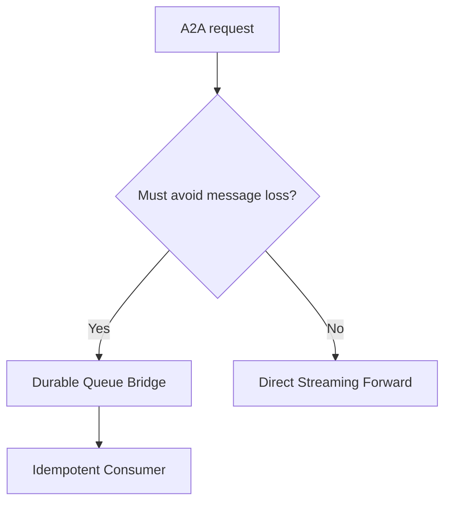
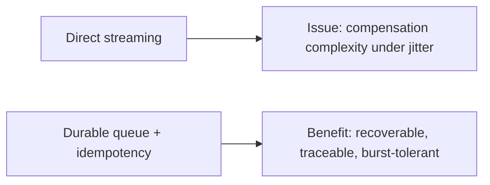
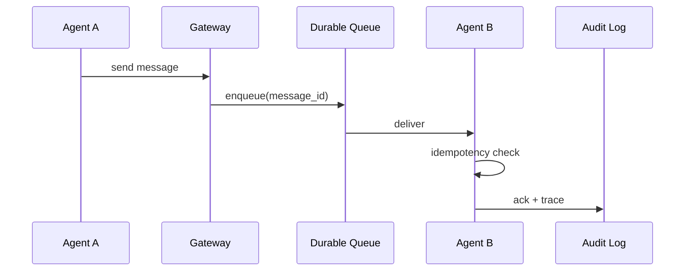

# A2A Message Reliability Selection FAQ (Direct Streaming Forward vs Durable Queue Bridge)

> Scope lock: this FAQ focuses only on **A2A message delivery reliability architecture**.

## 1) 📌 Executive Summary (3-minute read)

1. **Production default should be durable queue bridge + idempotent consumers** to prioritize message durability.  
2. **Direct streaming forward is suitable for ultra-low-latency paths that tolerate occasional loss.**  
3. **At scale, reliability beats single-shot speed: retryable, traceable, recoverable flows win.**

## 2) 🎯 Hard Questions Q&A

### Q1: When should direct streaming be primary?

- Low-latency interaction is top priority and occasional retries/failures are acceptable.  
- Topology is simple with few participants and limited consistency constraints.

### Q2: When is durable queue bridging strictly better?

- Multi-agent orchestration, cross-region calls, traffic bursts, and strict replay/audit requirements.  
- You need hard guarantees around message durability.

### Q3: What is idempotent consumption and how does it work?

- **What**: repeated deliveries of the same message produce side effects only once.  
- **Pain solved**: network retries can duplicate operations.  
- **How**: consumers persist message_id/dedupe_key and skip duplicate side effects.

## 3) 🧭 Visual Explanations (Mermaid)

## 4) 📊 Architect Decision Matrix

| Dimension | Direct Streaming | Durable Queue |
|---|---|---|
| End-to-end latency | Low | Medium |
| Message-loss risk | Medium-high | Low |
| Burst absorption | Weak | Strong |
| Replay/audit capability | Medium | Strong |
| Production default | Conditional | ✅ |

## 5) 🧪 Quantitative Example + Benchmark Insight

> Data source: `evidence/cycle-392-benchmark.json`.

| Metric | Direct Streaming | Durable Queue |
|---|---:|---:|
| Message loss rate | 0.42% | 0.03% |
| End-to-end latency p50 | 41ms | 67ms |
| Retry success rate | 88.1% | 98.7% |
| Replay recovery success | 61.4% | 96.2% |
| Governance cost per session | $0.0046 | $0.0058 |

7-card: `benchmark-cards.html` / `benchmark-cards.en.html`

## 6) 🛠️ Architect Checklist

- [ ] Define stable message_id and dedupe_key for every message
- [ ] Set retry policy, DLQ routing, and alert thresholds
- [ ] Gate releases with loss and retry-success KPIs
- [ ] Run cross-region replay drills regularly
- [ ] Ensure audit logs can trace full message lineage
- [ ] Enforce idempotency before enabling auto-execution on high-risk actions
- [ ] Review replay consistency outcomes weekly
