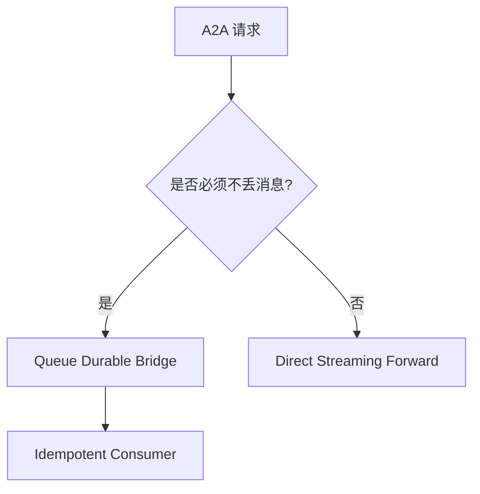
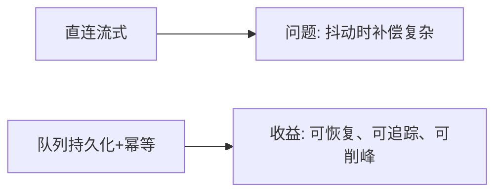
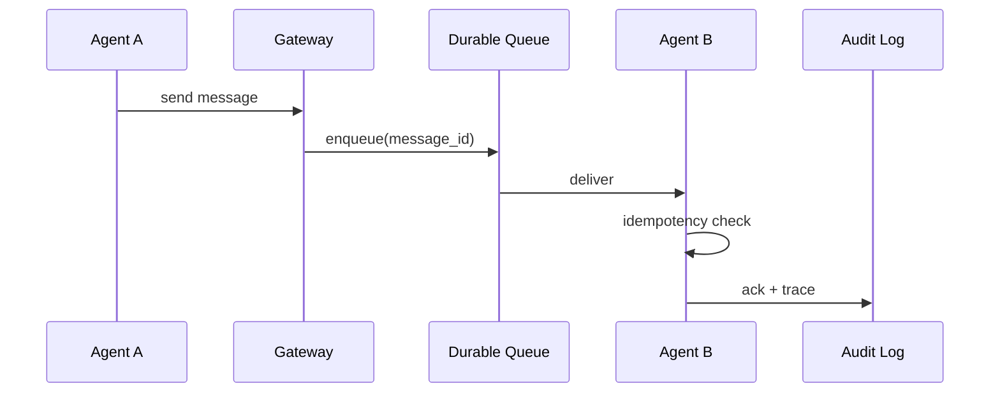

# A2A 消息可靠性选型 FAQ（直连流式转发 vs 队列持久化中转）

> 专题边界：仅讨论 **A2A 消息传递可靠性架构**。

## 1) 📌 Executive Summary（3 分钟结论）

1. **生产默认建议“队列持久化中转 + 幂等消费”**，优先保证消息不丢。  
2. **直连流式转发适合低延迟、可容忍偶发丢包场景**。  
3. **高并发多代理系统的核心不是快一次，而是可重试、可追踪、可恢复。**

## 2) 🎯 灵魂拷问 Q&A

### Q1：什么时候选直连流式转发？

- 低时延交互优先，且业务能接受少量重试失败与补偿。  
- 链路短、参与方少、状态一致性要求不高。

### Q2：什么场景队列持久化严格更优？

- 多代理协同、跨区调用、峰谷流量波动明显、必须可追责可回放。  
- 对“消息不丢”和“可审计”有硬性要求。

### Q3：核心技术 X（幂等消费）是什么，怎么运作？

- **是什么**：同一消息重复到达也只生效一次。  
- **解决痛点**：网络抖动和重试会造成重复执行。  
- **底层运作**：消费端记录 message_id / dedupe_key，命中则跳过副作用执行。

## 3) 🧭 可视化图解（Mermaid）

## 4) 📊 Architect Decision Matrix

| 维度 | 直连流式 | 队列持久化 |
|---|---|---|
| 端到端延迟 | 低 | 中 |
| 丢消息风险 | 中-高 | 低 |
| 峰值削峰能力 | 弱 | 强 |
| 回放审计能力 | 中 | 强 |
| 生产默认 | 条件适配 | ✅ |

## 5) 🧪 定量算例 + Benchmark 洞察

> 数据来源：`evidence/cycle-392-benchmark.json`。

| 指标 | 直连流式 | 队列持久化 |
|---|---:|---:|
| 消息丢失率 | 0.42% | 0.03% |
| p50 端到端延迟 | 41ms | 67ms |
| 重试成功率 | 88.1% | 98.7% |
| 回放修复成功率 | 61.4% | 96.2% |
| 单会话治理成本 | $0.0046 | $0.0058 |

7-Card：`benchmark-cards.html` / `benchmark-cards.en.html`

## 6) 🛠️ Architect Checklist

- [ ] 为每条消息定义稳定 message_id 与 dedupe_key
- [ ] 明确重试策略、死信队列与告警阈值
- [ ] 将丢失率/重试成功率纳入发布门禁
- [ ] 建立跨区故障回放演练流程
- [ ] 保证审计日志可关联到原始消息链路
- [ ] 高危动作必须幂等化后再开放自动执行
- [ ] 周度复盘“重放后状态一致性”
