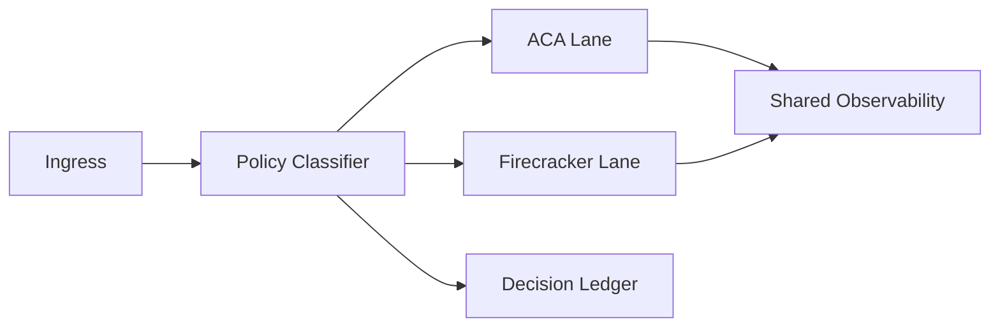

# ACA vs Firecracker Runtime Isolation Selection FAQ (Cycle 1764)

## 1) Three-minute decision
- **Container isolation (ACA) and microVM isolation (Firecracker) are best used as a risk-tier strategy, not a single-choice replacement.**
- **Recommendation:** use ACA for cost-efficient baseline lanes and Firecracker for high-risk/high-adversarial workloads.
- **Goal:** preserve explainable security boundaries without collapsing throughput economics.

## 2) Core questions (Q1/Q2/Q3)
### Q1: Why not enforce strong isolation for everything?
1) stronger isolation increases cold-start and ops cost,
2) low-risk requests often do not require it,
3) one-tier strong isolation compresses aggregate throughput budgets.

### Q2: How to operationalize tiered isolation?
- score by data sensitivity, tool risk, and compliance class,
- route into ACA or Firecracker lanes,
- persist routing rationale in a policy ledger.

### Q3: How to prove tiering beats a single layer?
- compare critical success and per-session cost,
- compare policy-interception rates in high-risk scenarios,
- verify cross-lane switching latency budgets.

## 3) Reference architecture

## 4) Decision matrix
| Dimension | ACA only | ACA + Firecracker tiering (Recommended) |
|---|---:|---:|
| Unit cost | Low | Medium |
| Strong-isolation capability | Medium | High |
| High-risk workload fitness | Medium | High |
| Ops complexity | Low | Medium-high |
| Compliance flexibility | Medium | High |

## 5) Evidence and reproducibility
- Evidence files:
  - `workshops/azure-agent-infra/evidence/cycle-1764-benchmark.json`
  - `workshops/azure-agent-infra/evidence/cycle-1764-latency.csv`
  - `workshops/azure-agent-infra/evidence/cycle-1764-throughput.csv`
  - `workshops/azure-agent-infra/evidence/cycle-1764-policy.csv`
- Labels: `measured / synthetic / anonymized_reported`.
- validation7 requires bilingual structure, CSP self-contained cards, evidence consistency, and replayability.

## 6) Production checklist
- [ ] Risk grading rules and approval boundaries are auditable.
- [ ] Cross-lane routing has rollback controls.
- [ ] High-risk tasks default to strong-isolation lane.
- [ ] Unified observability traces cross-lane execution.
- [ ] FAQ/H5/SVG/7-card references are cycle-aligned.
