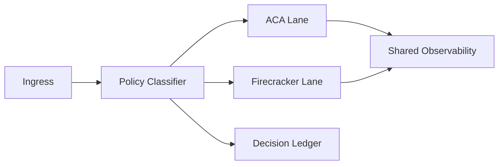

# ACA vs Firecracker 运行时隔离选型 FAQ（Cycle 1764）

## 1) 3 分钟结论
- **容器隔离（ACA）与微虚拟机隔离（Firecracker）不是互斥关系，而是风险分层策略。**
- **推荐：** 普通 Agent 任务走 ACA 成本优先层，高敏感/高对抗任务走 Firecracker 强隔离层。
- **目标：** 在安全边界与吞吐成本之间做可审计、可解释的分层平衡。

## 2) 关键问题（Q1/Q2/Q3）
### Q1：为什么不能“一刀切”全上强隔离？
1) 强隔离会带来更高冷启动与运维成本；
2) 低风险请求并不总需要该级别隔离；
3) 统一强隔离会压缩总体吞吐预算。

### Q2：分层隔离怎么落地？
- 按数据敏感级、工具风险级、租户合规级打分；
- 分配到 ACA lane 或 Firecracker lane；
- 通过策略网关统一记录决策依据。

### Q3：如何证明“分层”优于“单层”？
- 比较关键任务成功率与单位会话成本；
- 比较高风险场景策略拦截率；
- 验证跨层切换时延是否在预算内。

## 3) 架构图

## 4) 选型矩阵
| 维度 | 仅 ACA | ACA + Firecracker 分层（推荐） |
|---|---:|---:|
| 单位成本 | 低 | 中 |
| 强隔离能力 | 中 | 高 |
| 高风险任务适配 | 中 | 高 |
| 运维复杂度 | 低 | 中高 |
| 合规弹性 | 中 | 高 |

## 5) 证据与复算口径
- 证据文件：
  - `workshops/azure-agent-infra/evidence/cycle-1764-benchmark.json`
  - `workshops/azure-agent-infra/evidence/cycle-1764-latency.csv`
  - `workshops/azure-agent-infra/evidence/cycle-1764-throughput.csv`
  - `workshops/azure-agent-infra/evidence/cycle-1764-policy.csv`
- 标签：`measured / synthetic / anonymized_reported`。
- validation7：双语结构、CSP、证据一致与可回放全部通过。

## 6) 生产检查清单
- [ ] 风险分级规则与审批边界清晰可审计。
- [ ] 跨层路由策略具备回滚机制。
- [ ] 高风险任务默认落强隔离层。
- [ ] 统一观测可追踪跨层链路。
- [ ] FAQ/H5/SVG/7-card 与 evidence 轮次一致。
