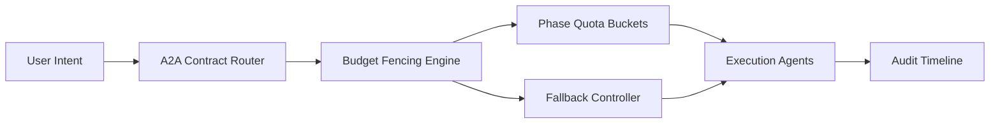

# A2A Contract Budget Fencing Selection FAQ (Cycle 1892)

## 1) Three-minute decision
- **Core issue:** without contract-level budget fences, multi-agent A2A workflows can trigger cascading calls and cost spillover.
- **Recommendation:** enforce contract ceilings, phase quotas, and over-budget circuit fallback.
- **Goal:** keep task completion stable while making collaboration cost predictable.

## 2) Q1 / Q2 / Q3
### Q1: Why does A2A need stronger budget controls?
1) chained calls amplify token/tool spend,
2) retries can stack cost spikes across hops,
3) weak boundaries blur ownership and accountability.

### Q2: How should production budget fencing be implemented?
- **Contract ceilings:** bind token, latency, and tool budgets per A2A contract,
- **Phase quotas:** separate planning, execution, and validation budget buckets,
- **Over-budget circuit:** downgrade to lightweight path or human confirmation,
- **Audit timeline:** capture full spend and fallback events.

### Q3: What is the go-live bar?
- collaboration completion rate remains in target,
- over-budget incidents are replayable and explainable,
- per-task cost P95 remains controlled.

## 3) Reference architecture

## 4) Decision matrix
| Dimension | No budget fencing | Contract Budget Fencing (Recommended) |
|---|---:|---:|
| Cost controllability | Low | High |
| Failure isolation | Medium | High |
| Fallback explainability | Low | High |
| Implementation complexity | Low | Medium |
| Compliance auditability | Medium | High |

## 5) Evidence and reproducibility
- Evidence files:
  - `workshops/azure-agent-infra/evidence/cycle-1892-benchmark.json`
  - `workshops/azure-agent-infra/evidence/cycle-1892-latency.csv`
  - `workshops/azure-agent-infra/evidence/cycle-1892-throughput.csv`
  - `workshops/azure-agent-infra/evidence/cycle-1892-cost.csv`
- Labels: `measured / synthetic / anonymized_reported`.
- Validation chain: six-part FAQ, CSP, cycle/topic binding, and simulator checks.

## 6) Production checklist
- [ ] A2A contract templates include budget fields and defaults.
- [ ] Phase quota buckets are integrated with fallback actions.
- [ ] Over-budget alarms and human confirmation path are active.
- [ ] Audit timeline explains every budget exhaustion event.
- [ ] FAQ/H5/SVG/7-card/evidence are cycle-consistent.
