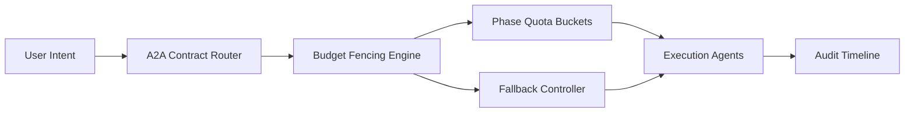

# A2A Contract Budget Fencing 选型 FAQ（Cycle 1892）

## 1) 3 分钟结论
- **核心问题：** 多 Agent 协作链路中，A2A 合约若缺少预算围栏，易出现级联调用失控与成本外溢。
- **推荐方案：** “合约级预算上限 + 分阶段配额 + 超额熔断回退”三层防线。
- **目标：** 在保障任务完成率的同时，将协作成本保持在可预测区间。

## 2) Q1 / Q2 / Q3
### Q1：为什么 A2A 场景更需要预算围栏？
1) 链式调用会放大 token 与工具开销；
2) 上下游重试可能叠加成本峰值；
3) 缺乏合约边界会导致责任不清。

### Q2：生产级 budget fencing 如何实现？
- **合约上限：** 每条 A2A 合约绑定 token/时延/工具预算；
- **阶段配额：** 规划、执行、校验分别设预算桶；
- **超额熔断：** 触顶后降级到轻量路径或人工确认；
- **审计轨迹：** 全链路记录预算消耗与回退事件。

### Q3：上线判据是什么？
- 协作任务完成率保持目标区间；
- 超预算事件可回放且可解释；
- 单任务成本 P95 持续受控。

## 3) 架构图

## 4) 选型矩阵
| 维度 | 无预算围栏 | Contract Budget Fencing（推荐） |
|---|---:|---:|
| 成本可控性 | 低 | 高 |
| 故障隔离 | 中 | 高 |
| 回退可解释性 | 低 | 高 |
| 实施复杂度 | 低 | 中 |
| 合规审计能力 | 中 | 高 |

## 5) 证据与复算口径
- 证据文件：
  - `workshops/azure-agent-infra/evidence/cycle-1892-benchmark.json`
  - `workshops/azure-agent-infra/evidence/cycle-1892-latency.csv`
  - `workshops/azure-agent-infra/evidence/cycle-1892-throughput.csv`
  - `workshops/azure-agent-infra/evidence/cycle-1892-cost.csv`
- 标签：`measured / synthetic / anonymized_reported`。
- 校验链：FAQ 六段、CSP、cycle/topic 绑定、模拟器检查。

## 6) 生产检查清单
- [ ] A2A 合约模板包含预算字段与默认阈值。
- [ ] 分阶段预算桶与回退动作已联调。
- [ ] 超额熔断告警与人工确认链路可用。
- [ ] 审计轨迹可追溯预算耗尽原因。
- [ ] FAQ/H5/SVG/7-card/evidence 轮次一致。
