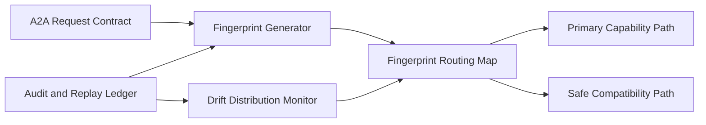

# A2A Contract Fingerprint Routing Selection FAQ (Cycle 1875)

## 1) Three-minute decision
- **Core issue:** mixed contract variants in A2A chains can cause route mismatch and semantic drift across agents.
- **Recommendation:** contract fingerprint routing with compatibility-tier fallback and fingerprint drift monitoring.
- **Goal:** preserve semantic consistency and route control during multi-version evolution.

## 2) Q1 / Q2 / Q3
### Q1: Why is version-only routing insufficient?
1) contracts with same version can still carry semantic variants,
2) parallel team rollouts produce branched contract states,
3) version numbers do not encode detailed compatibility boundaries.

### Q2: How should production fingerprint routing be designed?
- **Fingerprinting:** stable hash over schema plus semantic rules,
- **Route mapping:** fingerprint-to-capability path matrix,
- **Compatibility fallback:** degrade to safe path on unknown fingerprints,
- **Drift monitoring:** detect distribution shifts for audit and throttling.

### Q3: What is the go-live bar?
- fingerprint hit rate remains in target band,
- fallback paths do not degrade task success,
- drift alerts identify abnormal contract evolution early.

## 3) Reference architecture

## 4) Decision matrix
| Dimension | Version-based routing | Fingerprint routing (Recommended) |
|---|---:|---:|
| Semantic matching precision | Low | High |
| Evolution compatibility | Medium | High |
| Fallback controllability | Medium | High |
| Implementation complexity | Low | Medium |
| Drift observability | Low | High |

## 5) Evidence and reproducibility
- Evidence files:
  - `workshops/azure-agent-infra/evidence/cycle-1875-benchmark.json`
  - `workshops/azure-agent-infra/evidence/cycle-1875-latency.csv`
  - `workshops/azure-agent-infra/evidence/cycle-1875-throughput.csv`
  - `workshops/azure-agent-infra/evidence/cycle-1875-policy.csv`
- Labels: `measured / synthetic / anonymized_reported`.
- validation7 enforces six-part structure, CSP-safe 7-card output, strict cycle-topic alignment, and replayable checks.

## 6) Production checklist
- [ ] Fingerprint generation spec is frozen.
- [ ] Fingerprint map is validated in canary.
- [ ] Compatibility fallback path passes load tests.
- [ ] Drift alert thresholds are calibrated.
- [ ] FAQ/H5/SVG/7-card/evidence remain cycle-consistent.
