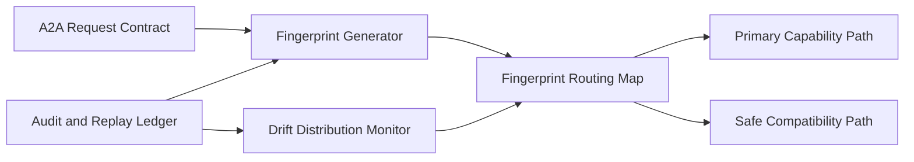

# A2A Contract Fingerprint Routing 选型 FAQ（Cycle 1875）

## 1) 3 分钟结论
- **核心问题：** A2A 多代理链路中，合同版本混跑会导致路由错配与跨代理语义偏差。
- **推荐方案：** “合同指纹（fingerprint）路由 + 兼容级回退 + 指纹漂移监控”。
- **目标：** 在多版本并行演进时保持交互语义一致与路径可控。

## 2) Q1 / Q2 / Q3
### Q1：为什么只用版本号做路由不足？
1) 相同版本下也可能存在字段语义变体；
2) 多团队并行发布会出现分支化合同；
3) 版本号无法表达兼容边界细节。

### Q2：生产级 fingerprint routing 如何设计？
- **指纹生成：** 对合同 schema+语义规则生成稳定哈希指纹；
- **路由映射：** 指纹到执行路径/代理能力矩阵映射；
- **兼容回退：** 未命中指纹时按兼容级降级到安全路径；
- **漂移监控：** 指纹分布突变触发审计与限流。

### Q3：上线判据是什么？
- 指纹命中率稳定在目标区间；
- 未命中回退不引发任务成功率下降；
- 漂移告警能提前识别合同异常演进。

## 3) 架构图

## 4) 选型矩阵
| 维度 | 版本号路由 | 指纹路由（推荐） |
|---|---:|---:|
| 语义匹配精度 | 低 | 高 |
| 演进兼容性 | 中 | 高 |
| 回退可控性 | 中 | 高 |
| 实施复杂度 | 低 | 中 |
| 漂移可观测性 | 低 | 高 |

## 5) 证据与复算口径
- 证据文件：
  - `workshops/azure-agent-infra/evidence/cycle-1875-benchmark.json`
  - `workshops/azure-agent-infra/evidence/cycle-1875-latency.csv`
  - `workshops/azure-agent-infra/evidence/cycle-1875-throughput.csv`
  - `workshops/azure-agent-infra/evidence/cycle-1875-policy.csv`
- 标签：`measured / synthetic / anonymized_reported`。
- validation7：六段结构、7-card CSP、cycle-topic 对齐、验证链可回放。

## 6) 生产检查清单
- [ ] 合同指纹生成算法与规范冻结。
- [ ] 指纹路由映射表完成灰度验证。
- [ ] 兼容级回退路径通过压测。
- [ ] 漂移监控告警阈值完成校准。
- [ ] FAQ/H5/SVG/7-card/evidence 轮次一致。
